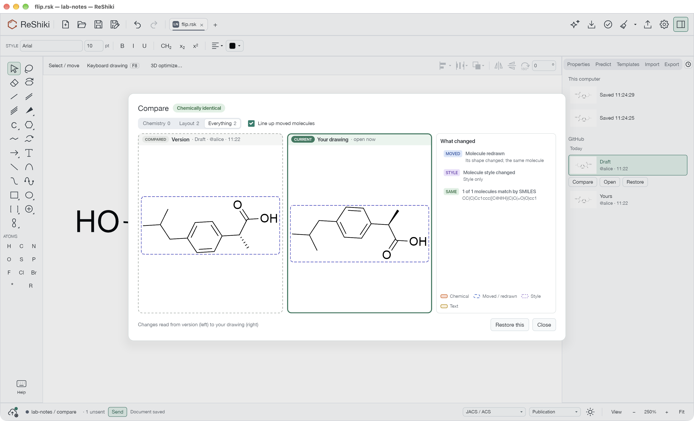
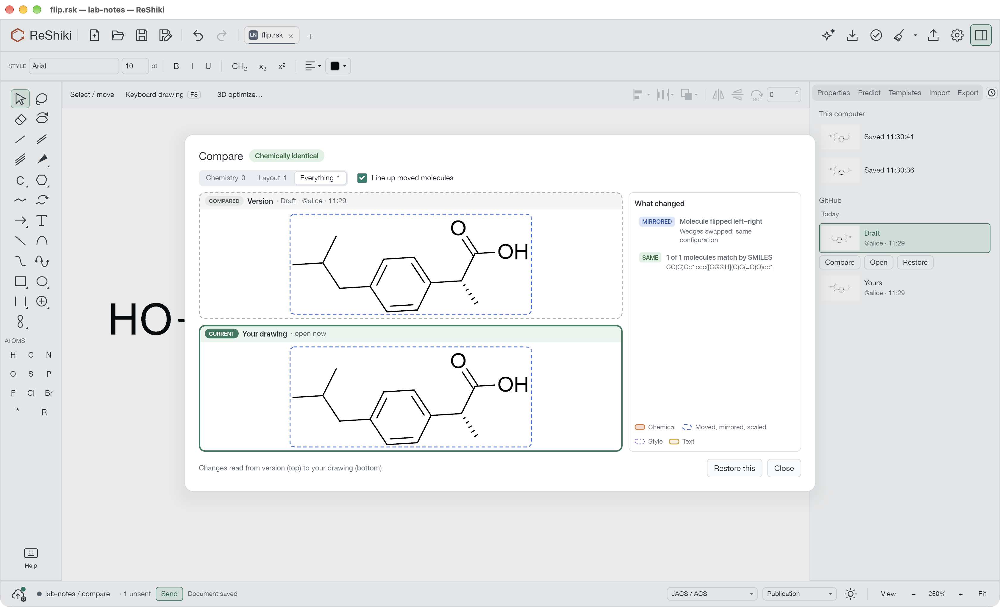
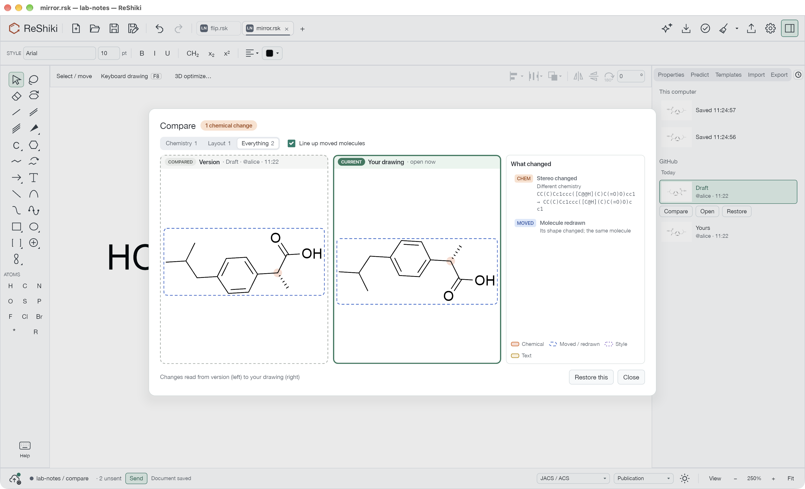
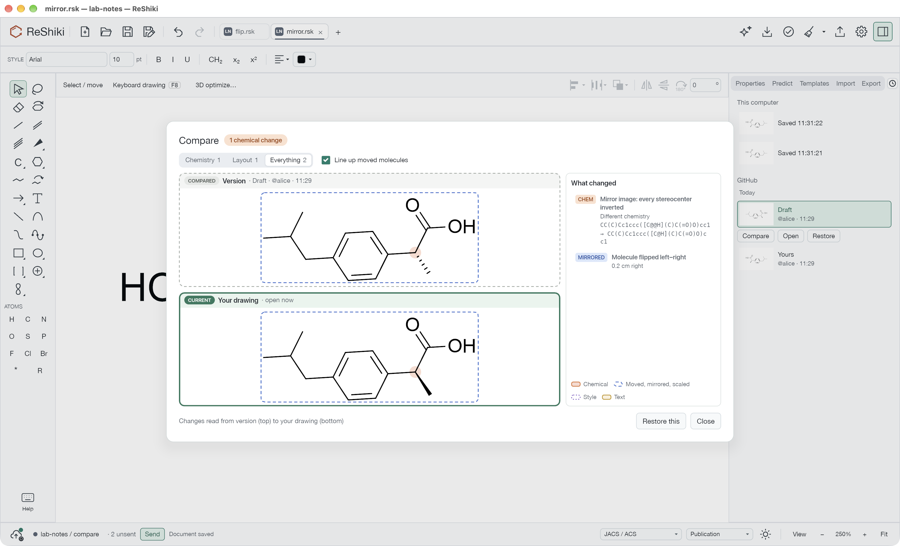
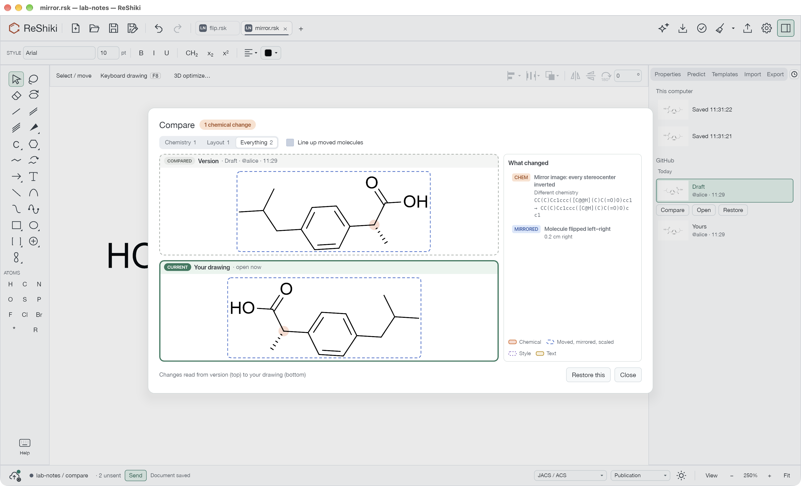
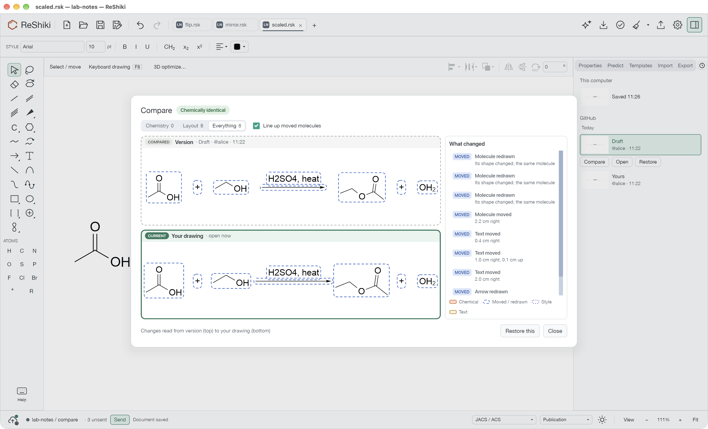
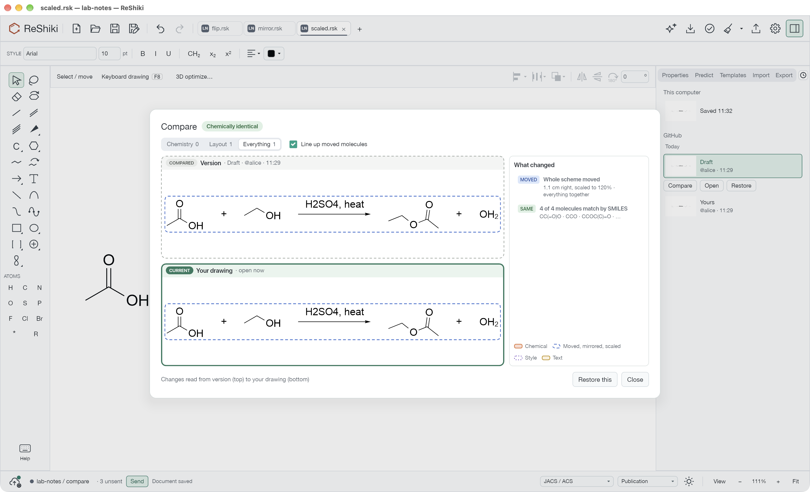
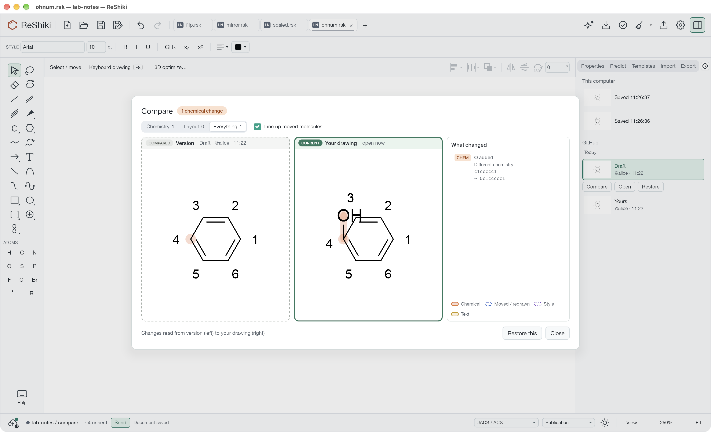
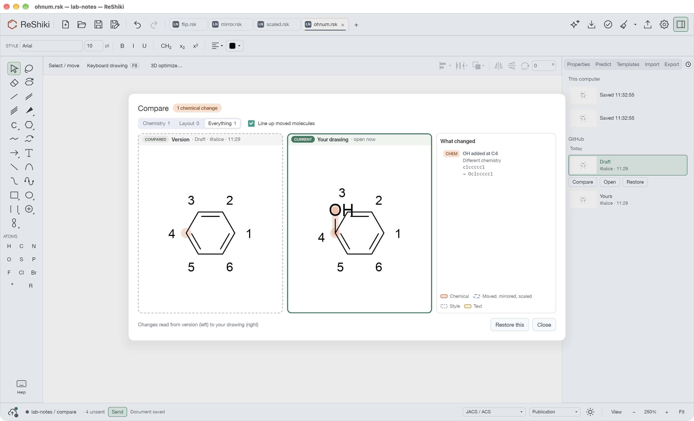
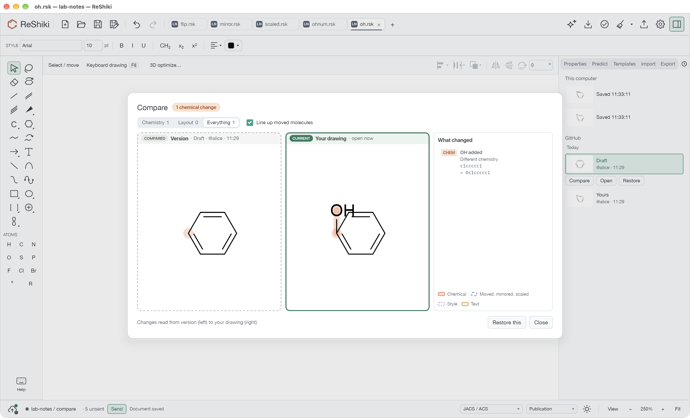

## Why

Compare C2a, after C1 (#1222), the polish PR (#1235) and the zoom fix (#1237). C1 left three gaps the owner wanted closed before matching by structure (C2b):

- A molecule flipped with the Flip tool, or drawn larger, was a **redraw**, and the Flip tool's wedge swap was listed as a **Style** change.
- A mirror image of a chiral molecule had no words for what it is.
- A chemical line said **O added**, not **OH added at C4**.

## Approach

Plan sections 1–2 with the critic's corrections and decisions 1, 4, 5, 6 and 9.

- **Fit** (`compare/fit.rs`) gains `scale` and `mirror`; `Fit::similar(pairs, mirror, scale)` fits a reflection, a scale or both, and `axis_degrees()` gives the mirror line. Each molecule or graphic is fitted rigidly first, then mirrored, then scaled (by ≥ 1%), then both, at C1's tolerances (0.01 / 0.03 bond lengths). Only objects with three points off one line get mirror or scale, so an arrow drawn longer stays **redrawn**.
- **Whole scheme** refits with the winning model. An object the scheme fit carries within the tolerances has no line of its own, so a scaled scheme's straight arrow is not redrawn; it lines up by the scheme fit. The displayed scale is the reciprocal of the alignment scale.
- **New kinds** `Mirrored` and `Scaled`, tags **MIRRORED** and **SCALED** in the MOVED blue, legend **Moved, mirrored, scaled**. Rows read **Molecule flipped left–right / top–bottom / mirrored** and **Molecule scaled to 120%**.
- **One reflection function**, `editing::transform_display`: everything but positions that a planar transform carries (fixed hydrogens, number, stereo and map offsets, marks, bond indicators) and, for a reflection, wedges ↔ hashes and double-bond sides. The Flip tool, rotate/scale and Compare's lined-up view all use it; the lined-up view therefore undoes a mirror with the full Flip display transform, and Style is compared on the lined-up values (rounded to 0.01), so the Flip tool's swap is not a style change.
- **Mirror vs stereo:** chemistry is still decided by the signature. Flip tool → same chemistry + **MIRRORED**, detail **Wedges swapped; same configuration**. Positions mirrored without the swap → **Mirror image: every stereocenter inverted**, only when every centre has the same mapped neighbours and opposite parity and double-bond stereo and stereo groups are unchanged.
- **Wording:** `chemistry::edit_mapped(left, right, map)` replaces `edit` (identity maps for id matches; C1's stereo marks unchanged) and carries centres, double bonds and groups through the map, ready for C2b. `chemistry::parts` splits an edit into added/removed/replaced groups (formulas `OH`, `NH₂`, `NO₂`, `CO₂H`, `OCH₃`, `CN`), atoms changed in place (charge, isotope, H, radicals), bond orders, and inverted centres. Wording is not paint: the attachment carbon that only lost an H is painted but not worded. Positions use the drawing's own atom numbers (`4` → **C4**, `N1′` as written), qualified when one side lacks the number (**C4 (current)**) or the sides differ (**C5 → C4**); hidden atoms of collapsed labels are not used; no number, no position.

## Evidence

Real window captures from macOS arm64: a debug build of `main` (before, with #1235) and of this branch (after), against the local mock GitHub with a fresh data folder per run. History compares alice's **Draft** (original) with the drawing now (her **Yours**, restored and saved).

### Flip tool on a chiral molecule (ibuprofen, wedge as drawn)

| Before (`main`) | After |
|---|---|
|  |  |

Before: **Molecule redrawn** plus a **Style** line for the swapped wedge. After: **Chemically identical**, one **MIRRORED · Molecule flipped left–right · Wedges swapped; same configuration**; lined up, the mirror is undone and the hash shows as drawn on the left.

### Mirrored without swapping the wedge

| Before (`main`) | After | After, line-up off |
|---|---|---|
|  |  |  |

After: **CHEM · Mirror image: every stereocenter inverted** and **MIRRORED**. Lined up, the right side still shows its own configuration (wedge, not hash); unticked, it shows where and how it is drawn.

### Whole scheme scaled to 120%

| Before (`main`) | After |
|---|---|
|  |  |

Before: every molecule **redrawn**, every text **moved**, the arrow **redrawn**. After: one **Whole scheme moved · scaled to 120%** line; the straight arrow has no line of its own and lines up with the rest.

### OH added, with and without atom numbers

| Numbered, before | Numbered, after | Unnumbered, after |
|---|---|---|
|  |  |  |

Before: **O added**. After: **OH added at C4** where the drawing numbers its atoms, **OH added** where it does not ([before](https://github.com/Ameyanagi/ReShiki-evidence/blob/d10bc3bf01afc41fe893ea91efe968d8ed3612e6/pr-reviews/feat-compare-c2a/before/history-oh.png)).

Dark: [flip](https://github.com/Ameyanagi/ReShiki-evidence/blob/d10bc3bf01afc41fe893ea91efe968d8ed3612e6/pr-reviews/feat-compare-c2a/after/history-flip-dark.png) · [mirror](https://github.com/Ameyanagi/ReShiki-evidence/blob/d10bc3bf01afc41fe893ea91efe968d8ed3612e6/pr-reviews/feat-compare-c2a/after/history-mirror-dark.png) · [mirror, line-up off](https://github.com/Ameyanagi/ReShiki-evidence/blob/d10bc3bf01afc41fe893ea91efe968d8ed3612e6/pr-reviews/feat-compare-c2a/after/history-mirror-unlined-dark.png) · [scaled](https://github.com/Ameyanagi/ReShiki-evidence/blob/d10bc3bf01afc41fe893ea91efe968d8ed3612e6/pr-reviews/feat-compare-c2a/after/history-scaled-dark.png) · [OH at C4](https://github.com/Ameyanagi/ReShiki-evidence/blob/d10bc3bf01afc41fe893ea91efe968d8ed3612e6/pr-reviews/feat-compare-c2a/after/history-ohnum-dark.png) · [OH](https://github.com/Ameyanagi/ReShiki-evidence/blob/d10bc3bf01afc41fe893ea91efe968d8ed3612e6/pr-reviews/feat-compare-c2a/after/history-oh-dark.png). Contact sheet: [contact-sheet.png](https://github.com/Ameyanagi/ReShiki-evidence/blob/d10bc3bf01afc41fe893ea91efe968d8ed3612e6/pr-reviews/feat-compare-c2a/contact-sheet.png).

## Verification

| Platform | Result |
|---|---|
| macOS arm64 (Apple M4) | pass at 7961da6 · fmt, workspace clippy --all-targets --all-features -D warnings, wasm32 clippy, model tests (compare, reaction_mapping, editing: 143), reshiki --lib --bins (1989 + 512), renderer tests --include-ignored (1831), Python unittest, module_index, copy_lint, changelog, docs checks · GUI evidence via the mock GitHub |
| PR CI | see checks |

## Review

Two adversarial passes (gpt-6.2-sol, read-only), focused on mirror vs stereo, the lined-up view and the wording. Fixed, with tests where the case is reachable:

- A whole-scheme scale with two molecules and a straight arrow missed the quorum; every object a candidate fit carries now counts, the refit is checked again and a degenerate refit falls back to the candidate.
- Scheme agreement used a lenient bound that could hide a real local move; agreement is now the absolute tolerances.
- An object explained by the scheme lines up by the scheme fit, so a flipped scheme's hydrogens and numbers are undone too.
- The exact rotate path (`editing::reference::rotate`) skipped offsets after the refactor; it now calls `transform_display`.
- A bold wedge comes back hollow after a flip (the Flip tool maps both to hashed); style ignores that difference for a mirrored molecule.
- The mirror headline also needs the same extra stereo and no allene or other non-tetrahedral stereo; a centre whose winding cannot be carried (new neighbour) is a changed centre.
- A stereo double bond's kept end stays marked when the bond is removed; a lone-pair angle of −90° equals 270°.
- Wording: a hydrogen only drawn out is not "H added"; an atom given another element in place is "Cl → Br at C2" by its attachment; a letter label is not prefixed; isotopes and singlet spin show.
- A mirror drawn again with new ids pairs atoms by the best of the fit models, so it reads **mirrored**, not redrawn.
- A projection bond is not called a swapped wedge.

Greptile, first round (4/5): a symmetric molecule drawn again and turned 180° could pair its atoms as a mirror (the pairing is now chosen by the first model that fits, rigid first), and bonds made or broken between kept atoms went unworded (now **C1–C3 bond added**, their hydrogens not worded). Both fixed with tests; second round 5/5 at the final head, no open threads.

Not changed (noted): a graphic stored as a large path in local coordinates scales only its frame axes, so a scale of it can go unseen; an exact 45° rotation can move a fixed H to the other cardinal side; drawn H on a protonated atom can read as a charge-only change.

## Risk

- Lined-up view and Style now go through `transform_display`; offsets of rotated molecules are compared rounded to 0.01 drawing units.
- Most drawings carry no atom numbers, so most rows name no position.
- `map_positions` no longer moves offsets itself; every caller (rotate, exact rotate, flip, scale about a pivot, stretch) calls `transform_display` first.
- Owner decisions use "stereocentre"; the app copy rules require US English, so the text reads "stereocenter".

## Changelog

`docs/changes/unreleased/feat-compare-c2a.md`

## Contribution license

- [x] I have read [CONTRIBUTING.md](https://github.com/Ameyanagi/ReShiki/blob/main/CONTRIBUTING.md). I have the right to submit this contribution and agree to offer my original contributions under both MIT and Apache-2.0, so recipients may choose either license (`MIT OR Apache-2.0`).
- [x] Any third-party material is identified below with its source and license, and its required notices are preserved; otherwise, no third-party material is added.
