## Why

Compare C2b, the third Compare follow-up after the polish PR (#1235) and C2a (#1236). Compare matched molecules by ReShiki's ids, then by SMILES. A molecule that was both edited and given new ids, as after importing a scheme again, showed as **Molecule removed** plus **Molecule added**, with every atom painted. Adding a nitro group to a re-imported ester should be one chemical change, painted where it changed.

## Approach

Plan section 3, with the critic's corrections and decisions 2, 3 and 9.

**Order of matching.** By id, then by SMILES (unchanged), then the scheme's common move is fitted again from all pairs so far, then:

1. **By constitution** (`MatchedBy::Constitution`): the same canonical SMILES written without stereo or isotopes (`Signature.constitution`), paired nearest first like SMILES. This catches a stereo flip drawn anew.
2. **By structure** (`MatchedBy::Structure`), in the new `compare/structure.rs`.

**Mapper** (`reaction_mapping/search.rs`). `correspond(left, right, budget, cost)` reuses the bounded search under Compare's own policy, and leaves `propose` untouched:

- `Graph::compared` ignores atom maps and isotopes, and marks ring bonds (a bond is in a ring when its ends stay joined without it). A bond is kept only as one of the same order and ring membership.
- Compare ranks a pairing by bonds kept, then by the lowest total integer cost, then by the first found. The cost is the distance in hundredths of a bond length once the two centroids meet. The mapper's finer preferences, fewest changed atoms first, don't count for Compare. If they did, its optimistic bound would never equal the best, and a 97-atom pair would take 177M work. `propose` keeps its tie pruning (it stops at an equal score once two bests were seen), its isotope rule, its map anchors and its pre-charged work. The shared core (`domains`, `run`) is extracted unchanged.
- `correspond` returns the work it used, so Compare can enforce one budget across all its searches.

**Acceptance** (`compare/structure.rs`):

- Candidates are molecules left unmatched with readable chemistry on both sides. A per-class bound filters them before any search: heavy bonds by (elements, order, ring). The two molecules must also have the same number of ring systems.
- Similarity is kept heavy-atom bonds over the bonds of either, kept / (L + R − kept). Accept only if it is **≥ 0.5** with **≥ 3** bonds kept, and every ring system pairs with exactly one on the other side **through ring bonds kept between them**.
- A pair must be **each molecule's clear best**. Similarities are compared in 0.05 steps. An equally similar rival must be both strictly farther and at least twice as far. A rival of unknown worth leaves both unmatched if its bound could reach the winner. That covers a rival the budget skipped or cut short, one over 128 atoms, and one whose best pairing splits ring systems. If the mapper can't read an open molecule at all (over 768 drawn bonds), nothing is matched by structure. Distance never matters otherwise, so far-apart molecules match when the match is unambiguous.
- **Budget** (work units, not time): 20,000 states and 10,000,000 work per pair, and 40,000,000 per comparison, constitution pairings included. One pass through two 128-atom molecules costs about 7M in the mapper's accounting. With more than 32 such molecules on a side, none are matched.

**Under a pairing.** Constitution and structure correspondences feed C2a's `edit_mapped`, so paint is local and the wording is the same as for id matches. A constitution pairing is used only if it keeps every bond, explicit hydrogens included; otherwise the molecule is painted whole, as before. The fit leaves out matched atoms whose bonds to other matched atoms changed; a group added or removed doesn't count, so hexafluorobenzene drawn over benzene is not a redraw. The chemical line's detail reads **Different chemistry · matched by structure (ids changed)**.

**ID guard.** A shared-id pair counts a kept bond only when both endpoints keep their elements, and needs kept bonds ≥ ½ × the bonds of the smaller molecule. A pair at exactly half is weak evidence. It is used only when SMILES, constitution and structure matched neither molecule. In a fresh re-import, the ethanol took three of the ester's old ids and kept one of its two bonds. That pair now yields to the real matches, while a molecule cut down with its ids kept, such as decane to butane, is still one chemical change.

### Thresholds, and why

| Rule | Value | Why |
|---|---|---|
| Similarity | ≥ 0.5 | Pyridine ↔ benzene sits exactly here (4 of 6 aromatic bonds kept); anything less is mostly a different molecule. |
| Bonds kept | ≥ 3 | Rejects water → methanol and ethanol → propanol, where any pairing looks similar. |
| Same order and ring membership | always | Biphenyl ↔ hexylbenzene would otherwise keep 12 of 13 bonds (0.92); n-butane ↔ cyclobutane 0.75. Now 0.39 and 0. |
| Ring systems one to one | always | Biphenyl (two) never pairs with hexylbenzene (one), nor a fused system with separate rings. |
| Similarity steps | 0.05 | Near-equal candidates count as equal, so distance decides, or nothing does. |
| Distance tie-break | strictly nearer and ≤ ½ the next | `0 ≤ 0/2` would accept two candidates at the same place. |
| Per pair / per comparison | 20k states, 10M / 40M work | Deterministic bounds, the same on every machine; 10M covers one pass through two 128-atom molecules. |

## Evidence

Real window captures on macOS arm64 (Apple M4): debug builds of the base, C2a's `feat/compare-c2a` at `b6732f2` (before), and of this branch (after). Both run against ReShiki's local mock GitHub with a fresh data folder each run. Each drawing has alice's commits **Yours** (changed) and **Draft** (original). History restores **Yours**, saves, then compares **Draft** with the drawing now. For the changed-on-GitHub dialog, alice then commits the original again and **Send** raises the conflict.

Each "after" drawing was built the way a re-import builds it. The same layout is drawn again from scratch, product first, so every atom has a new id; then it is edited.

### Re-imported scheme with NO₂ added

| | Before (C2a) | After |
|---|---|---|
| History › Compare | 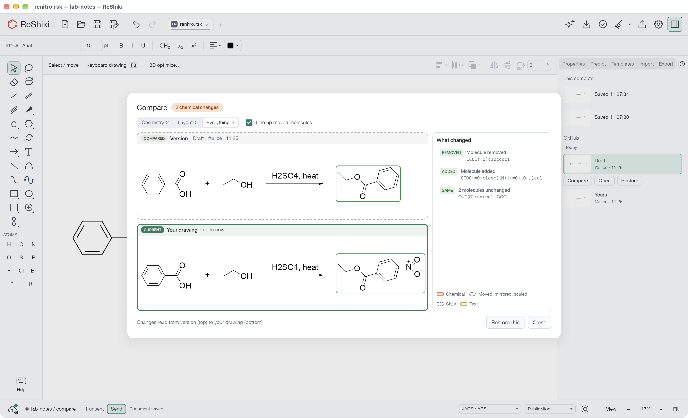 | 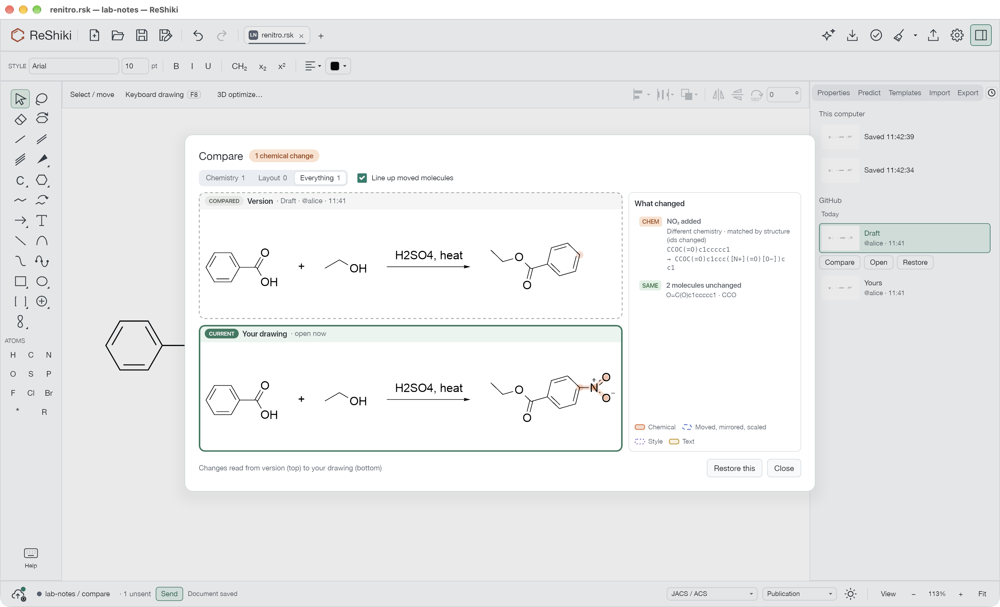 |
| Changed on GitHub | 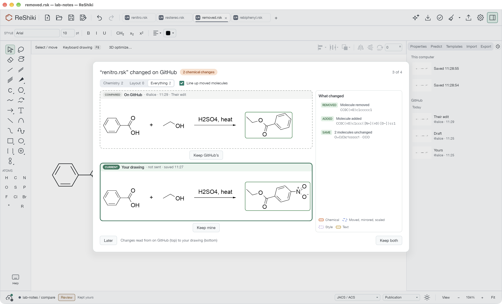 | 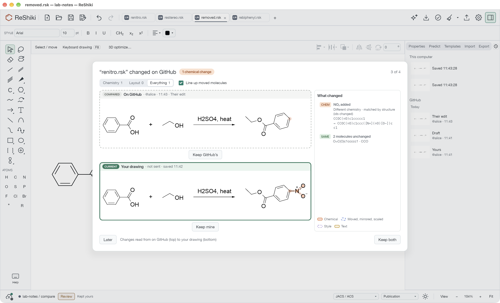 |

Before: **Molecule removed** plus **Molecule added**, with the whole ester painted. After: one chemical line, **NO₂ added**, with the detail **Different chemistry · matched by structure (ids changed)**. Only the nitro group and its carbon are painted, as when the ids are kept. The acid and ethanol match by SMILES.

### Re-imported stereo flip

| | Before (C2a) | After |
|---|---|---|
| History › Compare | 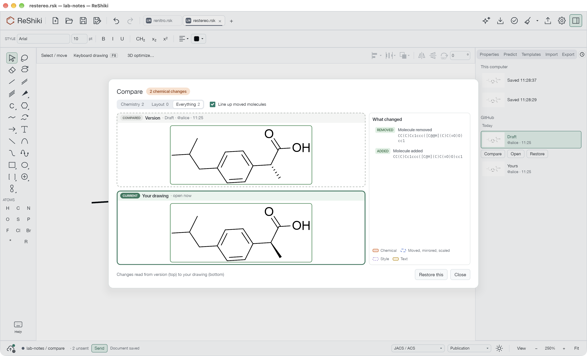 | 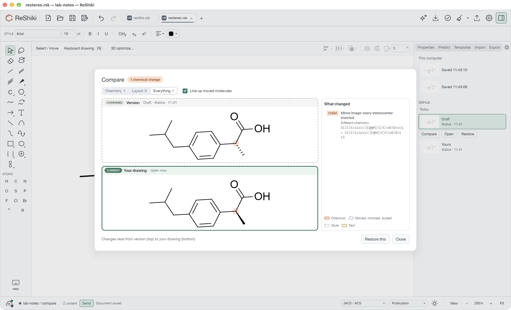 |
| Changed on GitHub | 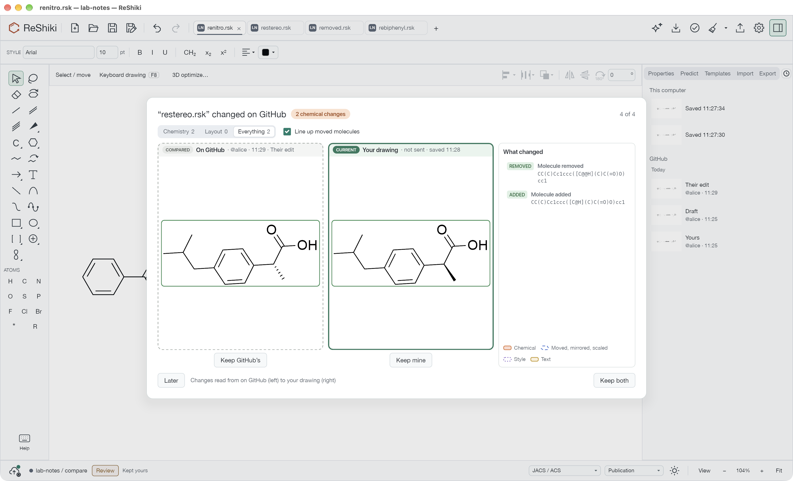 | 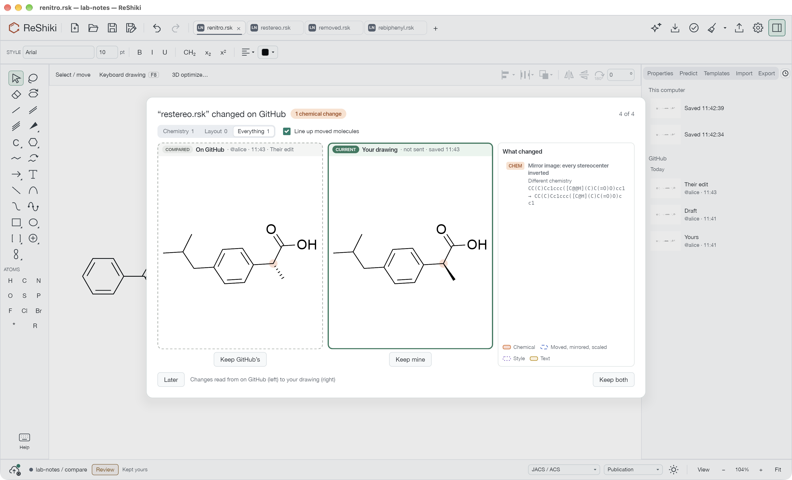 |

(S)-ibuprofen drawn again with its wedge swapped. Before: removed plus added. After: matched by constitution (SMILES without stereo). There is one chemical line, painted at that centre only. It reads C2a's **Mirror image: every stereocenter inverted**, since the molecule's only centre is inverted and nothing else changed.

### Re-imported, moved and edited

| | Before (C2a) | After |
|---|---|---|
| History › Compare | 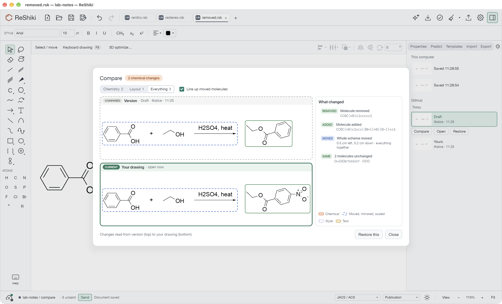 | 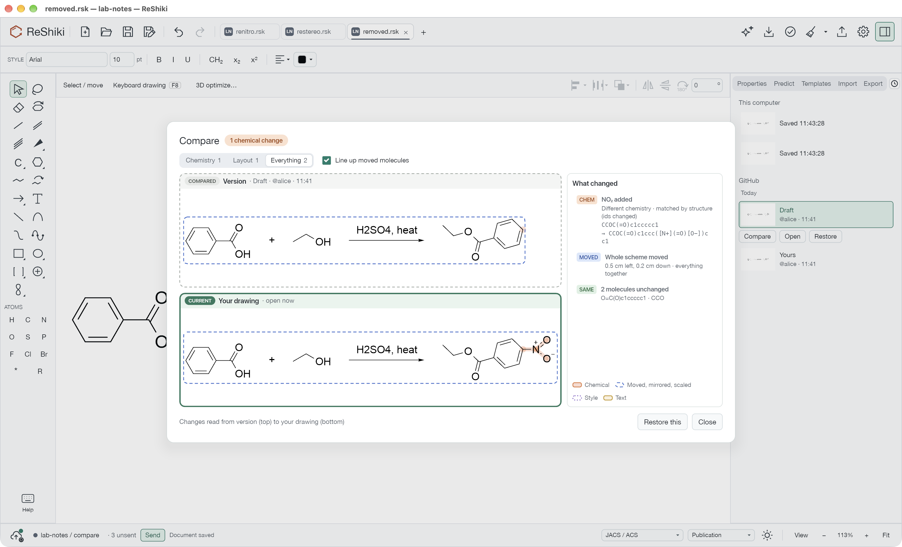 |
| Changed on GitHub | 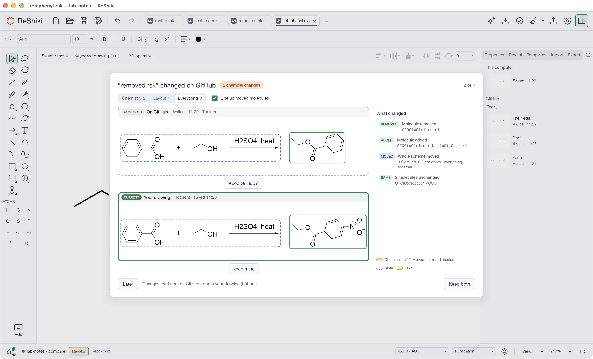 | 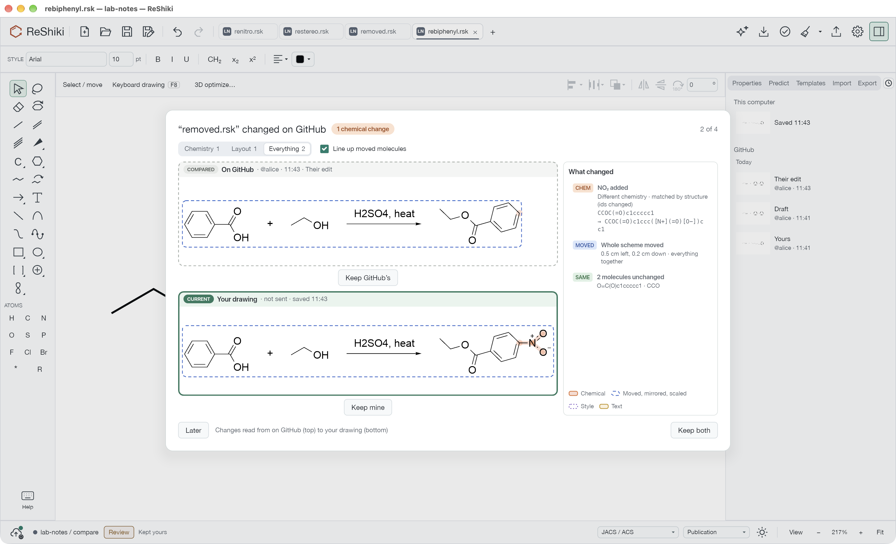 |

The NO₂ scheme, also moved by (−38, 14). Before: removed, added and **Whole scheme moved**. After: one **Whole scheme moved** line and one chemical line.

### Adversarial: biphenyl redrawn as hexylbenzene stays removed plus added

| | Before (C2a) | After |
|---|---|---|
| History › Compare | 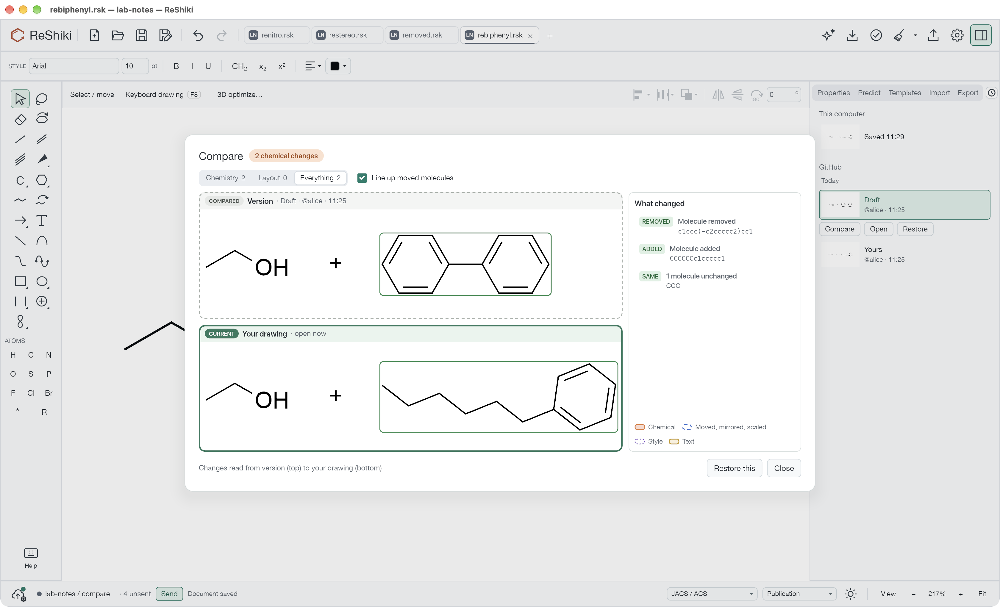 |  |
| Changed on GitHub |  | 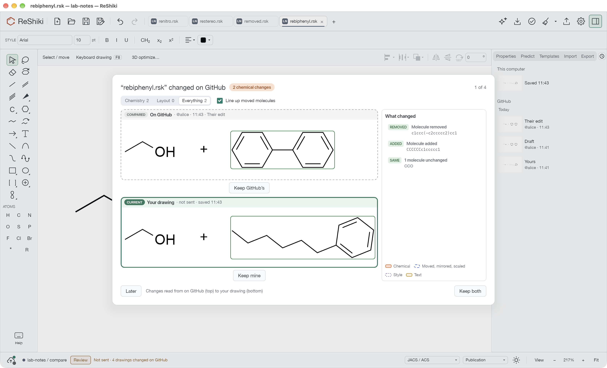 |

Same in both builds. Biphenyl has two ring systems and hexylbenzene one, and a chain bond never counts as a ring bond (0.39 at best). So the molecule is listed as **Molecule removed** plus **Molecule added**, not as a chemical change.

Contact sheets: [before](sheet-before.png) · [after](sheet-after.png).

### Tests

New model tests in `compare/structure/tests.rs` and `reaction_mapping/search/tests.rs`, and an app row test in `src/app/github/compare/tests.rs`:

- NO₂ on a re-imported scheme is one Structure match. Its paint matches the id case: 4 right atoms, 1 left atom, 3 bonds. It has one `NO₂` part, with `by_structure`.
- Colliding sequential ids from a fresh import are matched again by SMILES. A molecule cut down with its ids kept, next to a new copy of itself, still pairs by id.
- A stereo flip drawn anew is one Constitution match, painted at the centre by each side's id.
- On a re-imported toluene made into m-cresol, the left mark is the carbon at the same place.
- Re-imported, moved and edited: one scheme line and one chemical line.
- Must reject, both ways round: biphenyl ↔ hexylbenzene, n-butane ↔ cyclobutane, water ↔ methanol, ethanol ↔ propanol, and cyclopropyl ↔ diaziridinyl tails (a ring system needs a kept ring bond). An R-group molecule is never matched by structure.
- Two candidates match only if one is strictly nearer and at most half as far. Same place, mirrored places and 200 vs 300 all stay unmatched; 100 vs 400 matches.
- A rival too large to search blocks an equally similar candidate.
- A structure tie is broken after the move that constitution matches share.
- Benzene ↔ pyridine matches at exactly 0.5.
- Hexafluorobenzene drawn over benzene is not a redraw.
- A constitution pairing that breaks a bond to a drawn H is not used for local paint.
- A 97-atom polycycle matches, and comparing it twice gives the same report.
- `clear_best` policy table: skipped and cut-short rivals, unacceptable rivals, the half-distance rule, and `0 ≤ 0/2`.
- Mapper: only bonds of the same order and ring membership count; ties go to the lowest cost, not to id order; out of budget, the search is unfinished and its work stays bounded. All existing `propose` tests pass unchanged.
- Measured (debug build): a 97-atom pair costs 4.9M work and is complete. Before Compare stopped ranking by the mapper's finer preferences, it cost 177M. A 49-atom pair costs 0.66M, an ester 8k.

## Reviews

Two adversarial review passes (gpt-6.2-sol, read-only), focused on false matches, determinism, budget bounds and reaction auto-mapping. Fixed:

- **Pass 1:** no work after the budget is spent; a molecule over 128 atoms, or a pairing that splits ring systems, is a rival of unknown worth instead of disappearing; a ring-system link needs a kept ring bond (cyclopropyl ↔ diaziridinyl tails no longer match); the scheme guess is refitted after constitution matches; an unfinished constitution pairing is not used for local edits; costs are bounded.
- **Pass 2:** exact-half id evidence only (a molecule cut down with its ids kept beside a new copy pairs as before); a constitution pairing must keep bonds to drawn H; the fit no longer drops atoms that only gained a group (hexafluorobenzene over benzene was a false redraw); an open molecule the mapper can't read turns structure matching off; positions looked up once per molecule.
- **Not changed:** `O` ↔ `[2H]O` (see Risk). An independently drawn biphenyl that reuses six ids of hexylbenzene's ring still pairs by id, as it does on C2a.
- Both passes confirmed `propose` keeps its isotope rule, map seeds, pre-charged work and tie pruning.

## Verification

VERIFICATION_TABLE

## Risk

- **False structure matches**, the highest risk. Mitigated by the thresholds, strict mutual best candidates, excluding small and unverifiable molecules, and saying **matched by structure** on the row. Two adversarial review rounds focused on this.
- **Mapper refactor**: `propose` moved into shared helpers. All `reaction_mapping` tests pass unchanged.
- An element change near the threshold, such as pyridine for benzene, matches; larger rewrites stay removed plus added.
- Small molecules with sequential ids from a fresh import can still pair by id when they keep half the larger molecule's bonds between atoms of the same elements. Butane and propan-1-ol is an example; it reads as a chemical change.
- Water and other molecules with fewer than three heavy bonds never match by structure. A hydrogen-isotope edit to one of them, such as `O` → `[2H]O` re-imported, stays removed plus added.

## Changelog

`docs/changes/unreleased/feat-compare-c2b.md`

## Contribution license

- [x] I have read [CONTRIBUTING.md](https://github.com/Ameyanagi/ReShiki/blob/main/CONTRIBUTING.md). I have the right to submit this contribution and agree to offer my original contributions under both MIT and Apache-2.0, so recipients may choose either license (`MIT OR Apache-2.0`).
- [x] Any third-party material is identified below with its source and license, and its required notices are preserved; otherwise, no third-party material is added.
