## Why

Follow-ups to Compare C1 (#1222), from its review and from the evidence:

- A reaction scheme is much wider than it is tall, so in the side-by-side panes it is drawn small with most of each pane empty.
- A long SMILES wrapped glyph by glyph, breaking inside `[N+]` or between `C` and `l`, with before and after run together.
- In History, the verdict badge sat at the far right edge; in the changed-on-GitHub dialog it sat beside the title.
- Clicking a change outlined it, but a small edit in a big drawing stayed small.

## Approach

UI only; `reshiki::compare` is unchanged.

- **Stack wide schemes.** The panes are laid out in `responsive`. Using the panes' own zoom formula (`compare_zoom`, now shared with the preview), the panes stack, the compared one on top, when that draws the drawing at least 10% larger. The footer then reads **Changes read from … (top) to … (bottom)**. The dialogs pass their footer as a closure so it can follow.
- **SMILES on two lines.** Before, then **→ after** under it, with word wrapping. A zero-width space goes only between tokens: never inside a bracket atom, inside `Cl`/`Br`, or before a ring bond (`1`, `%12`). The row's accessible name carries the raw SMILES.
- **Badge beside the title** in both dialogs, through one shared title row.
- **Zoom to the selected row.** Both panes zoom to the change at one scale, each centred where the change is on its side. A chemical change is bounded by its painted atoms and bond endpoints, not its whole molecule; anything else by its objects.

## Evidence

Real window captures from macOS arm64: a debug build of `main` (before) and of this branch (after), against ReShiki's local mock GitHub with a fresh data folder each run. Each drawing has alice's commits **Yours** (changed) and **Draft** (original); History restores **Yours**, saves, then compares **Draft** with the drawing now. For the changed-on-GitHub dialog alice then commits the original again, and **Send** raises the conflict. Scenarios: C1's scheme (acetic acid + ethanol → ethyl acetate + water) moved, moved with NO₂ added, and with ethanol redrawn; a wide two-step scheme with Cl added; and a tetrapeptide with Phe → Tyr for a long SMILES. The drawings were generated by a script, so some conditions labels and the NO₂ group overlap their neighbours; that is the fixture, the same in both builds.

### Wide scheme: stacked panes, badge by the title

| Before (`main`) | After |
|---|---|
| 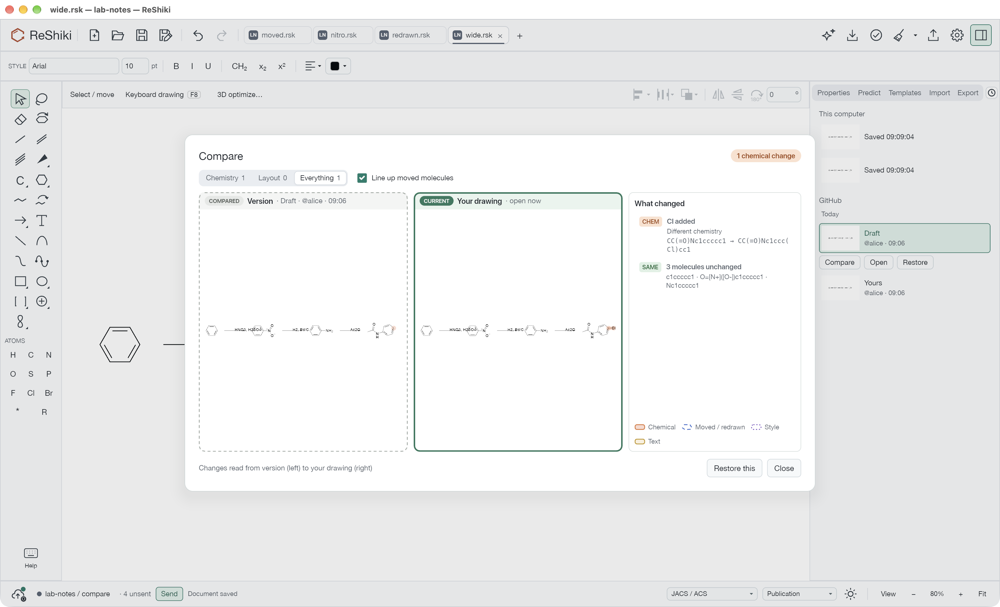 | 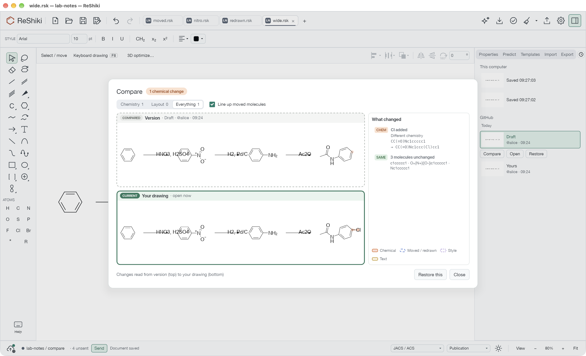 |
| 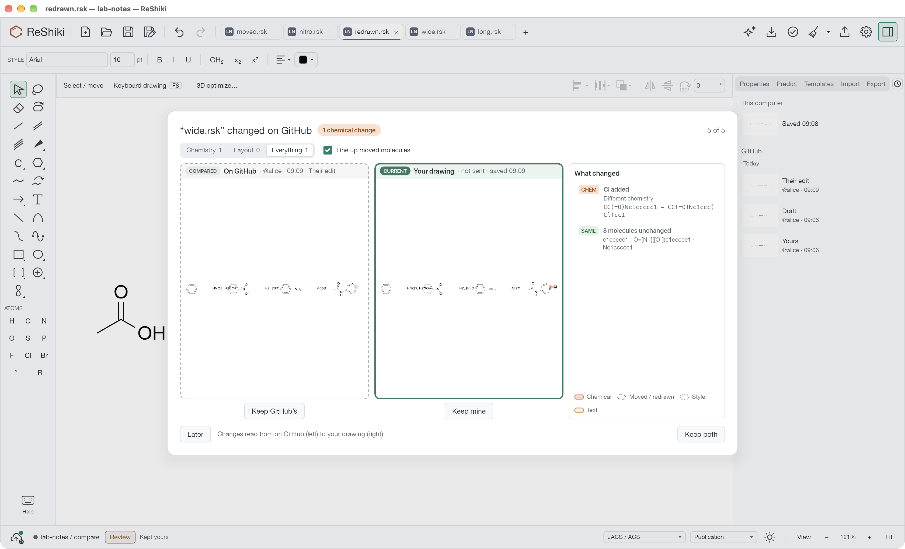 | 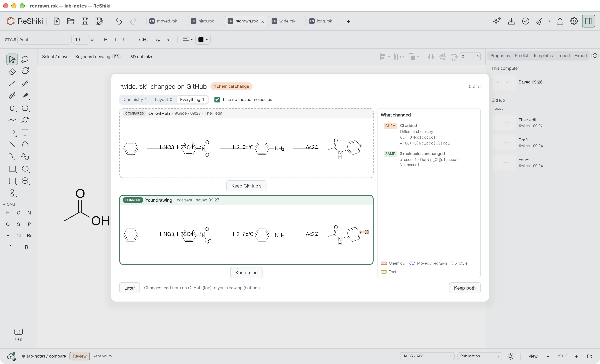 |

After: the panes stack with the compared version on top, the scheme is drawn about twice as large, and the footer reads **Changes read from version (top) to your drawing (bottom)**. The badge sits beside the title. C1's three scenarios are wide schemes too, so they stack as well: [moved](after/history-moved.png) ([before](before/history-moved.png)) · [NO₂](after/history-nitro.png) ([before](before/history-nitro.png)) · [redrawn](after/history-redrawn.png) ([before](before/history-redrawn.png)) · conflict [moved](after/conflict-moved.png) · [NO₂](after/conflict-nitro.png) · [redrawn](after/conflict-redrawn.png).

### Long SMILES

| Before (`main`) | After |
|---|---|
|  | 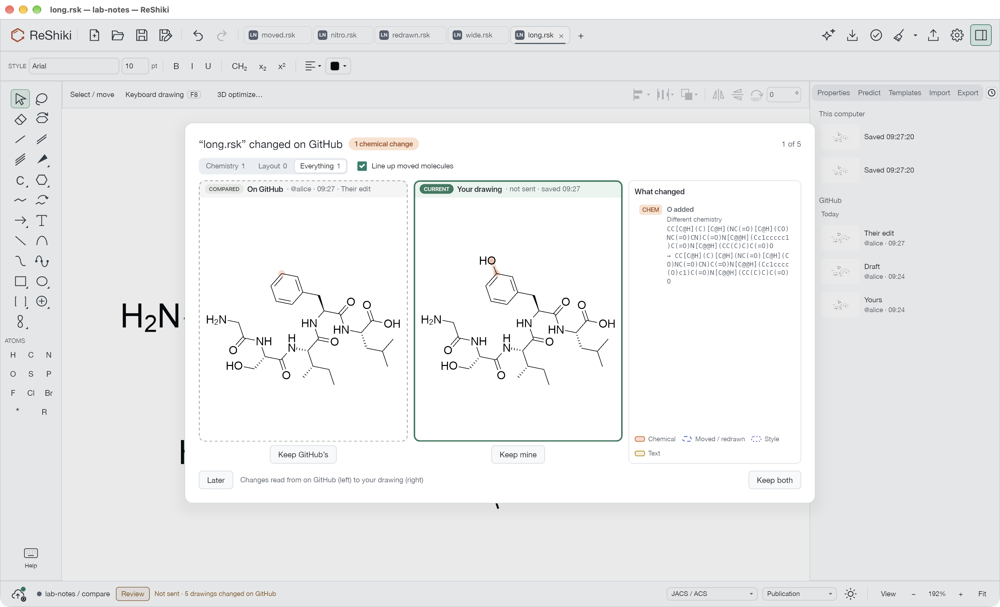 |

Before: one block broken anywhere, inside `[C@@H]` or `Cc1`. After: the SMILES before, then **→ after** on its own line, each breaking only between tokens. A square-ish molecule keeps the side-by-side panes. [History, before](before/history-long.png) · [after](after/history-long.png).

### Zoom to the selected row

| NO₂ row selected | Long SMILES row selected | Wide scheme row selected |
|---|---|---|
| 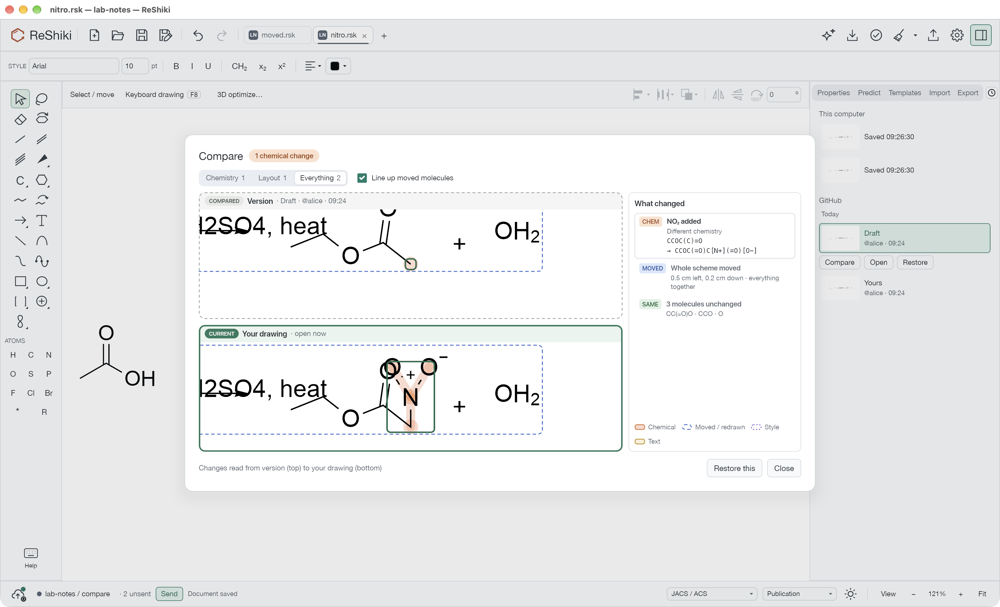 | 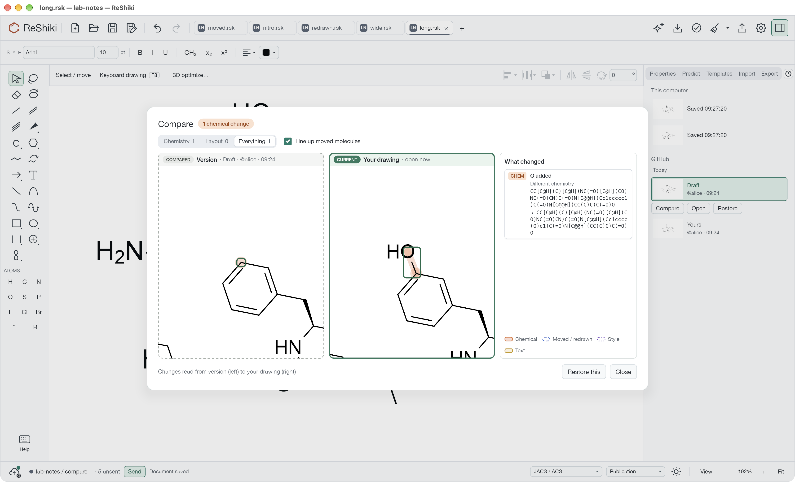 | 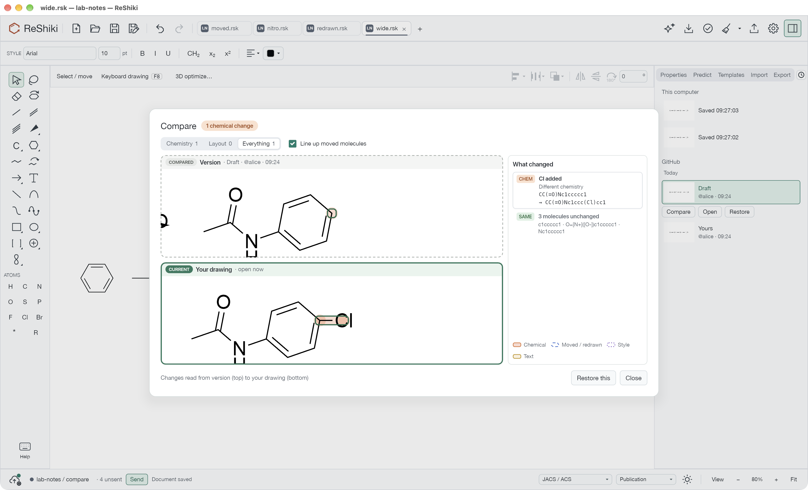 |

Both panes zoom, at one scale, to the change: the nitro group and its carbon on the right, the carbon on the left.

### Dark interface

| Before | After |
|---|---|
| 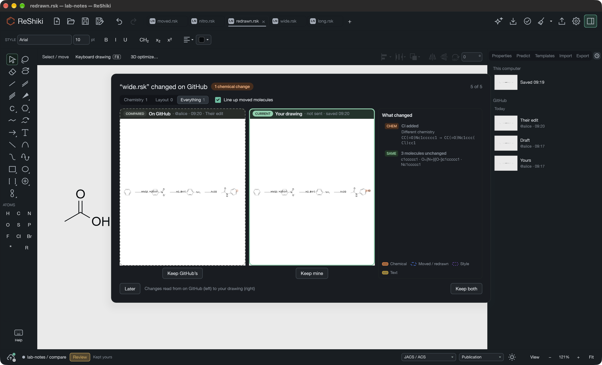 | 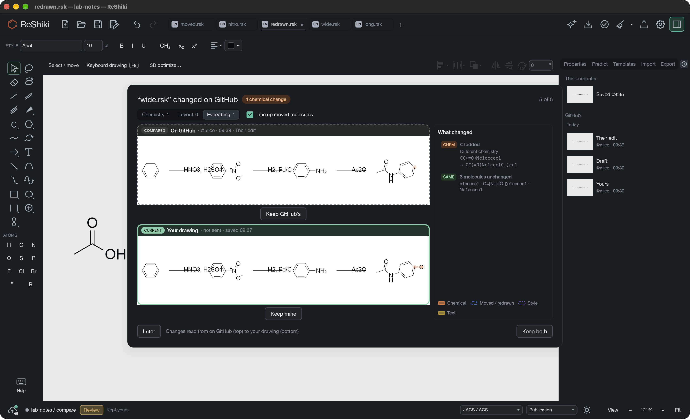 |
| 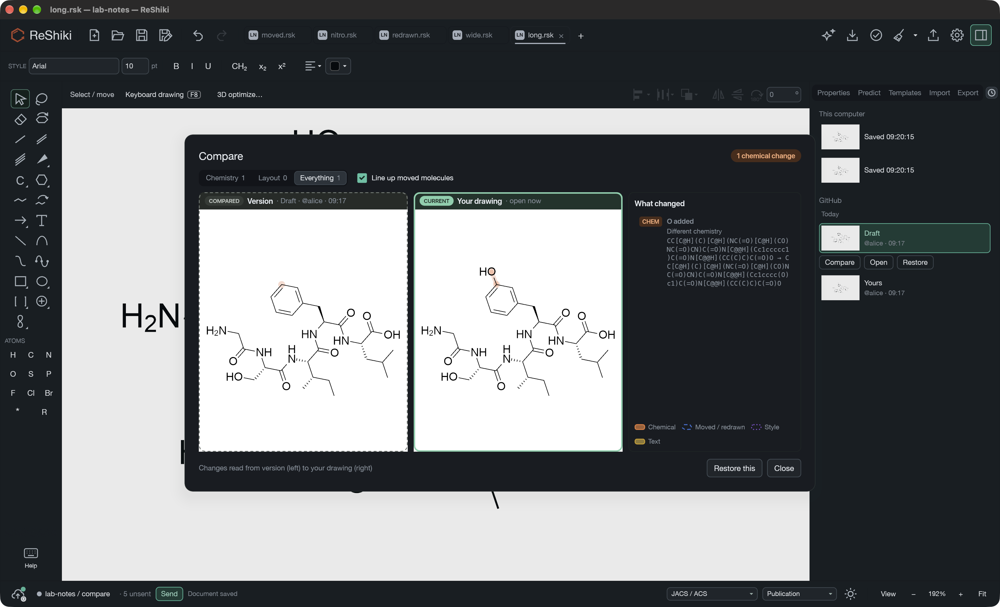 | 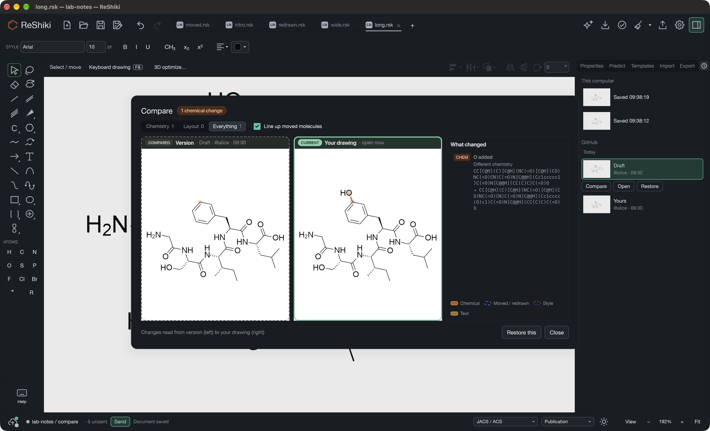 |

All dark captures: [before](before/) · [after](after/). Contact sheets: [light](contact-sheet-light.png) · [dark](contact-sheet-dark.png).

## Verification

VERIFICATION_TABLE

## Review

An adversarial pass (gpt-6.2-sol, read-only) on the diff. Fixed, each with a failing-first test:

- A chemical change painted on one side only (an oxygen added to a sulfur) zoomed the other pane to the whole molecule; that side now looks at the atoms the change touches there.
- `->`, `<-` and `%(123)` could break inside; every token is now kept whole with word joiners, bracket atoms included.
- A wrapped pane name could make one pane shorter than the other; names stay on one line.

Not changed: the stacking estimate uses fixed header and footer heights, so near the 10% threshold the choice can go either way by a few pixels.

## Risk

- Stacking depends on the dialog's size; a window resize can switch between the two layouts, which is intended.
- The pane zoom estimate uses fixed header and footer heights; an error of a few pixels only shifts the 10% threshold slightly.
- C1's own scheme is wide, so most real comparisons of a reaction scheme now show stacked panes in the 1060-wide dialog.

## Changelog

`docs/changes/unreleased/feat-compare-polish.md`

## Contribution license

- [x] I have read [CONTRIBUTING.md](https://github.com/Ameyanagi/ReShiki/blob/main/CONTRIBUTING.md). I have the right to submit this contribution and agree to offer my original contributions under both MIT and Apache-2.0, so recipients may choose either license (`MIT OR Apache-2.0`).
- [x] Any third-party material is identified below with its source and license, and its required notices are preserved; otherwise, no third-party material is added.
