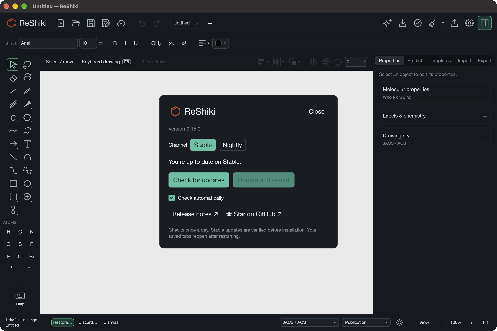
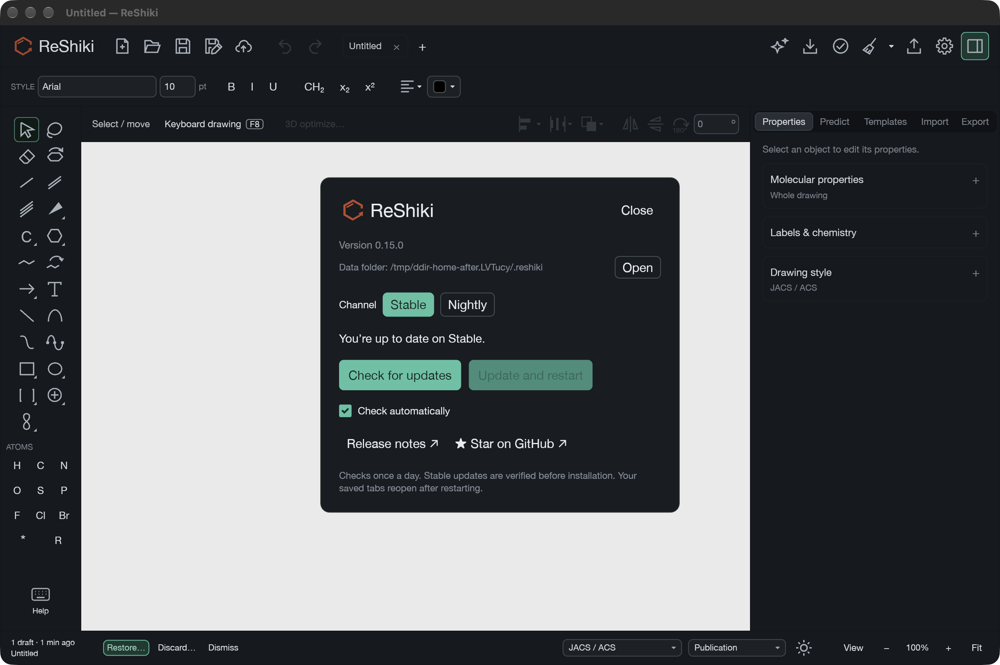
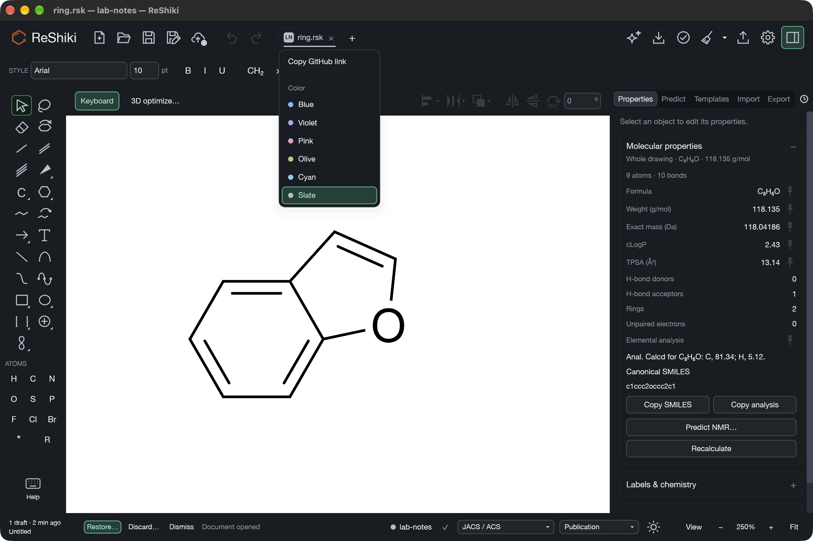
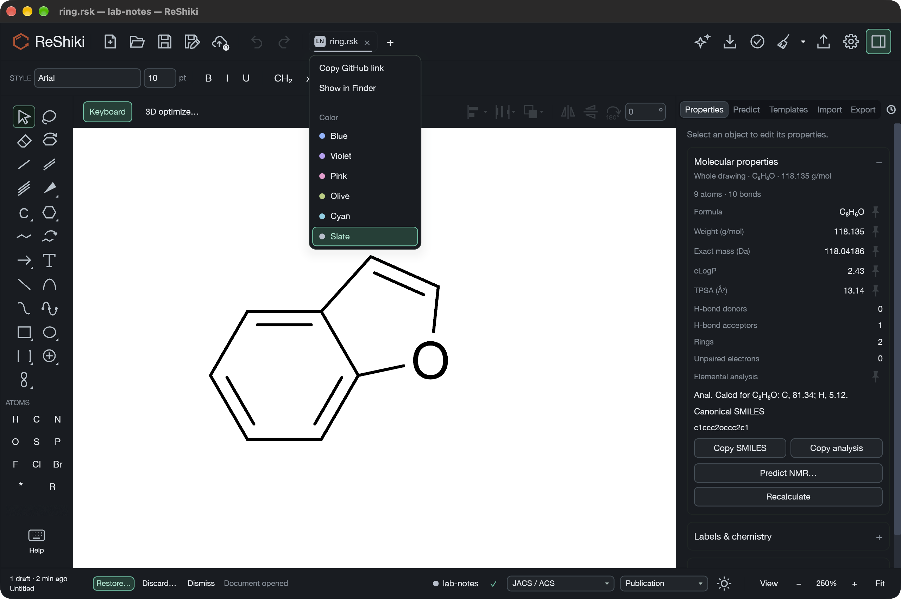
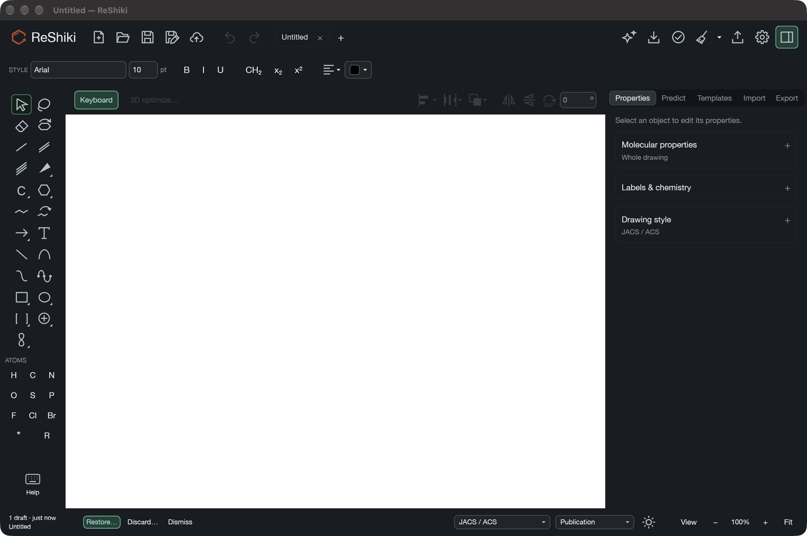
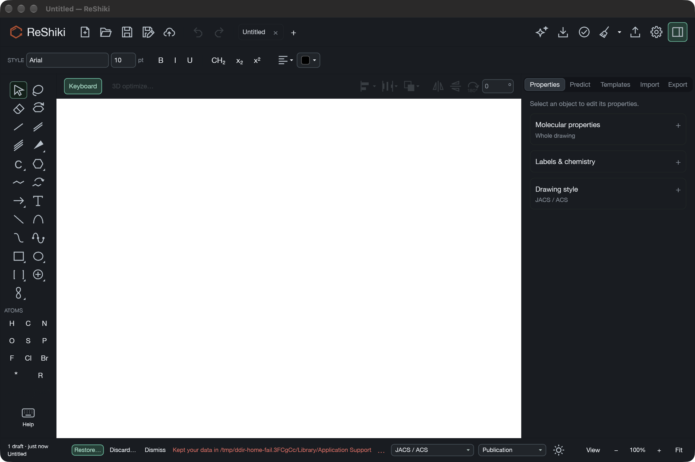

## Why it matters

On macOS and Linux, ReShiki's settings, templates, recovery drafts and GitHub
working copies lived in `~/Library/Application Support/dev.reshiki.ReShiki/`
or `~/.local/share/reshiki/`: hard to find, and the GitHub working copies
(where unsent drawings live) were effectively hidden. The owner decided on
2026-11-17 that the data folder becomes `~/.reshiki/` on macOS and Linux.
Windows stays at `%LOCALAPPDATA%\reshiki\ReShiki\data\`.

The path was also computed in four places: abbreviations, themes and
appearance each had their own copy of the rule, and they ignored the old
`MORUNO_DATA_DIR` override. A move would have left those three writing to the
old folder.

## Approach

- **One resolver** (`reshiki_io::compatibility::data_directory_location`):
  `RESHIKI_DATA_DIR` (or `MORUNO_DATA_DIR`) wins; else on macOS and Linux
  `~/.reshiki` once anything is there, or the old folder while it has not
  moved; else the platform folder (Windows unchanged). Abbreviations, themes
  and appearance now call it too, so no second rule is left. The rule is
  stateless, so `--mcp` and `--cli` resolve the same folder at any moment
  without a lock, and never move anything themselves.
- **Migration** (`move_data_directory`) runs once in the GUI, after a second
  launch has handed off to the running window (Linux) and before anything
  reads or writes data.
- **Cache helper** `cache_directory()`: `cache` inside the data folder in use
  (`~/.reshiki/cache` on macOS and Linux), the platform cache folder on
  Windows. Nothing uses it yet. It follows the folder in use, rather than
  always naming `~/.reshiki/cache`, so a cache can never create `~/.reshiki`
  before the data has moved (that would strand the old data as "both exist").
- **Findability**:
  - **About ReShiki** shows the data folder, with **Open**. There is no
    Settings › About section, so it goes in the About dialog the ReShiki
    wordmark opens.
  - **Show in Finder** (**Show in Explorer** on Windows, **Open containing
    folder** on Linux) is in a GitHub tab's right-click menu, in the read-only
    chip's menu (the only chip with a menu) and in the command palette. It
    reveals the drawing's working copy with `open -R` on macOS, `explorer
    /select,` on Windows and the `open` crate on the parent folder on Linux.
- **Docs**: data-folder tables, the [install guide](https://reshiki.com/guide/install/)
  (new "Your data folder" and "Uninstall" sections, with credential-store
  names checked against `src/github/credentials/*`, and the
  `.reshiki-update-*` staging folder next to the app per
  `src/updates/install.rs`), and a changelog fragment.

## Migration rules

| Situation at startup (no override)                             | Result                                                                                       |
| -------------------------------------------------------------- | -------------------------------------------------------------------------------------------- |
| Only the old folder                                            | One `rename` to `~/.reshiki`. Nothing is copied or deleted.                                  |
| Both folders                                                   | `~/.reshiki` is used; the old one is left alone.                                             |
| No old folder                                                  | Nothing happens.                                                                             |
| `RESHIKI_DATA_DIR` / `MORUNO_DATA_DIR` set                     | No migration; the override is used.                                                          |
| Rename fails (other disk, permissions)                         | Old folder used this run; status bar: "Kept your data in <old>: could not move it to ~/.reshiki (<reason>)". |
| Old folder is a link, or holds any link                        | Kept, with the same message: a moved link could point elsewhere.                             |
| A running ReShiki owns a recovery draft there, or drafts can't be listed | Kept, with the same message ("another ReShiki is using it").                       |
| Another ReShiki renamed it first                               | No message; `~/.reshiki` is used.                                                            |

A failed rename leaves nothing at `~/.reshiki`, so the next launch simply tries
again. After an in-app update, the tabs the updater reopens by their old paths
are rebased onto `~/.reshiki`. `recovery/`, `github/` (with unsent drawings)
and everything else move together in the one rename.

## Evidence

macOS arm64, debug builds of `ff074126` (main, before) and `77684ee9` (this
branch, after), each wrapped as its own `.app` with a unique bundle id, run
with a throwaway `HOME` seeded with an old-style folder holding a recovery
draft and `appearance.json` (`"mode": "dark"`), no `RESHIKI_DATA_DIR`, and a
local mock of GitHub. Window-only captures.

**About ReShiki** names the data folder, with **Open**:

| Before (main)                                         | After                                                |
| ----------------------------------------------------- | ---------------------------------------------------- |
|  |  |

**GitHub tab right-click menu** gains **Show in Finder** (clicking it opened
Finder on the `files` folder with `ring.rsk` selected):

| Before (main)                                         | After                                                |
| ----------------------------------------------------- | ---------------------------------------------------- |
|  |  |

**First launch moves the folder.** The files under the throwaway `HOME`
before and after one launch ([macos-migration.txt](macos-migration.txt)):

```text
before: Library/Application Support/dev.reshiki.ReShiki/{appearance.json, recovery/99999-1-0.json}
after:  .reshiki/{appearance.json, recovery/99999-1-0.json, star-prompt.json, update-cache.json}
        Library/Application Support/ is empty
```

The moved settings and draft are in use: the window opens in dark mode and the
status bar offers the recovered draft.

| First launch after the move                            | Move refused (read-only `Application Support`)       |
| ------------------------------------------------------ | ---------------------------------------------------- |
|  |  |

In the second shot the old folder stays in place and in use (dark mode, draft
offered); the full message shows on hover.

**Ubuntu arm64**, real binary with a throwaway `HOME`
([transcript](ubuntu-arm64-launch.txt)): `~/.local/share/reshiki/` with a
draft, settings and an unsent GitHub drawing moved whole to `~/.reshiki/`; a
second run changed nothing; with both folders the old one was left alone; with
`RESHIKI_DATA_DIR` nothing moved; `reshiki --mcp` read `agent-access.json` from
the old folder without moving it. The host has no display, so the window
itself could not open there (the move runs before the window).

The owner's real data folder on the capture Mac was checked before and after:
untouched, and no `~/.reshiki` was created.

## Verification

VERIFICATION_TABLE

macOS arm64 at `77684ee9`: `cargo fmt --check`; workspace clippy
`--all-targets --all-features -D warnings`; wasm32 clippy as in checks.yml;
`cargo test --locked --no-default-features -p reshiki --lib --bins` (483 lib +
1799 bin passed); `reshiki-io` and `reshiki-agent` lib tests (698 + 316
passed); renderer tests for About, GitHub menus, star prompt, context menus
and popovers with `--include-ignored --test-threads=1 --skip manual_` (226
passed); Python unittest (`tests`: 264, `reference`: 185); `module_index.py
--check`; `copy_lint.py`; `bun fmt --check`; `check_docs_tree.mjs`;
`assemble_changelog.py --check`. InChI and naming helpers pointed at the built
binary.

New tests: resolution per platform, `~/.reshiki` vs old folder, a whole move
with recovery, both folders, an injected rename failure, a read-only parent,
a raced rename, no old folder, an override, a linked old folder, a link
inside, an in-use folder, unlisted drafts, cache placement, the status-bar
message (also with startup's own message), the About row, Show-in-Finder from
the tab menu and the palette, and rebasing an update's reopen paths.

Reviews: three adversarial passes by a second model, focused on data loss.
Fixed from them: a missing match arm, linked folders, links inside the folder,
the warning being replaced by startup messages, a root-only test failure,
in-use detection, unreadable folders, and reopen paths after an update.

## Risk

- **Another ReShiki running on the old folder** with no recovery draft yet
  (for example an older version still open while the new one starts outside
  the usual routes) could have its folder moved underneath it; its next
  drafts would then land in a recreated old folder that the new version does
  not read. Mitigations: on Linux a second launch hands off to the running
  window before anything moves; macOS keeps one instance per app and refuses
  to replace a running app; the in-app updater quits the old app first; and a
  running instance with any draft blocks the move. A process-table scan was
  judged disproportionate (it would also block on long-lived `reshiki --mcp`
  servers).
- A data folder that holds any symbolic link, or sits on another disk, keeps
  working where it is and shows the message at every launch until the user
  moves it.
- Windows paths are unchanged; PR CI covers Windows.

## Changelog

- On macOS and Linux, ReShiki now keeps its data in `~/.reshiki/`. The first
  launch moves your existing settings, templates, recovery drafts and GitHub
  working copies there automatically; if it cannot, ReShiki keeps using the
  old folder and says why in the status bar. Windows is unchanged.
- **About ReShiki** shows the data folder, with **Open**; GitHub tabs offer
  **Show in Finder** (**Show in Explorer**, **Open containing folder**).
- The install guide explains how to uninstall completely.

## Contribution license

- [x] I have read [CONTRIBUTING.md](https://github.com/Ameyanagi/ReShiki/blob/main/CONTRIBUTING.md). I have the right to submit this contribution and agree to offer my original contributions under both MIT and Apache-2.0, so recipients may choose either license (`MIT OR Apache-2.0`).
- [x] Any third-party material is identified below with its source and license, and its required notices are preserved; otherwise, no third-party material is added.

Third-party sources, if any: none.
