## Summary

B2 of three stacked PRs on #1209 (`feat/github-shared-repos`, B1): **Newer on GitHub**, the owner's decision 31 and the "Update from GitHub" palette row of decision 33.

- **On window focus**, with B1's access re-check, at most every five minutes and only while GitHub drawings are open, ReShiki asks GitHub about the open drawings of each repository you may send to.
- **No changes here:** the chip shows **● lab-notes · Newer on GitHub** with **Update**. The tab tooltip ends **· Newer on GitHub**, and the command palette has **Update from GitHub**.
- **Update** replaces the drawing with GitHub's, exactly as stored, in **one undo step**. The status bar says **Updated · @alice: Add an ethyl group**, or **You** for your own commit made on another computer. The drawing is then based on that commit, so nothing is left to send.
- **Changes here** (saved and unsent, or edited): the chip shows the amber **Review**. Review opens the existing conflict dialog (Keep GitHub's / Keep mine / Keep both), as a Send would have.

Desktop only, as before. Docs: `docs/github.md`; release note `docs/changes/unreleased/feat-github-newer.md`.

## Why it matters

Before this, you found out that a colleague had changed a drawing you have open only when you tried to send yours: Send stopped with **Not sent · route.rsk changed on GitHub** and a conflict. If you had not changed it, you never found out, and you kept working on an old version. Labs share repositories, so this happens often. Now ReShiki says so when you come back to the window and offers the newer drawing in one click, which you can undo.

## Approach

- **One trigger, one throttle.** B1's `github_recheck` (window focus, 5 min) now asks read-only repositories about access, as before, and the others about newer versions. It counts as a check only while GitHub drawings are open, so a focus with nothing open does not use up the window.
- **One request round per repository**, in `send::newer` (`src/github/send.rs`). It finds the repository by id (as Send does, so a rename or a new default branch is followed), reads the branch head and looks up the open drawings' blobs through the same `Folders` walk Send uses. Only a changed drawing costs two more requests, its last commit (who and what) and its bytes. The result has the same shape as a Send conflict, so with changes here it becomes a conflict for the existing Review.
- **Update reuses History's Restore path.** `App::replace_with_stored` gives the one undo step and the exact drawing, the guard is shared with Restore (`replaceable`), and `workcopy::checkout` makes GitHub's commit the new base. Undo brings yours back as unsaved edits; saving them makes them unsent, as usual.
- **Stale answers cannot roll anything back.** A found version keeps the base commit it was asked against and counts only while the drawing is still on that commit. Every send, Keep mine and download moves it. Replies that land while the repository is saving or sending are dropped (the send finds out itself), as are replies from an earlier sign-in. A drawing a send has already marked in conflict is left to that conflict. Update re-reads the working copy first, so a save made elsewhere counts as a change. An expired sign-in found by the check signs out, as elsewhere.
- The app side is a new module, `src/app/github/newer.rs`, plus a `Chip::Newer`, two `github::Action` variants (`Newer`, `Update`) and one palette row. There is no new top-level `Message`, and the picker's listing and tree are untouched (B3 works there).
- The mock (`src/github/mock.rs`) gains `Repo::commit_as(path, bytes, author, message)` for a change "by @alice" between two checks. `POST /_mock/commit` uses it and takes `author` and `message`.

Not done here: read-only repositories (someone else's, or signed out) are not checked for newer versions, because their chip has no Send and their conflicts could not be settled by sending. Old-version tabs are never checked.

## Evidence

Real app, macOS arm64 debug builds, window 1280 × 852 pt, against the **local mock GitHub** (`src/github/mock.rs` served with `RESHIKI_GITHUB_CLIENT_ID=mock` and the API/web overrides), each run with a fresh `RESHIKI_DATA_DIR`, driven by Codex computer use. Each image is a capture of the ReShiki window only. The mock's user is `@octo-test` with the private `lab-notes`. "@alice changes a drawing" is a `POST /_mock/commit` with `"author": "alice"`. "Coming back to the window" is another app brought to the front, then ReShiki again. In every run `scheme/route.rsk` has a saved, unsent bond, so the repository chip counts **1 unsent** while ring.rsk is in front.

- **Before**: `feat/github-shared-repos` at `04bc41b84`.
- **After**: this branch at `1ad4aedb4`. The head adds only the race guards from the review (base commit, saving/sending, conflict marks, repository by id, expired sign-in) and the B1 merge. None of them is visible in these flows; the unit tests cover them.

### @alice changed ring.rsk, which you have open and have not changed

| Before | After |
| --- | --- |
| 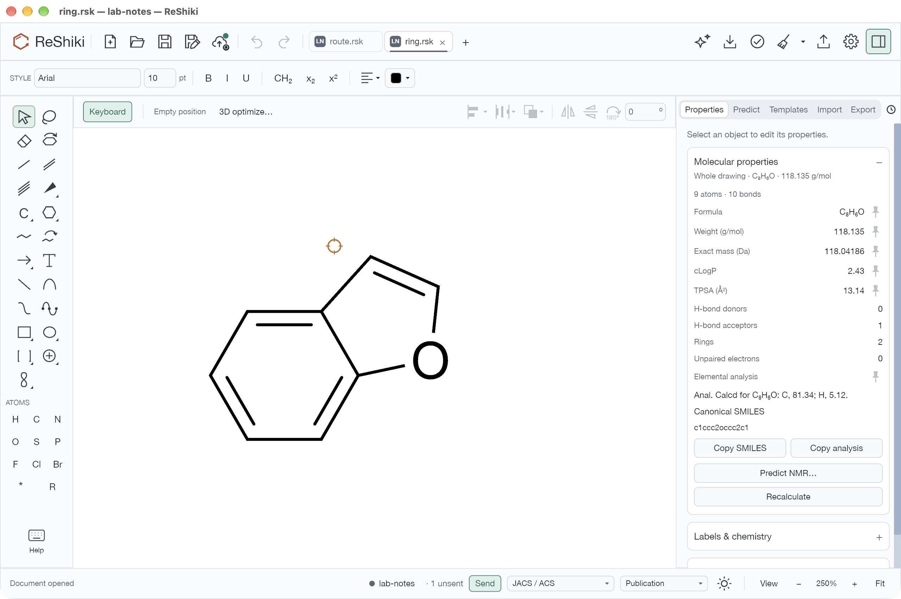 Back in the window: nothing. The chip still says **● lab-notes · 1 unsent** (route.rsk's) and the drawing is the old one. | 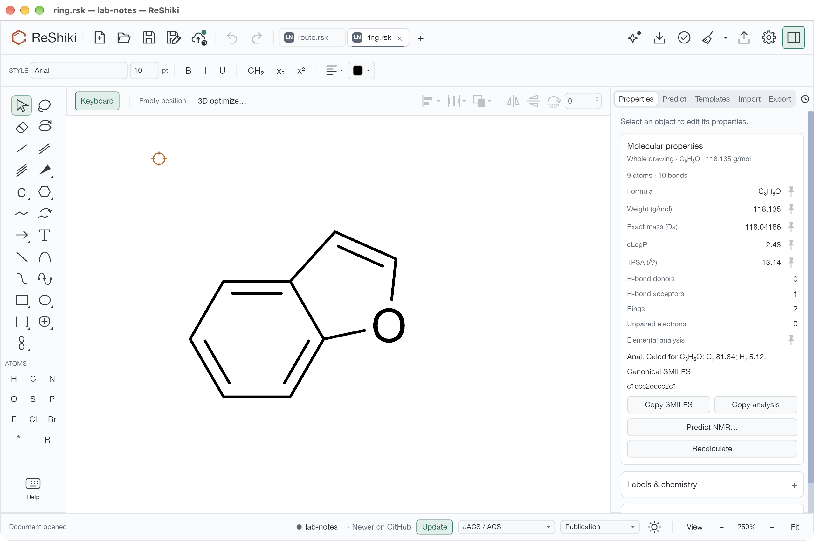 **● lab-notes · Newer on GitHub** with **Update**. The drawing is unchanged until you choose. |
| 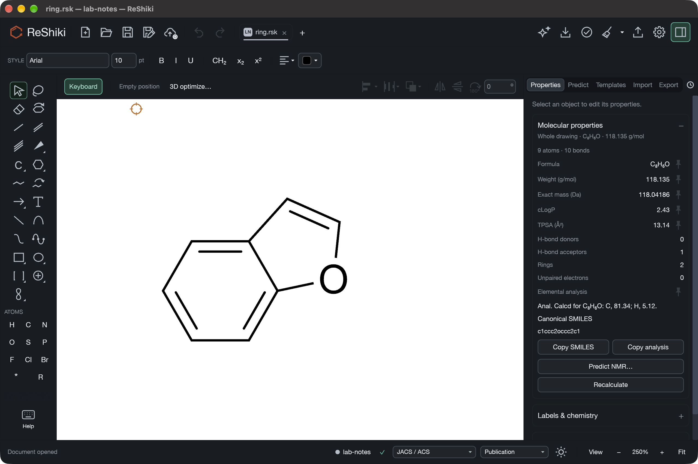 Dark: **● lab-notes ✓**, nothing to see. |  Dark: the same chip. |
| | 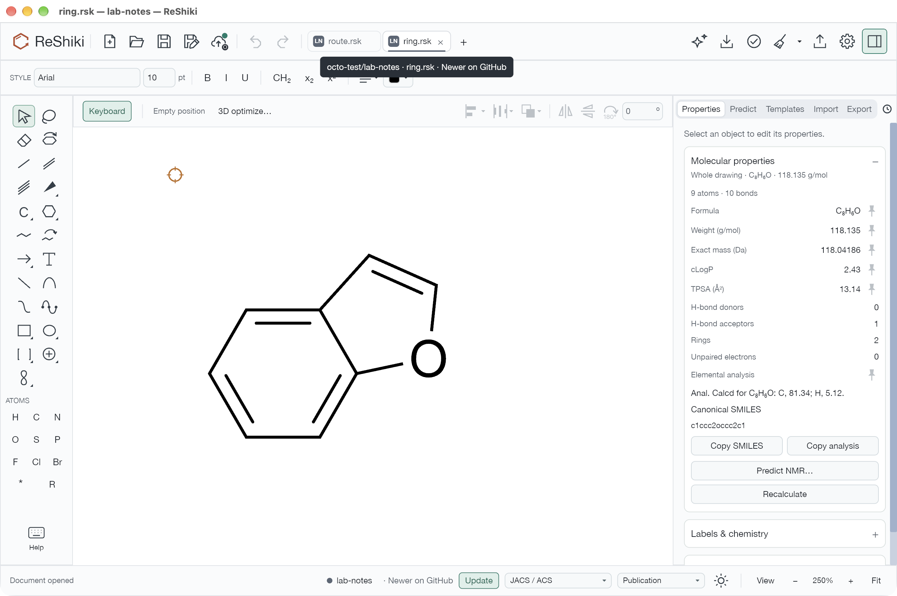 The tab's tooltip: **octo-test/lab-notes · ring.rsk · Newer on GitHub**. |

### Update from GitHub in the command palette (33)

| Before | After |
| --- | --- |
| 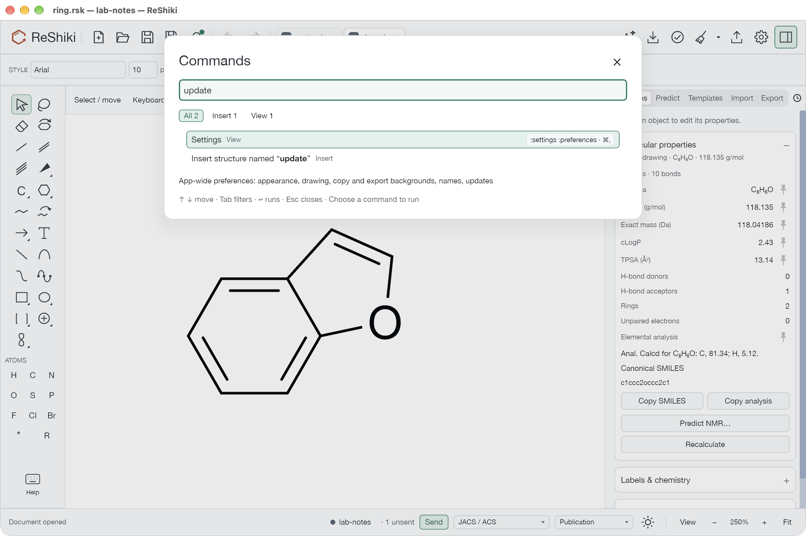 `update`: **Settings** and **Insert structure named "update"**. | 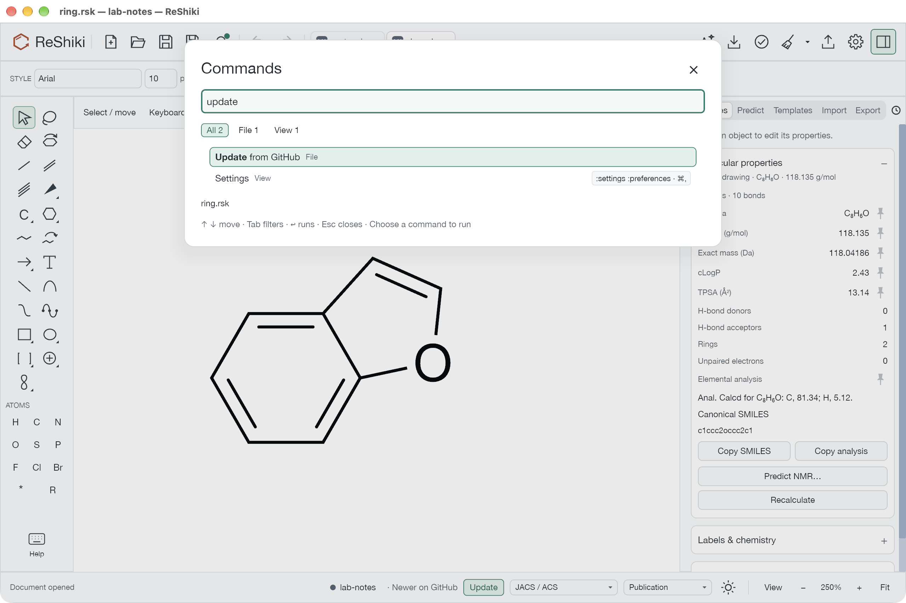 `update`: **Update from GitHub** (File) first, detail **ring.rsk**. The row is there only while Update applies. |

### Update, then Undo

| After | |
| --- | --- |
| 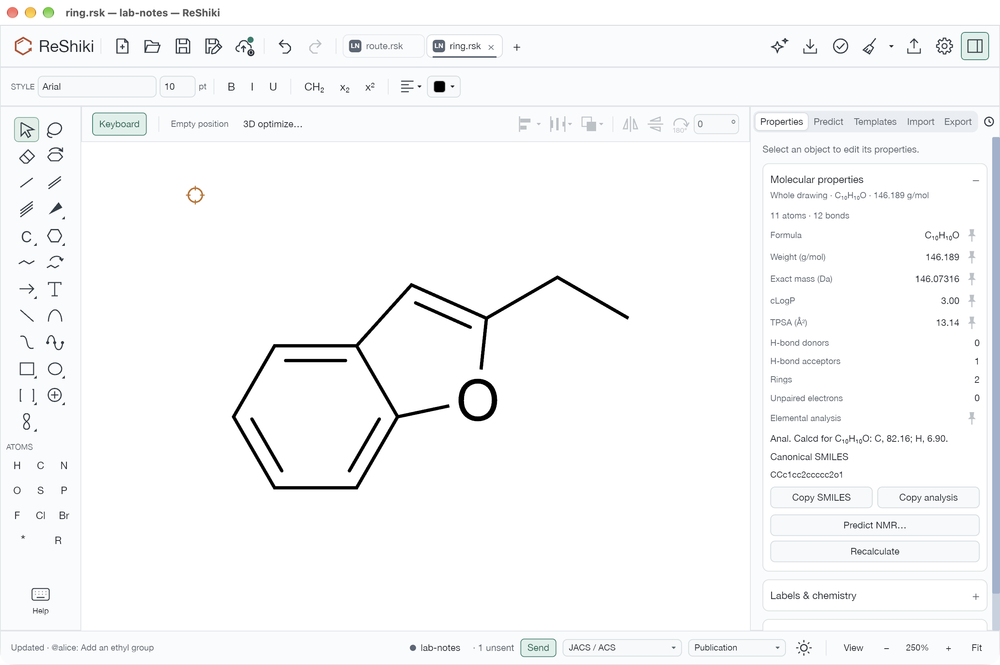 **Update**: alice's drawing, 2-ethylbenzofuran (C₁₀H₁₀O, 11 atoms · 12 bonds). Status **Updated · @alice: Add an ethyl group**. The tab is not marked edited, and the chip is back to route.rsk's **1 unsent**. |  One **Cmd+Z**: your benzofuran again (C₈H₆O). The tab is marked edited (title **ring.rsk •**) and the chip says **2 unsent**: yours would now go over alice's. Cmd+Shift+Z brought hers back (checked, not captured). |
| 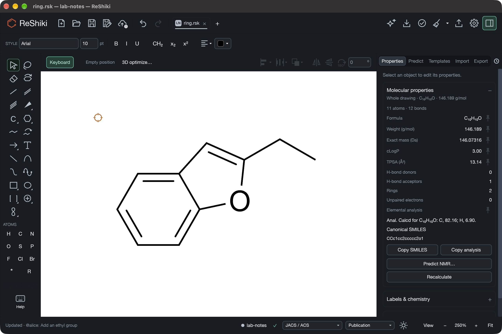 Dark: after Update. | |

### @alice changed route.rsk, which you had changed too

| Before | After |
| --- | --- |
| 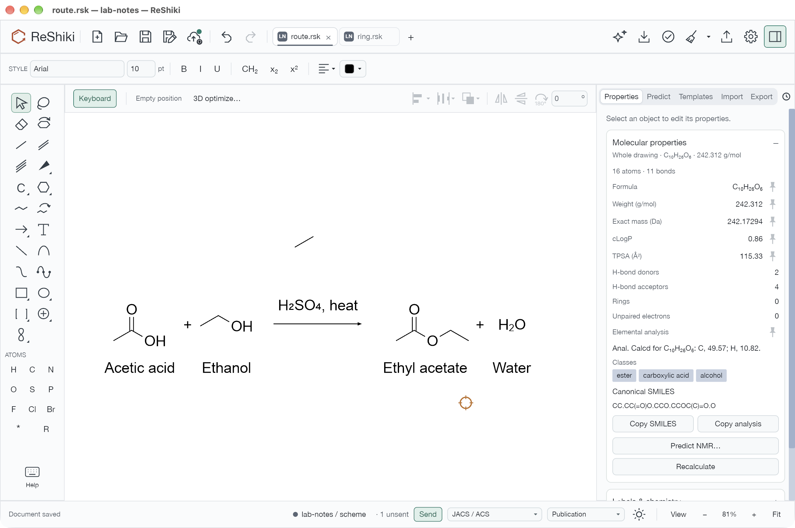 Back in the window: still **● lab-notes / scheme · 1 unsent** with **Send**. | 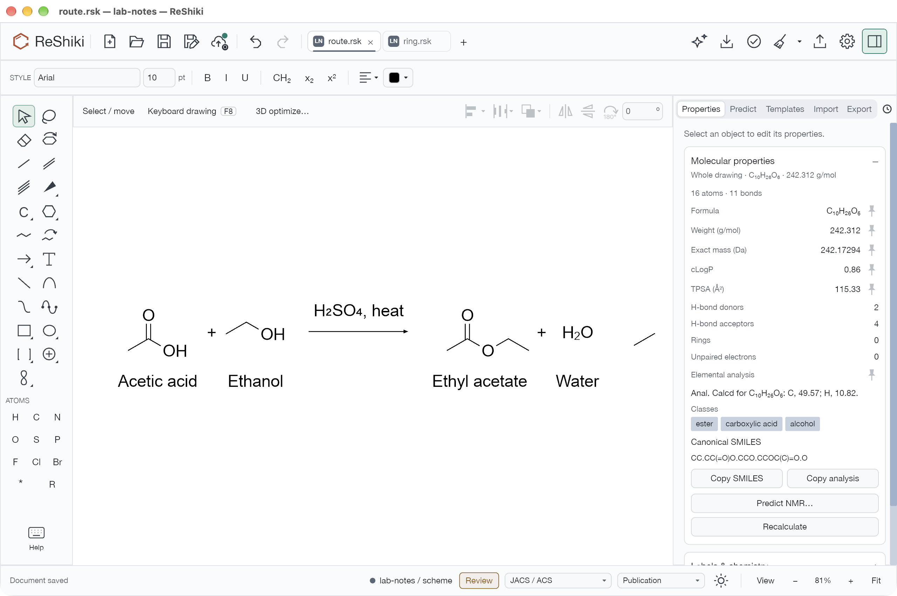 **● lab-notes / scheme** with the amber **Review**, not Update: your change would be lost. |
| 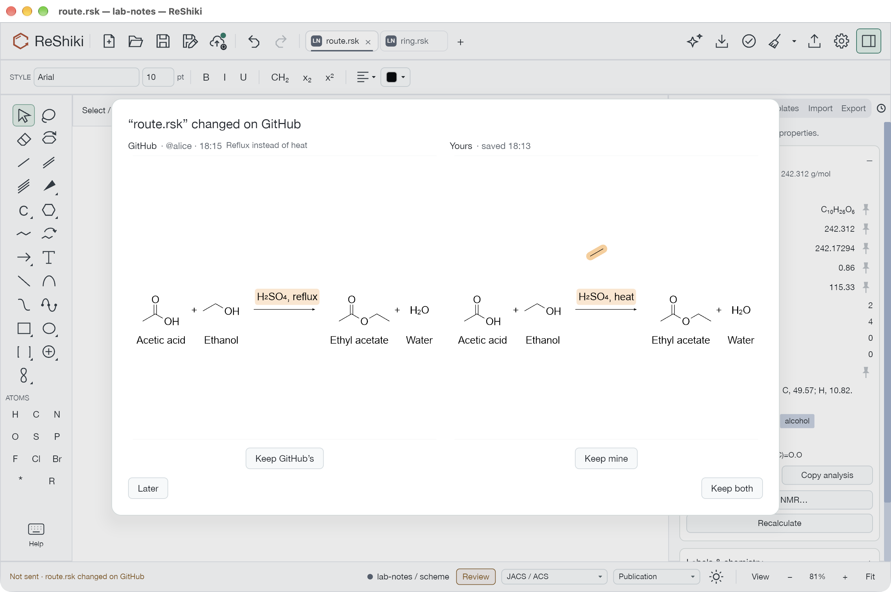 Only **Send** finds it: **Not sent · route.rsk changed on GitHub** and the conflict dialog. | 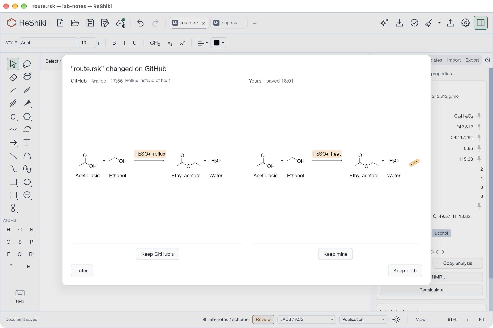 **Review** opens the existing dialog before anything is sent. The left header reads **GitHub · @alice · 17:56 Reflux instead of heat** and the right **Yours · saved 18:01**; the changed condition text is painted on both sides. |

## Verification

VERIFICATION_TABLE

Checks on macOS arm64 (Apple M4), at the head:

- `cargo fmt --all --check`
- `cargo clippy --workspace --all-targets --all-features --locked -- -D warnings`
- wasm32 clippy as in `checks.yml`
- `cargo test --locked --no-default-features -p reshiki --lib --bins`: lib 482 passed, bins 1764 passed
- the opt-in renderer tests (`--bin reshiki -- --include-ignored --test-threads=1 --skip manual_`): 1916 passed
- `uv run --locked python -m unittest discover -s tests -p 'test_*.py'`: 264, OK
- `python3 scripts/module_index.py --check`
- `scripts/copy_lint.py`
- `bun fmt --check docs`

New tests:

- `github::tests::send::newer_finds_each_drawing_changed_on_github_and_who_changed_it` (mock): nothing changed; @alice changes one drawing between two checks and another is deleted (left for Send); the commit, blob, bytes, folder names and author come back; nothing is written; still found after a rename and a new default branch.
- `app::github::tests::newer::*`:
  - no local edits shows Newer, the tab hint and the palette row; a save made after detection turns it into Review;
  - Update is one undo step to GitHub's exact drawing, with the status and the new base; stale or late answers offer nothing;
  - your own commit says **You**;
  - local edits (saved, or unsaved) become the conflict Review; also a conflict found by a send since, a save made elsewhere, and no apply while sending;
  - the throttle: no second check within the window, a stale generation is ignored, nothing is asked with no GitHub drawing open, and an expired sign-in signs out.

Adversarial review: four passes by an independent model on the full diff. Fixed:

- a cached version could roll back a sent drawing (now tied to the base commit);
- a reply landing during a Send's saves could reorder the conflict queue behind an open Review (now dropped while saving or sending);
- edits made after detection hid the change (now Review);
- a stale "Not sent" outranked Newer;
- a drawing in conflict could gain a second, stale conflict;
- Update could overwrite a save made elsewhere;
- an expired sign-in was swallowed;
- the check used a stale branch name.

Rejected, with reason:

- The base branch's `github_sent` replaces a repository's conflict list. A focus-found conflict for a drawing with only unsaved edits can drop from that list when a different drawing is sent from its close question. Nothing is lost: the edits stay in the tab, and the next Send of that drawing finds the conflict again. Changing `github_sent` belongs to B1.
- Suppressing Review while a Send runs: that behaviour already exists in the base branch.

## Risk

Low to medium. The new requests run only on window focus, at most every five minutes, only for open drawings in repositories you may send to. That is 3 requests plus one per folder level, and 2 more per changed drawing. Nothing is written without a click. Update is one undo step, and with changes here you get Review, never Update. A failed or late check is ignored until the next one. B1's access re-check still runs from the same trigger and throttle; it now counts only while GitHub drawings are open.

## Changelog

- When someone changes an open drawing on GitHub, the status bar chip shows **Newer on GitHub** with **Update** as you come back to the window. **Update** shows their drawing in one undo step and says who changed it. If you have changed the drawing too, the chip shows **Review** instead.

## Contribution license

- [x] I have read [CONTRIBUTING.md](https://github.com/Ameyanagi/ReShiki/blob/main/CONTRIBUTING.md). I have the right to submit this contribution and agree to offer my original contributions under both MIT and Apache-2.0, so recipients may choose either license (`MIT OR Apache-2.0`).
- [x] Any third-party material is identified below with its source and license, and its required notices are preserved; otherwise, no third-party material is added.

Third-party sources, if any: none.
