## Summary

The desktop app now asks for a GitHub star, rarely and only at a quiet moment.

- After five successful exports or copies, on a later day than the first launch, a small **Enjoying ReShiki?** card appears at the bottom right of the canvas. It waits until the window has had no input for 30 seconds. It never appears while a field or control has the keyboard, while a mouse button is held, while a menu, panel or dialog is open, while the window is in the background, or in a drawing that Office or LibreOffice hosts.
- **Star on GitHub** opens the project page in the browser. **Not now** and **×** close the card.
- Without a star, it asks again at most once: in a later feature release (x.y.0) and at least 90 days after the first ask.
- **ReShiki → Check for updates** has a **Star ReShiki on GitHub ↗** link after **Release notes ↗**. Using it counts as a star, so the card never asks.
- **Help → About ReShiki** opens the same panel.
- The count and the answer stay in `star-prompt.json` in the data folder. Nothing is sent anywhere. The browser editor, the CLI, MCP and tests never ask.

## Why it matters

Stars are how most chemists find small open-source tools on GitHub. ReShiki has no other way to ask, and no analytics. The ask must not cost anyone a drawing session: it comes only after real use, never during work, and at most twice in total.

## Approach

- `src/app/star_prompt.rs` holds everything. `should_ask(record, moment)` is a pure function of the saved record and the current moment (day, version, idle time, focus, busy). The pure tests cover every rule with it.
- **One count per real use.** `App::receive` is now the runtime's entry point (`main.rs` and `web.rs` register it instead of `update`). It counts a finished export or copy once and then calls `update`. Internal re-dispatches go straight to `update`, so nothing counts twice. Receipts for a closed or replaced drawing still count. Figure, structure, NMR, theme and drawing-style exports and every successful copy count. Canceled or failed ones do not. The count stops at 5, so later copies do not write the file.
- **The ask is saved before the card shows.** If the save fails, the card does not show. Quitting with the card open still counts as an ask.
- **Each change re-reads the file.** A second running ReShiki keeps its count and answer, without a lock file.
- **Busy check.** `App::star_busy` lists the menus, dialogs and panels. A timer tick also asks the view whether any widget has keyboard focus. The card shows only when the drawing has the keyboard.
- **Cost while waiting.** One 5-second timer and one input listener run only while this run may still ask. Afterwards both are `Subscription::none()`.
- `chrono` (clock and serde features only) becomes a direct dependency for local calendar days. It was already in `Cargo.lock`, so the lock gains one edge and no packages.

Alternatives rejected:

- **A lock file around each change.** Two copies saving within the same millisecond is rare. The worst case is one lost count or one extra ask. Removed together with the other rare-case guards below (see [what the simplification removed](tests/simplification-lines.txt)).
- **A `.json.bad` copy of an unreadable record.** An unreadable file (for example from a newer build) now just ends the asks for that run and is left alone.
- **Tracking held touch fingers and files dragged over the window.** Both need a touch or a hover held perfectly still for 30 seconds. Any movement already resets the idle timer, and a held mouse button still blocks the card.
- **Counting in each export handler.** Receipts that arrive after their tab closed never reached the handlers. A single entry point counts each one once.
- **A `picture` flag on Copy As.** Copy on Windows writes Embed Source, EMF, PDF, CDX and DIB, and text copies such as SMILES go into another app too. Every successful copy now counts on every platform.
- **Escape to close the card.** The card never takes focus, so Escape keeps its drawing meaning. × and **Not now** are reachable with Tab.

## Evidence

All window captures: 1280 × 852 pt window, captured at 2× with `screencapture -l` (2784 × 1928 px including the window shadow), `aspirin.mol` at 245%. Before: main `1d94f392`. After: branch `c09e7a4b`. Both runs used a fresh `RESHIKI_DATA_DIR` seeded with the same due record: `{"first_launch_day":"2026-11-14","uses":5,"state":"asking"}`.

### The card (seeded record, 40 s without input)

| Before (main 1d94f392) | After (c09e7a4b) |
| --- | --- |
| 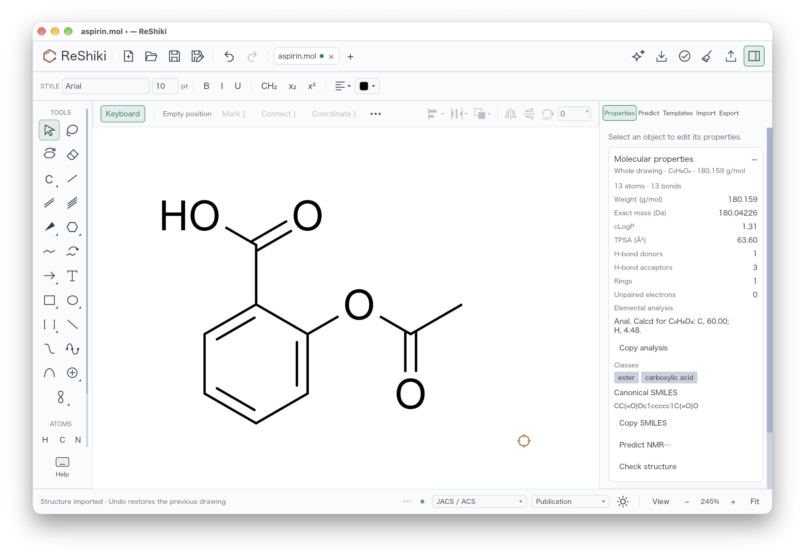 | 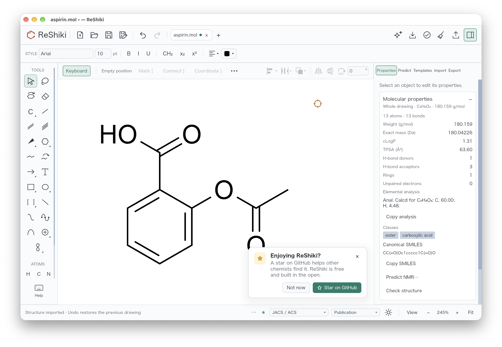 |
| 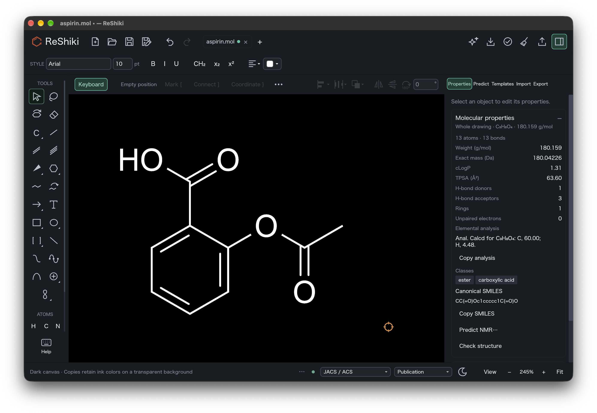 | 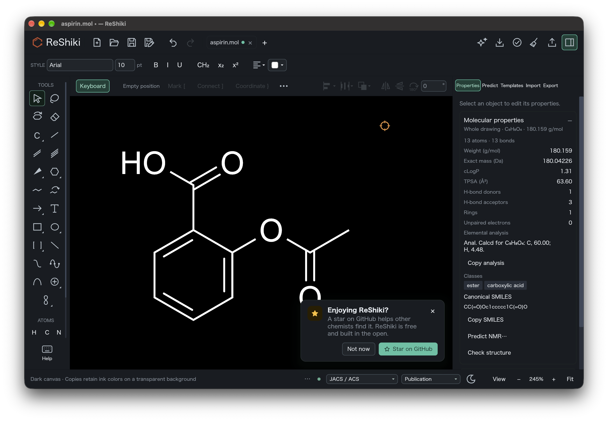 |

Close-ups: [light](real-app/15-card-light-closeup.png), [dark](real-app/37-card-dark-closeup.png). The card appeared after 30 s and by 35 s in both themes ([light timing](real-app/light-idle-timing.json), [dark timing](real-app/dark-idle-timing.json)).

When the card must not appear (branch, same seed, all over 45 s without input):

| Field has the keyboard (52 s) | Context menu open (56 s) | Window in the background (56 s) |
| --- | --- | --- |
| 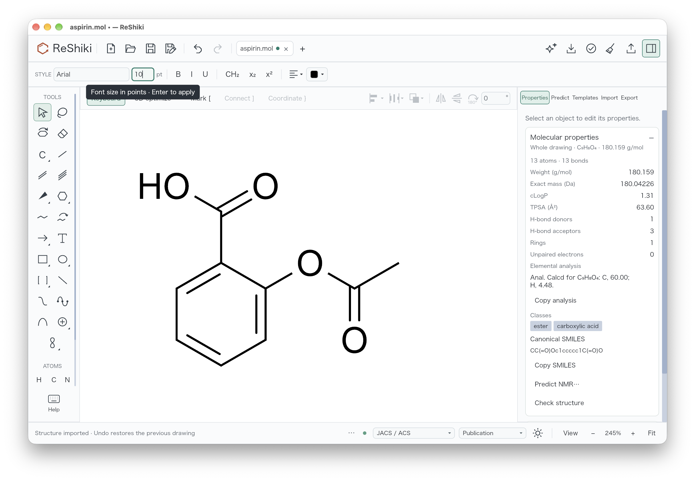 | 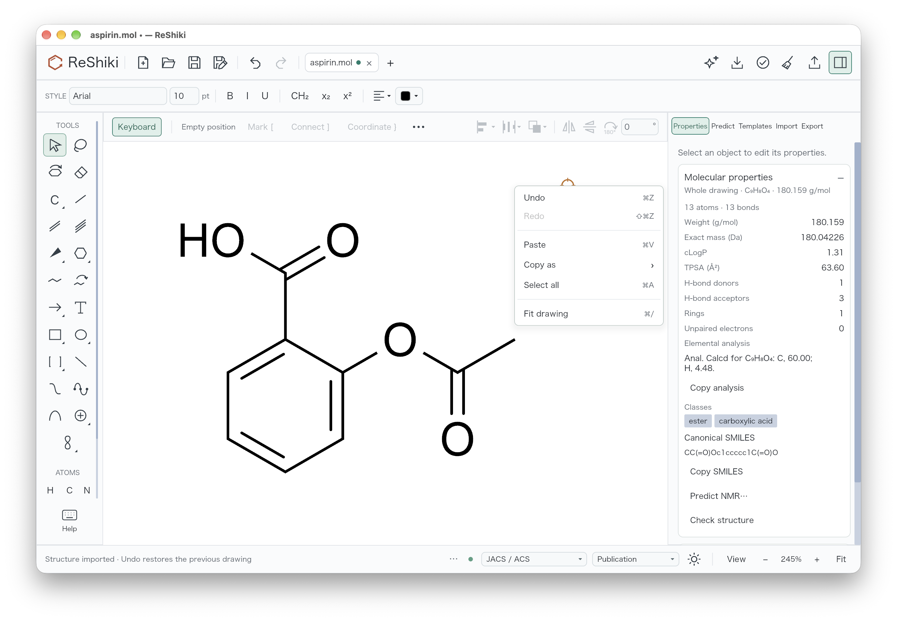 | 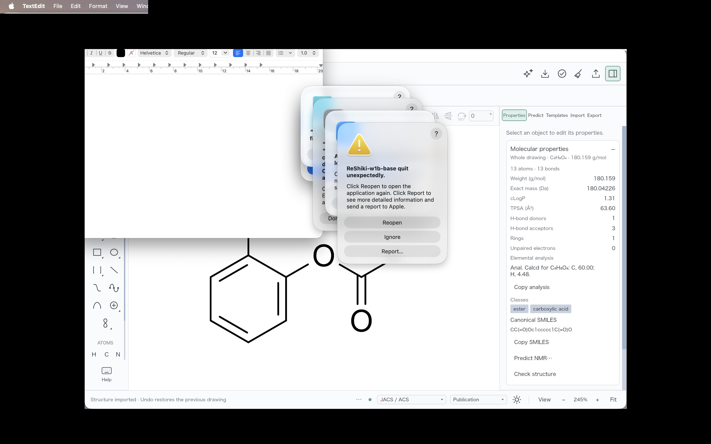 |

After **Not now**, Cmd+A selects the drawing with no extra click, so focus is back on the canvas: [17-not-now-cmd-a-selected.png](real-app/17-not-now-cmd-a-selected.png). The same holds after × in dark mode: [38-dark-x-closed-cmd-a-selected.png](real-app/38-dark-x-closed-cmd-a-selected.png). After the card showed once, another 40 s idle did not bring it back: [41-dismissed-no-repeat-after-40s-desktop.png](real-app/41-dismissed-no-repeat-after-40s-desktop.png).

### Updates / About panel link

| Before (main 1d94f392) | After (c09e7a4b) |
| --- | --- |
| 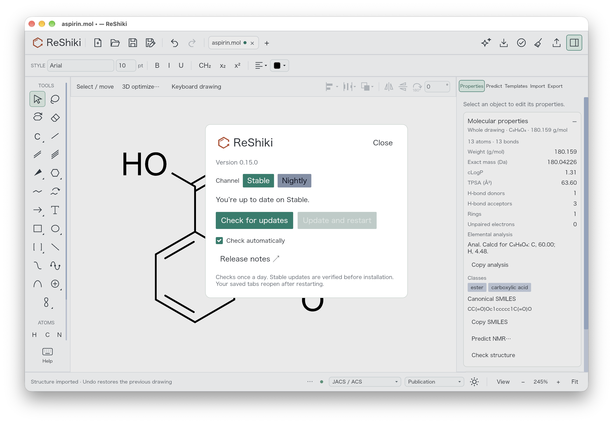 | 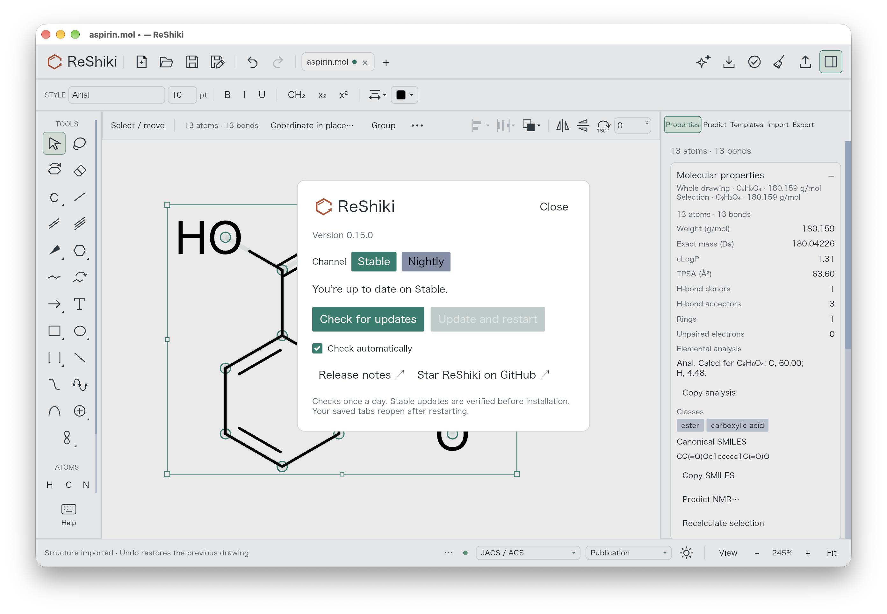 |
| 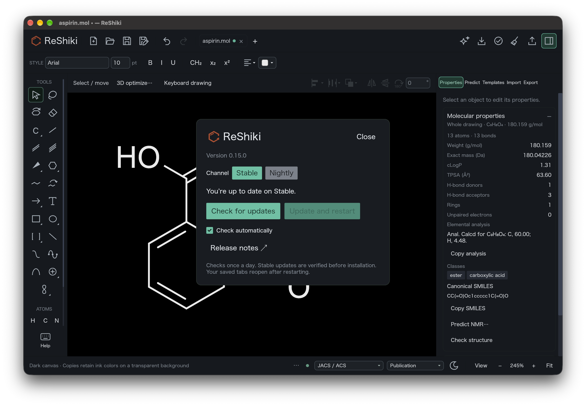 | 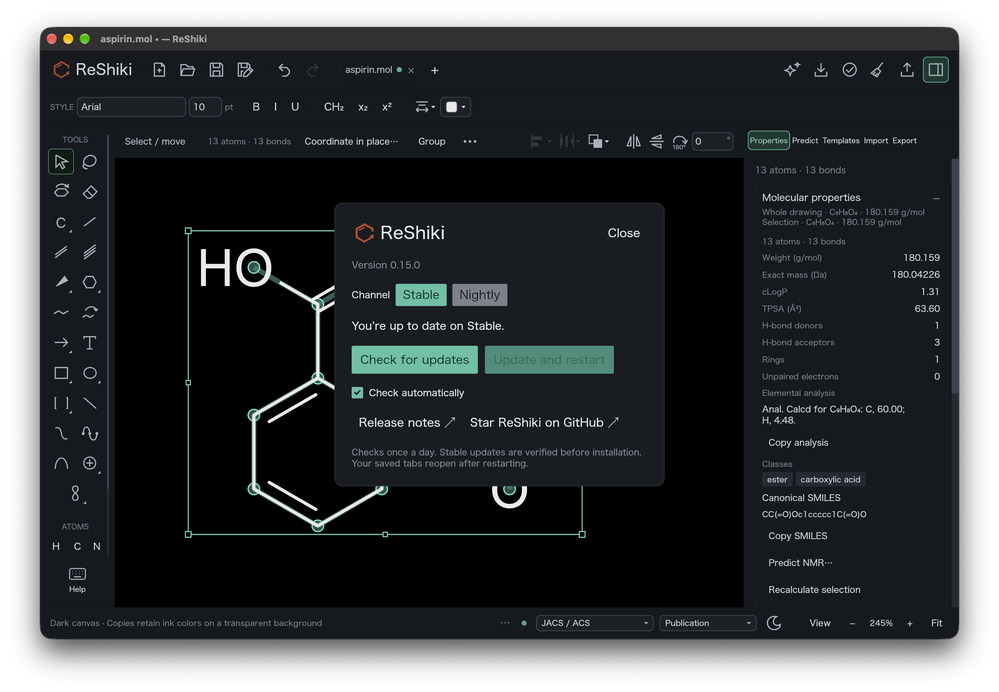 |

### Help → About

| Before (main 1d94f392) | After (c09e7a4b) |
| --- | --- |
| 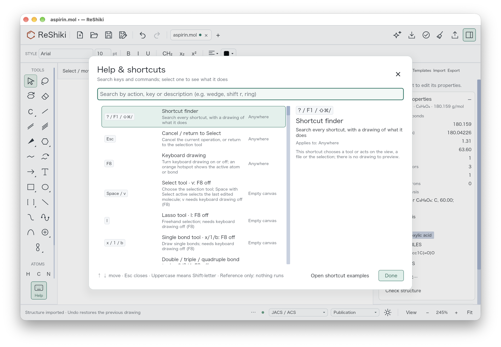 | 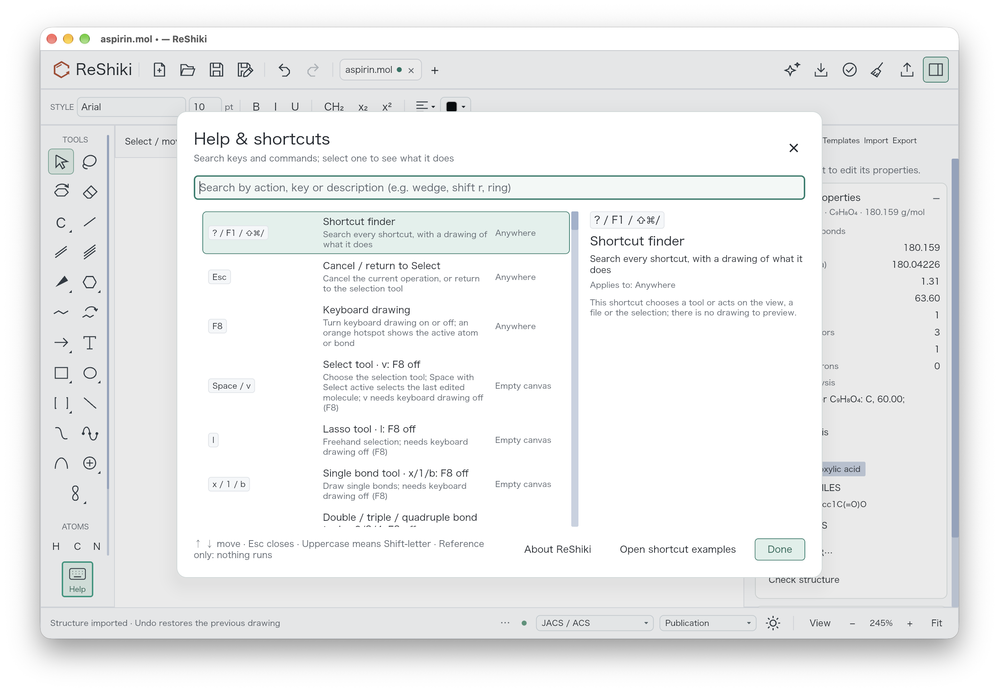 |

**About ReShiki** closes Help and opens the About panel with the star link: [23-updates-panel-via-help-about.png](real-app/23-updates-panel-via-help-about.png). Main's dark Help for reference: [08-help-dark.png](base-app/08-help-dark.png).

Headless renderer captures of the card, the canvas and the About panel (1280 × 800 logical at 2×, from `star_prompt_evidence` on the branch before the last commit, which changed only Help and copy counting, and the same test run against main's sources): [renderer/before](renderer/before/), [renderer/after](renderer/after/).

### The record file through the ask, close and re-ask cycle

Before: main never reads or writes `star-prompt.json`. After 40 s idle in both themes, About, Help and Quit, the seeded file was byte-for-byte unchanged ([record-main.txt](tests/record-main.txt)).

After: a temporary test (not committed) drives the app's own paths and prints the file at each step ([record-cycle.txt](tests/record-cycle.txt), source included):

```text
0. before the first launch                (no file)
1. first launch                           {"first_launch_day":"2026-11-15","uses":0,"state":"asking"}
2. export #5 (App::receive)               {"first_launch_day":"2026-11-15","uses":5,"state":"asking"}
2. export #6 (App::receive)               {"first_launch_day":"2026-11-15","uses":5,"state":"asking"}
   toast after 30 s idle on the first-launch day: false
3. next day, relaunch                     {"first_launch_day":"2026-11-14","uses":5,"state":"asking"}
   toast after 30 s idle: true
4. toast shown (saved before it shows)    {..."state":{"asked":{"version":"0.15.0","day":"2026-11-15"}}}
5. Not now / x                            (unchanged)
   toast again in the same run: false
   toast after a relaunch, same version: false
7. asked in 0.14.0, 89 days ago           toast: false
8. asked in 0.14.0, 90 days ago           toast: true
9. second ask shown                       {..."state":"done"}
11. relaunch                              {..."state":"done"}   toast: false
13. Star ReShiki on GitHub (Updates link) {..."state":"starred"} toast: false
```

At every step the data folder holds only `star-prompt.json`.

The real app showed the same first transition: `asking` became `{"asked":{"version":"0.15.0","day":"2026-11-15"}}` when the card appeared ([star-prompt-light-asked.json](real-app/star-prompt-light-asked.json)).

### What the simplification removed

From the last commit before the simplification (`0b756678`) to head (`c09e7a4b`), the branch went from 1,639 to 1,545 lines added and from 18 to 9 lines removed. `star_prompt.rs` went from 634 to 568 lines and its tests from 899 to 889. The simplification commit alone is +99 / −184 across 3 files. `src/app/import.rs`, `src/app/clipboard.rs`, `src/app/clipboard/tests.rs` and `src/app/gates/result_tests.rs` are back to main. Table: [simplification-lines.txt](tests/simplification-lines.txt).

## Verification

macOS arm64 (Apple M4), head `c09e7a4b`, separate target folder, InChI and naming helpers set to that build, `RESHIKI_REQUIRE_INCHI_HELPER=1`, fresh `RESHIKI_DATA_DIR` ([full log summary](tests/macos-arm64-results.txt)):

| Check | Result |
| --- | --- |
| `cargo fmt --all --check` | pass |
| `cargo clippy --workspace --lib --bins --all-features --locked -- -D warnings` | pass |
| `cargo clippy -p reshiki --all-targets --all-features --locked -- -D warnings` | pass |
| `cargo clippy` for `reshiki-web`, `reshiki`, `reshiki-web-worker` on `wasm32-unknown-unknown` | pass |
| `cargo test --locked -p reshiki --no-fail-fast` | 2,592 passed, 0 failed, 205 ignored (106 test binaries) |
| `star_prompt::` with `--include-ignored` (renderer focus, Updates link, Help → About, evidence) | 14 passed |
| `updates` with `--include-ignored` (includes the About keyboard traversal test) | 32 passed |
| `help` with `--include-ignored` (with `RESHIKI_HELP_QA_DIR` set) | 23 passed |
| `star_prompt::` at `6af8faa4` (pushed head; adds only a test skip where folder permissions are not enforced) | 14 passed |
| `bun fmt --check` on the two docs, `assemble_changelog.py --check` | pass |
| Real app, light and dark: field focus, context menu, background, idle timing, Not now / × focus, no repeat, Updates link, Help → About | pass ([report](real-app/report.md)) |

VERIFICATION_TABLE

## Risk

- **New panels must join the busy list.** `App::star_busy` names each menu, dialog and panel. A panel added later that is missing from it could show the card over it, unless it holds keyboard focus. The focus check catches fields and focused controls.
- **`App::receive` is the counting point.** A new export or copy path counts only if its success message matches `star_prompt::counts`.
- **Window focus events.** The card relies on iced's Focused and Unfocused window events. They were checked in the real app on macOS only. Linux (X11 and Wayland) and Windows need a real-app look.
- **Two running copies.** Without a lock, two copies saving at the same moment can lose one count or ask once more. Each change re-reads the file, so answers are kept.
- **Low blast radius otherwise.** Without a due record nothing appears. An unreadable or unwritable record means the app never asks. The browser editor, CLI and MCP are unchanged.

## Changelog

`docs/changes/unreleased/feat-github-star-toast.md` (section Changes):

- After five exports or copies, on a later day than the first launch, the desktop app asks once in a small card at the bottom right of the canvas: **Enjoying ReShiki?** It waits until you have not touched the window for 30 seconds, and never appears while you type in a field, drag, or have a menu, panel or dialog open. **Star on GitHub** opens the project page in your browser. Without a star, it asks again at most once, in a later feature release and at least 90 days later. Nothing is sent anywhere. See the [privacy policy](privacy-policy.md#github-star-request).
- In the desktop app, **ReShiki → Check for updates** has a **Star ReShiki on GitHub ↗** link after **Release notes ↗**. After you use it, the card no longer asks. **Help → About ReShiki** opens the same panel.

`docs/privacy-policy.md` gains a **GitHub star request** section with the same rules.

## Contribution license

- [x] I have read [CONTRIBUTING.md](https://github.com/Ameyanagi/ReShiki/blob/main/CONTRIBUTING.md). I have the right to submit this contribution and agree to offer my original contributions under both MIT and Apache-2.0, so recipients may choose either license (`MIT OR Apache-2.0`).
- [x] Any third-party material is identified below with its source and license, and its required notices are preserved; otherwise, no third-party material is added.

Third-party sources, if any: none added. `chrono` (MIT OR Apache-2.0) becomes a direct dependency; it was already in `Cargo.lock`.
