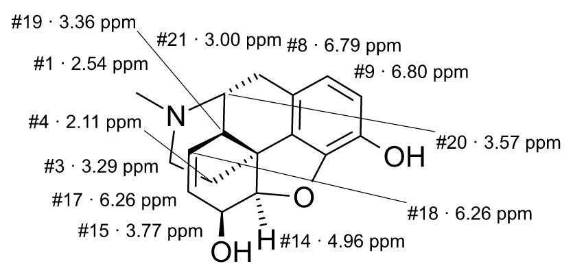
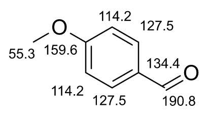
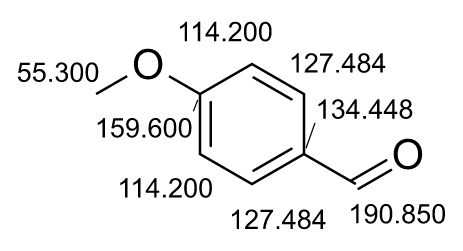

Fixes #1203 (PR 2 of 2: labels; #1231 added the prediction).

## Why it matters

#1231 made NMR prediction scriptable, but the last step of @ssiddhantsharma's design in #1203 still needed the app: putting the shifts on the atoms. Open structure-elucidation tools return SMILES, and a journal-styled structure with the assigned shifts was a manual step. This PR lets Python, `reshiki --cli` and `reshiki --mcp` write the labels into files that keep them, laid out for a journal figure: by default the bare shift beside each atom (`6.26`, `128.4`), as journals print it with "δ (ppm)" stated once in the caption, or one of the **Show labels** formats. It follows the design and the owner's decisions of 2026-11-18. Thanks to @ssiddhantsharma for the design.

## Approach

One core function, three thin surfaces, a shared layout, and the canvas sharing the label text:

- **Core** (`crates/io/src/nmr/labels.rs`):
  - `LabelFormat { Value, Numbers, Ppm, Both }` and `label_text(format, atom, ppm, decimals)`: `1.28`, `#3`, `1.28 ppm`, `#3 · 1.28 ppm`.
  - `default_decimals(nucleus)`: 2 for ¹H (`7.26`), 1 for ¹³C (`128.4`), 2 when the rows do not name a nucleus; 0 to 4 on request.
  - `write_labels(doc, rows, format, decimals)` writes each row's label into the atom's number (`AtomDisplay.number`). Every row is checked before anything changes: an ID that is not an atom, a ppm that is not finite, a label over 32 characters or decimals over 4 is an error, and nothing is written. Rows with no ppm are skipped. Listed atoms keep their number style and lose their offset; an atom without a number gets the shift-label style (below). Other atoms are untouched.
- **Layout** (`crates/model/src/atom_labels/long_numbers.rs`), shared by canvas, SVG, PNG and PDF:
  - **Switch:** shift labels are the atom numbers that are a decimal value (`6.26`, `128.4`, `-0.52`: digits, one point, digits) or end in ` ppm` (every `ppm` and `both` label). Every other number (`3`, `12a`, `#3`, `L (S)`, free text, and a whole number such as a `decimals=0` value) keeps today's layout; no golden changed.
  - Candidates around the atom, outward first (away from the drawing around it) and nearest first, in 7.5° steps and half-text-height distance steps. A spot must keep the text clear of every bond stroke as the scene draws it (a ring's second line inside the ring, wedges at their real width), atom labels, other labels and leaders, and be nearer its own atom, or that atom's explicit H, than any other atom. Text uses its real advance width and height.
  - **Values** may sit between the bonds, inside a ring, so they stay right beside their atom. `ppm` and `both` labels stay outside the molecule's convex hull.
  - Labels that fit beside their atom go first, those with the least room first; the rest are placed after them.
  - A **leader** (a thin line, half the bond width) is the last resort: only when no spot within 1.5 bond lengths is free. A value then first tries the best spot within that reach (its short leader may cross a bond away from its ends) before going further. A spot whose leader would cross text or another leader is not used, and a leader crosses a bond only at least half a bond length from either of its ends, so the crossing never reads as a mark on the bond. If a label is still left without a clear spot, the leader pass is retried with it placed first.
  - Deterministic: the order and candidates depend only on the drawing.
  - **Size:** labels written without a style are 65% of the drawing's atom-label size (6.5 pt with 10 pt atom labels), and never below 4 pt. At the previous 7.5 pt (75%) a row of shift labels read as full-size text next to the atoms.
- **Canvas** (`src/canvas/nmr.rs`): the **Show labels** overlay builds its text with `label_text` (3 decimals, as before). A test checks the overlay text equals the atom numbers scripts write. The overlay stays on screen only.
- **Python**: `Drawing.with_labels(rows, *, format="value", decimals=None) -> Self`. `rows` is an `NmrPrediction`, or `NmrShift` rows, `{"atom", "ppm"}` mappings or `(atom, ppm)` tuples; the nucleus default applies when every row names the same nucleus. A changed drawing is reconciled as the app reconciles an atom-number edit. Errors are `ReShikiError` with code `invalid_arguments`.
  - **RDKit `atomNote`** (as the reply on #1203 promised): `to_rdkit()` sets `atomNote` on each numbered atom, by position in the MOL block ReShiki writes (`doc.atoms` order). `from_rdkit()` puts each note on the atom imported from that RDKit atom (MOL atom ID = atom-block position) and skips, with one `StructureWarning` saying how many, notes whose atom was dropped on import (a folded explicit H) or whose text is not 1 to 32 printable characters.
- **MCP** (`crates/agent/src/ops/label_atoms.rs`): `label_atoms {document, rows: [{atom, ppm|null}], format, decimals, base_revision, idempotency_key}`; `format` is required, one of `value`, `numbers`, `ppm`, `both`. Mutating, destructive (it replaces numbers), idempotent, closed-world, one undo step.
  - `base_revision` is required and is the `revision` `predict_nmr` returned, so rows never land on atoms that an edit since then removed or renumbered (`stale`).
  - It reuses `apply`'s receipt replay and atomic commit (`apply`'s `prepare`, `replace` and `commit` are shared; `apply` behaves the same and its tests are unchanged). A call that writes nothing commits the snapshot unchanged (`recorded: false`), which binds its key without normalizing the drawing.
  - `decimals` is 0 to 4, or `null` for 2 (MCP rows do not carry a nucleus). An atom not in the drawing is `unknown_object`; another bad row or decimals out of range is `invalid_arguments`; both change nothing.
- **CLI**: `reshiki --cli convert … --nucleus 1H|13C --labels value|numbers|ppm|both [--decimals N]` (`--labels` stays required; `value` comes first in the help and the docs' examples) runs `import`, `predict_nmr`, `label_atoms` (bound to the predicted revision, decimals from the nucleus unless given) and `export`.
  - Only for outputs that keep atom numbers: svg, png, pdf, cdxml, cdx (`convert` cannot write `.rsk`; use Python's `rsk()` or MCP `file_save`).
  - Another output, `--labels` without `--nucleus`, `--nucleus` without `--labels`, `--decimals` without `--labels` or outside 0 to 4 is a usage error (exit 2).
- **CDXML/CDX** keep writing plain atom numbers; ChemDraw places them itself, without leaders.

## Label formats and storage trade-offs

| `format` | ¹H | ¹³C |
| -------- | -- | --- |
| `value` (Python default) | `1.28` | `128.4` |
| `numbers` | `#3` | `#3` |
| `ppm` | `1.28 ppm` | `128.4 ppm` |
| `both` | `#3 · 1.28 ppm` | `#3 · 128.4 ppm` |

Labels are stored as atom numbers (static text), as the owner decided:

- No `.rsk` format change. The test keeps the input's version floor (30 for a plain drawing, 35 for one that already needs it), and reopening keeps the numbers.
- They render in SVG, PNG and PDF and go to ChemDraw as `AtomNumber`/`ShowAtomNumber`.
- They do not update after later edits: the user owns them, as with any atom number. Predict and label again to refresh.
- Labelling ¹H after ¹³C replaces only the atoms the ¹H rows list.
- If **Show labels** is on while a labelled drawing is open, both show.
- Data credit: documented (cite the prediction's `credit` with a published figure). No caption is added; the docs say journals usually state "δ (ppm)" once in the figure caption.
- The app's **Show labels** overlay is unchanged.

## Evidence

All images were made on macOS arm64 (Apple M4) from this branch with the default format (`value`) and decimals (2 for ¹H, 1 for ¹³C), except one `both` image for comparison and one `decimals=3` image. Shifts are predicted from the bundled nmrshiftdb2-derived index; contains information from nmrshiftdb2.

### The issue's example, end to end (Python)

`m = reshiki.Molecule.from_smiles(MORPHINE).clean()`, `m.predict_nmr(nucleus)`, then `m.with_labels(shifts).save(..., style="JACS / ACS")`. [python-session.txt](python-session.txt) has the full session: every label, the formats, the decimals, the row types, the `.rsk` round trip, RDKit `atomNote`, CDXML and the errors. Rows without reference data are skipped: morphine ¹³C has data for 5 of 17 carbons, ¹H for 12 of 14 sites.


Morphine ¹H, the default `value` format. Ten of the twelve values sit right beside their atom with no leader; `4.96` sits beside the explicit H of its carbon. Two atoms in the cage have bonds on every side closer than a value is wide: atom 18 (`6.26`, the alkene CH under the N-CH₂ bridge) and atom 4 (`2.11`, the CH₂ at the end of the hashed bridge). Their values take a leader, the last resort. No value touches a bond, an atom label or another value, and no leader crosses text.


Morphine ¹³C: four values beside their atoms; atom 18 (`126.8`) again needs a leader.

The same ¹H labels in the `both` format, for comparison:



### 4-Anisaldehyde, every site predicted

| ¹³C | ¹H |
| --- | --- |
|  |  |

Every value beside its atom, inside the ring where the outside is taken (`134.4`), with no leader.

`decimals=3` instead of the ¹³C default of 1; the wider values at C3 and C6 take short leaders:



SVGs and `.rsk` files: [morphine-1H.svg](morphine-1H.svg), [morphine-13C.svg](morphine-13C.svg), [morphine-1H-both.svg](morphine-1H-both.svg), [anisaldehyde-13C.svg](anisaldehyde-13C.svg), [anisaldehyde-1H.svg](anisaldehyde-1H.svg), [anisaldehyde-13C-decimals3.svg](anisaldehyde-13C-decimals3.svg), [anisaldehyde-13C.rsk](anisaldehyde-13C.rsk).

### Decimals, `.rsk` and RDKit

```text
# Decimals default per nucleus, or 0 to 4 on request (anisaldehyde atom 7, 13C):
#   decimals=None: 190.8
#   decimals=0: 191
#   decimals=2: 190.85
#   decimals=4: 190.8500
#   decimals=5: ReShikiError[invalid_arguments]: decimals must be 0 to 4
# The four formats on anisaldehyde 13C, atom 7 (the aldehyde C):
#   value: 190.8
#   numbers: #7
#   ppm: 190.8 ppm
#   both: #7 · 190.8 ppm
# .rsk round trip: the labels and the file version are kept
#   version written: 30, unlabelled: 30
#   labels equal after reopening: True
# RDKit atomNote round trip:
#   to_rdkit notes: [(0, '3.79'), (3, '6.79'), (4, '7.25'), (6, '9.98'), (8, '7.25'), (9, '6.79')]
#   from_rdkit numbers: {1: '3.79', 4: '6.79', 5: '7.25', 7: '9.98', 9: '7.25', 10: '6.79'}
```

The pytest suite also covers the `[H]CO` case with the explicit H kept in RDKit (notes land on C as atom 2 and O as atom 3; a note on the H is skipped with a warning) and invalid notes.

### CDXML atom numbers (ChemDraw)

```text
<n id="3" ... AtomNumber="#1 · 55.3 ppm" ShowAtomNumber="yes">   (Python, format="both")
AtomNumber="22.4"                                                (CLI, --labels value, ibuprofen)
```

Plain atom numbers, no leaders: [anisaldehyde-13C.cdxml](anisaldehyde-13C.cdxml), [cli-ibuprofen-13C.cdxml](cli-ibuprofen-13C.cdxml).

### Command line

```text
$ reshiki --cli convert --smiles 'CN1CC[C@]23c4c5ccc(O)c4O[C@H]2[C@@H](O)C=C[C@H]3[C@H]1C5' --nucleus 13C --labels value -o cli-morphine-13C.png --force
reshiki: warning: PNG: … at 1200 dpi
[exit 0]
```


[cli.txt](cli.txt) also has ¹H `value` to PNG ([cli-morphine-1H.png](cli-morphine-1H.png)), `--decimals 3` to SVG ([cli-anisaldehyde-13C-decimals3.svg](cli-anisaldehyde-13C-decimals3.svg)), `numbers` to PDF, CDXML with `--receipt`, and the usage errors:

```text
$ reshiki --cli convert --smiles ... --to svg --decimals 2
reshiki: --decimals needs --labels value, numbers, ppm or both                    [exit 2]
$ reshiki --cli convert --smiles ... --to svg --nucleus 13C --labels ppm --decimals 5
reshiki: --decimals must be a whole number from 0 to 4                            [exit 2]
$ reshiki --cli convert --smiles ... --to svg --nucleus 13C --labels Both
reshiki: --labels must be value, numbers, ppm or both                             [exit 2]
$ reshiki --cli convert --smiles ... --to mol --nucleus 13C --labels both
reshiki: --labels needs an output that keeps atom numbers: svg, png, pdf, cdxml, cdx   [exit 2]
```

### MCP: `label_atoms` and undo

[mcp.txt](mcp.txt): the `tools/list` entry (with `decimals`), then on ibuprofen `predict_nmr` (revision 0, 13 rows, 5 without data) → `label_atoms` with `format: "value"`, `decimals: 1` and `base_revision: "0"` → `{effect: "applied", revision: "1", recorded: true, labeled: [...8 atoms]}`; the same key replays that receipt; the same rows without the key are `stale`; one `apply` undo removes every label; an unknown atom is `unknown_object`; a label over 32 characters (`format: "both"`), `format: "Both"` and `decimals: 5` are `invalid_arguments`. The exported SVG: [mcp-ibuprofen-13C.svg](mcp-ibuprofen-13C.svg).

## Verification

VERIFICATION_TABLE

On macOS arm64 (Apple M4), on this branch on top of `main` at 1178767:

- `cargo fmt --all --check`, `cargo clippy --workspace --all-targets --all-features -D warnings`, and the wasm32 clippy for `reshiki-web`, `reshiki` and `reshiki-web-worker`.
- `reshiki-model` 1,585 passed (the shift-label tests: values beside their atoms on morphine ¹H and ¹³C and 4-anisaldehyde ¹H and ¹³C, the `both` labels on morphine ¹H and ¹³C and 4-anisaldehyde ¹³C, the switch and determinism, size, the dragged label, the 4 pt floor), `reshiki-io` 772 (the `value` text and decimals), `reshiki-agent` 368 (`label_atoms` with `value`; contract 36 with a `format_value` case), `reshiki` lib and bins 2,353, CLI 97 (`--labels value` parse and output), the `it` CLI and MCP suites 51, renderer and canvas 499 (no golden changed). 0 failed.
- Python: the wheel built with maturin, pytest 175 passed (3 skipped) with RDKit (the `value` default, per-nucleus decimals, `decimals=3` and `0`), `ruff check`, `ruff format --check` and `ty check`; the repository's Python tests 288 OK.
- Module index, copy lint, changelog, docs tree, `bun fmt --check`, `bun run docs:check`, `bun run docs:build` (`agent-api.txt` 218,438 bytes, 18 tools), runtime dependency check of the built binary.
- Failing first: before values took the shift-label placement, the four value tests failed (`149.0 is as near atom 6 as its own atom 10`, `159.6 is as near atom 5 as its own atom 3`, `2.11 is as near atom 15 as its own atom 4`).

Linux (x64, arm64) and Windows x64 are covered by PR CI.

## Risk

- Overwrites the numbers of the listed atoms, including numbers a user typed. Only listed atoms change, and it is one undo step in MCP.
- Labels go stale after a chemistry edit (documented).
- Enclosed atoms: a value needs a free spot about its own width beside the atom. In morphine's cage, atom 18 (the alkene CH under the N-CH₂ bridge) and atom 4 (the CH₂ at the end of the hashed bridge) have bonds on every side closer than that, so their values (`6.26`/`126.8` and `2.11`) take a leader; every other value in the four test drawings sits beside its atom with no leader. The tests pin this: values beside their atom within one bond length (or beside its explicit H), nearer to it than to any other atom, touching no drawn bond line, atom label or other value; the two enclosed values within three bond lengths, with leaders that cross no text and no bond near their ends. The leader search is capped at 8 bond lengths and eight retries, after which the least-bad spot is used.
- Text rule: any atom number that is a decimal value (`1.5`, `6.26`) now gets the shift-label placement, beside its atom, including numbers typed with the Number tool from a decimal seed; whole numbers, `#3`, `12a` and free text are unchanged. No golden changed.
- Hit testing, Print Selection and molecules shown only in 3D use the same placement as before for picking; a long label's leader is drawn but not itself pickable, and a 3D-only neighbour can shift where a picking pass expects a label. Both are edge cases of the existing indicator code.
- Numbers inside a collapsed abbreviation make CDXML/CDX export ask for the abbreviation to be expanded, as for any atom number there (documented).
- MCP catalog: 21,437 (was 20,250 before this PR; `value` added 8) characters, under the 21,500 cap that #1231 set; not raised. `agent-api.txt`: 218,438 bytes, under the 220 KiB cap; not raised.

## Review

- Codex (gpt-6.2-sol), adversarial, four passes on the first round (revision binding, atomicity, overwrite, surface consistency). Fixed: a no-op call recorded a revision and left its key unbound (now commits the snapshot unchanged, binding the key); `ppm` was optional in MCP rows; a figure round-trip test and a docs claim assumed embedded drawings; real writes reconcile again after a detour (separators and captions need it); the result contract's warnings; Windows UTF-8. Not changed: `budget` before `stale` under a concurrent edit (`apply`'s existing order); a negative atom in Python raises `OverflowError`, like other argument type errors.
- Greptile (4/5): Python skipped reaction spacing; fixed with a failing-first test. Then 5/5.
- Codex, adversarial, two passes on this round's layout, decimals and `atomNote`. Fixed: the switch was every number with a space, which moved free-text numbers (now only labels ending in ` ppm`; no other layout or golden changes); hulls were rebuilt per atom and placement order depended on far-away labels (now once per molecule, ordered around each molecule's own centre); beside-only searches ran to 8 bond lengths (now 1.5); rail clearance did not cover wide bond spacings or triple bonds (now one bond spacing plus half the bold width); shift labels could fall below the 4 pt minimum on small styles; Python applied a nucleus default to mixed rows; dragged labels ran the room count. Not changed: a dragged label's leader is not collision-checked (the user placed it); hit testing does not pick the leader itself and builds against the full drawing, as indicators always have; Print Selection can drop a leader that existed only because an unselected atom was near; after the 8-bond-length cap the least-bad spot is used; `numbers` labels written by scripts also get the smaller shift-label size (they are new numbers, not existing ones).
- Own check of the regenerated images: the ¹³C `#18` leader crossed a bond right next to the label, which read as a mark on the bond, and once a short-end rule was added a ¹H leader went through an `OH` label because earlier leaders had taken the clear paths. Fixed with failing-first tests (a morphine ¹³C case; the shared check now rejects leaders through atom labels and bond crossings near a leader end): such a crossing costs more than any ordinary one, and the leader pass is retried with each label left without a clear spot placed first.
- Codex, adversarial, on that change. Fixed: a mark was also charged as an ordinary crossing; the retry stopped when the first stuck label was already first, and could repeat orders (now each stuck label is moved first at most once). Not changed: clearance is measured along the leader, not from the bond's end atoms, by design (a leader passing near an atom is already kept off its box).
- Owner review of the second images: morphine ¹H still needed long leaders across the cage, and in anisaldehyde ¹³C `#6`'s leader ran into the ring while `#7`, `#9` and `#10` sat far below without leaders. Decision: make the compact journal style (`value`) the default. Done in this round; see the images.
- Codex, adversarial, on the `value` round. Fixed: rails the scene does not draw (trimmed past their length) were kept as obstacles; a dotted H-bond contact counted as the atom's own H; the tests checked bond centre lines only (now every drawn line) and did not bound the enclosed values' distance (now three bond lengths); the scripting guide implied Python's defaults apply to the CLI and MCP. Not changed: decimal atom numbers typed with the Number tool now get the shift placement (the text rule the owner chose; above); a mixed-width double bond gets the bold clearance on both strokes, as the scene's own label clearance does; leader crossings are measured against bond centre lines (stroke-based crossings made the morphine leaders worse); the 1.5-bond-length reach is sampled along each search direction; hover hit testing rebuilds the bond strokes only when a drawing has shift labels.
- Owner review of the first images: `#19` crossed ring bonds, `#18` sat on the N-methyl bond, long labels sat far from their atoms and the text was full size. All addressed above; see the images.

## Changelog

`docs/changes/unreleased/feat-nmr-labels-scripting.md` (Changes, `issues: [1203]`, `credit: [@ssiddhantsharma]`). Every commit carries `Co-authored-by: Siddhant Sharma`.

## Docs updated

`docs/python.md` (Label the atoms, decimals, RDKit `atomNote`), `docs/agent-cli.md` (NMR labels, `--decimals`), `docs/agent-api.md` (18 tools, `label_atoms`, `decimals`), `docs/nmr-prediction.md` (Labels from scripts, layout), the website NMR guide, `docs/atom-labels.md`, `docs/architecture.md`, `crates/python/README.md`, the Agent Skill (a labelled-convert recipe), the generated agent reference and module index.

## Contribution license

- [x] I have read [CONTRIBUTING.md](https://github.com/Ameyanagi/ReShiki/blob/main/CONTRIBUTING.md). I have the right to submit this contribution and agree to offer my original contributions under both MIT and Apache-2.0, so recipients may choose either license (`MIT OR Apache-2.0`).
- [x] Any third-party material is identified below with its source and license, and its required notices are preserved; otherwise, no third-party material is added.

Third-party sources, if any: none new. The evidence images and test values show shifts predicted from the bundled nmrshiftdb2-derived index (`licenses/nmrshiftdb2/DATABASE-LICENSE.txt`). Contains information from nmrshiftdb2 (https://nmrshiftdb.nmr.uni-koeln.de), available under the nmrshiftdb2 Database License.
