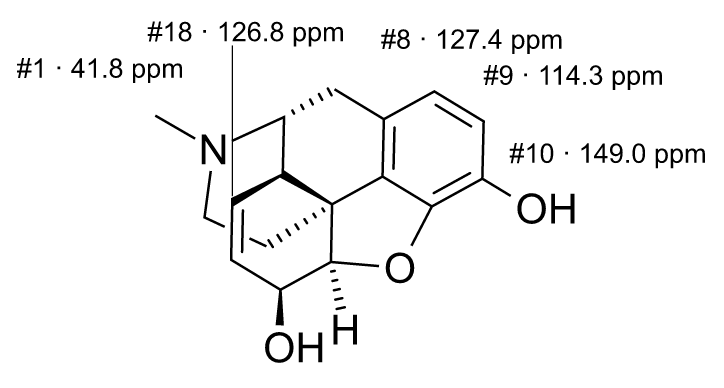
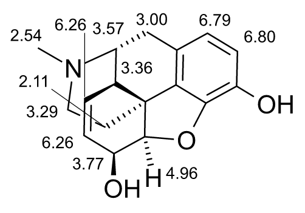
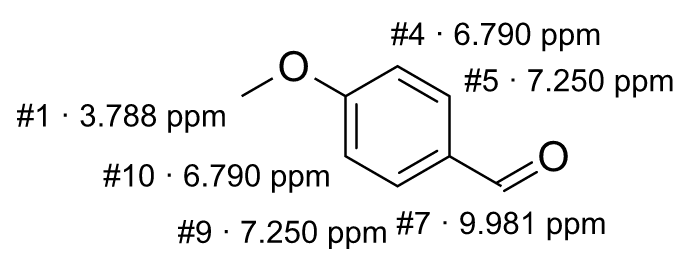
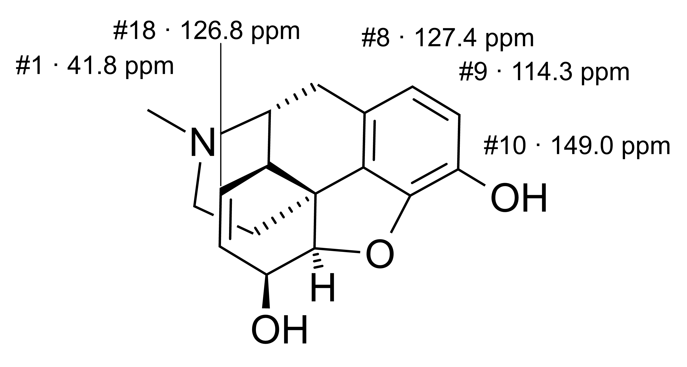

Fixes #1203 (PR 2 of 2: labels; #1231 added the prediction).

## Why it matters

#1231 made NMR prediction scriptable, but the last step of @ssiddhantsharma's design in #1203 still needed the app: putting the shifts on the atoms. Open structure-elucidation tools return SMILES, and a journal-styled structure with the assigned shifts was a manual step. This PR lets Python, `reshiki --cli` and `reshiki --mcp` write the labels, in the formats of **Show labels**, into files that keep them. It follows the design and the decisions the owner approved on 2026-11-18. Thanks to @ssiddhantsharma for the design.

## Approach

One core function, three thin surfaces, and the canvas sharing the label text:

- **Core** (`crates/io/src/nmr/labels.rs`):
  - `LabelFormat { Numbers, Ppm, Both }` and `label_text(format, atom, ppm)`: `#3`, `1.280 ppm`, `#3 · 1.280 ppm`.
  - `write_labels(doc, rows, format)` writes each row's label into the atom's number (`AtomDisplay.number`).
  - Every row is checked before anything changes. An ID that is not an atom (in any row), a ppm that is not finite, or a label over 32 characters is an error, and nothing is written.
  - Rows with no ppm are skipped. Listed atoms keep their number style (`number_style()` if they had none) and lose their offset. Other atoms are untouched.
- **Canvas** (`src/canvas/nmr.rs`): the **Show labels** overlay now builds its text with `label_text`. A test checks that the overlay text equals the atom numbers scripts write, for all three formats. The overlay is otherwise unchanged: on screen only, never exported.
- **Python**: `Drawing.with_labels(rows, *, format="numbers" | "ppm" | "both" = "both") -> Self`. `rows` is an `NmrPrediction`, or an iterable of `NmrShift`, `{"atom", "ppm"}` mappings or `(atom, ppm)` tuples. Errors are `ReShikiError` with code `invalid_arguments`.
- **MCP** (`crates/agent/src/ops/label_atoms.rs`): `label_atoms {document, rows: [{atom, ppm|null}], format, base_revision, idempotency_key}`. It is mutating, destructive (it replaces numbers), idempotent, closed-world, and one undo step.
  - `base_revision` is required and is the `revision` `predict_nmr` returned, so rows never land on atoms that an edit since then removed or renumbered (`stale`).
  - It reuses `apply`'s receipt replay and atomic commit: `apply`'s `prepare` (the two receipt lookups) and `commit` (the single effect, with revision, owner and key checked again under the store's lock) are now shared functions. `apply` behaves the same; its tests are unchanged.
  - Only atom numbers change, and `write_labels` checks them, so the labelled copy replaces the snapshot as written (`transaction::replace`) instead of being reconciled, which would also normalize unrelated geometry. A call that changes nothing commits `recorded: false`, which binds its idempotency key, as `apply` does.
  - An atom not in the drawing is `unknown_object`; another bad row is `invalid_arguments`; both change nothing.
  - Value: `{effect, document, revision, recorded, labeled}`.
- **CLI**: `reshiki --cli convert … --nucleus 1H|13C --labels numbers|ppm|both` runs `import`, `predict_nmr`, `label_atoms` (bound to the predicted revision) and `export`.
  - Only for outputs that keep atom numbers: svg, png, pdf, cdxml, cdx. `convert` cannot write `.rsk` (use Python's `rsk()` or MCP `file_save`).
  - Another output, `--labels` without `--nucleus`, `--nucleus` without `--labels`, or a bad value is a usage error (exit 2). `render` does not take them.

## Label formats and storage trade-offs

| `format` | Label on atom 3 |
| -------- | --------------- |
| `numbers` | `#3` |
| `ppm` | `1.280 ppm` |
| `both` | `#3 · 1.280 ppm` |

Labels are stored as atom numbers (static text), as the owner decided:

- No `.rsk` format change. The test keeps the input's version floor (30 for a plain drawing, 35 for one that already needs it), and reopening keeps the numbers.
- They render in SVG, PNG and PDF with the existing collision-aware placement, and go to ChemDraw as `AtomNumber`/`ShowAtomNumber`.
- They use the drawing's atom-number style, not the teal overlay, and have no leader lines. An atom inside a collapsed abbreviation shows its label only when expanded.
- They do not update after later edits: the user owns them, as with any atom number. Predict and label again to refresh.
- Labelling ¹H after ¹³C replaces only the atoms the ¹H rows list.
- If **Show labels** is on while a labelled drawing is open, both show.
- Data credit: documented (cite the prediction's `credit` with a published figure). No caption is added.

## Evidence

All images were made on macOS arm64 from this branch. Shifts are predicted from the bundled nmrshiftdb2-derived index; contains information from nmrshiftdb2.

### The issue's example, end to end (Python)

`m = reshiki.Molecule.from_smiles(MORPHINE).clean()`, `m.predict_nmr(nucleus)`, then `m.with_labels(shifts, format="both").save(..., style="JACS / ACS")` ([python-session.txt](python-session.txt) has the full session, every label text, the three formats, the row types, the `.rsk` round trip, CDXML and the errors). Rows without reference data are skipped: morphine ¹³C has data for 5 of 17 carbons, ¹H for 12 of 14 sites.

| Morphine ¹³C | Morphine ¹H |
| --- | --- |
|  |  |

The ¹H figure shows the limit of the shared atom-number placement with 12 long labels on a crowded polycycle: `#19 · 3.360 ppm` crosses ring bonds and `#18 · 6.260 ppm` touches the N-methyl bond. The `#N` prefix keeps every label attributable, and the labels can be dragged in the app; see Risk.

A molecule with full coverage, 4-anisaldehyde:

| 4-Anisaldehyde ¹³C | 4-Anisaldehyde ¹H |
| --- | --- |
|  |  |

SVGs and `.rsk` files: [morphine-13C.svg](morphine-13C.svg), [morphine-1H.svg](morphine-1H.svg), [anisaldehyde-13C.svg](anisaldehyde-13C.svg), [anisaldehyde-1H.svg](anisaldehyde-1H.svg), [anisaldehyde-13C.rsk](anisaldehyde-13C.rsk).

### `.rsk` round trip

```text
# .rsk round trip: the labels and the file version are kept
#   version written: 30, unlabelled: 30
#   labels equal after reopening: True
```

The io test also starts from a drawing whose floor is 35 and checks it stays 35.

### CDXML atom numbers (ChemDraw)

```text
<n id="3" ... AtomNumber="#1 · 55.300 ppm" ShowAtomNumber="yes">
<n id="5" ... AtomNumber="#3 · 159.600 ppm" ShowAtomNumber="yes">
<n id="9" ... AtomNumber="#7 · 190.850 ppm" ShowAtomNumber="yes">
```

Full file: [anisaldehyde-13C.cdxml](anisaldehyde-13C.cdxml).

### Command line

```text
$ reshiki --cli convert --smiles 'CN1CC[C@]23c4c5ccc(O)c4O[C@H]2[C@@H](O)C=C[C@H]3[C@H]1C5' --nucleus 13C --labels both -o cli-morphine-13C.png --force
reshiki: warning: PNG: 3577 × 1454 pixels at 1200 dpi
[exit 0]
```



[cli.txt](cli.txt) also has `--labels ppm` to SVG ([cli-morphine-1H.svg](cli-morphine-1H.svg)), `--labels numbers` to PDF ([cli-ibuprofen-13C.pdf](cli-ibuprofen-13C.pdf)), CDXML with `--receipt`, and the usage errors:

```text
$ reshiki --cli convert --smiles ... --to svg --labels both
reshiki: --labels needs --nucleus 1H or 13C            [exit 2]
$ reshiki --cli convert --smiles ... --to mol --nucleus 13C --labels both
reshiki: --labels needs an output that keeps atom numbers: svg, png, pdf, cdxml, cdx   [exit 2]
$ reshiki --cli render --smiles ... --to svg --nucleus 13C --labels both
reshiki: render does not take --nucleus                [exit 2]
$ reshiki --cli convert --smiles 'CCO.CC' --to svg --nucleus 1H --labels both
reshiki: error[failed]: NMR prediction needs exactly one molecule; this drawing has 2   [exit 1]
```

### MCP: `label_atoms` and undo

[mcp.txt](mcp.txt): the `tools/list` entry, then on ibuprofen `predict_nmr` (revision 0, 13 rows, 5 without data) → `label_atoms` with `base_revision: "0"` → `{effect: "applied", revision: "1", recorded: true, labeled: ["1","2","3","5","6","7","9","10"]}`; the same key replays that receipt; the same rows without the key are `stale` (`current_revision: "1"`); one `apply` undo removes every label; an unknown atom is `unknown_object`, a 34-character label and `format: "Both"` are `invalid_arguments`. The exported SVG: [mcp-ibuprofen-13C.svg](mcp-ibuprofen-13C.svg).

## Verification

VERIFICATION_TABLE

Run on macOS arm64 (Apple M4):

- `cargo fmt --all --check`; workspace `cargo clippy --all-targets --all-features -D warnings`; wasm32 clippy as in checks.yml.
- `cargo test -p reshiki-io` (714, including the new `nmr::` label tests), `-p reshiki-model` (1520), `-p reshiki-agent` (327 unit, 36 contract including the new `ops-label-atoms` corpus, 4 headless).
- `cargo test --no-default-features -p reshiki --lib --bins` (505 + 1823) and the renderer suite (`--bin reshiki -- --include-ignored --test-threads=1 --skip manual_`, filtered to nmr, canvas and label: 498). These ran before the last agent-only fixes; `cli::` (97) and the agent tests ran again on the head.
- The `it` CLI/MCP modules `cli::`, `mcp_stdio::`, `mcp_tools::`, `mcp_shutdown::`, `headless_parity::` (51).
- The Python wheel built as CI builds it (`maturin build --locked`), then `pytest crates/python/tests` with rdkit (169 passed, 3 skipped), ruff and ty; `python -m unittest discover -s tests` (288), ruff and ty for scripts.
- Goldens regenerated from the built binary and verified: `ops-catalog.json`, `cli-tools.json`, `cli-help.json`, `cli-help/convert.txt`, the Agent Skill folder, `docs/agent-reference.md`, and the four MCP transcripts (`label_atoms` success and stale in the modern and legacy `tools-*`).
- `module_index.py --check`, `copy_lint.py`, `assemble_changelog.py --check`, `check_docs_tree.mjs`, `bun run docs:check`, `bun run docs:build` (llms check: 217,225 bytes, 18 tools), `bun fmt --check`, and `check_runtime_dependencies.verify_agent_api` on the built binary (the packaged client's ordered tool list).
- Failing first: with the no-op guard removed, `a_call_that_writes_nothing_changes_nothing_and_binds_its_key` fails (`recorded: true`).

## Risk

- Overwrites the numbers of the listed atoms, including numbers a user typed. Only listed atoms change, and it is one undo step in MCP.
- Labels go stale after a chemistry edit (documented).
- Placement: labels use the existing atom-number placement, which was made for short numbers. Long `ppm`/`both` labels on a crowded polycycle can touch or cross a bond (morphine ¹H above). The `#N` prefix of `both` keeps them attributable, and users can drag them in the app. Improving that placement would change every atom number's layout, so it is left for a follow-up.
- Numbers on atoms inside a collapsed abbreviation make CDXML/CDX export ask for the abbreviation to be expanded, as for any atom number there (documented). SMILES and MOL inputs have no abbreviations.
- `apply.rs` now shares its `prepare` and `commit` steps; its behaviour and tests are unchanged.
- MCP catalog: 21,382 (was 20,250) characters, under the 21,500 cap that #1231 set; not raised. `agent-api.txt`: 217,225 bytes (was 212,078), under the 220 KiB cap; not raised.

## Review

- Codex (gpt-6.2-sol), adversarial, on the whole diff. Fixed:
  - A `label_atoms` call whose rows wrote nothing still reconciled and recorded a revision (it normalized an unsettled arrow). It now commits the snapshot unchanged: `recorded: false`, no normalization, and the idempotency key is bound as for any commit. Test written failing first.
  - MCP rows without `ppm` decoded as `null`; `ppm` is now required, as the schema says (contract case `row_ppm_omitted`).
  - The Python test read a drawing back from figures, which the package does not embed; the CLI guide claimed the same. Both corrected.
- Second pass. Fixed: the key of a no-op call was left unbound (see above); the Python SVG test now reads UTF-8 (Windows CI). Documented, not changed: numbers inside a collapsed abbreviation make CDXML/CDX export ask for expansion, as for any atom number there. Not changed: a negative atom in Python raises `OverflowError` from the binding, as argument type errors do across the package; under a concurrent edit `budget` can be reported before `stale`, which is `apply`'s existing order.
- Third pass. Skipping reconciliation for real writes (tried after the second pass) also skipped the reflows an atom-number change needs (reaction separators, caption positions). Real writes reconcile again, as the app's atom-number edits do; only no-ops skip it.
- Final pass on that change: no stale-write, atomicity, key-binding or reconciliation-parity defect. Fixed: the result contract said `warnings` is empty; like `apply`, a label refresh notice becomes a warning. Not changed: `budget` before `stale` under a concurrent edit (`apply`'s existing order).

## Changelog

`docs/changes/unreleased/feat-nmr-labels-scripting.md` (Changes, `issues: [1203]`, `credit: [@ssiddhantsharma]`). Every commit carries `Co-authored-by: Siddhant Sharma`.

## Docs updated

`docs/python.md` (Label the atoms), `docs/agent-cli.md` (NMR labels), `docs/agent-api.md` (18 tools, `label_atoms`), `docs/nmr-prediction.md` (Labels from scripts), the website NMR guide, `docs/atom-labels.md`, `docs/architecture.md`, `crates/python/README.md`, the Agent Skill (a labelled-convert recipe), the generated agent reference and module index.

## Contribution license

- [x] I have read [CONTRIBUTING.md](https://github.com/Ameyanagi/ReShiki/blob/main/CONTRIBUTING.md). I have the right to submit this contribution and agree to offer my original contributions under both MIT and Apache-2.0, so recipients may choose either license (`MIT OR Apache-2.0`).
- [x] Any third-party material is identified below with its source and license, and its required notices are preserved; otherwise, no third-party material is added.

Third-party sources, if any: none new. The evidence images and test values show shifts predicted from the bundled nmrshiftdb2-derived index (`licenses/nmrshiftdb2/DATABASE-LICENSE.txt`). Contains information from nmrshiftdb2 (https://nmrshiftdb.nmr.uni-koeln.de), available under the nmrshiftdb2 Database License.
