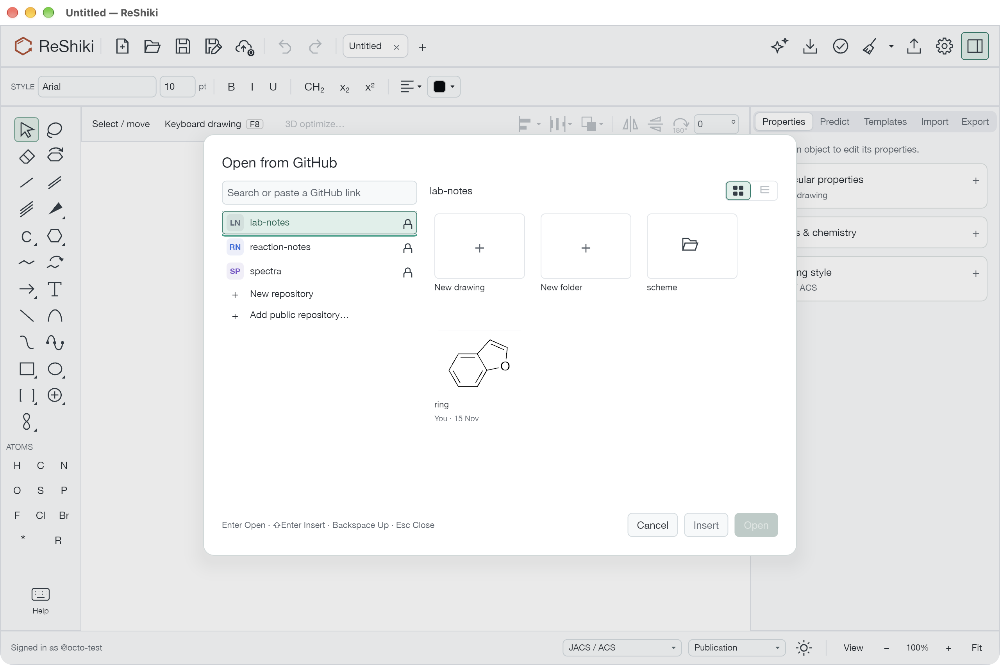
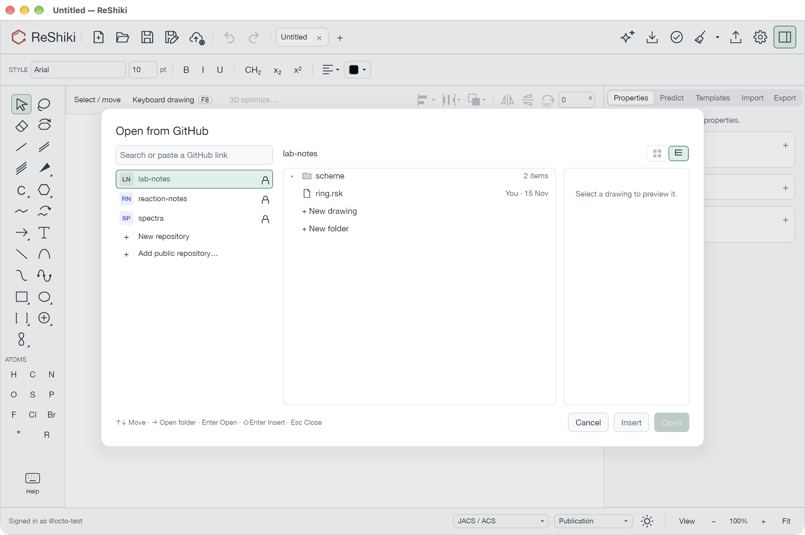

## Summary

**Open from GitHub…** opens in **Tree** the first time instead of **Tiles**. It still opens in the view used last, in every repository. Send and Save a copy still choose a folder as tiles.

No issue is filed for this; it is an owner decision of 2026-11-17 ("tree structure should be the default").

## Why it matters

The tree lists the whole repository, searches all of it and previews the selected file beside it, so it is the view that finds a drawing with the fewest steps. Until now a new user saw Tiles and had to find the small switch at the end of the folder path to get it.

## Approach

- The kept preference now records the view that is not the default. `Prefs.tree: bool` became `Prefs.tiles: bool`, with the same `#[serde(default, skip_serializing_if = …)]`, so a fresh `prefs.json` (no key) means Tree, and only a choice of Tiles is written, as `"tiles": true`.
- In Open mode the picker is a tree unless `prefs.tiles`; choosing a view sets `tiles = !tree`. Send and Save a copy (`Mode::SendTo`) are unchanged: tiles, and they never change the kept view.
- No migration. The `tree` key only ever shipped in a nightly. An old `prefs.json` holding `"tree": true` is read without error, the key is ignored, and the picker opens in Tree, which is what that user chose anyway. A nightly user who went back to Tiles had no key written, and now gets Tree once.
- Tests: `the_picker_opens_in_the_view_used_last` now asserts Tree on the first open, that choosing Tiles is kept and written as `"tiles":true`, that going back to Tree writes nothing, that Send leaves the kept view alone, and that an old `{"tree":true}` reads as Tree. The older picker tests were written against Tiles (listing replies, tile selection, date sorting); they now set `prefs.tiles = true` first, so they test what they tested before instead of passing by accident in the tree.
- Docs: `docs/github.md` (Tiles or Tree) and a release-note fragment.

## Evidence

Real app on macOS arm64 (debug builds), one build at a time. Each launch used a fresh `RESHIKI_DATA_DIR` and the local mock of GitHub (`RESHIKI_GITHUB_CLIENT_ID=mock`, user `octo-test`); nothing reached github.com. Steps, the same on both builds: launch, GitHub → **Sign in…**, GitHub → **Open from GitHub…** (the first time the picker opens in that data folder), one click on **lab-notes**. Neither view button was clicked. Window 1280 × 852 pt, light appearance. Driven by Codex computer use; the captures are of the ReShiki window only.

| Before: main `ff074126` | After: branch `947d3b76` |
| --- | --- |
|  |  |
| First open, lab-notes chosen: **Tiles**. The tiles button of the switch is the active one; the pane shows New drawing, New folder, the folder scheme and a picture of ring. | Same steps: **Tree**. The tree button is the active one; the pane lists scheme (2 items), ring.rsk (You · 15 Nov), + New drawing and + New folder, with the preview pane beside it ("Select a drawing to preview it."). |

`prefs.json` in the data folder after each run holds no view key on either build (`colors`, `last`, `shared` only): the view shown is the default, not a kept choice.

The test, on the branch:

```
test app::github::tests::files::the_picker_opens_in_the_view_used_last ... ok
```

## Verification

<!-- VERIFICATION_TABLE -->

Commands, on the branch head:

- `cargo fmt --all --check`
- `cargo clippy --workspace --all-targets --all-features --locked -- -D warnings`
- `cargo clippy -p reshiki-web -p reshiki -p reshiki-web-worker --lib --bin reshiki --target wasm32-unknown-unknown --locked -- -D warnings`
- `cargo test --locked --no-default-features -p reshiki --lib --bins -- github`: 79 + 135 passed
- `cargo test --locked --no-default-features -p reshiki --bin reshiki -- --include-ignored --test-threads=1 --skip manual_ github`: 137 passed (the renderer tests included)
- `python3 scripts/module_index.py --check`

Linux and Windows run in this PR's CI.

## Risk

Low. Two lines of behaviour and a renamed field.

- A user of the nightly who chose Tiles gets Tree once and has to choose Tiles again. Accepted: the field only shipped in a nightly.
- The tree reads the repository whole with one recursive request when it opens; a repository too big for GitHub to list whole shows **Only part of this repository is listed** in the tree, and Tiles still list each folder in full. That is the tree as it shipped; it is now what a new user meets first.

## Release-note material

One-sentence user-facing caption: **Open from GitHub…** opens in **Tree** the first time instead of **Tiles**; it still opens in the view you used last.

Fragment: `docs/changes/unreleased/feat-picker-tree-default.md`.

Reusable image paths or permanent attachment links: the two captures above.

## Contribution license

- [x] I have read [CONTRIBUTING.md](https://github.com/Ameyanagi/ReShiki/blob/main/CONTRIBUTING.md). I have the right to submit this contribution and agree to offer my original contributions under both MIT and Apache-2.0, so recipients may choose either license (`MIT OR Apache-2.0`).
- [x] Any third-party material is identified below with its source and license, and its required notices are preserved; otherwise, no third-party material is added.

Third-party sources, if any: none.
