## Summary

Adds a **Settings** page and lets you choose what copied pictures and exported files look like.

- **Settings** opens with **Cmd+,** (**Ctrl+,** on Windows and Linux), the new gear button at the right of the toolbar, or **Settings** in the command palette. It has six sections: Appearance, Drawing, Copy & export, Names & checks, Assistant and Updates. **Search settings** finds a setting by name. Changes save at once. Esc, Cmd+, or Done close the page, and keys go back to the drawing.
- **Picture background**: copied pictures and exported files can be **Transparent**, **Canvas**, **White**, **Black** or **Custom**, with a separate default for each. The defaults keep today's behavior: copies are transparent and exports keep the canvas. On white, black or a color, black and white ink swap so a dark drawing stays readable. Other colors stay as they are. You can save your own colors for Custom.
- **PNG resolution**: copied pictures and exported files each use 150, 300, 600 or 1200 dpi. Copies now default to **300 dpi**. Exported files stay at 1200 dpi. The size in centimeters is the same at every setting. Settings shows close-ups of the drawing at each resolution.
- **Export tab**: gains a **Background** choice and, for PNG, a **Resolution** menu that shows the size in centimeters and pixels.
- **Right-click > Copy image on ›** copies one picture on a chosen background and leaves the default unchanged.
- **Include editable drawing** now also applies to Copy, Copy image and Copy as. With it off, copied pictures carry no drawing. Pasting between ReShiki windows still gives the drawing.
- A PNG's editable drawing (the `iTXt` chunk) now goes after the image data, just before `IEND`.

## Why it matters

- On main, **Cmd+, does nothing** and there is no Settings command. App-wide preferences are spread over the status bar's View menu, the Export tab and other panels (improvement plan U11).
- Copied pictures were always transparent at 1200 dpi. A transparent picture on a dark slide hides black ink, and a 1200 dpi copy of a small drawing is about 16 times the pixels of a 300 dpi copy. For aspirin, the copied PNG is 76,696 bytes at 1200 dpi and 14,128 bytes at 300 dpi. macOS also builds a TIFF from the PNG: 5.8 MB at 1200 dpi and 369 KB at 300 dpi.
- Users who turn off **Include editable drawing** for files did not expect their copies to keep carrying the drawing.
- Readers that stop at the image data no longer have to skip the drawing first.

## Approach

- **One place for preferences, no second save path.** Each Settings row sends the same message as the control it mirrors (View, naming, assistant, updates), so saving and error reporting stay as they are. Only two rows had no control and got new actions: Canvas for new drawings and Drawing Style units. New preferences live in `appearance.json`. An older file loads with the old behavior. A file with an unknown value is kept as `appearance.json.bad` before it is replaced.
- **Validated once.** `Dpi` accepts only 150, 300, 600 and 1200 when the file loads. The rest of the code takes the type.
- **Backgrounds in the exporter.** `reshiki::export::Background` reaches PNG, SVG, PDF, page PDF and EMF, including the Windows Office preview and the preview rebuilt after editing in Word.
- **Copy resolution.** Copy, Copy image, Copy as and the Windows OLE preview use the copy dpi. File export uses the export dpi. Oversized drawings still step down, but only through lower presets. `pHYs` records the dpi used. CLI, agent export and other callers keep 1200 dpi, so their output does not change.
- **Close-ups** come from the real exporter, off the UI thread, once per drawing revision and label update. They are shown with nearest-neighbor scaling, so low dpi looks blocky, as it will in the copy.

Rejected:
- Recoloring the whole drawing for a color background. It changed palette and element colors (Publication Blue on Black became a lighter blue). Now only black and white ink swap.
- Five labeled tiles in the Export tab. Transparent and Canvas overlapped at the inspector's width. The tab shows swatches, each named on hover and to assistive technology.
- Removing all drawing data from the clipboard when the switch is off. ReShiki-to-ReShiki paste would lose the drawing. Only the pictures leave it out. ReShiki's own clipboard data keeps it.
- Storing the background in the embedded Office object. The rebuilt Word preview uses the current Copy background preference instead, because the object stores only the drawing.

## Evidence

Builds: main `1d94f392` (before) and this branch at `82f35693` (after), macOS arm64 debug builds, each wrapped as ReShiki.app and run with an empty `RESHIKI_DATA_DIR`. Input: `aspirin.mol`. Window 1280 × 852 pt, captured at 2x (2560 × 1704 px), canvas zoom 245%, light canvas, interface Match canvas. Before images (`before/`) and the clipboard runs (`after/`, `clipboard/`) were captured in one session with `screencapture -l <window id>`. The `real-app/` images come from an earlier session at the same commit and window size, through the computer-use screenshot tool. Its full step-by-step report is [real-app/report.md](real-app/report.md).

### Settings page

| Before (main) | After (branch) |
| --- | --- |
| 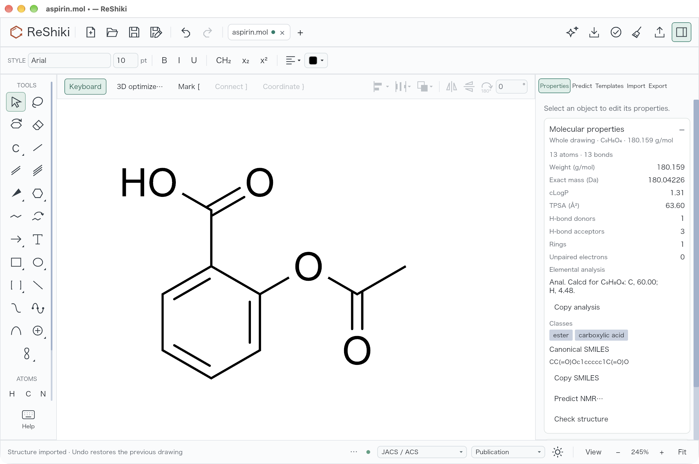<br>Cmd+, pressed: nothing opens. No gear button in the toolbar. | 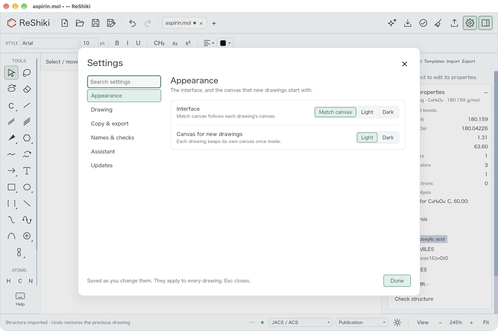<br>Cmd+, opens Settings on Appearance, with focus in Search settings. Gear button at the right of the toolbar. |
| 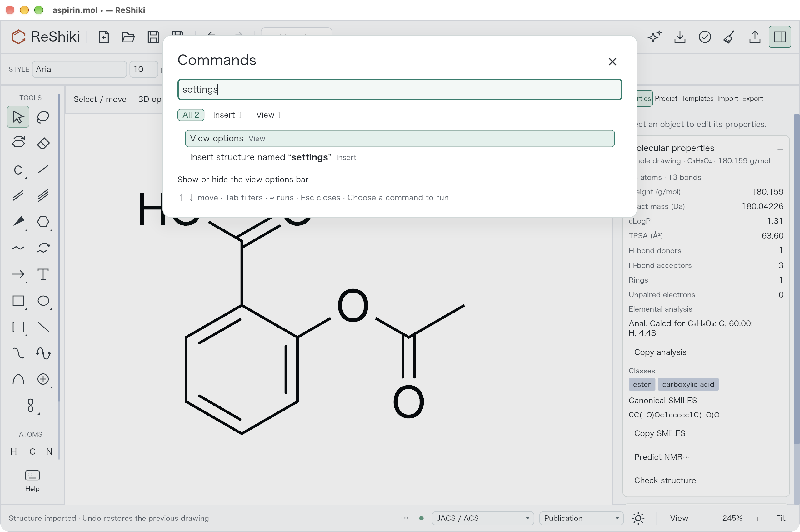<br>Command palette, "settings": only View options and Insert structure. | 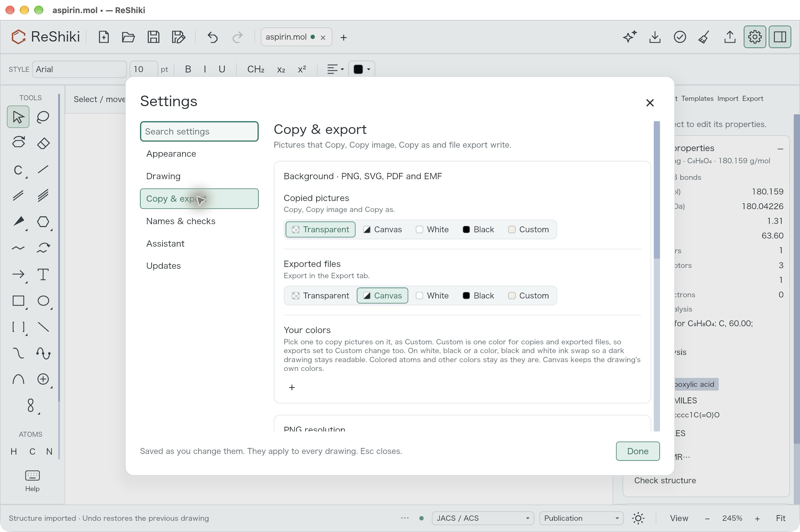<br>Copy & export: background for copied pictures and exported files, and saved colors. |
| | 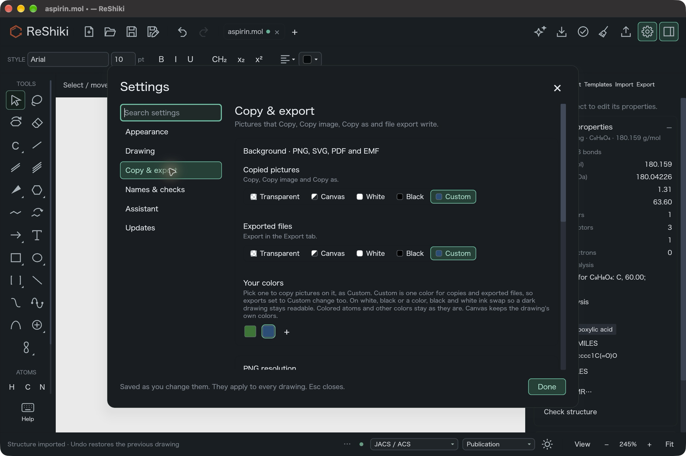<br>Same section with the interface set to Dark. |

### Copied PNG on each background

Each PNG was read straight from the clipboard (`«class PNGf»`) after Select all and Cmd+C, one launch per Copy background, and laid on a checkerboard so transparency shows. On main, every copy is transparent like the first tile, at 1200 dpi.

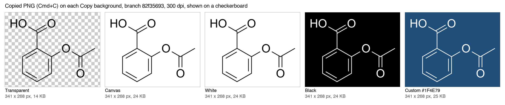

Canvas and White are byte-identical here because the canvas is light. On Black and Custom #1F4E79, the ink is white. Files: `clipboard/b-*.png`.

### PNG resolution

| Before (main) | After (branch) |
| --- | --- |
| 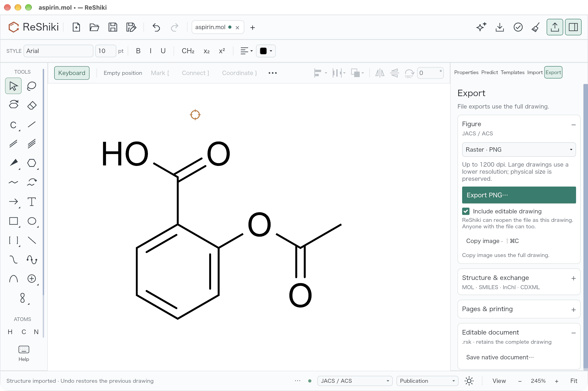<br>Export tab, PNG: "Up to 1200 dpi". No choice. | 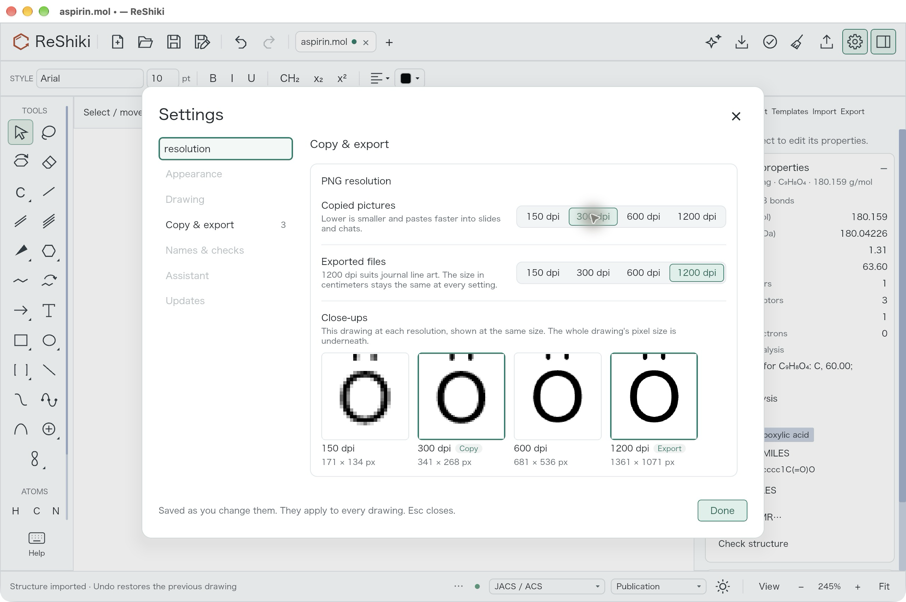<br>Settings, search "resolution": Copied pictures 300 dpi, Exported files 1200 dpi, close-ups at each dpi with the whole drawing's pixel size. |
| | 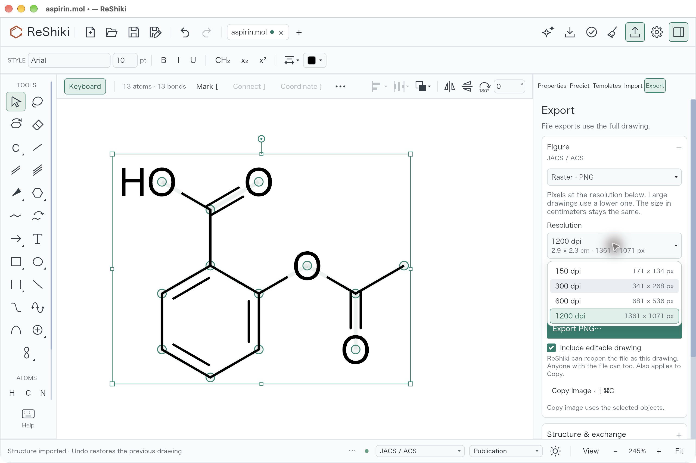<br>Export tab, PNG: Resolution menu, 1200 dpi = 2.9 × 2.3 cm, 1361 × 1071 px. |

Copied PNG size, same drawing:

| Copy | Pixels | PNG bytes | `pHYs` | TIFF macOS builds from it |
| --- | --- | --- | --- | --- |
| main (always 1200 dpi) | 1361 × 1071 | 76,696 | 1200 dpi | 5,834,290 |
| branch, 300 dpi (default) | 341 × 268 | 14,128 | 300 dpi | 368,982 |
| branch, 1200 dpi | 1361 × 1071 | 76,696 | 1200 dpi | 5,834,290 |

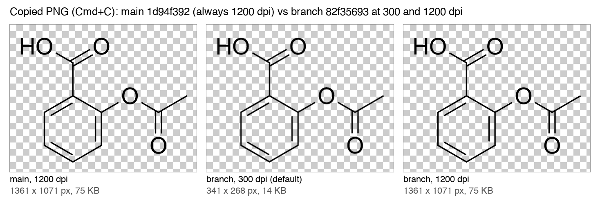

At 1200 dpi the branch writes the same chunks as main, only in a different order (next section). Type lists: `clipboard/*.types.txt`.

### Export tab

| Before (main) | After (branch) |
| --- | --- |
| 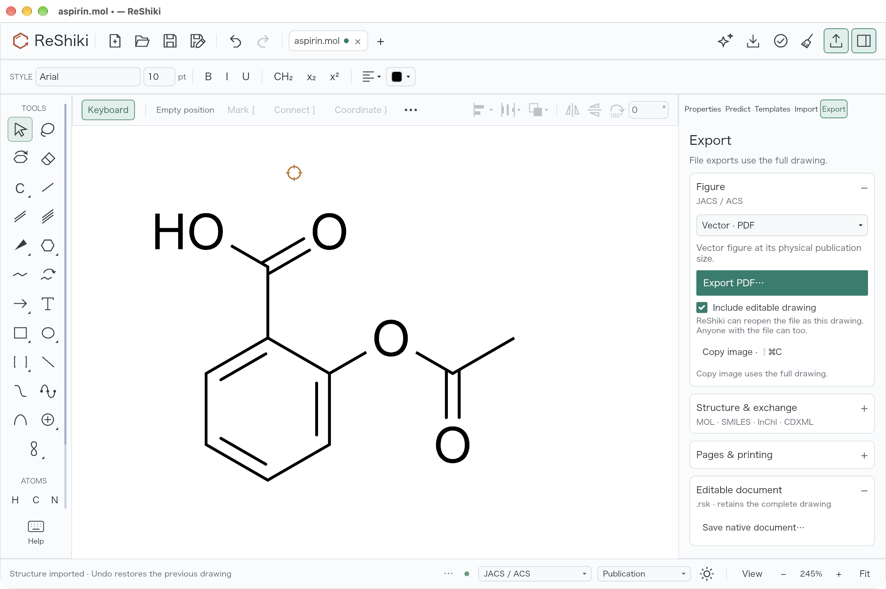<br>PDF: no background choice. | 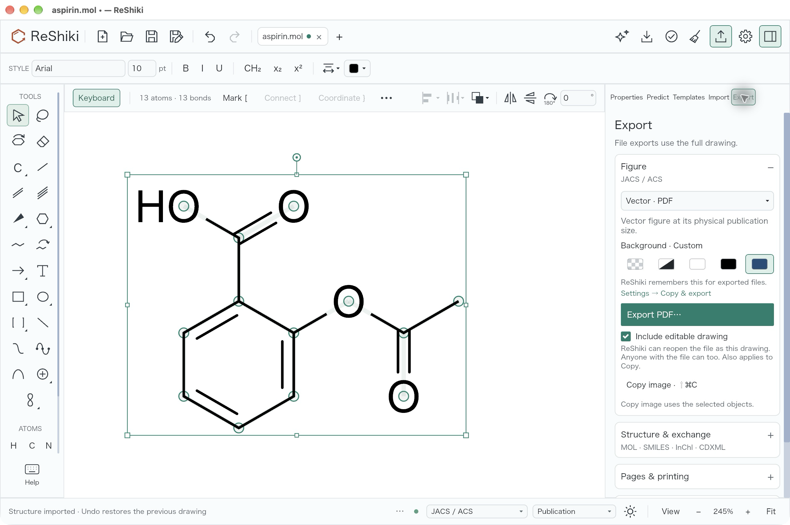<br>PDF: Background · Custom, five swatches, Settings → Copy & export link. "Include editable drawing" now says it also applies to Copy. |
| <br>PNG: fixed 1200 dpi. | 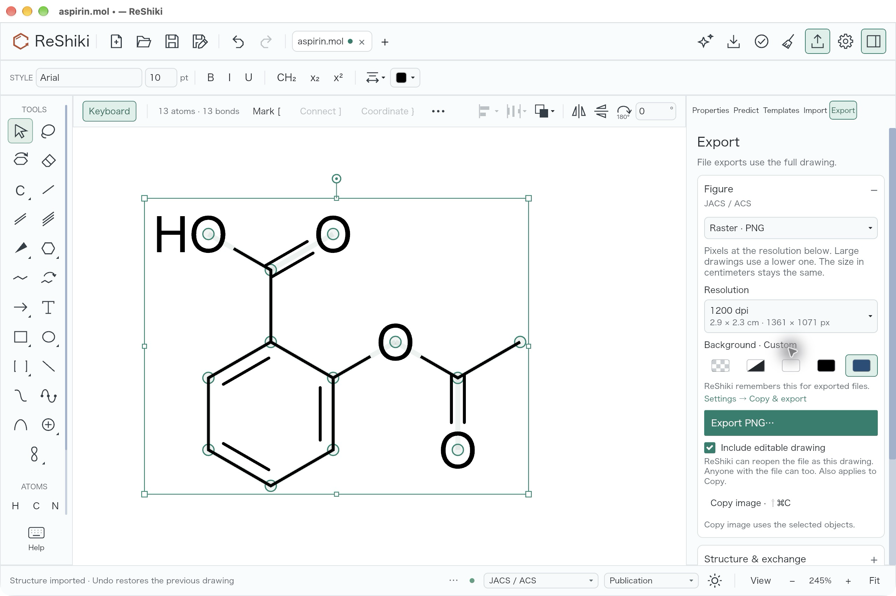<br>PNG: Resolution menu above Background. |

### Copy image on (right-click)

| Before (main) | After (branch) |
| --- | --- |
| 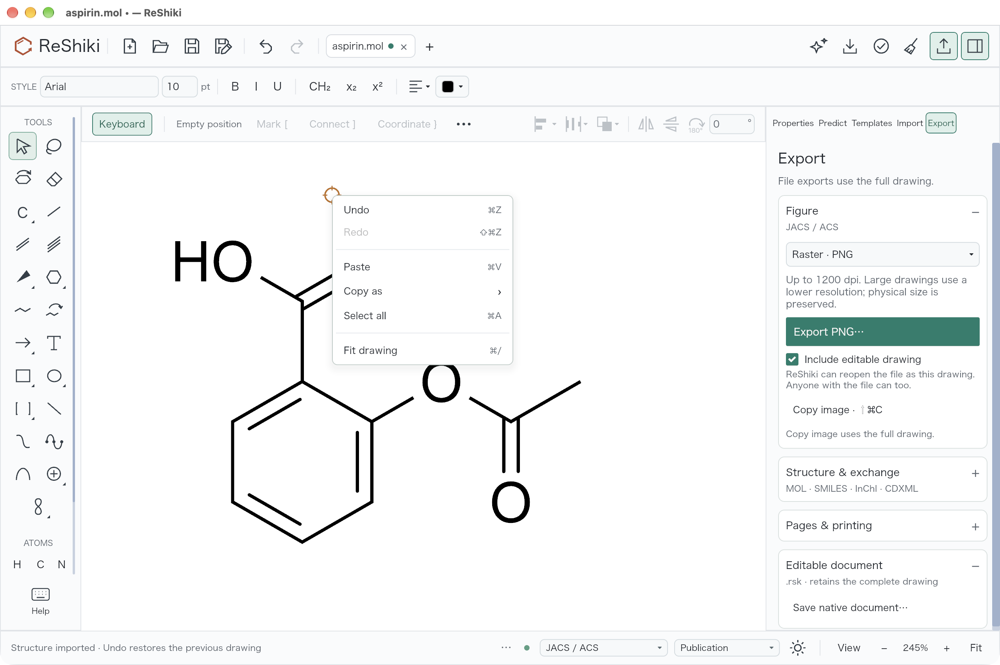<br>Empty-canvas menu: Paste, Copy as, Select all. | 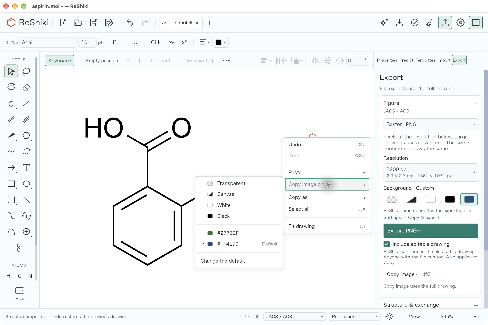<br>New Copy image on ›: Transparent, Canvas, White, Black, saved colors, the default ticked, Change the default…. |

### PNG chunk order

Listed with [clipboard/png_chunks.py](clipboard/png_chunks.py) (full output: [clipboard/chunks.txt](clipboard/chunks.txt)).

```text
before: main 1d94f392, Cmd+C                after: branch 82f35693, Cmd+C (300 dpi)
base-copy.png: 76696 bytes, 1361 x 1071 px  b-transparent.png: 14128 bytes, 341 x 268 px
   0 IHDR 13                                   0 IHDR 13
   1 iTXt 768  keyword dev.reshiki.drawing     1 pHYs 9  11811 px/m = 300 dpi
   2 pHYs 9  47244 px/m = 1200 dpi             2 IDAT 13270
   3 IDAT 75838                                3 iTXt 768  keyword dev.reshiki.drawing
   4 IEND 0                                    4 IEND 0
```

Main's reader walks chunks until `IEND`, so main also opens the new order. `payload::tests::png_payload_right_after_ihdr_from_older_versions_still_reads` covers older files on the branch.

### Editable drawing off: no iTXt

| Settings | Copied PNG |
| --- | --- |
| 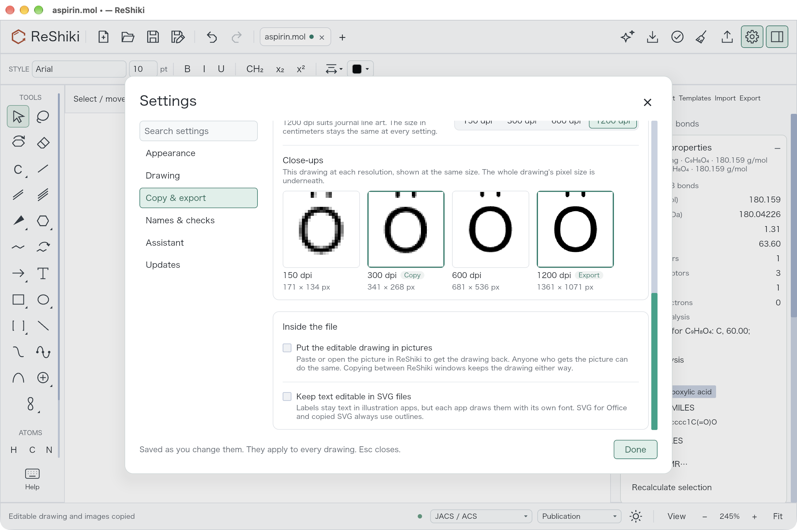<br>"Put the editable drawing in pictures" off. The status line still shows the last Cmd+C. | <pre>b-noedit.png: 13348 bytes, 341 x 268 px<br>   0 IHDR 13<br>   1 pHYs 9  11811 px/m = 300 dpi<br>   2 IDAT 13270<br>   3 IEND 0</pre>Removing the 780-byte `iTXt` chunk from `b-transparent.png` gives this file byte for byte. ReShiki's own clipboard types (CDIF, CHMS, 1,855 bytes each) stay. |

The earlier real-app run also pasted an editable-off copy into TextEdit and Preview, where it arrived as a picture, and back into ReShiki, where it pasted as the drawing ([real-app/report.md](real-app/report.md), step 10).

## Verification

macOS arm64 at `82f35693`:

- `cargo fmt --all --check`: pass.
- `cargo clippy --workspace --lib --bins --all-features --locked -- -D warnings`: pass.
- `cargo test --workspace --locked --no-default-features --no-fail-fast`: 144 test binaries, 5,507 passed, 0 failed, 226 ignored.
- `cargo test --locked -p reshiki --tests --no-fail-fast`: 105 test binaries, 2,601 passed, 0 failed, 205 ignored.
- Both runs had `RESHIKI_INCHI_HELPER` and `RESHIKI_NAMING_HELPER` set to the built `reshiki`, `RESHIKI_REQUIRE_INCHI_HELPER=1` and an empty `RESHIKI_DATA_DIR`.
- Ignored renderer tests, `cargo test --locked --bin reshiki <name> -- --ignored`: `review_close::settings` (focus returns to the drawing after Esc, Cmd+, and Done; a floating NMR panel stays covered), `settings_rows_show_failures_wait_for_naming_and_reach_the_picker`, `changed_surfaces_expose_live_controls_and_mask_foreground_backgrounds` and the two ignored `settings_page::` tests: 6 passed, 0 failed.
- Lane checks before the PNG resolution commits: `cargo check --target wasm32-unknown-unknown -p reshiki-web` and `cargo check --target x86_64-pc-windows-msvc -p reshiki-io --tests`: pass. The Windows root crate cannot be cross-checked from macOS (aws-lc-sys), so the `--ole-server` change in `src/main.rs` is checked on Windows x64.
- Real app (macOS arm64 debug): the runs above.

VERIFICATION_TABLE

## Risk

- **Copies are now 300 dpi by default.** A copy enlarged a lot in a slide looks softer than before. Settings > Copy & export > Copied pictures > 1200 dpi restores the old output. Files, CLI and agent export stay at 1200 dpi.
- **Include editable drawing now affects Copy.** Users who turned it off for files now also get copies without the drawing. Pasting into ReShiki keeps working through ReShiki's own clipboard data.
- **Color backgrounds swap black and white ink.** Palette, element and custom colors stay exact. A drawing with dark custom colors on Black can still be hard to read.
- **Windows Office previews** (first copy and rebuild after editing in Word) follow the Copy background. They are covered by a Windows-only test and need a run on Windows x64. The LibreOffice extension's preview stays transparent.
- **`appearance.json`** gains keys. An older ReShiki ignores them. A bad value (for example `copy_dpi: 2400`) sets the file aside as `.bad`, which resets the other appearance preferences too, as an unknown value already did.

## Changelog

`docs/changes/unreleased/feat-settings-page.md` (section Changes): the Settings page, picture backgrounds with **Copy image on**, PNG resolution for copies (300 dpi) and files (1200 dpi), **Include editable drawing** applying to copies, and the PNG chunk order.

## Contribution license

- [x] I have read [CONTRIBUTING.md](https://github.com/Ameyanagi/ReShiki/blob/main/CONTRIBUTING.md). I have the right to submit this contribution and agree to offer my original contributions under both MIT and Apache-2.0, so recipients may choose either license (`MIT OR Apache-2.0`).
- [x] Any third-party material is identified below with its source and license, and its required notices are preserved; otherwise, no third-party material is added.

Third-party sources, if any: none.
