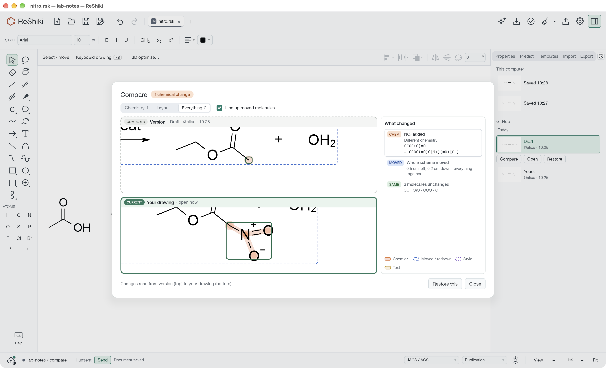
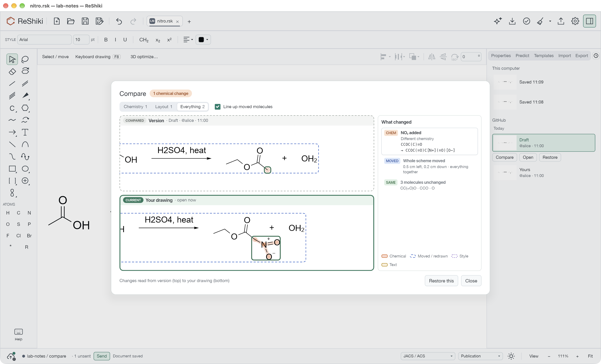
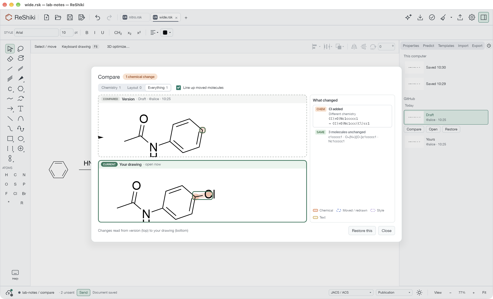
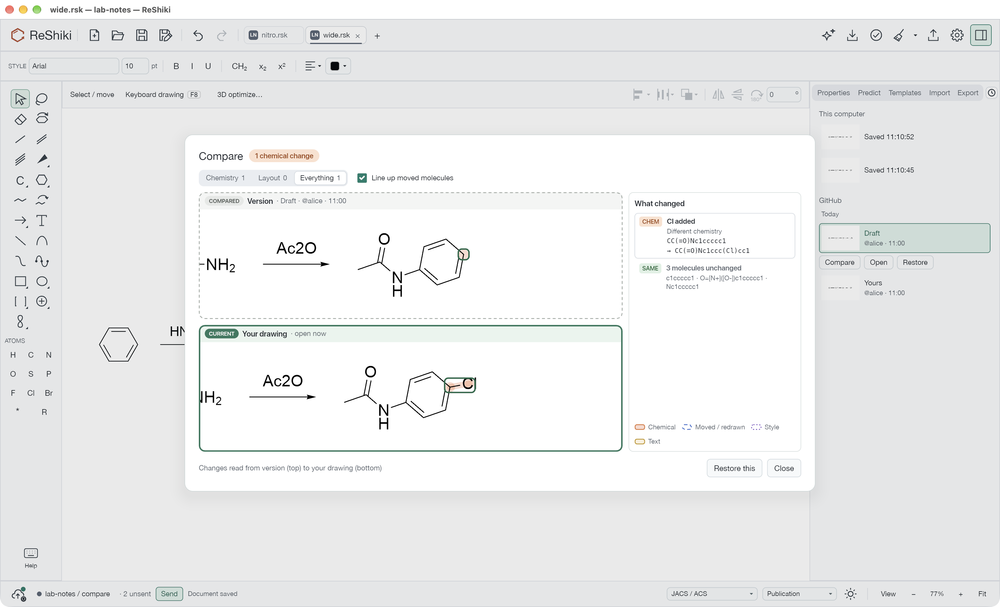
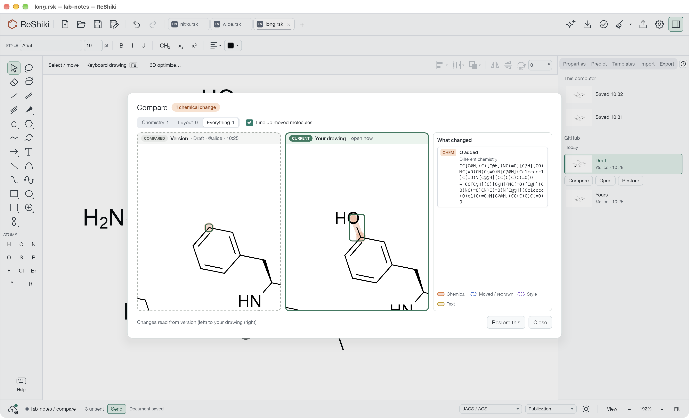
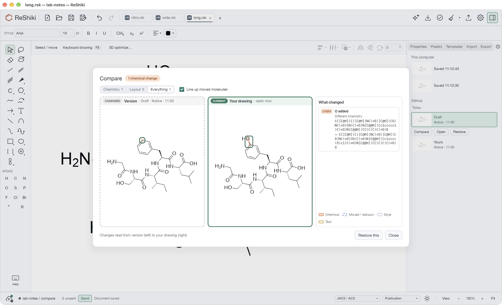

## Why

Follow-up to #1235. Clicking a change in **What changed** zoomed both panes to the changed atoms alone, so the zoom went as far as the preview allows: labels beside the change were cut at the pane edge ("H2SO4, heat" read "I2SO4, heat"), the compared pane cut off an O, and the painted NO₂ filled the pane.

## Approach

- The zoom box is the change's objects (for a chemical change, its whole molecule) together with its painted atoms, padded by half a bond length so labels at its edge are not cut; the selection outline still marks just the changed atoms and bonds.
- Both panes keep one size, so one scale, each centred on the change on its side.
- The box is at least half the whole drawing in each direction, so a selected change is shown at most about twice as large as the full view.
- Each spot now carries both boxes (`Spot { outline, context }`).

## Evidence

Real window captures from macOS arm64: a debug build of `main` (before, with #1235) and of this branch (after), against the local mock GitHub with a fresh data folder per run. History compares alice's **Draft** with the drawing now; the CHEM line is clicked.

| Before (`main`) | After |
|---|---|
|  |  |
|  |  |
|  |  |

Before: the panes zoom onto the NO₂ alone; "H2SO4, heat" and the ester's O are cut at the pane edge. After: the whole ester with its NO₂, the whole acetanilide with its Cl, and the whole peptide with the new OH, both panes at one scale; the outline still marks only the changed atoms.

Dark: [before nitro](https://github.com/Ameyanagi/ReShiki-evidence/blob/428774df2b44eba727252db83d4299bd2581cbd2/pr-reviews/fix-compare-zoom/before/history-nitro-selected-dark.png) · [after nitro](https://github.com/Ameyanagi/ReShiki-evidence/blob/428774df2b44eba727252db83d4299bd2581cbd2/pr-reviews/fix-compare-zoom/after/history-nitro-selected-dark.png) · [before wide](https://github.com/Ameyanagi/ReShiki-evidence/blob/428774df2b44eba727252db83d4299bd2581cbd2/pr-reviews/fix-compare-zoom/before/history-wide-selected-dark.png) · [after wide](https://github.com/Ameyanagi/ReShiki-evidence/blob/428774df2b44eba727252db83d4299bd2581cbd2/pr-reviews/fix-compare-zoom/after/history-wide-selected-dark.png) · [before long](https://github.com/Ameyanagi/ReShiki-evidence/blob/428774df2b44eba727252db83d4299bd2581cbd2/pr-reviews/fix-compare-zoom/before/history-long-selected-dark.png) · [after long](https://github.com/Ameyanagi/ReShiki-evidence/blob/428774df2b44eba727252db83d4299bd2581cbd2/pr-reviews/fix-compare-zoom/after/history-long-selected-dark.png). Unselected views: [after nitro](https://github.com/Ameyanagi/ReShiki-evidence/blob/428774df2b44eba727252db83d4299bd2581cbd2/pr-reviews/fix-compare-zoom/after/history-nitro.png) · [after wide](https://github.com/Ameyanagi/ReShiki-evidence/blob/428774df2b44eba727252db83d4299bd2581cbd2/pr-reviews/fix-compare-zoom/after/history-wide.png) · [after long](https://github.com/Ameyanagi/ReShiki-evidence/blob/428774df2b44eba727252db83d4299bd2581cbd2/pr-reviews/fix-compare-zoom/after/history-long.png). Contact sheet: [contact-sheet.png](https://github.com/Ameyanagi/ReShiki-evidence/blob/428774df2b44eba727252db83d4299bd2581cbd2/pr-reviews/fix-compare-zoom/contact-sheet.png).

**Wide scheme text in #1235's evidence.** The reagent labels over the arrows in #1235's wide-scheme captures overlapped the arrows and rings because the generated fixture placed each label's top-left corner at the middle of its arrow. That was the fixture, not the preview: redrawn with each label centred above an arrow long enough for it (above), the preview draws it cleanly at every zoom.

## Verification

| Platform | Result |
|---|---|
| macOS arm64 (Apple M4) | pass · fmt, workspace clippy --all-targets --all-features -D warnings, wasm32 clippy, model tests (115), reshiki --lib --bins (1987 + 512), renderer tests --include-ignored (1829), Python unittest, module_index, copy_lint, changelog, docs checks; after the padding change fmt, clippy and the compare tests again · GUI evidence via the mock GitHub |
| PR CI | see checks |

## Review

An adversarial pass (gpt-6.2-sol, read-only) found one low-severity case, not changed: a hydrogen bond added between molecules has no objects on the side without it, so that pane centres on the bond's ends with the other pane's width, and a label far to the side could still be cut.

## Risk

- A very large changed molecule now zooms little or not at all, since its whole molecule is the context.

## Changelog

`docs/changes/unreleased/fix-compare-zoom.md`

## Contribution license

- [x] I have read [CONTRIBUTING.md](https://github.com/Ameyanagi/ReShiki/blob/main/CONTRIBUTING.md). I have the right to submit this contribution and agree to offer my original contributions under both MIT and Apache-2.0, so recipients may choose either license (`MIT OR Apache-2.0`).
- [x] Any third-party material is identified below with its source and license, and its required notices are preserved; otherwise, no third-party material is added.
