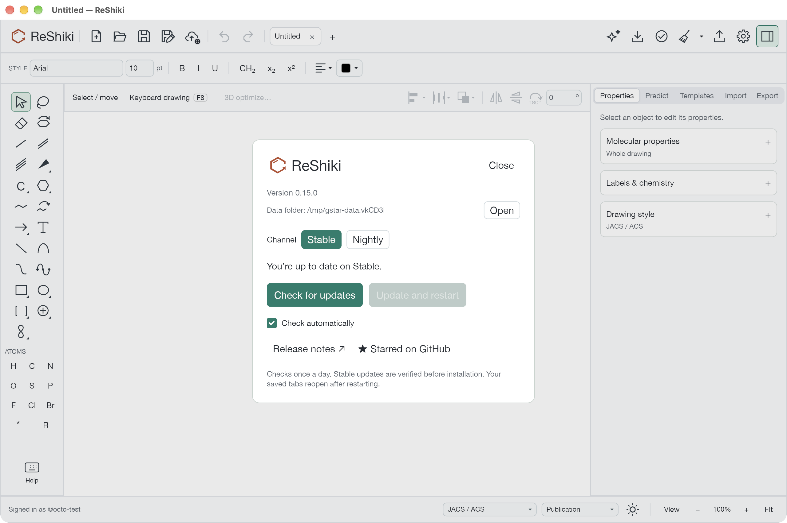
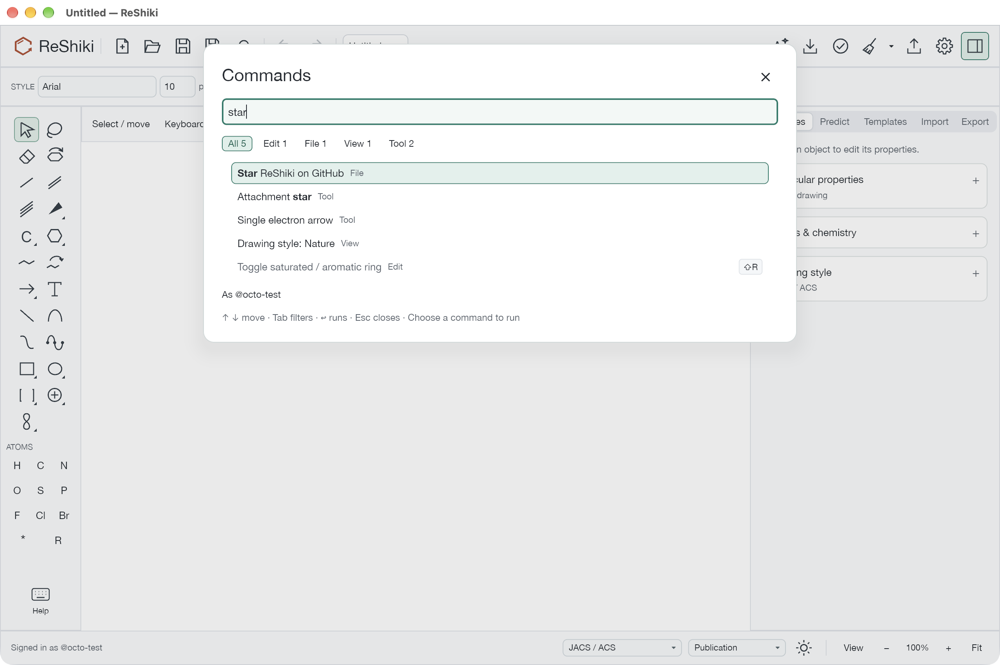
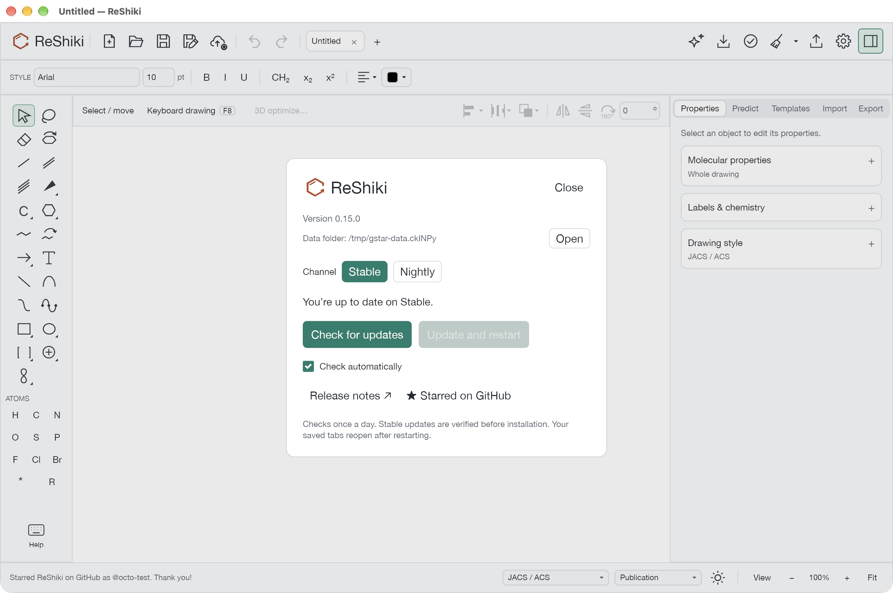

## Why it matters

The owner reported on the Windows nightly `0.15.0-nightly.20261116.43935165397.1`:
signed in to GitHub, **About › ★ Star on GitHub** (no ↗, so the one-click
path) opened the browser instead of starring. They had already starred
ReShiki, yet About did not say **Starred**.

## Root cause

- **About never asked GitHub.** The link showed **★ Starred on GitHub** only
  after a star made in the same run. A star from the website, another computer
  or an earlier run was never looked up. Confirmed in the code.
- **Any failed star was silent.** Whatever GitHub answered, the app dropped the
  reason and opened the browser. Confirmed in the code; this is why the report
  could not say what went wrong.
- **The star request stated no length.** `PUT /user/starred/{owner}/{repo}`
  went out with no `Content-Length`. GitHub's REST documentation for this
  endpoint says the length must be set to zero. Confirmed that the app sent
  none: the new mock check fails without the fix (`Rejected("GitHub refused
  the request.")`). **Not confirmed live** that this is what GitHub refused:
  without an account, `PUT /user/starred/octocat/hello-world` with an invalid
  token answers 401 with and without `Content-Length: 0` (HTTP/1.1 and
  HTTP/2), and the anonymous `POST /markdown` reaches the API either way, so
  GitHub's edge does not turn a lengthless write away today. If the star still
  fails after this change, the status now names the reason (for example **No
  access on GitHub**, which would point at the sign-in's permissions).

## Approach

- `client.send`: a PUT, POST or PATCH without a body sends
  `Content-Length: 0`. The star is the only such request today. Four lines, to
  stay clear of the HTTP client work in progress elsewhere.
- The mock answers 411 to a write that states no length.
- **About** asks GitHub once per sign-in whether ReShiki is starred (again on
  the next open only if GitHub could not tell). When it is, the link reads
  **★ Starred on GitHub** and opens the project page. The accessible name is
  the label.
- A failed one-click star sets the status, for example "Couldn't star through
  GitHub (No access on GitHub). Opened GitHub instead." An expired sign-in
  signs out as it does elsewhere. A second star is the same 204 and counts as
  success.
- The command palette has **Star ReShiki on GitHub** (with ↗ when signed out),
  the same action as About's link. It is gone once starred.
- The privacy policy names the new check: opening About while signed in
  contacts GitHub.

## Evidence

macOS arm64, debug builds of `dc6a5408` (main, before) and this branch
(after), each wrapped as its own `.app` with a unique bundle id and a fresh
data folder, signed in to a local mock of GitHub. Window-only captures.

**About, signed in, ReShiki already starred on GitHub:**

| Before (main)                                         | After                                                |
| ----------------------------------------------------- | ---------------------------------------------------- |
|  |  |

**Command palette, `star`, signed in and not yet starred:**

| Before (main)                                         | After                                                |
| ----------------------------------------------------- | ---------------------------------------------------- |
|  |  |

With the star already made, the row is gone, as on the left.

**One click in About, not yet starred:** the link changes to **★ Starred on
GitHub**, the status thanks, and no browser opens.

## Verification

VERIFICATION_TABLE

macOS arm64: `cargo fmt --check`; workspace clippy `--all-targets
--all-features -D warnings`; wasm32 clippy as in checks.yml; `cargo test
--locked --no-default-features -p reshiki --lib --bins -- github star updates
command_palette` (102 lib + 286 bin passed); the star, About and updates
renderer tests with `--include-ignored --test-threads=1 --skip manual_` (36
passed); `module_index.py --check`; `copy_lint.py`; `assemble_changelog.py
--check`. InChI and naming helpers pointed at the built binary; every run used
a fresh data folder.

New tests:

- `a_star_is_one_put` now requires `content-length: 0` and a second star to
  succeed. With the client change reverted it fails with `Rejected("GitHub
  refused the request.")`, because the mock answers 411.
- About asks once per sign-in, again after an answer GitHub could not give,
  and once more for the next account; a starred reply changes the label and
  the link then opens the page without a request.
- A failed star's status for no access, offline and no browser; an expired
  sign-in signs out.
- The palette row signed out, signed in, and gone once starred.

Review: one adversarial pass by a second model found nothing serious. Its
points were timing cases: a reply that arrives after a sign-out and a new
sign-in within the same second or so, and a palette that is already open when
About's answer arrives. Both need a sub-second race and at worst show a stale
label until the next sign-in, so they are left as they are, like the star
card's existing check.

## Risk

- Small. The length header only affects bodiless writes, and the star is the
  only one.
- One more request to GitHub per sign-in, when About opens.
- If GitHub refuses the star for another reason, the browser still opens, now
  with the reason in the status.

## Changelog

- Signed in to GitHub, **★ Star on GitHub** stars ReShiki instead of opening
  the browser: the request GitHub refused now states its length. If GitHub
  still cannot make the star, the status says why before the page opens.
- **About** shows **★ Starred on GitHub** when you already starred ReShiki,
  also from the website or another computer.
- The command palette has **Star ReShiki on GitHub**.

## Contribution license

- [x] I have read [CONTRIBUTING.md](https://github.com/Ameyanagi/ReShiki/blob/main/CONTRIBUTING.md). I have the right to submit this contribution and agree to offer my original contributions under both MIT and Apache-2.0, so recipients may choose either license (`MIT OR Apache-2.0`).
- [x] Any third-party material is identified below with its source and license, and its required notices are preserved; otherwise, no third-party material is added.

Third-party sources, if any: none.
