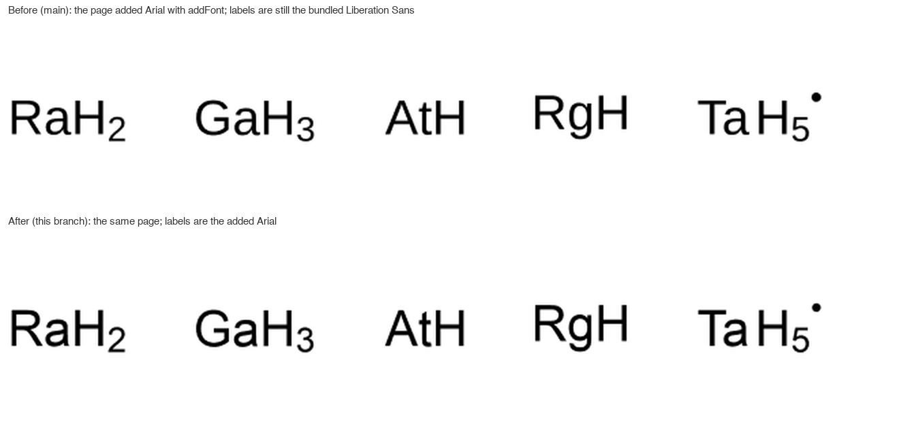
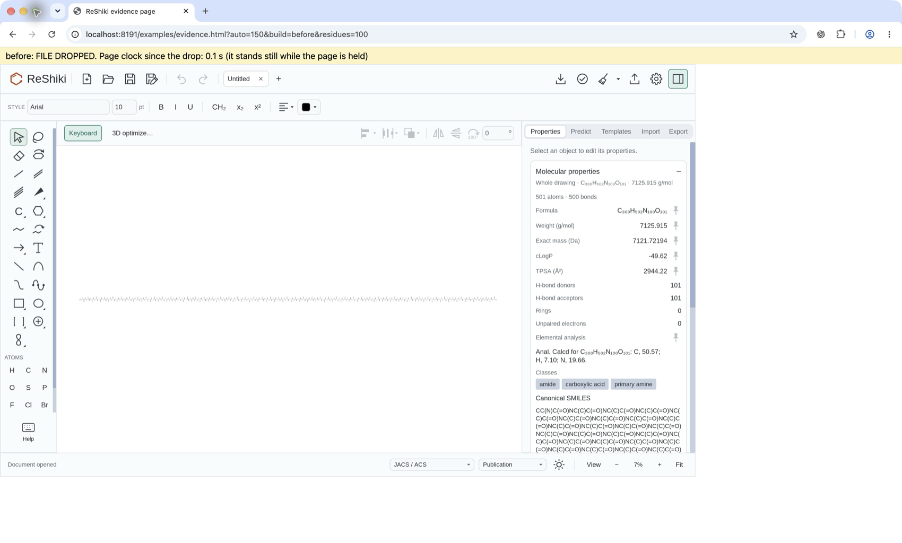
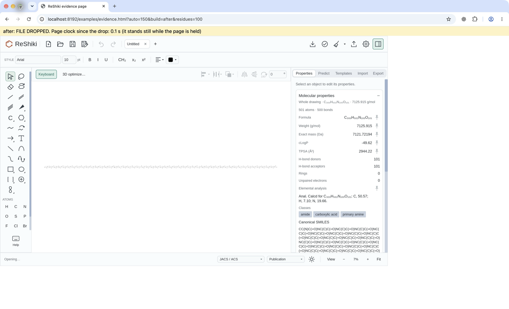

## Summary

Five small, independent fixes from the open-issue triage, approved by the owner on 2026-11-18. Each fix has its own commit, and none depends on another.

- Fixes #1160: in the browser editor, an Arial added with `addFont` is used instead of the bundled Liberation Sans stand-in.
- Refs #1183: the Python package and `reshiki --cli` read the editable drawing inside a ReShiki PNG, SVG or PDF. Read side only.
- Refs #88: the porphine template's round-trip test also covers CDX and checks the two N–H sites. Test only.
- Refs #431: `<reshiki-editor>` loads the drawing again when its `src` or `format` attribute changes, after a cancelable `beforeload` event.
- Refs #430: in the browser, "Opening…" and "Preparing … export…" show before the work holds the page. Partial; the freeze itself stays.

## E1: an added Arial wins over the bundled stand-in (#1160)

**Why it matters.** A browser has no system fonts, so the editor registers its bundled Liberation Sans faces under the family name Arial. A page that adds a real Arial with `addFont` still got the bundled faces: the font database returns the first of equally good matches, and the bundled faces were registered first.

**Approach.**

- `crates/model/src/style/font.rs`: new `yield_arial`. Each bundled face stops answering to `Arial` once another face supplies the same weight, style and width under that name. The face keeps its hidden bundled family name, so it stays the fallback for glyphs the added font lacks.
- It is called from `add_font` and `load_fonts` (`crates/model/src/style.rs`), as the plan said.
- **Change from the plan:** the canvas keeps its own font database (`src/canvas/text_cache/glyphs.rs`). A font added after the editor started reached that database with the alias still in place, so the canvas would have kept drawing Liberation Sans while export used Arial. The same call now runs there.
- **Change from the plan:** the alias is dropped per weight and style, not for all four bundled faces at once. A page that adds only Arial Regular keeps the bundled bold and italic faces for bold and italic labels. Dropping all four would have drawn those labels in the regular face.
- Native builds are unaffected when the system has Arial, because the bundled faces are not loaded there.

**Evidence.**

- New unit test `an_added_arial_is_used_instead_of_the_bundled_stand_in`: without an added Arial nothing changes; a condensed Arial does not displace the regular face; after adding Arial Regular the `Arial` query returns the added face; bold still resolves to the bundled bold face; a glyph the added face lacks still comes from the bundled face. Output: [`tests/e1-model-style-tests.txt`](tests/e1-model-style-tests.txt).
- Browser, before and after. A local page mounts the editor with `fonts: [Arial]` (which calls `addFont`) and opens five element labels. Editor builds of main and of this branch, same page, headless Chrome. The letter shapes differ: look at the leg of R, the spur of G, and the digits.

  

  The Arial file came from the test computer and is not in the evidence folder. Page and script: [`browser/evidence.html`](browser/evidence.html), [`browser/run.mjs`](browser/run.mjs).

## E2: Python and the CLI read the drawing inside a picture (#1183, read side)

**Why it matters.** Since 0.15.0 the app puts the editable drawing into the PNG, SVG and PDF files it exports. `reshiki.Drawing.open`, `reshiki.parse` and `reshiki --cli convert` treated every input as text, so such a picture failed with a UTF-8 or SMILES error.

**Approach.**

- `crates/io/src/payload.rs`: `is_picture` tells a PNG, SVG or PDF from structure text, and `NO_DRAWING` is the shared message.
- Python (`crates/python/src/drawing.rs`): `read` returns the embedded drawing for the formats `png`, `svg` and `pdf`, and for `auto` when the bytes are a picture. The drawing then goes through the same reaction inference as a native drawing.
- CLI (`src/cli/host.rs`): `Session::text` reads the bytes once. A picture gives its drawing as a native document, so `convert`, `render`, `analyze` and `name` all read pictures. The input format `reshiki` is passed to the import tool.
- A picture without a drawing fails with "This picture has no ReShiki drawing inside".
- The CLI help text is unchanged, because its golden files are a contract. The behaviour is documented in `docs/agent-cli.md` and `docs/python.md`.
- **Out of scope:** the write side. Pictures written by the Python package and the CLI still carry no drawing. #1183 stays open for that.

**Evidence.** The three pictures are `tests/fixtures/editable-drawing/ethanol.{png,svg,pdf}`, written by the app's figure exporter with the editable drawing.

CLI, before (nightly build of 2026-11-16) and after ([`e2/cli-before.txt`](e2/cli-before.txt), [`e2/cli-after.txt`](e2/cli-after.txt), script [`e2/cli_check.sh`](e2/cli_check.sh)):

| Command | Before | After |
| --- | --- | --- |
| `convert ethanol.png --to smiles` | `error: The file is not valid UTF-8: …` (exit 1) | `CCO` (exit 0) |
| `convert ethanol.svg --to smiles` | `error[failed]: Invalid SMILES at byte 0` (exit 1) | `CCO` (exit 0) |
| `convert ethanol.pdf --to smiles` | `error: The file is not valid UTF-8: …` (exit 1) | `CCO` (exit 0) |
| `convert plain.png --to smiles` (no drawing inside) | `error: The file is not valid UTF-8: …` | `error: This picture has no ReShiki drawing inside` (exit 1) |
| `convert plain.svg --to smiles` (no drawing inside) | `error[failed]: Invalid SMILES at byte 0` | `error: This picture has no ReShiki drawing inside` (exit 1) |
| `name ethanol.pdf` | `error: The file is not valid UTF-8: …` (exit 1) | `ethanol` (exit 0) |
| `convert - --from mol --to smiles < ethanol.svg` | `error[failed]: Invalid MOL input at line 4: …` | `CCO` (exit 0) |

Python, before (`reshiki==0.15.0` from PyPI) and after (the wheel built from this branch) ([`e2/python-before.txt`](e2/python-before.txt), [`e2/python-after.txt`](e2/python-after.txt), script [`e2/python_check.py`](e2/python_check.py)):

| `reshiki.Drawing.open(…)` | Before | After |
| --- | --- | --- |
| `ethanol.png` | `ValueError: The file is not valid UTF-8: …` | `Drawing CCO` |
| `ethanol.svg` | `ValueError: Unsupported import format` | `Drawing CCO` |
| `ethanol.pdf` | `ValueError: The file is not valid UTF-8: …` | `Drawing CCO` |
| `plain.png`, `plain.svg`, `plain.pdf` (no drawing inside) | the same UTF-8 and format errors | `ReShikiError: This picture has no ReShiki drawing inside` |

Tests ([`tests/e2-cli-payload-python-tests.txt`](tests/e2-cli-payload-python-tests.txt)): `pictures_convert_from_the_editable_drawing_inside_them` (CLI, all three formats, with and without a drawing, `convert` and `name`), `pictures_are_told_from_drawings_and_structure_text` (payload), and two parametrized Python tests (`Drawing.open`, `parse` with and without a format; with and without a drawing).

## E3: porphine round trip through CDX, with an N–H site check (#88, test only)

**Why it matters.** The issue asks for the template's exchange to be checked independently for the graph and for the two N–H sites. The existing test covered MOL and CDXML and compared InChIKeys. A standard InChI treats the inner hydrogens as mobile, so it cannot tell opposite N–H sites from neighbouring ones.

**Approach.** `tests/porphine_core.rs` adds `cdx` to the round trip and a helper that finds the two N–H nitrogens (neutral, two single bonds) and measures their graph distance. Opposite sites are eight bonds apart; neighbouring ones would be four. The template and each reimported drawing must give eight.

**Evidence.** [`tests/e3-porphine-tests.txt`](tests/e3-porphine-tests.txt): both porphine tests pass. CDX keeps the graph and the N–H sites, so the new check found no defect.

Left for #88: the manual check that a ReShiki copy pastes into ChemDraw with the same graph.

## E4: `<reshiki-editor>` reacts to `src` and `format` changes (#431)

**Why it matters.** Changing the `src` or `format` attribute after the element was inserted did nothing. A host page had to call `load()` itself.

**Approach** (`packages/editor/src/element.js`).

- `observedAttributes = ["src", "format"]`. Changes made before the editor starts are ignored, because the start reads the attributes. `src` and `format` changed together load once.
- `load()` replaces the drawing in front without a dirty check, so the element asks first. Once the new file is fetched it fires a cancelable `beforeload` event with `detail: { src, format, dirty }`. `preventDefault()` keeps the current drawing. Otherwise the drawing loads as asked. The name follows the element's other events (`ready`, `change`, `error`).
- The event fires after the fetch, not before it, so `dirty` counts edits made while the file was on its way.
- Of several changes in a row only the last one loads, and a superseded fetch that fails reports no error. Removing `src`, or removing the element, drops a load that is still on its way.
- A `src` that cannot be loaded fires `error` and keeps the current drawing. If the editor never started because the first `src` failed, a changed `src` starts it.
- The start reads `src` and `format` together. A change made while the first file is still on its way stops that fetch, and the editor starts with the new pair.
- Documented in `packages/editor/README.md` and `element.d.ts` (`BeforeLoadEvent`).

**Evidence.** [`tests/e4-element-tests.txt`](tests/e4-element-tests.txt): 7 pass. The same test file against main's element: 3 pass, 4 fail ([`tests/e4-element-tests-on-main.txt`](tests/e4-element-tests-on-main.txt)). The new tests cover:

| State | `beforeload` not prevented | `beforeload` prevented |
| --- | --- | --- |
| No unsaved changes | loads; `dirty: false` | keeps the drawing; `dirty: false` |
| Unsaved changes | loads; `dirty: true` | keeps the drawing; `dirty: true` |

They also cover a 404, two changes in a row answered out of order, an edit made during the fetch, a listener that removes `src`, `src` removed during the fetch, a change while the first file never arrives, and a start that failed.

## E5: the busy status shows before the page is held (#430, partial)

**Why it matters.** The browser build runs file parsing and figure rendering on the page's only thread. The status was set and the work started in the same turn, so the status never painted before the freeze.

**Approach.**

- `after_paint()` moves from the NMR worker to `src/web.rs`. It waits for the next animation frame and one timer turn. `prepare_contents` (`src/app/files.rs`) and the figure export task (`src/app/figure_export.rs`) await it on wasm before the heavy work. Opening awaits it twice; see the evidence.
- **Change from the plan:** there was no "Opening…" status to show. The plan assumed one. A wasm-only `Message::Opening` now sets it before each chosen or dropped file is prepared, and `file_prepared` clears it if the file opens in another tab.
- Native builds do not change: every added line is behind `cfg(target_arch = "wasm32")`.
- The freeze stays. Moving the work off the page's thread is the larger part of #430.

**Evidence.**

- Browser, opening a file. The evidence page drops a large native drawing on the editor (150 copies of a 100-residue peptide) and shows a clock that runs on the page's thread. Screenshots of the Chrome window taken while the page was held (Codex computer use; reports: [`before`](browser/e5-before-computer-use-report.md), [`after`](browser/e5-after-computer-use-report.md)):

  | Before (main) | After (this branch) |
  | --- | --- |
  |  |  |
  | The status line keeps "Document opened" from the earlier drawing through the freeze (8 of 8 screenshots). | The status line says "Opening…" through the freeze (6 of 6 screenshots while the clock stood still). |

- Browser, exporting a figure. The same page logs when the status is set, when a frame is painted with it, and each long task, for **Export PDF…** on a 10 020-atom drawing ([`before`](browser/e5-before-export.txt), [`after`](browser/e5-after-export.txt)):

  | | Before (main) | After (this branch) |
  | --- | --- | --- |
  | "Preparing PDF export…" painted | after the long task (1390 ms) | before it (126 ms) |
  | Long task | 73 to 1364 ms | 127 to 1368 ms |

  The same log for opening a file: [`before`](browser/e5-before-open.txt), [`after`](browser/e5-after-open.txt).
- The first version of this fix waited one frame before preparing a file. The log showed the work starting 1 ms after the status was set, with no frame in between: the wait had begun before the app took the `Opening` message. Opening now waits two frames, and the screenshots above are from that build.
- These are development builds of the editor (`opt-level = 1`), so the freezes are longer than in a release build.
- No unit test: the code is wasm-only and the app's tests run natively. The wasm32 clippy check compiles it.

## Verification

- `cargo fmt --all --check`: pass.
- `cargo clippy --workspace --all-targets --all-features --locked -- -D warnings`: pass.
- `cargo clippy -p reshiki-web -p reshiki -p reshiki-web-worker --lib --bin reshiki --target wasm32-unknown-unknown --locked -- -D warnings`: pass.
- `cargo test --locked --no-default-features`: `-p reshiki --lib --bins` 498 and 1810 passed; `-p reshiki-model -p reshiki-io --lib` 1520 and 702 passed; `--test it porphine_core` 2 passed; `-p reshiki --lib cli::` 93 passed. Helpers set to the built binary.
- Python package: wheel built with `maturin build` as CI does, then `pytest crates/python/tests`: 159 passed, 3 skipped. `ruff check`, `ruff format --check`, `ty check`: pass.
- `packages/editor`: `bun test`: 27 pass. `bun run lint:js` (oxlint) and `bun run format:check`: pass.
- `scripts/module_index.py --check`, `scripts/copy_lint.py`, `scripts/assemble_changelog.py --check`, `scripts/check_docs_tree.mjs`, `bun run docs:check`: pass.
- Repository Python tests (`python -m unittest discover -s tests`): 292 tests OK (11 skipped), with the InChI helper built.
- Browser: editor builds of main and of this branch for wasm32, driven in Chrome (see E1 and E5).
- Review: two adversarial review passes on the diff, then Greptile (one finding, fixed; 5/5 on the final head). The findings that were fixed are in the `fix: address …` commits. Not fixed, on purpose: see Risk.

VERIFICATION_TABLE

## Risk

- **E1.** A variable-weight Arial added by a page is not handled: the bundled faces keep the name for the weights the variable face does not declare. Arial ships as static faces, so this is unlikely.
- **E2.** A structure file whose text starts with `<` and has `<svg` in its first kilobyte is taken for a picture and refused. Real MOL, RXN, CDXML, SMILES, InChI and native files do not look like that. The CLI's 16 MB input limit applies to the picture file.
- **E4.** A host that sets `src` on a drawing with unsaved changes and does not listen for `beforeload` replaces the drawing. That is the owner's decision: the host set `src` deliberately. `isDirty()` covers every tab, while `load()` replaces the one in front.
- **E5.** The wait uses `requestAnimationFrame`, which a hidden browser tab does not run. An open or export started just before the tab is hidden waits until the tab is visible again. The NMR panel already behaved this way.
- **E5.** If the user switches drawing tabs while a file is being prepared, the tab they left can keep "Opening…" until its next status. The page is frozen for most of that time.

## Changelog

`docs/changes/unreleased/fix-issue-triage-easy.md` (section Fixes): one bullet each for the Arial fix, the pictures in Python and the CLI, the element's `src` and `format` changes, and the browser status. E3 is test only and has no bullet.

## Contribution license

- [x] I have read [CONTRIBUTING.md](https://github.com/Ameyanagi/ReShiki/blob/main/CONTRIBUTING.md). I have the right to submit this contribution and agree to offer my original contributions under both MIT and Apache-2.0, so recipients may choose either license (`MIT OR Apache-2.0`).
- [x] Any third-party material is identified below with its source and license, and its required notices are preserved; otherwise, no third-party material is added.

Third-party sources, if any: none added.
