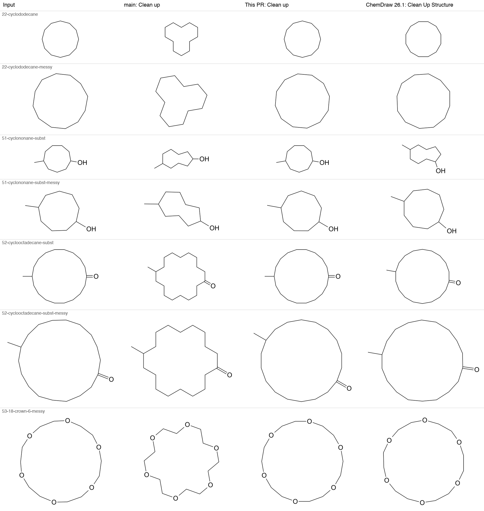
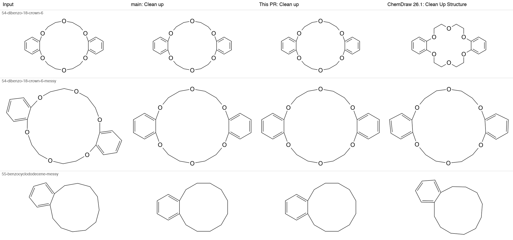

Follow-up to #1207, approved by the owner.

## Why it matters

Clean up folded large rings. A regular cyclododecane came out as a three-lobed shape, and 18-crown-6 and a substituted cyclooctadecane as a cog, with the substituents no longer pointing away from the ring. ChemDraw 26.1's Clean Up Structure keeps these rings as regular polygons. #1207 made the folded ring keep its size, but not its shape.

The cause: Clean up asks the depictor to use RDKit's ring templates, and RDKit ships folded templates for single macrocycles. New depictions (SMILES and name import) do not use templates, so they already drew these rings as regular polygons.

## Approach

One place recognises the case. Where the depictor seeds each ring system (`crates/chemistry/src/depict/expansion/initial.rs`), a system of exactly one ring with nine or more atoms skips the template and uses the regular-polygon ring embedding that new depictions already use. Ring systems are joined by any shared atom, so "exactly one ring" means not fused, not spiro and not bridged. Substituents are then placed by the normal depictor, radially.

- The switch is a depictor option, `regular_large_rings`, beside `preserve_spiro_rings`. Clean up sets it, and so does the import's template retry, the only place a new depiction uses templates (bridged molecules).
- Size and orientation are #1207's, unchanged: the layout is drawn at RDKit's length and scaled to the kept median; Keep fits the result to the drawing, then straightens by at most 15°.
- 15 added lines outside tests and docs, 8 of them doc comments. No new abstraction.

**Unchanged, and out of scope:**

- Fused, spiro and bridged macrocycles (benzo-crown ethers, cyclophanes) keep their layout.
- Rings of up to eight atoms are unchanged.
- A layout with two or more fixed atoms never used templates.
- RDKit-parity mode (`refine() == false`) is unchanged.
- The generic link/repeat depiction in `crates/model` is unchanged.

## Evidence

Headless renders by ReShiki's own renderer at 1200 dpi, drawn at one scale, so sizes compare directly. "main" is `origin/main` 4a194ab (#1207 merged). ChemDraw's column is its own Clean Up Structure, run once on the same input file. A real-window capture is not included because no UI changed.

### Lone large rings

The messy copies are 1.5x the size, turned 20° and jittered by up to 8% of a bond. With this PR every ring is a regular polygon at the drawn size, and the substituents point outward.

Two things about ChemDraw's column:

- ChemDraw leaves the jittered copies almost as drawn (bond spread 7.5–8.9% after its Clean Up). ReShiki regularises them.
- ChemDraw folds the clean 5-methylcyclononan-1-ol input (row 3). It keeps the same molecule regular from a different drawing, and it kept all 29 other probe inputs regular: rings of 9 to 16 atoms, plain, with one methyl, with two methyls, and with OH.

### Fused macrocycles are unchanged

main and this PR are identical for these (same coordinates). Their ring systems have no RDKit template, so they were already drawn round.

## Corpus changes

The 62 ChemDraw-reference inputs were re-run in Keep, Free and IUPAC (186 outputs) with a throwaway harness that is not committed. Results are written as `*-fix-cleanup.cdxml` beside the others. A fresh run of main reproduced #1207's `*-pr-cleanup.cdxml` in all 186 files.

**180 of 186 outputs are identical to main. The 6 that changed are cyclododecane and its messy copy**, the only lone ring of nine or more atoms in the corpus:

| Case | | Size | Bond spread | Ring corner angles (ideal 150°) | Turn from input |
|---|---|---|---|---|---|
| 22-cyclododecane | main, Keep | 1.000x | 0.00% | all 120° (three lobes) | 0° |
| | **this PR, Keep** | 1.000x | 0.00% | **all 150.0°** | 0° |
| | this PR, Free / IUPAC | 1.000x | 0.00% | all 150.0° | 0° |
| | ChemDraw | 0.997x | 0.03% | 150.0–150.1° | −15° (a symmetry turn) |
| 22-cyclododecane-messy | main, Keep | 1.000x | 0.00% | all 120° (three lobes) | 0° |
| | **this PR, Keep** | 1.000x | 0.00% | **all 150.0°** | 0° |
| | this PR, Free / IUPAC | 1.000x | 0.00% | all 150.0° | +20° (back to the conventional pose) |
| | ChemDraw | 0.998x | 8.65% | 140.2–158.0° | +10.5° |

Seventeen further inputs were made for this PR (clean and messy each, three orientations, 102 outputs). Keep:

| Input | main | this PR |
|---|---|---|
| 5-Methylcyclononan-1-ol | ring angles 106.5–128.2°, bond spread 4.9%, substituent 11.6° off radial | 140.0°, 0.0%, radial |
| 10-Methylcyclooctadecan-1-one | 120°, substituent 19.1° off radial | 160.0°, radial |
| 18-Crown-6 | 120° | 160.0° |
| Cyclononane | 106.5–128.2° | 140.0° |
| (Z)-Cyclododecene | 120° | 150.0° |
| Muscone | 115.9–128.6°, 26.4° off radial | 156.0°, radial |
| Phenylcyclododecane; 1-(cyclononyl)-3-(cyclododecyl)propane; norbornane with a cyclododecylmethyl group | large rings folded | large rings regular |
| Dibenzo-18-crown-6, benzocyclododecene (fused); spiro[5.11]heptadecane; a bridged bicycle | | identical |
| Methylcyclooctane (8-ring) | | identical |
| (E)-Cyclododecene; (E,E)-cyclotetradeca-1,8-diene; a 14-ring macrolide with ten stereocentres | | identical |

The three trans-alkene and macrolide cases match no template because of their stereochemistry, so main already used the regular embedding for them. A trans double bond keeps its inward corner.

## Verification

VERIFICATION_TABLE

Tests added in `crates/io/src/engine/native_import/tests.rs`:

- `lone_large_rings_are_regular_polygons_with_radial_substituents`: cyclododecane, methylcyclononane, cyclooctadecanol and 18-crown-6.
  - As a new depiction, and after Clean up of a messy copy (1.5x, turned 20°, jittered 8%) in Keep, Free and IUPAC.
  - Every bond is within 1% of the median, every ring angle within 1° of regular, and every substituent within 1° of radial.
  - The drawn size is kept within 1%, and Keep turns the drawing by at most 30°.
  - With one fixed atom, the ring is still regular and that atom stays.
  - It fails on main's behaviour: with the option off, "ring angle at 0 is 120.000, expected 150.000".
- `only_lone_large_rings_leave_their_ring_template`: benzocyclododecene, dibenzo-18-crown-6, a spiro and a bridged macrocycle, methylcyclooctane and (E)-cyclododecene get identical coordinates with the option on and off. Cyclododecane differs.

## Review

An independent adversarial review (gpt-6.1-sol, read-only) of the diff made two findings:

1. **Medium, rejected as out of scope, now documented.** Substituents are placed radially, but the depictor's collision repair can turn crowded neighbours apart: two adjacent tert-butyl groups on an 18-ring end up about 15° off radial. That is the depictor's general behaviour for every ring, it matches RDKit, and new depictions already do it. The doc now says so.
2. **Low, fixed.** The doc and release note promised a regular polygon without exception, but a trans double bond in the ring keeps its inward corner, which its stereochemistry needs. Both now say so, and (E)-cyclododecene is in the unchanged test.

## Risk

- **Visible change.** Clean up of a lone large ring gives a round ring where it gave a folded one. A user who preferred the compact folded shape has to draw it by hand, and Clean up will round it again.
- **Large round rings take more room** than the folded templates: an 18-ring is about 5.8 bond lengths across.
- **Fused, spiro and bridged macrocycles are not addressed.** Those with an RDKit template stay folded.
- **Windows and Linux** run in PR CI.

## Changelog

`docs/changes/unreleased/fix-large-ring-cleanup.md` (Fixes): Clean up keeps large rings round. `docs/selection-cleanup.md` describes the rule and its two limits.

## Contribution license

- [x] I have read [CONTRIBUTING.md](https://github.com/Ameyanagi/ReShiki/blob/main/CONTRIBUTING.md). I have the right to submit this contribution and agree to offer my original contributions under both MIT and Apache-2.0, so recipients may choose either license (`MIT OR Apache-2.0`).
- [x] Any third-party material is identified below with its source and license, and its required notices are preserved; otherwise, no third-party material is added.

Third-party sources, if any: none.
