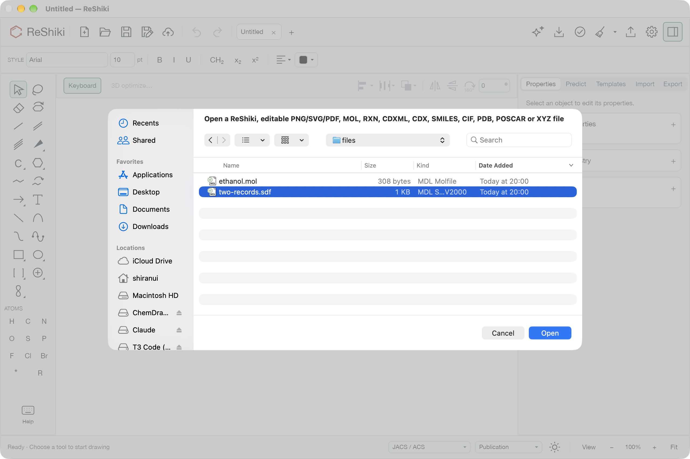
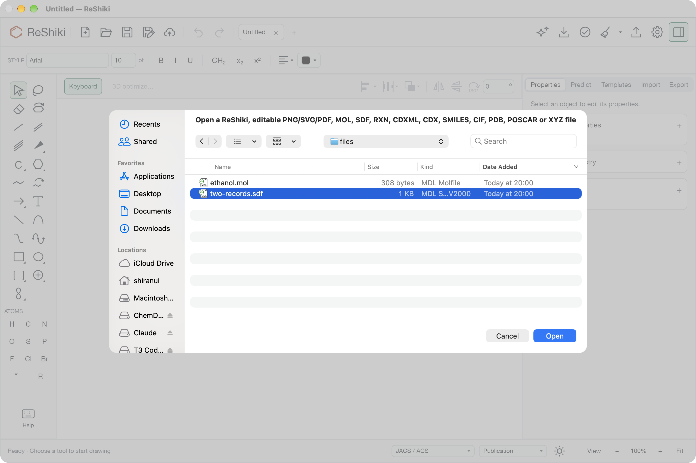
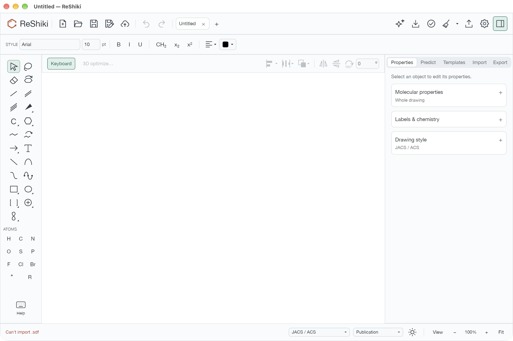
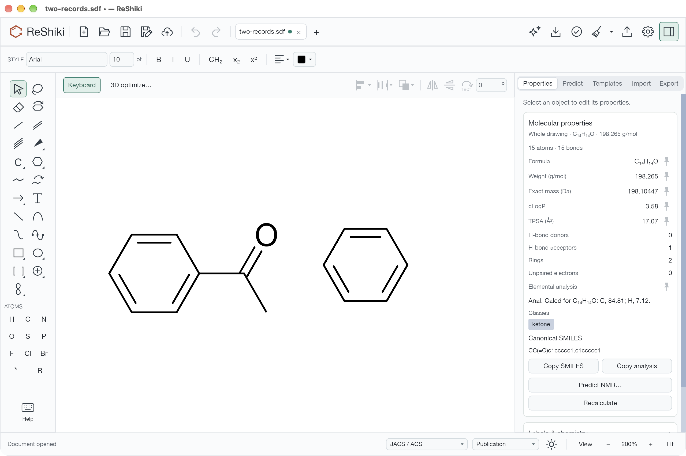
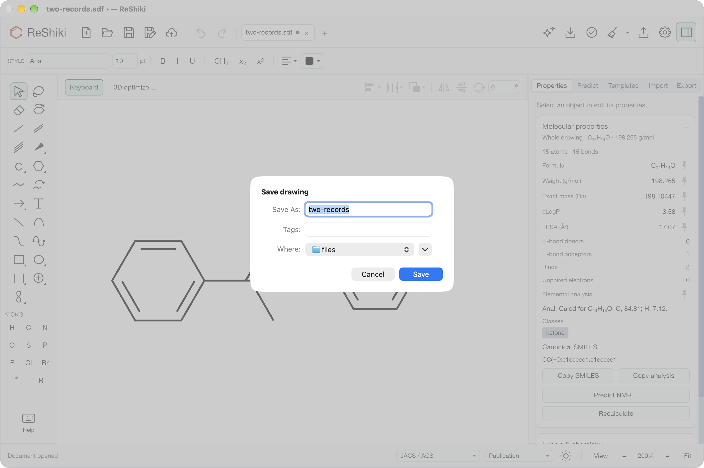

Follow-up to #1211 (B3), and stacked on it: the base is `feat/github-files-tree`, because the SD-file reader this reuses (`import::records` / `import::load`) arrives with that PR. Only the three commits on top are new here.

## Why it matters

- After #1211, an `.sdf` opens from GitHub and Insert reads one from disk, but **File › Open** still refuses the same file with "Can't import .sdf" (see Before).
- SD files are the usual export from databases and vendor catalogues; Open is where people try them first.

## Approach

- `files::prepare` accepts `.sdf`. `files::records` then reads every record with the reader Insert uses (`import::load`), inside the same read step, so files still open in the order they were chosen and a launch-time open is finished before the desktop "opening" barrier ends.
- The records open as one drawing, side by side (`import::side_by_side`, moved from the GitHub picker so both paths share it).
- **Save.** ReShiki cannot write SDF. The drawing opens unsaved, named after the file (`two-records.sdf •`), with no path, as `.cif`, `.smi` and `.rxn` files already do. ⌘S asks where to keep it and suggests `two-records.rsk`; the SD file is never written. The `.mol`/`.cdxml` keep-format prompt from #1205 does not apply: it is for formats Save can write back.
- The Open dialog has no extension filter (VASP files have no extension), so an `.sdf` was always selectable; its title lists what Open reads and now names SDF.
- Every path through `files::read` gets this: the dialog, a file passed at launch, and a file opened from the system. A dropped `.sdf` still inserts into the drawing in front, as #1211 made it. The app has no Open Recent list.
- `.sd` is not added: the reader splits records for `.sdf` only.
- An SD file with no structure reports "Could not open name.sdf: it has no structure" and opens nothing.

Rejected:
- Keeping the `.sdf` as the tab's file. Save would then have to refuse or silently write a different format.
- A second message for the read result. An independent review showed it let tabs open out of order and ended the launch barrier early, so the records are read before the file is reported.

## Evidence

Real app on macOS arm64 (Apple M4), debug builds, window captures only (`screencapture -l`), scripted GUI runs, a fresh data folder per launch. **Before** = base `feat/github-files-tree` 0d4403857. **After** = this branch at 022d366ac (the head only adds a formatting commit). The file is [two-records.sdf](two-records.sdf): acetophenone and benzene.

### File › Open, `two-records.sdf` selected

| Before (base) | After |
|---|---|
|  |  |
| The file can be chosen (the dialog has no filter); the title does not name SDF. | The title names SDF. |

### After choosing Open

| Before (base) | After |
|---|---|
|  |  |
| Nothing opens: "Can't import .sdf". | Both records, side by side, in an unsaved tab `two-records.sdf`; 15 atoms · 15 bonds. |

### ⌘S on the opened SD file (after only)

⌘S opens **Save drawing** instead of writing the `.sdf`. macOS hides the extension in the name field; the unit test below checks the suggested name is `two-records.rsk` and that the tab has no file to write over.

## Verification

VERIFICATION_TABLE

Run on macOS arm64 (Apple M4):
- `cargo fmt --all --check`
- `cargo clippy --workspace --all-targets --all-features --locked -- -D warnings`
- wasm32 clippy (`-p reshiki-web -p reshiki -p reshiki-web-worker --lib --bin reshiki --target wasm32-unknown-unknown`)
- `cargo test --locked --no-default-features -p reshiki --lib --bins`: 482 lib + 1783 bin pass
- renderer tests for files, open and import (`--bin reshiki -- files open import sd_file --include-ignored --test-threads=1 --skip manual_`): 230 pass
- `scripts/module_index.py --check`, `scripts/copy_lint.py`, `assemble_changelog.py --check`, `bun fmt --check` on the changed docs, `scripts/check_docs_tree.mjs`

New tests in `src/app/files/tests.rs`:
- `open_names_sd_files_among_what_it_reads`: the dialog title names SDF, and `.sdf`/`.SDF` are accepted;
- `an_sd_file_opens_its_records_side_by_side_and_saves_as_a_drawing`: a two-record file gives both structures, the second right of the first; the drawing in front keeps its tab; the tab has no path, is unsaved, SDF is not a Save format, and Save's target is `two.rsk`;
- `an_sd_file_without_a_structure_reports_it_and_opens_nothing`;
- `prepare_rejects_unsupported_files_and_shows_the_reason` now uses `.sd` where it used `.sdf`.

An independent adversarial review ran twice. The first pass found a test match that no longer compiled, tabs opening out of order, and the launch barrier ending early; all three are fixed (second commit). The second pass confirmed those and raised two limits in `side_by_side`, which #1211 wrote and its GitHub open shares; they are listed under Risk and left as they are.

## Risk

- Low. `.sdf` used to be refused outright, so no working path changes. Other formats take the same route as before; `records` returns anything but an SD file untouched.
- SD data fields (`> <Name>` …) are not kept, as with Insert.
- Limits inherited from `side_by_side` (#1211), not changed here:
  - a file whose records together pass a document limit (for example more than 10,000 atom-list sites) opens without the records that no longer fit, and says nothing;
  - the records are joined on the UI thread, with work that grows with the square of their count; a file of tens of thousands of records would stall the window while it opens.
- Stacked on #1211: merge that first. The diff here shows only this change.

## Changelog

`docs/changes/unreleased/fix-open-sdf.md` (Fixes). `docs/feature-status.md`: the SDF row now says Open and Insert read an SD file's structures.

## Contribution license

- [x] I have read [CONTRIBUTING.md](https://github.com/Ameyanagi/ReShiki/blob/main/CONTRIBUTING.md). I have the right to submit this contribution and agree to offer my original contributions under both MIT and Apache-2.0, so recipients may choose either license (`MIT OR Apache-2.0`).
- [x] Any third-party material is identified below with its source and license, and its required notices are preserved; otherwise, no third-party material is added.

Third-party sources, if any: none. The tests reuse existing repository fixtures (`tests/fixtures/…`).
