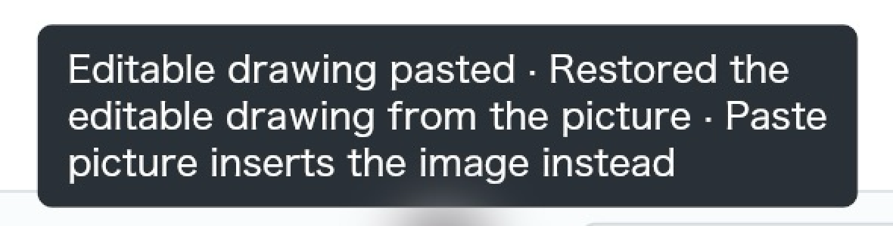

**ReShiki macOS pasteboard and Word UI verification**

Environment supplied for this run: macOS 27, arm64. Artifacts: `/private/tmp/claude-502/clipsvg/mac/after`. UI actions and screenshots used computer use. Pasteboard capture and SVG analysis used the supplied `pbdump`, `pbwrite`, and `svgsum.py` tools.

All requested UI steps completed. Copy Image pasted a visible caffeine structure and caption into a new Word document. SVG-only paste into ReShiki restored the editable drawing. Word's exact selected clipboard representation could not be identified from its context menu.

| Action | Exact ReShiki result | Native pasteboard types |
|---|---|---|
| Copy Image | Image copied | PDF, three CDX type names, PNG, SVG, ReShiki drawing |
| Copy | Editable drawing and images copied | ReShiki drawing, three CDX type names, PDF, PNG, SVG |
| Copy as → SVG | Selection copied as SVG | SVG and UTF-8 plain text |
| SVG-only paste | Editable drawing pasted · Restored the editable drawing from the picture · Paste picture inserts the image instead | Source check contained only `public.svg-image` |

**1. Launch and initial drawing**

Launched exactly with:

```sh
open -n /private/tmp/claude-502/clipsvg/apps/ReShikiQAAfter.app
```

The launched wrapper displayed `caffeine.rsk — ReShiki`, with the caffeine molecular drawing and the **Caffeine** caption. The inspector showed 14 atoms and 15 bonds. The status bar read exactly: **“Document opened”**.

Screenshot: [01-app.png](01-app.png).

**2. Copy Image**

Clicked once on empty canvas, pressed Cmd+A, then Cmd+Shift+C. The selection included the structure and caption; the inspector showed **14 atoms · 1 object · 15 bonds**. Waited 5 seconds before capturing the result. The status bar read exactly: **“Image copied”**.

Screenshot: [02-copy-image.png](02-copy-image.png).

Captured the pasteboard with `pbdump`, ran `osascript -e 'clipboard info'`, and ran `python3 -I` with `svgsum.py` against the captured SVG. Output folders were created before shell redirection so `types.txt` could be opened successfully. The same preparation was used for the Copy and Copy as SVG captures.

Contents of `copy-image/types.txt`:

```text
changeCount 2648, items 1
0 com.adobe.pdf 14098 bytes
1 com.revvity.chemdraw.cdx-clipboard 99137 bytes
2 com.perkinelmer.chemdraw.cdx-clipboard 99137 bytes
3 com.cambridgesoft.cdx 99137 bytes
4 public.png 99041 bytes
5 public.svg-image 13998 bytes
6 dev.reshiki.drawing 5142 bytes
```

Contents of `copy-image/svg-summary.txt`:

```text
bytes 13998 text_elements 0 path_elements 10 width 80.07648pt height 91.49686pt viewBox 0 0 106.76864 121.99581 carries_drawing True
```

Contents of `copy-image/clipboard-info.txt`:

```text
«class PDF », 14098, «class CDIF», 99137, «class CHMS», 99137, «class PNGf», 99041, «class svg », 13998, «class AVIF», 27209, «class 8BPS», 362706, GIF picture, 15217, «class jp2 », 99825, JPEG picture, 104003, TIFF picture, 8147418, «class BMP », 8143638, «class TPIC», 170469
```

The `pbdump` enumeration has one item with seven type names. Copy Image advertises PDF first, and its three CDX payloads are each 99,137 bytes. `clipboard info` lists additional image representations; that output is preserved separately and does not establish that ReShiki independently supplied each additional representation.

**3. Paste Copy Image into Microsoft Word**

Word was already running at its “Open new and recent files” screen. Selected **Blank Document** and clicked **Create**, which opened a new document titled **Document3**. Pressed Cmd+V. The caffeine structure and **Caffeine** caption appeared together as a picture near the top-left of page 1. Word's accessibility state identified **“Picture 1, In line with text”**; the status bar showed 0 words.

Screenshot: [03-word-paste.png](03-word-paste.png).

Right-clicked the pasted structure. The context menu offered **“Save as Picture...”**, **“Change Picture”**, wrapping, crop, size/position, and picture formatting commands. It did not name a picture file format. Captured the menu as additional evidence even though it did not disclose the format.

Screenshot: [03b-word-menu.png](03b-word-menu.png).

Pressed Escape, then Cmd+W to close only Document3. Word asked whether to keep the new document. This Word build labels its discard action **“Delete”** (`DontSaveButton`), rather than “Don't Save.” Chose that discard action. Word returned to its new/recent-files screen and remained running. No Word document was saved, and no existing document was opened or modified. ReShiki was in the background during this step, so no new ReShiki status message was observed here.

**4. Copy**

Returned to the same launched ReShiki instance and its caffeine drawing. Pressed Cmd+A and Cmd+C, waited 5 seconds, then captured the screenshot and pasteboard. The structure and caption remained selected. The status bar read exactly: **“Editable drawing and images copied”**.

Screenshot: [04-copy.png](04-copy.png).

Contents of `copy/types.txt`:

```text
changeCount 2649, items 1
0 dev.reshiki.drawing 5142 bytes
1 com.revvity.chemdraw.cdx-clipboard 2160 bytes
2 com.perkinelmer.chemdraw.cdx-clipboard 2160 bytes
3 com.cambridgesoft.cdx 2160 bytes
4 com.adobe.pdf 14098 bytes
5 public.png 99041 bytes
6 public.svg-image 13998 bytes
```

Contents of `copy/svg-summary.txt`:

```text
bytes 13998 text_elements 0 path_elements 10 width 80.07648pt height 91.49686pt viewBox 0 0 106.76864 121.99581 carries_drawing True
```

Copy advertises the same seven type names as Copy Image, with the ReShiki drawing first and PDF later. Its three CDX payloads are each 2,160 bytes, compared with 99,137 bytes for Copy Image. PDF, PNG, SVG, and ReShiki drawing byte counts match the Copy Image capture.

**5. Copy as → SVG**

Right-clicked a selected nitrogen atom in the caffeine drawing and opened **Copy as**. The submenu showed **PNG**, **SVG**, **PDF**, and chemical/text formats; its heading was **“Copy as · selected objects”**. The selection still contained 14 atoms, one object, and 15 bonds. Before clicking SVG, the status bar still read exactly: **“Editable drawing and images copied”**.

Screenshot of the open submenu before clicking SVG: [05-copy-as-menu.png](05-copy-as-menu.png).

Clicked **SVG**, waited 5 seconds, then captured the screenshot and pasteboard. The status bar read exactly: **“Selection copied as SVG”**.

Screenshot: [05b-copy-as-done.png](05b-copy-as-done.png).

Contents of `copy-as-svg/types.txt`:

```text
changeCount 2650, items 1
0 public.svg-image 13998 bytes
1 public.utf8-plain-text 13998 bytes
```

Contents of `copy-as-svg/svg-summary.txt`:

```text
bytes 13998 text_elements 0 path_elements 10 width 80.07648pt height 91.49686pt viewBox 0 0 106.76864 121.99581 carries_drawing True
```

This action supplied `public.svg-image` plus `public.utf8-plain-text`, each 13,998 bytes.

**6. SVG-only paste back into ReShiki**

Created `svg-only`, copied the SVG binary captured from **Copy Image** to `svg-only/item0-0-public.svg-image.bin`, ran `pbwrite` on that directory, and independently dumped the resulting pasteboard into `svg-only/check`. The source pasteboard check contained exactly one type, `public.svg-image`.

Contents of `svg-only/pbwrite.txt`:

```text
ok changeCount 2651
```

Contents of `svg-only/types.txt`:

```text
changeCount 2651, items 1
0 public.svg-image 13998 bytes
```

In the launched ReShiki instance, pressed Cmd+N. This created a new **Untitled** tab next to `caffeine.rsk` in the same window. Before pasting, the empty drawing's status bar read exactly: **“New document”**. Clicked the empty canvas, pressed Cmd+V, and waited 5 seconds.

The caffeine structure and caption appeared selected in the new tab. Individual atom selection circles and bond highlights were visible. The inspector showed **14 atoms · 1 object · 15 bonds**, the molecular formula and properties, and enabled drawing arrangement controls. The tab acquired an unsaved-change marker.

Screenshot: [06-svg-only-paste.png](06-svg-only-paste.png).

The long status bar message was truncated in the main screenshot. Clicking its ellipsis revealed the full message in a tooltip. Verbatim, including the middle-dot separators:

> Editable drawing pasted · Restored the editable drawing from the picture · Paste picture inserts the image instead

Full-window evidence with the tooltip: [06b-svg-only-status.png](06b-svg-only-status.png). The image below is a crop of that screenshot enlarged 2× to make the full status text readable; no text was added or reconstructed.



This verifies that the SVG-only input restored ReShiki's editable drawing, including the molecular structure and caption.

**7. Cleanup**

Pressed Cmd+Q in the launched ReShiki instance after capturing the paste result. It exited without displaying a save/discard prompt. The subsequent accessibility request returned `procNotFound`; an app inventory then confirmed the wrapper was absent and Microsoft Word remained running. The wrapper was not relaunched. No other application was quit, no system settings were changed, and no repository files were edited.

No screenshot was requested for this cleanup step.

**Artifact comparison**

All three captured SVG binaries are byte-identical: Copy Image, Copy, and Copy as SVG. The SVG-only input file and its independently dumped check are also identical to that same SVG. Each is 13,998 bytes. SHA-256:

```text
4b3407aea8719b5cd21216fd1940d94b9cb37b4e1b21ae3a20ddef4ce8e42bed
```

Each `svg-summary.txt` reports 0 text elements, 10 path elements, width `80.07648pt`, height `91.49686pt`, viewBox `0 0 106.76864 121.99581`, and `carries_drawing True`.

**Anything not determined and why**

The exact clipboard representation selected or retained by Word could not be determined. The picture context menu did not name SVG, PDF, PNG, or another format, and the test document was discarded without saving as requested. The visible result establishes a pasted picture containing the structure and caption; pasteboard type order alone does not prove Word's choice. All requested captures, pasteboard dumps, SVG summaries, SVG-only paste verification, and cleanup were completed.
