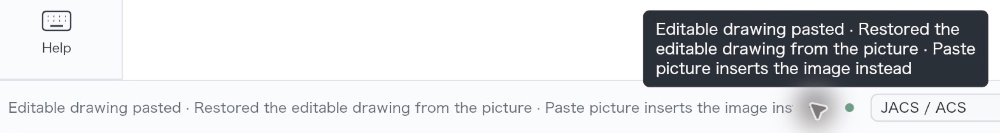

ReShiki macOS pasteboard verification — before build

Environment supplied for this run: macOS 27, arm64. Verification used computer use for native UI interactions. The app was launched only with `open -n /private/tmp/claude-502/clipsvg/apps/ReShikiQABefore.app`. All verification artifacts were written under `/private/tmp/claude-502/clipsvg/mac/before`; no repository files were edited.

Copy Image advertised PDF first, followed by three ChemDraw CDX aliases, PNG, SVG, and ReShiki drawing data. Copy advertised ReShiki drawing data first and had smaller CDX representations. Copy as → SVG advertised only SVG and UTF-8 plain text. All three SVG representations were identical and carried embedded drawing data. Word displayed the caffeine structure and caption as a picture. An SVG-only paste back into ReShiki restored editable atoms, bonds, and the caption.

**1. Launch and initial drawing**

Launched the specified wrapper with the exact `open -n` command. The window was titled `caffeine.rsk — ReShiki` and showed the caffeine structure and a “Caffeine” caption. The inspector reported 14 atoms and 15 bonds. The ReShiki status bar read exactly:

> Document opened

Screenshot: [01-app.png](01-app.png).

**2. Copy Image**

Clicked an empty canvas area, pressed Cmd+A, then Cmd+Shift+C, and waited 5 seconds. The selection included 14 atoms, 1 object, and 15 bonds. The status bar read exactly:

> Image copied

Screenshot: [02-copy-image.png](02-copy-image.png).

Ran the requested `pbdump`, `osascript -e 'clipboard info'`, and `svgsum.py` captures. The dump directories were created before shell redirection so that the `types.txt` files could be opened successfully.

`copy-image/types.txt`:

```text
changeCount 2644, items 1
0 com.adobe.pdf 14098 bytes
1 com.revvity.chemdraw.cdx-clipboard 99137 bytes
2 com.perkinelmer.chemdraw.cdx-clipboard 99137 bytes
3 com.cambridgesoft.cdx 99137 bytes
4 public.png 99041 bytes
5 public.svg-image 6123 bytes
6 dev.reshiki.drawing 5142 bytes
```

`copy-image/svg-summary.txt`:

```text
bytes 6123 text_elements 7 path_elements 1 width 80.07648pt height 91.49686pt viewBox -111.691864 -102.84949 233.55641 266.86584 carries_drawing True
```

`copy-image/clipboard-info.txt`:

```text
«class PDF », 14098, «class CDIF», 99137, «class CHMS», 99137, «class PNGf», 99041, «class svg », 6123, «class AVIF», 27209, «class 8BPS», 362706, GIF picture, 15217, «class jp2 », 99825, JPEG picture, 104003, TIFF picture, 8147418, «class BMP », 8143638, «class TPIC», 170469
```

**3. Paste Copy Image into Microsoft Word**

Opened Microsoft Word, which was not running in the initial application inventory. Used Blank Document in its template chooser. Accessibility calls then encountered a frame error and timeouts; Cmd+N recovered to a fresh blank `Document2`. Pressed Cmd+V and verified the caffeine structure and “Caffeine” caption appeared near the upper left of the page. Word identified the object as `Picture 1, In line with text`; its word count was 0.

Screenshot: [03-word-paste.png](03-word-paste.png).

Right-clicked the picture and captured [03b-word-menu.png](03b-word-menu.png). The menu included `Save as Picture...`, `Change Picture`, `Crop`, and `Format Picture...`. It did not state an explicit file format such as SVG, PDF, or PNG, so this UI evidence does not establish which pasteboard representation Word selected. No ReShiki status bar was visible while inspecting Word.

Pressed Escape and Cmd+W. In Word's save sheet, clicked `Delete` (the `DontSaveButton`) to discard the unsaved `Document2`. An additional empty `Document1` from the startup sequence was then visible; closed that blank document with Cmd+W, with no save prompt. Word returned to its new/recent-files chooser and was left running. No existing Word document was opened or modified, and no Word document was saved.

**4. Copy**

Returned to the launched ReShiki wrapper's caffeine drawing, pressed Cmd+A and Cmd+C, and waited 5 seconds. The same 14 atoms, 1 object, and 15 bonds remained selected. The status bar read exactly:

> Editable drawing and images copied

Screenshot: [04-copy.png](04-copy.png).

`copy/types.txt`:

```text
changeCount 2645, items 1
0 dev.reshiki.drawing 5142 bytes
1 com.revvity.chemdraw.cdx-clipboard 2160 bytes
2 com.perkinelmer.chemdraw.cdx-clipboard 2160 bytes
3 com.cambridgesoft.cdx 2160 bytes
4 com.adobe.pdf 14098 bytes
5 public.png 99041 bytes
6 public.svg-image 6123 bytes
```

`copy/svg-summary.txt`:

```text
bytes 6123 text_elements 7 path_elements 1 width 80.07648pt height 91.49686pt viewBox -111.691864 -102.84949 233.55641 266.86584 carries_drawing True
```

**5. Copy as → SVG**

Right-clicked a selected carbon atom in the caffeine structure and opened `Copy as`. The submenu was headed `Copy as · selected objects` and offered PNG, SVG, PDF, and chemical formats. The selection remained 14 atoms, 1 object, and 15 bonds. Captured the open submenu before clicking SVG: [05-copy-as-menu.png](05-copy-as-menu.png). The status bar at that point still read:

> Editable drawing and images copied

Clicked `SVG`, waited 5 seconds, and captured [05b-copy-as-done.png](05b-copy-as-done.png). The completion status read exactly:

> Selection copied as SVG

`copy-as-svg/types.txt`:

```text
changeCount 2646, items 1
0 public.svg-image 6123 bytes
1 public.utf8-plain-text 6123 bytes
```

`copy-as-svg/svg-summary.txt`:

```text
bytes 6123 text_elements 7 path_elements 1 width 80.07648pt height 91.49686pt viewBox -111.691864 -102.84949 233.55641 266.86584 carries_drawing True
```

**6. SVG-only paste back into ReShiki**

Ran the specified command to copy the SVG from `copy-image` into `svg-only/item0-0-public.svg-image.bin`, write that directory to the pasteboard with `pbwrite`, and dump it back into `svg-only/check`. The readback confirmed that only `public.svg-image` was present.

`svg-only/pbwrite.txt`:

```text
ok changeCount 2647
```

`svg-only/types.txt`:

```text
changeCount 2647, items 1
0 public.svg-image 6123 bytes
```

Pressed Cmd+N in the QA wrapper. This created a new `Untitled` tab alongside `caffeine.rsk`; the empty drawing status read exactly `New document`. Clicked the empty canvas, pressed Cmd+V, waited 5 seconds, and captured [06-svg-only-paste.png](06-svg-only-paste.png).

The new tab became modified (`Untitled • — ReShiki`). The caffeine structure and caption appeared with individual atom selection circles and an object selection box. The inspector reported 14 atoms, 1 object, and 15 bonds, providing visible evidence of editable drawing restoration.

The inline status was truncated by the available status-bar width. Clicking the status area's ellipsis exposed the complete message in a tooltip, captured in [06b-svg-only-status.png](06b-svg-only-status.png). The full status text, verbatim, was:

> Editable drawing pasted · Restored the editable drawing from the picture · Paste picture inserts the image instead

The following is an enlarged crop of the status bar and tooltip, taken from that screenshot and saved as [06c-svg-only-status-zoom.png](06c-svg-only-status-zoom.png):



**7. Quit the launched ReShiki instance**

Pressed Cmd+Q in `ReShikiQABefore`. It exited immediately; no save/discard prompt appeared. The immediate follow-up app-state request returned `procNotFound`, and a fresh application inventory confirmed the QA wrapper was no longer running. Microsoft Word, ChemDraw, Ghostty, Finder, and Safari remained running. No other app was quit. No additional ReShiki status text or screenshot was available after exit.

**Artifact comparison**

The SVG bytes from Copy Image, Copy, and Copy as → SVG were identical (6,123 bytes), with SHA-256:

```text
ac14823282b7423d0e74afc8720582d444ef1ce8d32e12709798539056e38fcf
```

Copy as → SVG's plain-text representation and the SVG-only input/readback also matched these bytes. Each SVG summary reported `carries_drawing True`. The SVG contained `reshiki:drawing` metadata in the `https://reshiki.dev/ns/drawing/1/` namespace, explaining the data available to the observed editable paste-back behavior.

Copy Image's CDX representation was 99,137 bytes, versus 2,160 bytes for Copy. A byte-level check found the complete 99,041-byte PNG payload at offset 88 within Copy Image's CDX; Copy's CDX did not contain that PNG. The standalone PNG was 1335 × 1525 pixels. These pasteboard facts do not prove which format Word chose.

**Anything that could not be established**

All seven requested workflow steps and all requested captures were completed. Word's context menu did not disclose the pasted picture's exact file format. Determining Word's selected internal representation was therefore not possible from the requested UI inspection; no Word document was saved for package inspection. The Word startup accessibility errors were recovered from, and both newly created blank documents were closed without saving.
