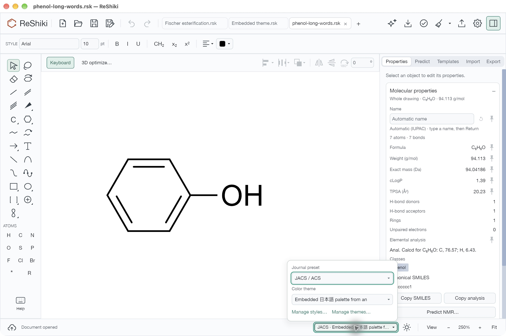
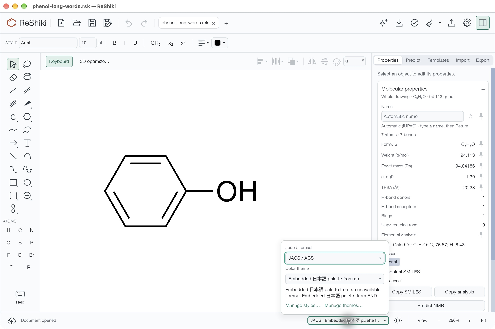

# Long embedded theme name in the style chooser

Open [the phenol fixture](phenol-long-words.rsk) in ReShiki and open the journal preset and color theme chooser in the status bar. The document embeds an 80-character name containing Japanese text and ending in `END`. The theme is absent from both test profiles' libraries.

Both captures show the drawing at 250% in a 2560 × 1704 pixel Apple Silicon macOS window capture. The earlier profile had two other QA tabs open.

| Before, `83128245` | After, `23b8a7ed2` |
| --- | --- |
|  |  |

Opening the chooser focuses Journal preset. Tab moves to Color theme, and Escape restores focus to the status-bar button.
