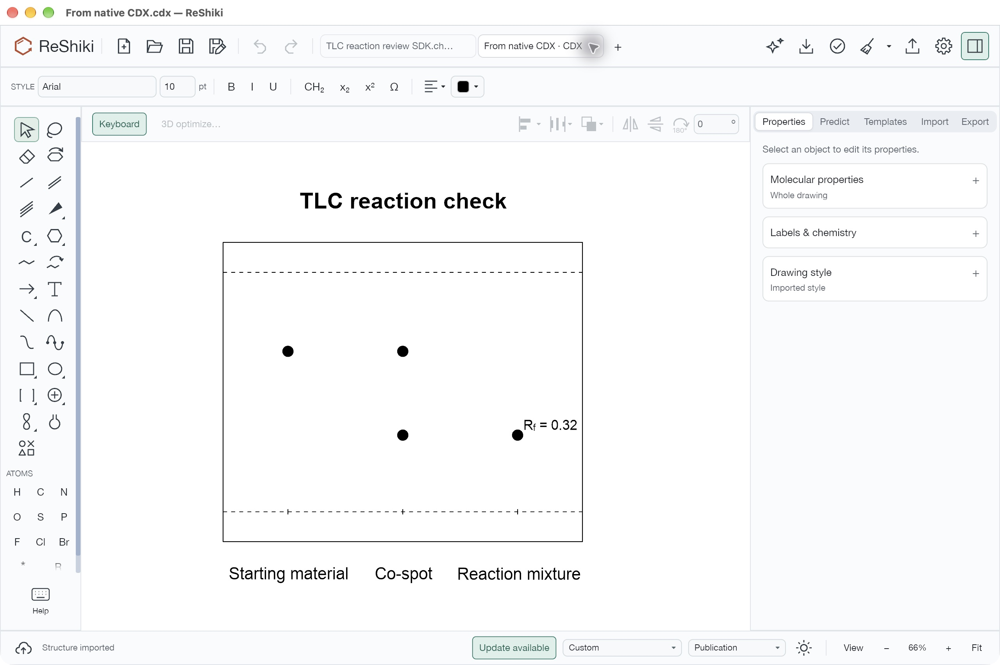
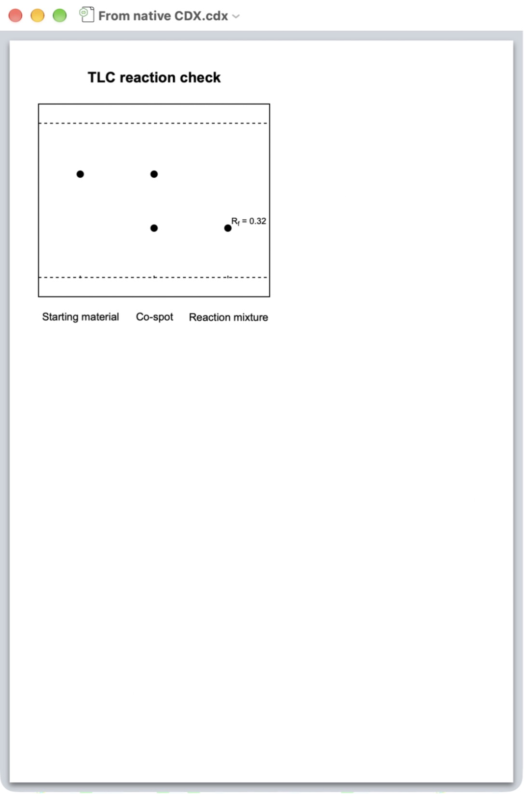
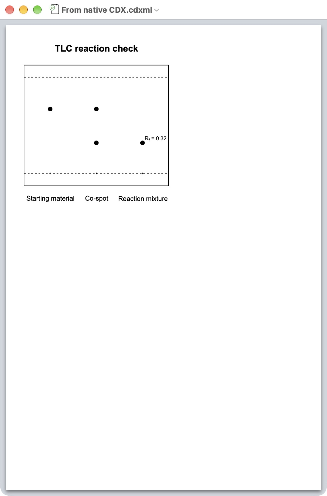

# Native TLC plate round trip

ReShiki `d398b505ee46fd20dde83bd653f00caf01d62534` was built on Apple Silicon macOS from drawing base `e909aef97bf837694b17459dba0ef4a9cb99c106`. The screenshots use the [three-lane reaction plate authored in ChemDraw 26.1](../tlc-reaction-reference/).

1. Open `TLC reaction review SDK.chemdraw.cdx` or its CDXML counterpart in ReShiki. Use `reshiki --cli convert INPUT -o OUTPUT` with `.cdx` and `.cdxml` outputs for each input.
2. Reopen the CDX output in ReShiki and fit the drawing to the window. The first screenshot shows the plate at 66%.
3. Open both outputs from the CDX input in ChemDraw 26.1. The second and third screenshots show the same plate in the ChemDraw window at its native view scale.

All four conversions succeeded, and ChemDraw SDK 26.8 reopened all four outputs. Each output retained one plate, three lanes with one, two, and one spots, and the visible Rf value of 0.32. Relative to the top left of the 240 × 200 pt plate, the maximum measured spot-centre shift was under 0.08 pt across the four routes. Captions stayed separate. The two files from the CDX input had identical plate crops in the SDK render.

| ReShiki reopening CDX | ChemDraw reopening CDX | ChemDraw reopening CDXML |
| --- | --- | --- |
|  |  |  |
