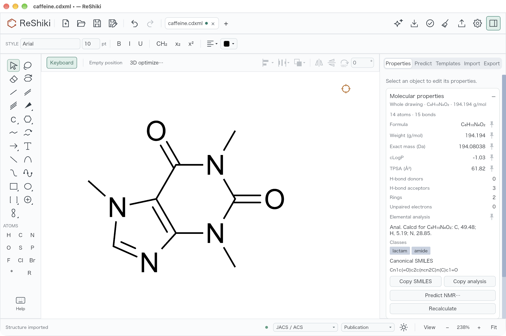
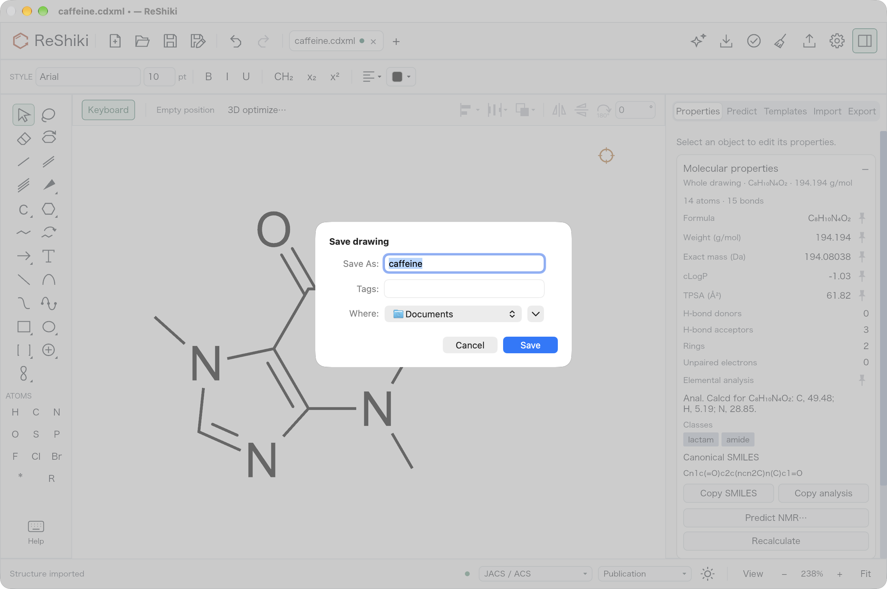
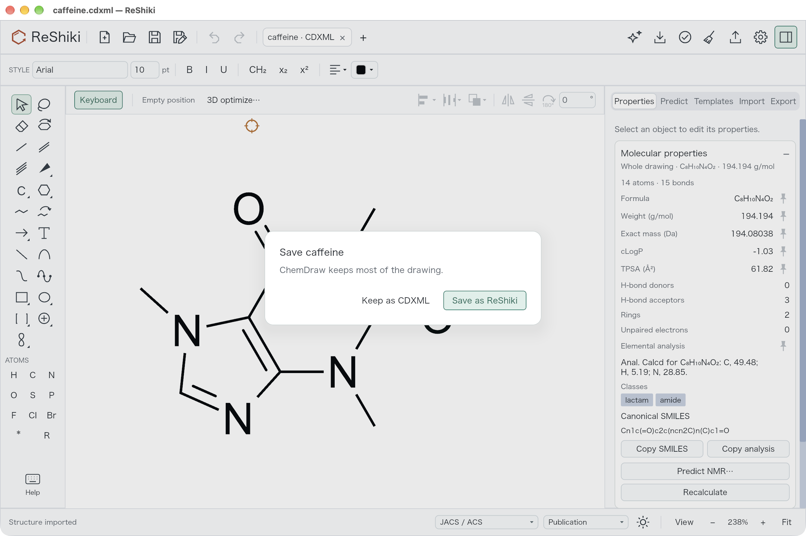
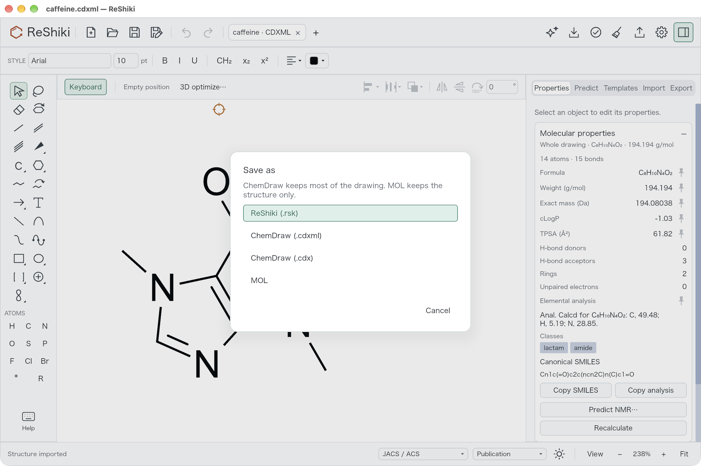
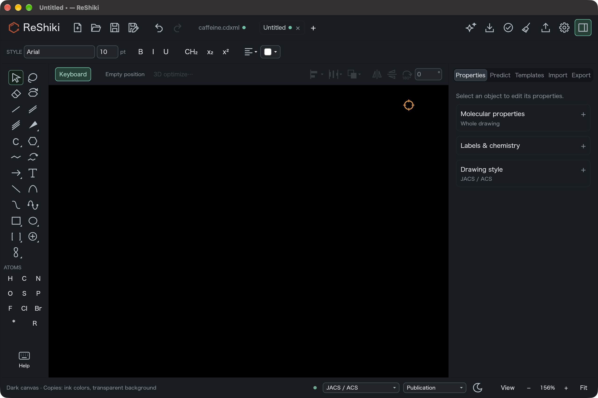
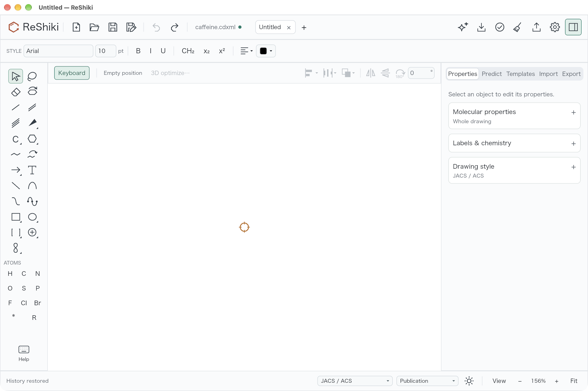
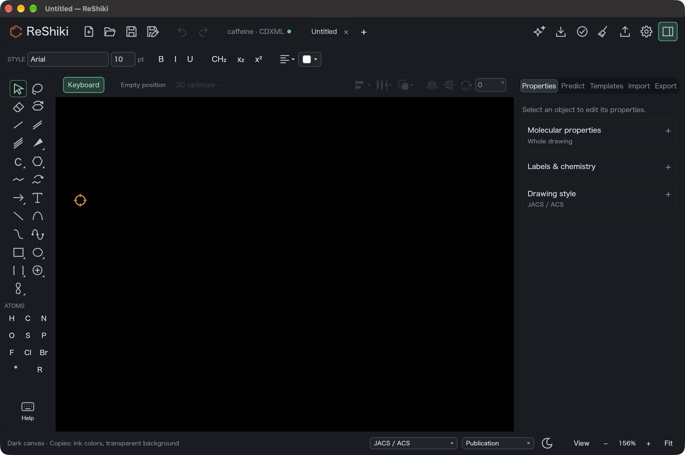
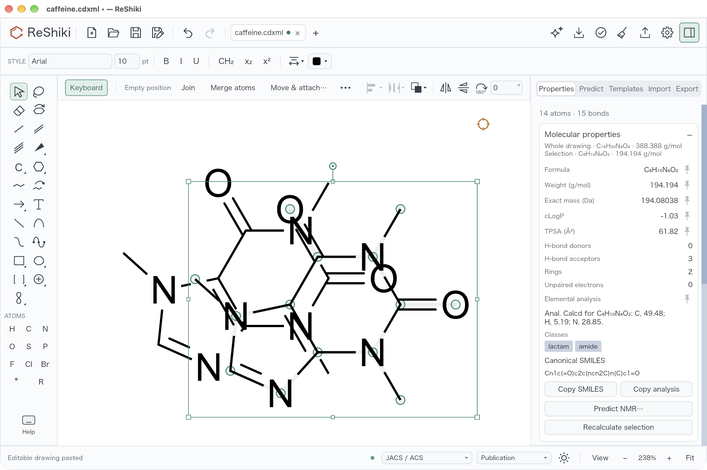
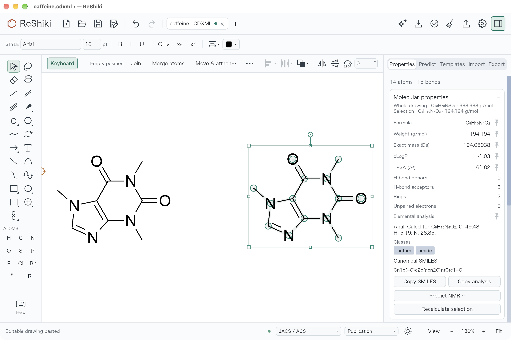

## Summary

Three owner-approved UX items from round 2 (r2-10, r2-14, r2-15), desktop app.

- **ChemDraw and MOL files open as themselves.** Opening a `.cdxml`, `.cdx` or `.mol` file shows the tab as `caffeine · CDXML`, with no unsaved dot and nothing to undo until an edit. The first **Save** asks once: **Keep as CDXML** (or CDX, MOL) writes the file back in its own format, **Save as ReShiki** saves a `.rsk` drawing. The answer holds while the file is open.
- **Save as… lists the formats:** ReShiki (.rsk) · ChemDraw (.cdxml) · ChemDraw (.cdx) · MOL, then the system save panel for that format.
- **View changes stay out of Undo.** Switching the canvas between light and dark is no longer an Undo step or an unsaved change (zoom, grid, rulers and panels already were not). The canvas is still saved with the drawing.
- **A large paste lands beside the drawing.** A pasted part wider than a quarter of the view goes one bond length right of the drawing and is brought into view. Smaller parts keep today's small offset.

## Why it matters

- An untouched opened `.cdxml` or `.mol` showed the unsaved dot, **Save** could only write `.rsk`, and CDXML was three levels deep under Export. ChemDraw users expect to open, edit and save a file in place (ux-observations "Saving CDXML is under Export").
- Each canvas light/dark switch was an Undo step, so the next ⌘Z flipped the canvas instead of undoing the last edit, and an empty drawing became "unsaved" (ux-observations "Switching light/dark takes Undo steps").
- ⌘A, ⌘C, ⌘V put the copy on top of the original with a few millimetres' offset, so copies of a scheme merged into one block that had to be dragged apart.

## Approach

- **Open.** `Job::ImportFile` now carries the file's path. For `.cdxml`, `.cdx` and `.mol` the finished import sets the tab's path to the file, marks the drawing saved and starts with an empty history; opening the same file again shows its tab. Other imports (RXN, SMILES, crystal files) and the browser build are unchanged: an unsaved drawing named after the file.
- **Save.** The file name's extension decides the bytes: `.cdxml`, `.cdx` and `.mol` are written by the chemistry engine (`reshiki::formats::write_with_engine`), anything else as `.rsk`. The first Save of such a file shows an in-app question (the existing `prompt.rs` dialog); the answer is one flag on the tab. A Save as into one of these formats counts as the answer.
- **Save as.** `rfd` merges file filters on macOS, so the system panel cannot show a format list there. Save as therefore asks for the format in the app first, on every desktop platform, and then opens the system panel for that one extension. The dialog carries the proposal's two lines: "ChemDraw keeps most of the drawing. MOL keeps the structure only."
- **Canvas.** `set_canvas_theme` changes the drawing without recording history; `same_drawing` no longer compares the canvas, and Undo/Redo keep the current canvas when they restore a frame.
- **Paste.** Both paste paths share one placement: a wide part uses the geometry and the reveal that inserted structures already use (`insert_beside_drawing`, `commit_structure_insert`). Paged drawings keep the small offset, because right of the drawing may be off the page.

Decisions where the proposal was open (simplest behaviour chosen):

- "Remembered per file" = while the file is open in its tab. Nothing is stored between sessions.
- MOL/SDF: the app has no SDF open today, so this covers `.cdxml`, `.cdx` and `.mol`.
- The Save as format list is an in-app step before the system panel, not a popup inside it (see above).
- Zoom, grid, rulers and panels were already outside Undo and the saved state; only the canvas needed a change. They are not newly written into the file.
- A wide paste sits in the view's row, as an inserted structure does.

## Evidence

Real app, macOS arm64 debug builds, window 1280 × 852 pt, fresh `RESHIKI_DATA_DIR` per run, driven with Codex computer use; each image is a capture of the ReShiki window only (the before Save panel is the window with its own sheet). Before: `origin/main` `8a2e01831`. After: `e2b2185ab`. Test file: `caffeine.cdxml` written by `reshiki --cli convert`.

### Open a ChemDraw file

| Before | After |
| --- | --- |
|  caffeine.cdxml just opened: tab "caffeine.cdxml" with the unsaved dot, title "caffeine.cdxml • — ReShiki", Undo enabled. |  The same file just opened: tab "caffeine · CDXML", no dot, title "caffeine.cdxml — ReShiki", Undo and Redo greyed. |

### Save and Save as

| Before | After |
| --- | --- |
|  ⌘S (and ⇧⌘S) open the system Save panel for a .rsk file named "caffeine"; no format choice. |  First ⌘S: "Save caffeine", "ChemDraw keeps most of the drawing.", Keep as CDXML / Save as ReShiki. Esc cancels. |
| |  ⇧⌘S: "Save as" lists ReShiki (.rsk), ChemDraw (.cdxml), ChemDraw (.cdx), MOL, and Cancel. Enter takes ReShiki. |
| |  After Keep as CDXML: status "Document saved", no dot. The file on disk still starts with `<?xml` / `<CDXML`, no .rsk was created, and the next ⌘S saved without asking. |

### Canvas and zoom changes

| Before | After |
| --- | --- |
|  New empty drawing, canvas switched to dark, zoom + twice: tab "Untitled" gets the unsaved dot, Undo is enabled. |  The same steps: "Untitled" has no dot, title "Untitled — ReShiki", Undo and Redo greyed. (The caffeine tab's dot is from the paste below.) |
|  One ⌘Z: the canvas flips back to light ("History restored"); zoom stays 156%. |  One ⌘Z: nothing changes; the canvas stays dark. |

### Paste a copy of the whole drawing (⌘A, ⌘C, ⌘V)

| Before | After |
| --- | --- |
|  The copy lands on top of the original, shifted slightly down and right. |  The copy lands to the right of the original with a gap; the view zooms from 238% to 136% to show both. The copy is selected. |

## Verification

macOS arm64 (Apple M4), on the pushed tree:

- `cargo fmt --all --check`; `cargo clippy --workspace --all-targets --all-features --locked -- -D warnings`: clean.
- `cargo test --locked --no-default-features -p reshiki --lib --bins`: lib 403 passed, app 1650 passed, 0 failed.
- Ignored renderer tests of the app binary that CI runs on Windows (all except `manual_` and `_child`): 151 passed.
- `cargo clippy -p reshiki-web -p reshiki --lib --bin reshiki --target wasm32-unknown-unknown --locked -- -D warnings`: clean.
- `python3 scripts/copy_lint.py`, `python3 scripts/module_index.py --check`, `scripts/assemble_changelog.py --check`, `bun fmt --check .`: clean.
- New tests: `chemdraw_and_mol_files_open_unchanged_and_ask_once_how_to_save`, `a_file_opened_during_the_format_question_cancels_it`, `save_as_reshiki_turns_a_chemdraw_file_into_a_drawing`, `save_as_lists_the_formats_and_a_chosen_format_is_kept`, `opening_an_open_chemdraw_file_again_shows_its_tab`, `view_changes_are_not_undo_steps_or_unsaved_changes`, `a_wide_paste_lands_beside_the_drawing_and_a_small_one_near_the_view_centre`.

VERIFICATION_TABLE

## Risk

- **Saving back loses what the format cannot hold**, by design: the tab is then "saved" although a `.mol` keeps the structure only. The dialogs say so in general terms; the chemistry engine's specific export warnings (for example a crystal's unit cell left out of CDXML) are not shown after Save, as they are after Export. Follow-up candidate.
- **Save as needs one more step** (the format list, Enter for .rsk) before the system panel.
- **Typed extension wins.** After choosing a format, typing a name with another extension writes by that extension (`.rsk` content for an unknown one), as Save as did before. macOS does not allow this in the panel; Windows and Linux do.
- **Same file opened twice before the first import finishes** gives two tabs on one file (the duplicate check sees a file only once its import is done). Needs two opens within the import time; not handled.
- **A canvas-only change is not kept on close**: it no longer counts as a change, so closing does not ask. It is saved with the next save.
- A wide **picture** paste also lands beside the drawing; the view then centres on the picture.
- Opening a ChemDraw/MOL file no longer leaves an Undo step back to the empty drawing.
- Browser build: unchanged (Save as .rsk only, imports open as unsaved drawings).
- Seen in the evidence runs on both builds, not changed here: ⌘V sent right after ⌘C can be dropped while the copy is still being prepared; Quit does not ask about an edited tab behind the front one.

## Changelog

- **Open** shows a ChemDraw (`.cdxml`, `.cdx`) or MOL file as itself: the tab reads `aspirin · MOL`, with no unsaved dot until you edit. The first **Save** asks once whether to **Keep as MOL** (or CDXML, CDX) or **Save as ReShiki**, and remembers the answer while the file is open.
- **Save as…** lists **ReShiki (.rsk)**, **ChemDraw (.cdxml)**, **ChemDraw (.cdx)** and **MOL**. In the browser it still saves `.rsk` only.
- Switching the canvas between light and dark is no longer an Undo step and no longer marks the drawing as changed, like zoom, the grid and the panels. The canvas is still saved with the drawing.
- A pasted drawing wider than a quarter of the view lands one bond length to the right of the drawing and scrolls into view, instead of on top of it. Smaller pieces still land near the middle of the view.

## Contribution license

- [x] I have read [CONTRIBUTING.md](https://github.com/Ameyanagi/ReShiki/blob/main/CONTRIBUTING.md). I have the right to submit this contribution and agree to offer my original contributions under both MIT and Apache-2.0, so recipients may choose either license (`MIT OR Apache-2.0`).
- [x] Any third-party material is identified below with its source and license, and its required notices are preserved; otherwise, no third-party material is added.

Third-party sources, if any:
