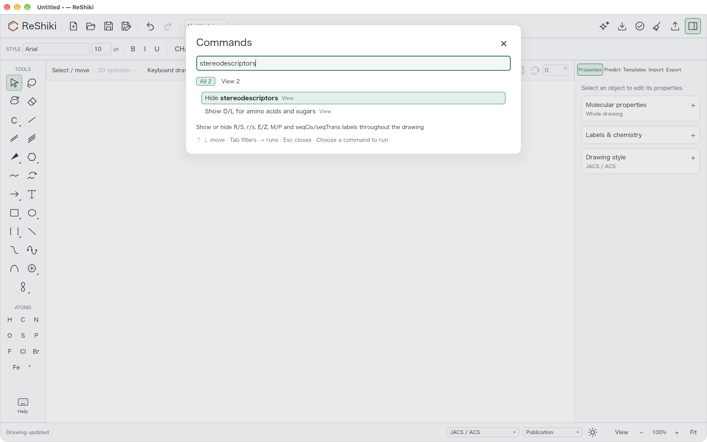
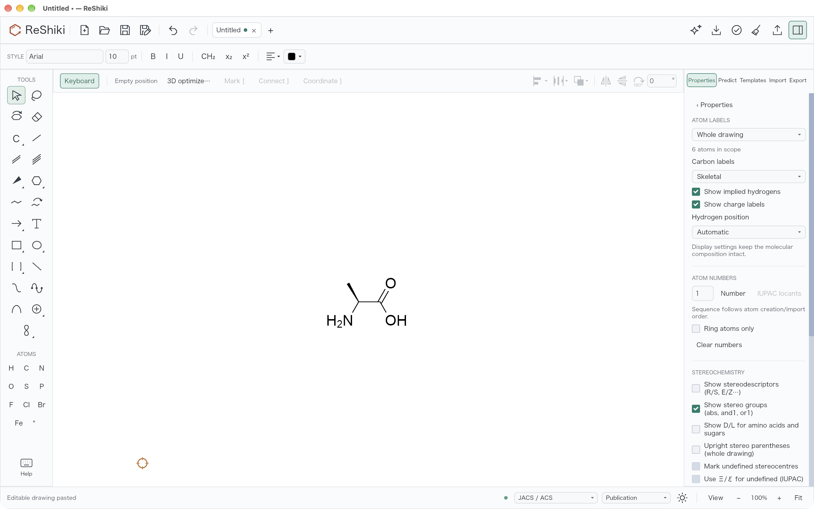
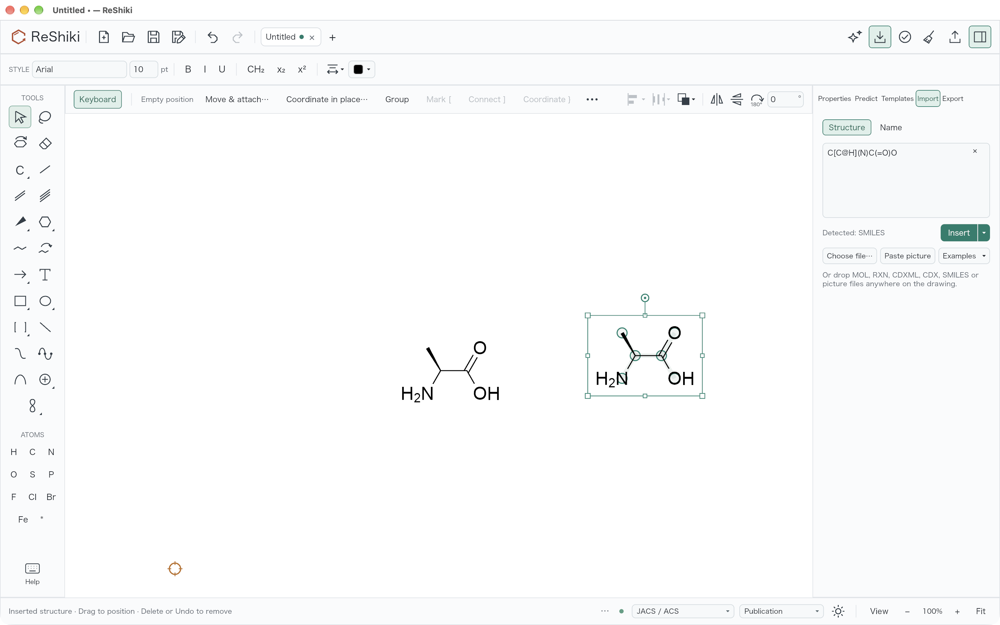
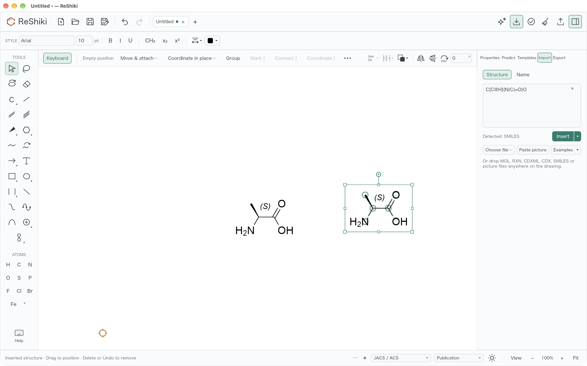
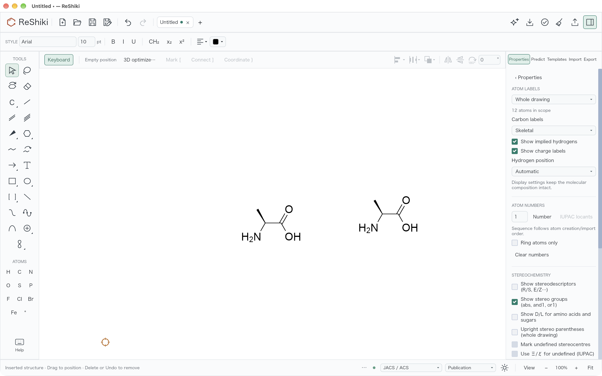
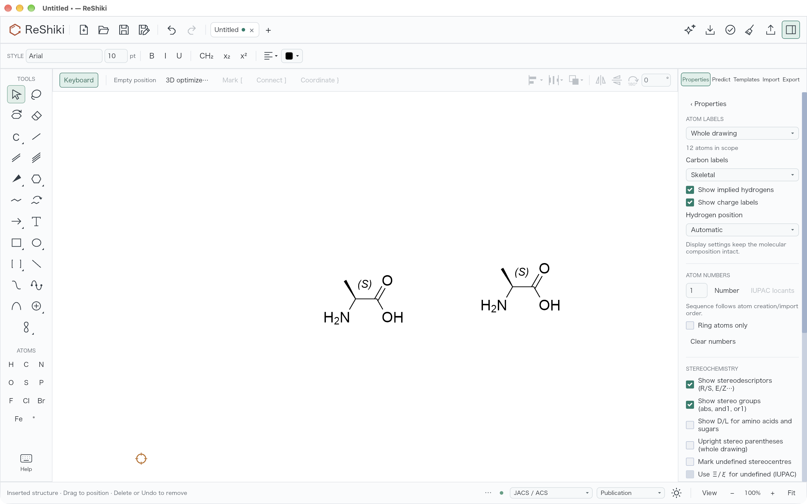

## Summary

Seven small app fixes and one undo speed-up from the wave 1 bug audit. Pasted and inserted structures keep the drawing's label settings, so **Show stereodescriptors** stays on. Other fixes: preference files that ReShiki cannot read are kept, focus returns after the macOS Print panel, Office tabs get their own numbered titles, and three cases that left the editor stuck or with a wrong selection are fixed.

Fixes #1151. Fixes #1119. Refs #1149: the owner still needs to check it by hand on macOS. See X7.

## Why it matters

The audit found these items by reading the code. The three issues were seen in earlier PR checks.

- **X1: paste and Insert turn stereodescriptors off (#1151).** Turn on **Show stereodescriptors**, then paste a SMILES or MOL structure or use **Insert** on the Import tab. The new atoms show no R/S label, and the checkbox shows as unchecked. Each paste gave every new atom its own "hidden" setting, so the user had to turn the option on again after every paste. Seen in the PR #1137 and #1098 checks on macOS arm64.
- **X5: settings from a newer ReShiki are lost.** If `appearance.json` or `assistant-preferences.json` was written by a newer ReShiki that this build cannot read, ReShiki starts with the default settings. The next settings change then overwrites the file. A user who opens an older build loses their settings for good. Found by the audit and reproduced below with a real launch.
- **X7: no keyboard focus after the macOS Print panel (#1149).** After **Cancel** or **Save as PDF**, the ReShiki window stays inactive. Keys do nothing until the user clicks the window. Seen during the #1134 and #1136 checks on macOS 27.0.1 arm64.
- **X8: Expand generic structures stays disabled.** An expansion that finishes while the recovery drafts dialog is open is dropped but stays marked as pending. **Expand generic structures** then stays disabled. Found by the audit.
- **X13: an Office tab stays busy.** If Word, PowerPoint, Excel or LibreOffice closes the drawing's document while dropped files are still loading, the tab stays busy for good. Check, Clean Up and similar actions stay disabled. Found by the audit.
- **X14: Office tabs share one title (#1119).** Two drawings from the same PowerPoint file both open as `Drawing in PowerPoint.rsk`, so the user cannot tell the tabs apart. Seen during the #100 checks on Windows x64.
- **X15: a cancelled edit leaves deleted objects selected.** When ReShiki rolls back an edit, for example a paste that would join separate reaction participants, the IDs of objects that no longer exist stay in the selection. Found by the audit.
- **P5: undo and redo trim the selection slowly.** Undo and redo removed missing objects from the selection with a list search, one per selected object. That costs O(selected × objects). The audit timed the trim at a 16× gallery (16 copies of the shortcut examples) with everything selected. The list search took 3.50 ms and a hash set took 0.17 ms (release build, macOS arm64, median of 3 runs on main). A whole undo plus redo took 120.5 ms. Most of that time is panel rebuilding, which this PR does not change.

## Approach

- **X1:** A structure from another program has no label settings of its own. A foreign paste (`clipboard.rs`) and an engine **Insert** (`engine_jobs.rs`) now copy the receiving drawing's `atom_labels` onto the incoming part before it is merged. The merge then sees matching settings and adds no per-atom overrides. A drawing copied from ReShiki keeps the look it was copied with, as before. The paste is still one Undo step. Rejected alternative: clearing overrides after the merge. That would also clear overrides that a ReShiki copy is meant to keep.
- **X5:** If a preference file cannot be parsed, ReShiki copies it to `appearance.json.bad` or `assistant-preferences.json.bad` and starts with the defaults. The original file stays in place until the next save. Rejected alternative: refusing to start or showing a dialog. The defaults are safe, and the copy lets the user recover the file.
- **X7:** When a print job that had opened the panel finishes, `print_action` returns `window::gain_focus` for the latest window. This happens on macOS only. A finished job whose panel was already gone, or a print that failed before the panel opened, leaves focus alone.
- **X8:** The generic-expansion gate now counts the open recovery dialog as a reason to discard a finished expansion. The status bar says that the expansion was discarded, and the pending state is cleared.
- **X13:** `begin_file_epoch` clears `tab.busy`. A file import has no engine job to cancel, and its late result for the old epoch is ignored. Without this, nothing ever cleared the flag.
- **X14:** Before it names a session file, the Windows OLE server checks the session files of the drawings already open from that host. It then picks the first free name: `Drawing in PowerPoint.rsk`, then `Drawing in PowerPoint (2).rsk`, and so on. Rejected alternative: the presentation and slide name. Office does not reliably pass these to the embedded server.
- **X15:** After a rejected edit is rolled back, the selection keeps only IDs that still exist in the document. The existing test asserted the old stale selection `[a, 999_999]`. It now expects `[a]`.
- **P5:** `step_history` builds `HashSet`s from `object_ids()` for the selection trim and the group check. The behaviour is the same.

## Evidence

All GUI captures: macOS arm64 debug builds. Base `e80cbf4f` and branch `5fe512af`, each from its own target folder. The binaries differ (SHA-256 `a28cfd55…` and `c95078b2…`). Window 1600 × 1000 pt captured at 2× (3200 × 2000 px). Canvas zoom 100%. Each run used a fresh `RESHIKI_DATA_DIR` folder from `mktemp -d`.

### X1: paste and Insert keep Show stereodescriptors (#1151)

Steps, the same in both builds: new drawing → command palette (`:`) → **Show stereodescriptors** → paste `C[C@H](N)C(=O)O` (L-alanine) from the clipboard with ⌘V → deselect → **Properties → Labels & chemistry → Atom labels & numbering…** (scope **Whole drawing**). Then on the Import tab, type the same SMILES and choose **Insert**.

Before the paste, both builds offer **Hide stereodescriptors** in the palette, so the drawing setting is on:

| Base `e80cbf4f` | Branch `5fe512af` |
| --- | --- |
|  |  |

After the paste:

| Base `e80cbf4f` | Branch `5fe512af` |
| --- | --- |
|  |  |

After **Insert** on the Import tab:

| Base `e80cbf4f` | Branch `5fe512af` |
| --- | --- |
|  |  |

Both structures, with the drawing's label settings (12 atoms in scope):

| Base `e80cbf4f` | Branch `5fe512af` |
| --- | --- |
|  |  |

Tests: `app::clipboard::tests::foreign_paste_follows_the_drawings_label_settings_in_one_undo_step` and `app::engine_jobs::tests::inserted_structures_follow_the_drawings_label_settings`. Both fail on base and pass on the branch.

### X5: unreadable preference files are kept as `.json.bad`

Real launch of each build with two preference files that this build cannot read. Then one click on the light/dark button in the status bar, which saves `appearance.json`, and quit. Full listings with file contents: [x5-base.txt](x5-base.txt) and [x5-branch.txt](x5-branch.txt).

Base `e80cbf4f`, after the click:

```text
280  appearance.json                ← newer file overwritten; its settings are lost
65   assistant-preferences.json
```

Branch `5fe512af`, after launch and again after the click:

```text
280  appearance.json
57   appearance.json.bad            ← {"mode":"a-mode-from-a-newer-build","smart_guides":false}
65   assistant-preferences.json
65   assistant-preferences.json.bad ← {"auto_apply":"a-value-from-a-newer-build","model":"gpt-6-astra"}
```

Tests on the branch: `appearance::settings_tests::unreadable_preferences_are_set_aside_before_a_save_replaces_them` and `assistant::settings::tests::unreadable_preferences_are_set_aside_before_a_save_replaces_them`. Both pass. They call `load_from` and `save_to`, which do not exist on base, so they were not run there. The real launch above shows the base behaviour.

### X7, X8, X13, X15: tests fail on base and pass on the branch

Method: the branch's new and changed tests were applied to the base `e80cbf4f` source and run there. Then the same tests were run on the branch. Full output: [tests-before-base-e80cbf4f.txt](tests-before-base-e80cbf4f.txt) and [tests-after-branch-5fe512af.txt](tests-after-branch-5fe512af.txt).

| Item | Test | Base `e80cbf4f` | Branch `5fe512af` |
| --- | --- | --- | --- |
| X7 | `app::printing::tests::closing_the_print_panel_returns_focus_to_the_editor_window` | FAILED: no focus task after `Ok(Outcome { completed: false })` | ok |
| X8 | `app::generic::tests::expansion_finishing_under_the_recovery_dialog_is_discarded_not_left_pending` | FAILED: `app.generic.pending.is_none()` | ok |
| X13 | `app::import::tests::a_new_file_epoch_releases_an_import_that_can_no_longer_finish` | FAILED: `!app.tab.busy` | ok |
| X15 | `app::transaction_tests::rejected_edit_deselects_the_objects_it_rolled_back` | FAILED: left `[1, 3]`, right `[1]` | ok |
| X15 | `app::transaction_tests::invalid_edit_rolls_back_with_edit_cancelled_status` (changed) | FAILED: left `[1, 999999]`, right `[1]` | ok |
| X1 | `app::clipboard::tests::foreign_paste_follows_the_drawings_label_settings_in_one_undo_step` | FAILED: left `[Some(false), Some(false)]`, right `[None, None]` | ok |
| X1 | `app::engine_jobs::tests::inserted_structures_follow_the_drawings_label_settings` | FAILED: per-atom stereo override set | ok |

Base: `test result: FAILED. 0 passed; 7 failed`. Branch: `test result: ok. 8 passed; 0 failed` (the 7 above plus the appearance test from X5).

**X7 still needs the owner's hand check.** The test only shows that the app asks for focus. Automated input can activate the window by itself, as noted in #1149. On macOS, press ⌘P, choose **Cancel**, then press an arrow key or an atom key without clicking. Check that ReShiki is the key window and that the key acts on the drawing. Do the same after **Save as PDF**. #1149 stays open until this is done.

### X14: numbered Office tab titles (#1119)

The OLE code is Windows only (`native/windows` is `#![cfg(windows)]`), so it does not build on macOS. The tests are `ole::tests::later_drawings_from_one_host_are_numbered` (new) and `ole::tests::session_file_name_uses_sanitized_host_app` (now passes a number). They run in the Windows x64 row of the verification table. This PR was not checked with two drawings in a real PowerPoint file.

### P5: undo and redo selection trim

Not measured before and after. No benchmark in `src/app/performance.rs` times `step_history` with everything selected. The audit numbers above, taken on main, are the only numbers for this change.

## Verification

macOS arm64, branch `5fe512af`, `CARGO_TARGET_DIR` set to the lane's own folder. `RESHIKI_INCHI_HELPER` and `RESHIKI_NAMING_HELPER` were set to `$CARGO_TARGET_DIR/debug/reshiki`, and `RESHIKI_DATA_DIR` to a fresh `mktemp -d` folder.

| Command | Result |
| --- | --- |
| `cargo fmt --all --check` | exit 0 |
| `cargo clippy --workspace --lib --bins --all-features --locked -- -D warnings` | exit 0 |
| `cargo build --locked --bin reshiki` | exit 0 |
| `cargo test --locked --bin reshiki -- <the 8 test names above>` | 8 passed, 0 failed |
| `cargo test --locked --lib -- assistant::settings::tests::unreadable_preferences_are_set_aside_before_a_save_replaces_them` | 1 passed, 0 failed |
| Lane's full `cargo test` run (finished after the last code change) | 106 test binaries: 2577 passed, 0 failed, 201 ignored |
| Same 7 tests on base `e80cbf4f` with the new tests applied | 0 passed, 7 failed (expected) |

VERIFICATION_TABLE

## Risk

- **X1** changes how foreign pastes and inserts merge. A pasted MOL or SMILES structure now follows the drawing's settings for implied hydrogens, charge labels, D/L and upright parentheses, as well as stereodescriptors. Pastes copied in ReShiki are unchanged.
- **X5** writes one extra file into the data folder, and only when a preference file cannot be read. A later failure with the same name overwrites the old `.bad` copy.
- **X7** affects macOS only and runs only when a print panel was open. It is not confirmed by hand yet.
- **X14** affects Windows Office embedding only. It was checked only by unit tests, not in a real Office document.
- **X8, X13, X15 and P5** are small changes inside existing code paths. Each is covered by the tests above.

## Changelog

`docs/changes/unreleased/wave1-app-fixes.md`:

```markdown
---
section: Fixes
issues: []
---

- Pasting a MOL file, SMILES or a ChemDraw structure, and **Insert** on the
  Import tab, no longer turn **Show stereodescriptors** off for the new atoms.
  A structure from another program follows the drawing's label settings. A
  drawing copied in ReShiki still keeps the look it was copied with. The paste
  is one Undo step (fixes
  [issue #1151](https://github.com/Ameyanagi/ReShiki/issues/1151)).
- On macOS, closing the Print panel returns keyboard focus to the ReShiki
  window, so the next key acts on the drawing without a click (fixes
  [issue #1149](https://github.com/Ameyanagi/ReShiki/issues/1149)).
- On Windows, several drawings opened from the same Office application get
  numbered tabs: `Drawing in PowerPoint.rsk`, then
  `Drawing in PowerPoint (2).rsk`, and so on (fixes
  [issue #1119](https://github.com/Ameyanagi/ReShiki/issues/1119)).
- A newer ReShiki's interface or assistant preferences that this version cannot
  read are no longer lost. ReShiki starts with the default settings and keeps a
  copy of the file as `appearance.json.bad` or `assistant-preferences.json.bad`
  in its data folder.
- **Expand generic structures** is available again after an expansion finishes
  while the recovery drafts dialog is open. The status bar says that the
  expansion was discarded.
- A drawing opened from Word, PowerPoint, Excel or LibreOffice no longer stays
  busy when its document closes while dropped files are still loading.
- After an edit that ReShiki cancels, such as a paste that would join separate
  reaction participants, the objects that were removed again are no longer
  selected.
```

## Contribution license

- [x] I have read [CONTRIBUTING.md](https://github.com/Ameyanagi/ReShiki/blob/main/CONTRIBUTING.md). I have the right to submit this contribution and agree to offer my original contributions under both MIT and Apache-2.0, so recipients may choose either license (`MIT OR Apache-2.0`).
- [x] Any third-party material is identified below with its source and license, and its required notices are preserved; otherwise, no third-party material is added.

Third-party sources, if any: none.
