## Summary

Eight fixes in the drawing model and in file import from the wave 1 bug audit, and three refactors that remove the cause of two of them. **Move & attach** works on a molecule with a name caption, depth paint or a 3D model, and on an arrow with condition text. Dragging a ring onto a bond no longer deletes a radical, mark or stereo group. Saving keeps the file's permissions and writes through a symbolic link. **Clean up…** with **Keep orientation** no longer mirrors the drawing. Files with a UTF-8 byte-order mark import. An out-of-range data-group charge or hydrogen count imports with a warning instead of wrapping. Recovery drafts from a newer ReShiki are shown instead of hidden. SMILES and SMARTS are trimmed the same way on every platform.

Fixes #1121.

## Why it matters

The audit found all eight items by reading the code. #1121 was seen in the #1116 check on macOS arm64.

- **X2: Move & attach refuses named molecules.** Select a molecule that has a name caption and choose **Move & attach…**. Base refuses every join with "Invalid molecule-name caption association". The same happens to a molecule with a depth appearance ("Invalid depth appearance scope") and to an arrow with condition text. A 3D model linked to the moved atoms loses its link. The cause: the join renumbered seven kinds of objects in the moved fragment, but not names, condition labels, depth scopes or models.
- **R1 found more of the same.** **Share an atom** and **Fuse along a bond** go through template attachment, which had the same gap. On base they report "No compatible attachment" for a named or depth-painted molecule.
- **X3: ring snap deletes radicals, marks and stereo groups.** Drag a saturated carbon ring onto a single bond and it fuses: the two ring atoms on the shared bond are deleted. If one of them carried a radical, a lone pair or another mark, or belonged to a stereo group, that state was lost without a notice. Template attachment already refuses these atoms; 294a7784 added stereo groups there. Ring snap kept its own, shorter list.
- **X4: saving changes permissions and breaks links.** On macOS and Linux, every save wrote a new owner-only (0600) file and renamed it over the old one. A shared 0644 file became private after one save. A symbolic link was replaced by a regular file, so the file it pointed to never got the change. The CLI already kept the mode; the app did not.
- **X6: Clean Up mirrors the drawing (#1121).** **Keep orientation** matched only the rotation of the new layout. When the layout engine returned the mirror image, Clean Up showed it as is. Seen on `O=C1Cc2ccccc2C12CCC(=O)c1ccccc12`, morphine, griseofulvin and flufenamic acid. Stereo was kept because wedges are reassigned, but the drawing flipped.
- **X9: a byte-order mark breaks import.** Windows tools often write a UTF-8 byte-order mark. An RXN file with one failed with "Invalid MOL input at line 1: Missing RXN header", and an InChI file was read as SMILES.
- **X10: data-group charges wrap.** A `ZCH` charge or a `HYD`/`IMPL_H` hydrogen count was stored in eight bits without a range check. A charge of 256 imported as 0 and 200 imported as −56, without a warning. RDKit wraps the same way.
- **X11: SMILES trimming depended on the platform.** The trim compared the platform `char` with 32. That type is signed on macOS, Windows and Linux x64 but unsigned on Linux arm64. So a pasted `CCO` followed by a no-break space (U+00A0) imported everywhere except Ubuntu arm64, where it was rejected.
- **X12: drafts from a newer version are hidden.** A recovery draft written by a newer ReShiki fails to load in an older one. The recovery scan skipped it without a word, so the user did not know the draft existed.

## Approach

- **X2 and R1 (root cause, b896931d and 07192497):** Paste/append and **Move & attach** each kept their own list of document collections to renumber. Every collection added since October reached only one of them. Both now call one function, `editing::remap_ids`, which destructures `Document`, so a new collection does not compile until its IDs are handled. Template merge (**Share an atom**, **Fuse along a bond**) now destructures `Document` the same way and remaps molecule names and depth scopes. **Move & attach** also takes an arrow's condition text with it, as Copy and Delete already do. Rejected alternative: adding the four missing collections to each list. That fixes today's bug and leaves the next one.
- **X3 and R2 (root cause, 76e98998 and 26436125):** Ring snap now asks the same "can these atoms merge" question as template attachment (`templates::compatible`), for the ring atoms and for the target bond's atoms. A ring atom with a radical, mark or stereo group is no longer fused; the ring just moves. A target atom with stereo, an atom map or a fixed hydrogen count is no longer a target, as with a ring template.
- **X4 and R4 (a946bed1, dd5a9fc1, 3dbd7e31):** A save follows a symbolic link and replaces the file it names. On macOS and Linux the replaced file keeps its mode, and a new file gets 0666 less the umask, as `File::create` gives. Recovery drafts, settings and caches still go through `write_atomic` and stay 0600. The CLI and the app now build their temporary file with one function, `storage::temporary_in`.
- **X6 (ccd661f8, da8caefc):** With **Keep orientation**, Clean Up also fits the mirror image of the new layout. When the mirror fits clearly better (by a relative margin of 1e-9, so symmetric layouts keep the old result), it reflects the layout back before it matches the rotation. The reference cleanup worker gets the same mirrored candidate, so the parity tests still compare like with like.
- **X9 (639a7dc7):** Import text drops one leading U+FEFF before format detection and parsing.
- **X10 (3a05257e, f268fec2):** The owner chose to warn, not refuse. A value outside −128 to 127 (charge) or 0 to 255 (hydrogen count) is left out, the structure imports, and an import warning names the group and the value: "Ignored the charge 256 in the ZCH data group: it is outside -128 to 127". MOL and RXN imports both report it. An earlier commit in this branch (a0a34b73) refused the file; 3a05257e replaces that. The RDKit parity tests now record these inputs as a warned difference.
- **X11 (e209b156):** The owner chose to trim on every platform. The rule is now explicit: bytes 0x21 to 0x7F are content, and every other byte is trimmed at either end. That is what RDKit does where `char` is signed, so macOS, Windows and Linux x64 behave as before, and Linux arm64 now matches them. A first attempt (0ce7e793) kept non-ASCII bytes as content everywhere. It broke 11 reference targets and was reverted (989c292f).
- **X12 (39253048):** The recovery scan counts abandoned drafts whose document version is newer than this build reads. The status bar shows "1 draft from a newer ReShiki" with **Open folder** and **Dismiss**. The tooltip says to update ReShiki and that the file stays in the recovery folder. Rejected alternative: opening the draft partly. A newer format can hold objects this build would drop.

## Evidence

All captures: macOS arm64 debug builds. Base `e80cbf4f` and branch `e209b156`, each from its own target folder. The binaries differ (SHA-256 `a3e6e76f…` and `91539e10…`). App windows are 1280 × 852 pt, captured at 2× (2560 × 1704 px). Each app run used a fresh `RESHIKI_DATA_DIR` folder from `mktemp -d`. Terminal output is shown as an image and kept as text next to it.

**X2, X3 and X6 are not real-app captures.** These runs could only press buttons and read the window in the background. The canvas did not take clicks, drags or keys, and the import text box did not take typed text. So no structure could be selected on the canvas, dragged, or pasted. For these three items, the branch's tests were copied onto the base source and run on both commits. Throwaway tests in the same run wrote the resulting drawings, which `reshiki --cli render` (branch build) drew. Those tests are not part of the branch. Steps to check them by hand are listed under each item.

### X2 and R1: Move & attach keeps the name caption

Input: [x2-named-ethanol.rsk](x2-named-ethanol.rsk), ethanol with a linked "ethanol" caption, and cyclohexane. The ethanol atoms are moved onto a cyclohexane carbon with `joining::Prepared::place`, the code behind **Move & attach…**.

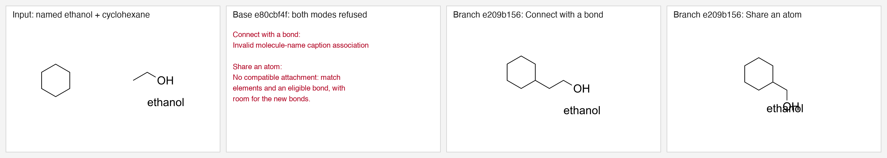

On the branch the caption stays linked: `MoleculeName { annotation: 4, atoms: [1, 2, 3] }` after **Connect with a bond**, and `atoms: [10, 2, 3]` after **Share an atom**, where host atom 10 replaces the shared carbon. The caption keeps its place relative to the moved fragment, so after **Share an atom** it overlaps the OH in this small example.

Tests: `joining::companion_tests::*` (five tests: name caption, condition label, depth appearance, linked model, Share an atom with a name and depth scope). On base all five fail; on the branch all five pass. Full output: [tests-base.txt](tests-base.txt) and [tests-branch.txt](tests-branch.txt).

| Base `e80cbf4f` | Branch `e209b156` |
| --- | --- |
|  | 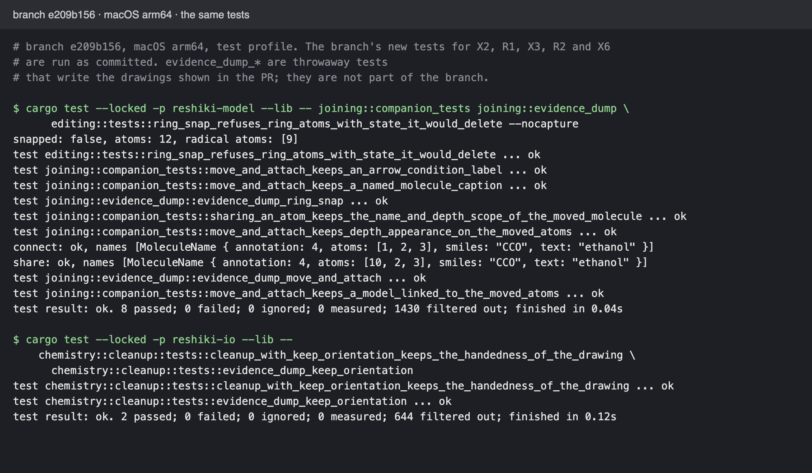 |

To check by hand: insert ethanol from **Import → Examples**, right-click it, choose **Show chemical name**, draw a cyclohexane, select the ethanol and choose **Move & attach…**, then click a cyclohexane carbon. Repeat with **Share an atom**.

### X3: ring snap keeps the radical

Input: [x3-ring-radical.rsk](x3-ring-radical.rsk), two cyclohexanes. The right ring has a radical on the atom that would be shared. The right ring is moved 160 units left, so its left bond lands on the left ring's right bond. The run follows `Edit::Move` in `src/app/canvas_edit.rs`: `editing::snap_ring` with the 250 % zoom radius, then a plain move if the snap is refused.

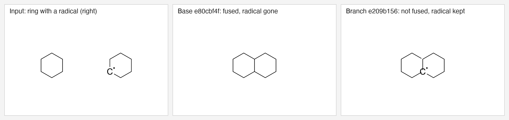

Run output: base `snapped: true, atoms: 10, radical atoms: []`; branch `snapped: false, atoms: 12, radical atoms: [9]`.

Test: `editing::tests::ring_snap_refuses_ring_atoms_with_state_it_would_delete`. It covers a radical, a lone pair and a stereo group on a ring atom and, after R2, on a target atom. Base: fails (`assertion failed: snap_ring(...).is_none()`). Branch: passes.

To check by hand: draw two cyclohexanes, add a radical to one ring atom, select that ring and drag it so the radical's bond lies on a bond of the other ring.

### X4: save keeps the file mode and the symbolic link

Real app. `plain.rsk` and `target.rsk` are 0644 copies of an ethanol drawing, and `link.rsk` is a symbolic link to `target.rsk`. Each file was opened with `reshiki --open <file>` (Finder's `open` resolves the link first), changed with **Import → Examples → Benzene**, and saved with the **Save** button.

| Base `e80cbf4f` | Branch `e209b156` |
| --- | --- |
| 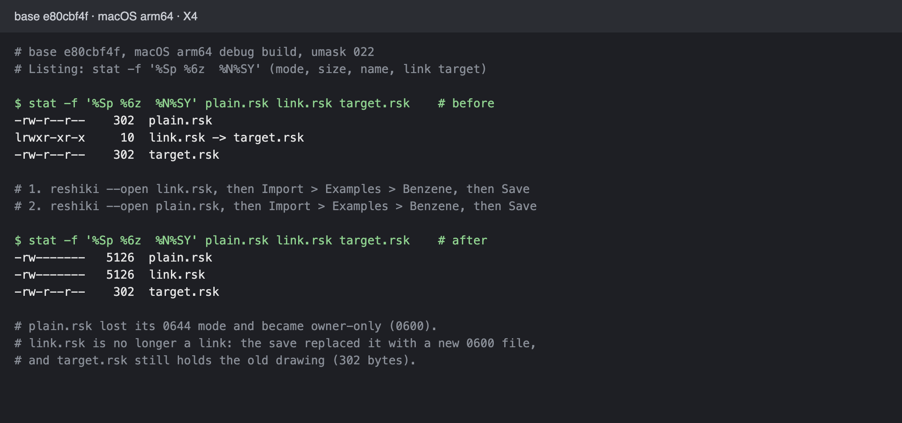 | 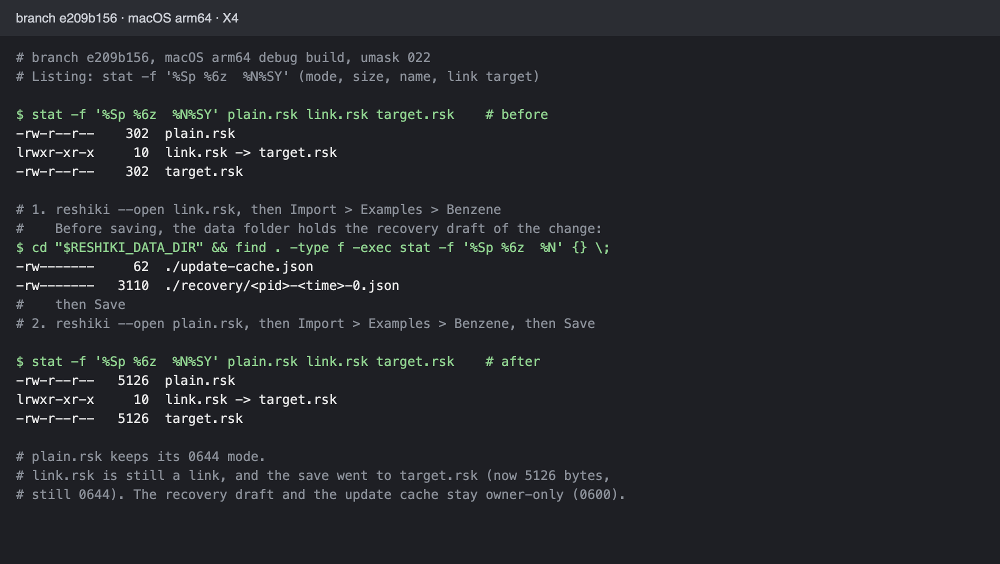 |

Text: [x4-base.txt](x4-base.txt), [x4-branch.txt](x4-branch.txt). Saving a new file with **Save as** was not checked in the app. The test `storage::tests::saving_keeps_the_file_mode_and_writes_through_a_symbolic_link` covers the mode of a new file.

### X6: Clean Up with Keep orientation keeps the handedness (#1121)

`O=C1Cc2ccccc2C12CCC(=O)c1ccccc12`, the structure from #1121, laid out by the depiction engine and then mirrored in x. Then Clean Up with the default options (whole drawing, **Keep orientation**), through the same `clean` helper as the cleanup tests.

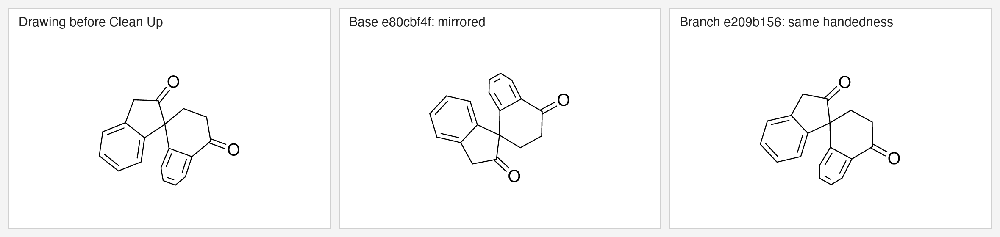

The unmirrored layout keeps its handedness on both commits: [x6-model-other-handedness.png](x6-model-other-handedness.png).

Test: `chemistry::cleanup::tests::cleanup_with_keep_orientation_keeps_the_handedness_of_the_drawing`, which checks both handednesses by the sign of a ring's area. Base: `mirror -1: ring area 7.742147855570487 became -7.742148302650348`. Branch: passes.

To check by hand: Import → Structure → `O=C1Cc2ccccc2C12CCC(=O)c1ccccc12` → **Insert**, select all, **Clean up…** with **Keep orientation**, **Apply**. Do it once more after **Flip horizontal**.

### X9: an RXN file with a byte-order mark

Real app, opened with `open -a ReShiki.app` [ethanol-oxidation-bom.rxn](ethanol-oxidation-bom.rxn) (ethanol → acetaldehyde, `EF BB BF` before `$RXN`):

| Base `e80cbf4f` | Branch `e209b156` |
| --- | --- |
| 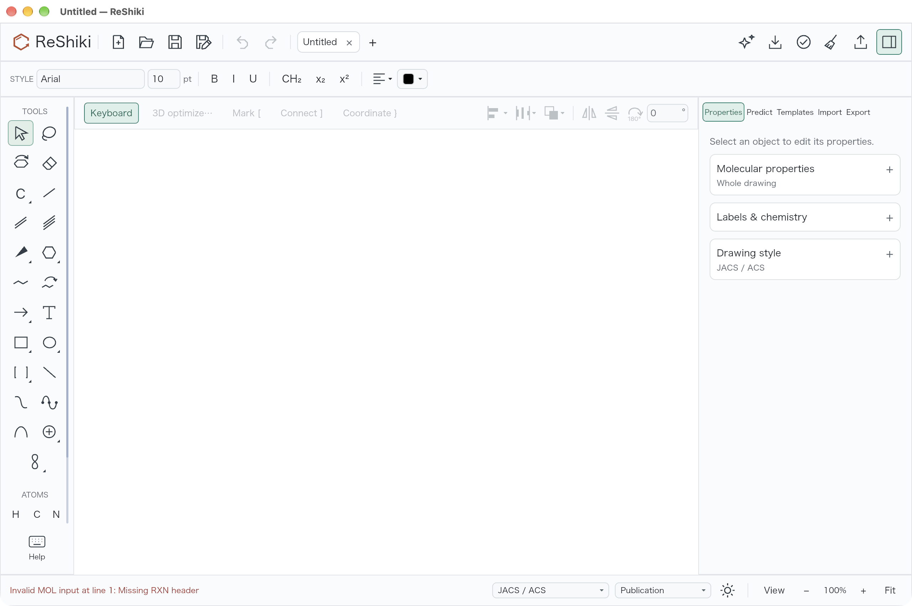 | 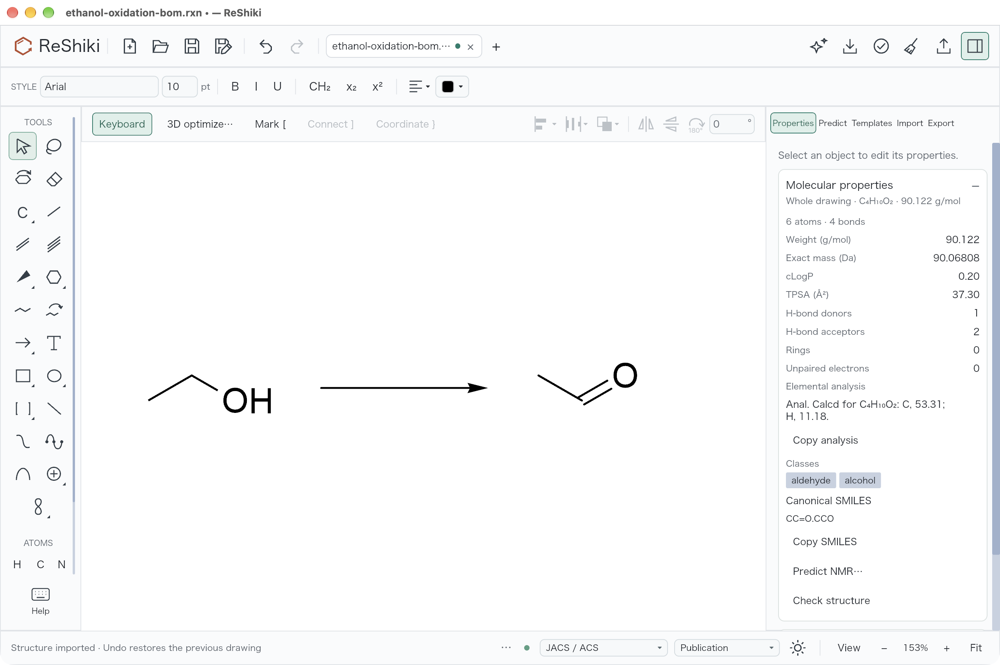 |

The CLI, with and without the mark:

| Base `e80cbf4f` | Branch `e209b156` |
| --- | --- |
| 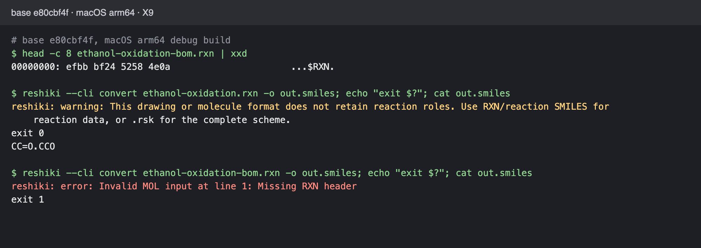 | 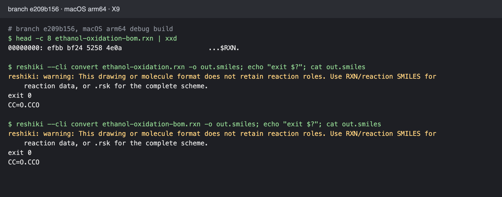 |

Text: [x9-base.txt](x9-base.txt), [x9-branch.txt](x9-branch.txt). Test: `compatibility::tests::import_text_drops_one_leading_byte_order_mark`.

### X10: out-of-range data-group charge

Real app, opened [zch-out-of-range.mol](zch-out-of-range.mol): ethanol with `ZCH` 256 on C1 and `ZCH` 200 on the oxygen.

| Base `e80cbf4f` | Branch `e209b156` |
| --- | --- |
| 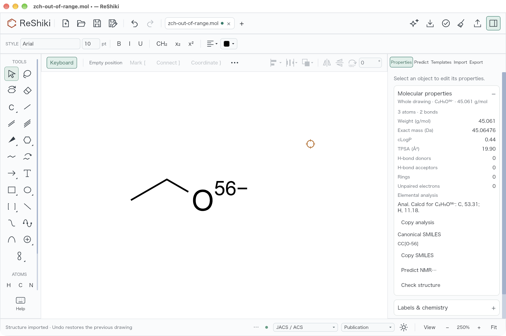 | 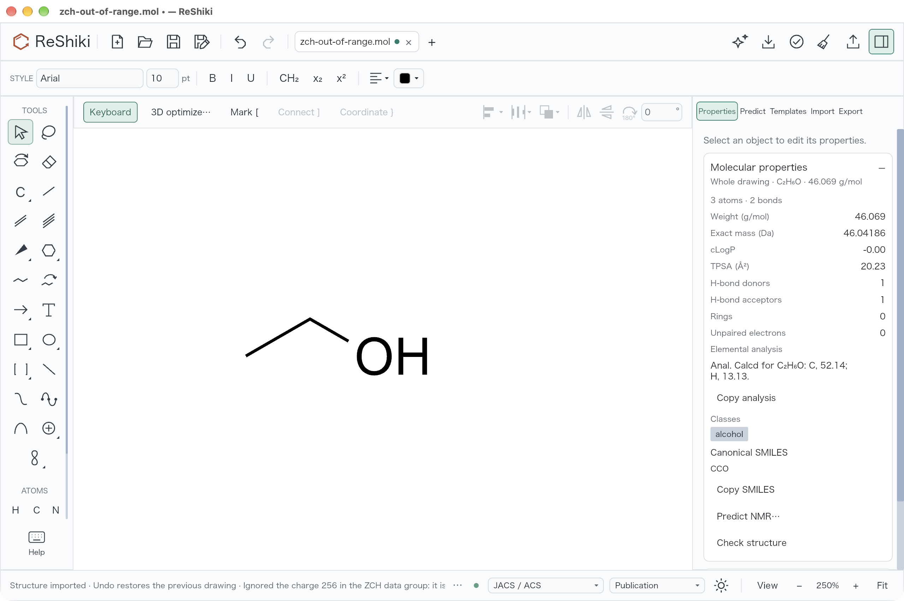 |
|  |  |

The status bar cuts the warning at the window width. The CLI prints both warnings in full:

| Base `e80cbf4f` | Branch `e209b156` |
| --- | --- |
| ![Base CLI: CC[O-56], no warning](x10-base-terminal.png) | 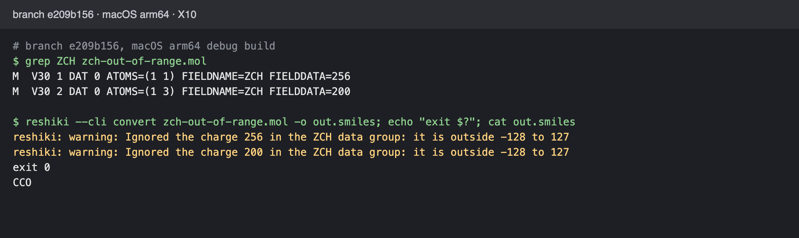 |

Text: [x10-base.txt](x10-base.txt), [x10-branch.txt](x10-branch.txt). Test: `chemistry::molfile::tests::substance_group_charges_and_hydrogen_counts_out_of_range_are_left_out` (`ZCH` 256, 200 and −129; `HYD` 256 and −1; `MRV_IMPLICIT_H` `IMPL_H-1`).

### X12: recovery draft from a newer version

Real app. Before launch, the fresh data folder got one abandoned draft, `recovery/999999-1794600000000000000-0.json`, whose document has `"version": 99`. This build reads up to version 37.

| Base `e80cbf4f` | Branch `e209b156` |
| --- | --- |
| 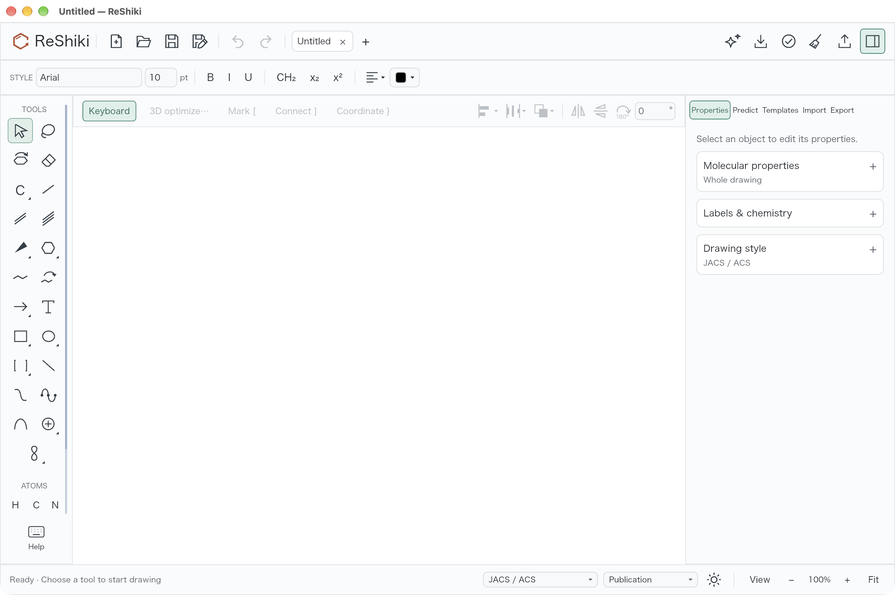 | 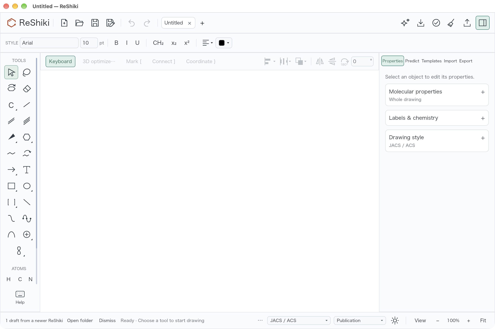 |

**Open folder** was not pressed in this run. Tests: `recovery::tests::drafts_from_a_newer_version_are_counted_not_offered` and `app::recovery_manager::tests::drafts_from_a_newer_version_show_the_banner_until_dismissed`.

### X11: SMILES trimming

The change only shows on Linux arm64, where `char` is unsigned; macOS already trimmed these bytes. Tests, in the Ubuntu arm64 row of the verification table: `smiles::tests::non_ascii_bytes_at_the_ends_are_trimmed_on_every_platform` and `tests::smarts_non_ascii_bytes_at_the_ends_are_trimmed_on_every_platform`. They read `CCO` with a trailing U+00A0, a leading U+3000 and both, and reject `CC\u{a0}O`.

### R2 and R4

R2 (26436125) is covered by the X3 test above, which now also checks the target atoms. R4 (3dbd7e31) has no new behaviour; it is covered by `storage::tests::saving_keeps_the_file_mode_and_writes_through_a_symbolic_link` and the X4 run above. R1 is under X2.

## Verification

macOS arm64, branch `e209b156`, `CARGO_TARGET_DIR` set to the lane's own folder. `RESHIKI_INCHI_HELPER` and `RESHIKI_NAMING_HELPER` were set to `$CARGO_TARGET_DIR/debug/reshiki`, and `RESHIKI_DATA_DIR` to a fresh `mktemp -d` folder.

| Command | Result |
| --- | --- |
| `cargo fmt --all --check` | exit 0 |
| `cargo clippy --workspace --lib --bins --all-features --locked -- -D warnings` | exit 0 |
| `cargo build --locked --bin reshiki` | exit 0 |
| `cargo test --locked -p reshiki-model -p reshiki-io -p reshiki-chemistry --lib` | 3 test binaries: 2380 passed, 0 failed, 17 ignored (model 1427, io 640, chemistry 313) |
| `cargo test --locked --bin reshiki -- recovery_manager storage` | 11 passed, 0 failed |
| X2, X3 and X6 tests on base `e80cbf4f` with the branch's tests copied in | 7 failed, as expected (see [tests-base.txt](tests-base.txt)) |
| The same tests on the branch | 7 passed |

The full workspace and integration test run is in the table below.

VERIFICATION_TABLE

## Risk

- **X2 and R1** change how every join and paste renumbers objects. A mistake in `remap_ids` would show in paste as well as in **Move & attach**. The existing paste and join tests pass.
- **X3 and R2** make ring snap refuse more targets. A ring dragged onto a bond whose atom has stereo, an atom map or a fixed hydrogen count now just moves, where it used to fuse.
- **X4** changes every save on macOS and Linux. A save through a link now needs write access to the folder of the linked file, not the folder of the link. A brand-new saved file is 0644 (with umask 022) instead of 0600; drafts, settings and caches stay 0600.
- **X6** can change the result of Clean Up with **Keep orientation** for any drawing whose new layout is a mirror image. Symmetric layouts keep the old result because of the margin.
- **X10** imports files that the earlier commit in this branch refused. The structure then lacks the out-of-range value, and the user sees a warning.
- **X11** changes behaviour only on Linux arm64.
- **X9 and X12** are small and covered by the tests above.

## Changelog

`docs/changes/unreleased/wave1-model-io-fixes.md`:

```markdown
---
section: Fixes
issues: [1121]
---

- **Move & attach** no longer refuses a molecule that has a name caption, a
  depth appearance or a 3D model, or an arrow that has condition text. The
  caption, text and appearance move with the fragment.
- Dragging a ring onto a bond no longer fuses it when a ring atom carries a
  radical, a lone pair or other mark, or a stereo group. Fusing used to delete
  them without notice. A bond whose atoms carry any of these, stereo, an atom
  map or a fixed hydrogen count is no longer a target, as with a ring template.
- Saving over a file keeps its permissions, and saving through a symbolic link
  writes to the linked file instead of replacing the link. A newly saved file
  gets the usual permissions instead of owner-only ones; recovery drafts and
  settings stay owner-only. This applies to macOS and Linux.
- **Clean up…** with **Keep orientation** no longer mirrors the drawing. When
  the new layout is the mirror image of the drawing, ReShiki reflects it back
  before matching the rotation.
- Files that start with a UTF-8 byte-order mark now import. An RXN file used to
  fail with "Missing RXN header", and an InChI file was read as SMILES.
- A MOL or RXN file whose `ZCH`, `HYD` or `IMPL_H` data group gives a charge or
  hydrogen count that is out of range now imports without that value, and an
  import warning names the group and the value. The value used to wrap, so a
  charge of 200 imported as -56.
- Recovery drafts made with a newer ReShiki are no longer hidden. The status
  bar shows how many there are, with **Open folder** to find the files.
- SMILES and SMARTS text is trimmed the same way on every platform: characters
  outside ASCII at either end, such as a no-break space after a pasted
  structure, are dropped. Linux on arm64 used to reject such text.
```

## Contribution license

- [x] I have read [CONTRIBUTING.md](https://github.com/Ameyanagi/ReShiki/blob/main/CONTRIBUTING.md). I have the right to submit this contribution and agree to offer my original contributions under both MIT and Apache-2.0, so recipients may choose either license (`MIT OR Apache-2.0`).
- [x] Any third-party material is identified below with its source and license, and its required notices are preserved; otherwise, no third-party material is added.

Third-party sources, if any: none.
