## Summary

Repository upkeep from the 0.15.0 maintenance and size audit. Release notes move to one fragment file per pull request, vendored crates get recorded patches and a check, and `AGENTS.md` lists the checks per path. macOS disk images switch to LZMA, shipped executables lose their symbols (kept as a workflow artifact), and stale developer docs match the code again.

No issue is closed by this PR. The full Release builds workflow has not run on this branch.

## Why it matters

**M1 `AGENTS.md` and `CLAUDE.md`.** Contributors and coding agents had no single page that says which checks to run for a changed path, which environment variables the tests need, or what a pull request must contain. Found in the maintenance audit. `CLAUDE.md` is one line, `@AGENTS.md`, so both tools read the same file. `.claude/worktrees/` is now ignored.

**M2 Release-note fragments.** Every pull request edited `docs/changes-unreleased.md` and often `docs/contributors.md`, so parallel pull requests conflicted on the same lines. Found while merging the 0.15.0 stack. Each pull request now adds `docs/changes/unreleased/<branch>.md`; nothing shared is edited.

**M7 Vendored crates.** `vendor/` holds 8 patched crates.io crates with no record of what changed. `iced_widget` alone is 31.8k lines for a 49-line change, so a reviewer could not see the patch or check that nobody edited the copy. Found in the maintenance audit.

**D1 Documentation drift.** `docs/development.md` named Rust 1.99.0 (the pin is 1.99.1), said pull requests run macOS CI (they run Linux and Windows; macOS runs on `merge/*`, `main`, nightly and release), and did not mention cargo-nextest, which CI uses. `docs/getting-started.md` duplicated the install guide and had fallen out of date with it. The README linked 0.9.1 release highlights. `docs/architecture.md` missed `reshiki-web`, `reshiki-web-worker`, `reshiki-python` and the npm package, and gave the 3D tile cache as 128 MB (the code uses 64 MB). Found in the docs audit.

**B1 DMG compression.** The macOS disk image is the largest download. The released 0.15.0 app in the release layout, through this branch's `create_disk_image`: 25,742,502–25,742,526 bytes in 5 of 5 runs, against 42,563,468 bytes for UDZO of the same folder (−40%). The published 0.15.0 DMG is 42,573,452 bytes.

**B2 Strip shipped executables.** 0.15.0 has no `[profile.release]`, so the shipped binary carries its full symbol table. macOS arm64: 100,855,808 → 83,492,432 bytes (−17%) with `strip -x`, which is what `strip = "symbols"` runs on Apple targets. Linux x64: 128,392,536 → 100,258,128 bytes (−22%). The Python wheel's `.so` goes from 47.2 MB to 39.2 MB. Crash reports still need line numbers, so the symbols move to a separate file instead of being dropped.

## Approach

**M1.** One `AGENTS.md` at the root with a table of changed path → command, the test environment (`RESHIKI_DATA_DIR`, helper variables), code invariants, release notes and pull request rules. `CLAUDE.md` imports it instead of duplicating it. Rejected: separate files per tool, which drift.

**M2.** `scripts/assemble_changelog.py` reads `docs/changes/unreleased/*.md` (front matter `section`, `issues`, optional `credit`, then `- ` bullets).

- No option: prints `docs/changes-unreleased.md` followed by the fragments grouped into Changes, Fixes and Developer. `website/scripts/sync-docs.mjs` calls it, so the website page shows the fragments.
- `--check`: validates every fragment.
- `--release VERSION`: appends the fragments to `docs/changes-<minor>.md`, adds `credit` names to `docs/contributors.md` and deletes the fragments.

`CONTRIBUTING.md`, `docs/releasing.md` and the PR template describe the new flow. Rejected: towncrier or another tool, which adds a dependency for about 150 lines of Python, and generating the page at release time only, which would hide merged changes from the website.

**M7.** `vendor/README.md` lists each crate, its upstream version, why ReShiki changes it and its patch. `vendor/patches/<crate>.diff` is the full difference from the crates.io source, and a new column records each crate file's crates.io sha256. `scripts/check_vendor.py` gets each upstream source in this order: the extracted source in Cargo's registry, the cached `.crate` file, or a download from `static.crates.io` through the project's verified TLS context (`scripts/download_tls.py`). It checks every `.crate` against the recorded sha256, applies the patch and compares every file. `cargo fetch` is not enough, because it skips crates that `[patch.crates-io]` replaces. `--write` regenerates the patches after a deliberate change. `.ignore` hides `vendor/` from ripgrep. Rejected: git submodules or forks, which need a second repository per crate.

**D1.** Fix each stale fact against the code: toolchain, uv version, CI scope and the nextest commands in `docs/development.md`; the crate list and cache size in `docs/architecture.md`; README links; `docs/roadmap.md`; the removed migration gates in `docs/structure-to-name-harness.md` (moved to `docs/changes/naming-ir-migration.md`). `docs/getting-started.md` is deleted and `/developer/getting-started` redirects to the install guide.

**B1.** `create_disk_image` in `scripts/installers.py` runs `hdiutil create -format UDZO` into a temporary folder, then `hdiutil convert -format ULMO`. Each step keeps its own three attempts for the hosted runners' "Resource busy" failures. The first version passed `-format ULMO` to `hdiutil create` directly. On macOS 27.0.1 arm64 that failed with "No space left on device" for some folder contents: the app alone failed 6 of 6 attempts and the app with the `Applications` link 8 of 8, while the release layout passed. Converting passed every attempt and gives a smaller image: 25.7 MB, against 27.7 MB for direct ULMO of the release layout. ULMO needs macOS 10.15 or later; the app requires macOS 14.

**B2.** `[profile.release]` sets `debug = "line-tables-only"`, `split-debuginfo = "packed"`, `strip = "symbols"`. `release.yml` overrides per platform:

- macOS: Cargo strips and writes `reshiki.dSYM`.
- Windows: `strip = none`, because the MSVC linker writes no PDB for a stripped build; `reshiki.pdb` holds the symbols and the exe has none.
- Linux: `split-debuginfo = off`; `scripts/build_release.py` copies the debug info into `reshiki.debug` with `objcopy --only-keep-debug`, then strips the shipped binary and adds a debuglink.

A new step uploads these as the `symbols-<platform>` workflow artifact, before any `cargo test` step rebuilds the app and replaces the PDB. They are not release downloads. `crates/python/pyproject.toml` sets maturin `strip = true`. `panic = "abort"` stays off because the app recovers from panics with `catch_unwind`. Rejected: shipping symbols (size), and `debug = 0` (crash reports lose file and line).

png 0.18 was tried and dropped: its `output_buffer_size()` returns `Option`, which broke four root integration-test targets on Ubuntu arm64, and `tiny-skia` 0.11.4 still needs png 0.17, so the duplicate crate stayed.

## Evidence

All captures on macOS arm64 (macOS 27.0.1). Base: `main` e80cbf4f. Head: `wave1/repo-hygiene` 8382c4ff. The M1, M2 and D1 renders are from e1a99203; none of those files changed after it. Document renders are Markdown rendered by headless Chrome at 900 px CSS width (1,400 px for the wide `vendor/README.md` table), 2× device scale, 100% zoom. Terminal captures are the `.txt` transcripts shown as a monospaced page in the same headless Chrome at 2×. No item changes the app's UI, so there are no app screenshots.

### M1 AGENTS.md (new)

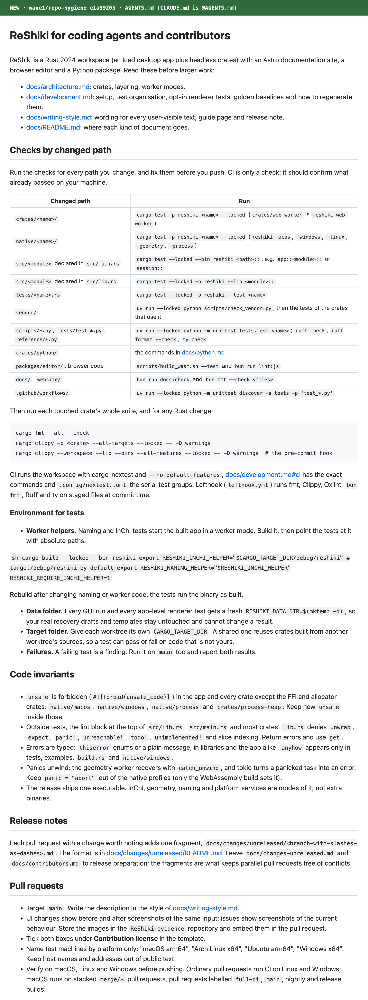

### M2 Release-note fragments

| Before: `docs/changes-unreleased.md` on main | After: the page the website builds from fragments |
| --- | --- |
| 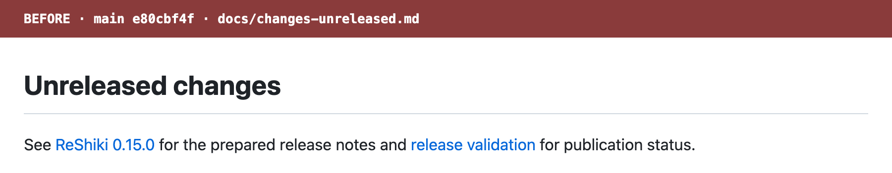 | 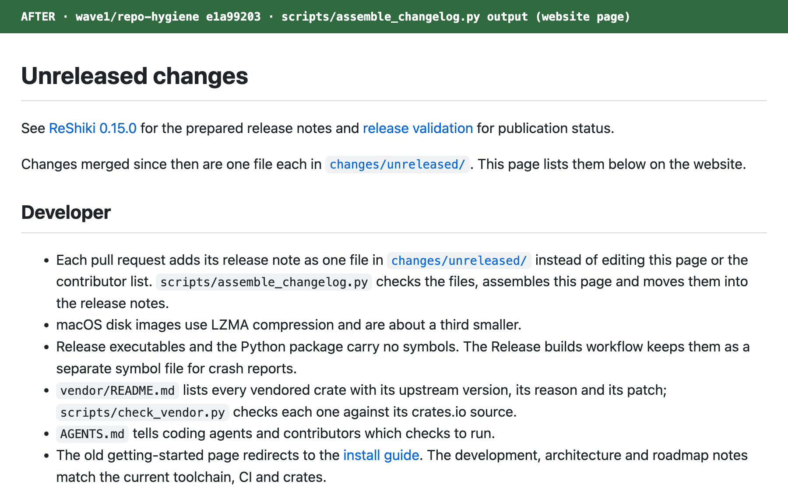 |

Fragment format: 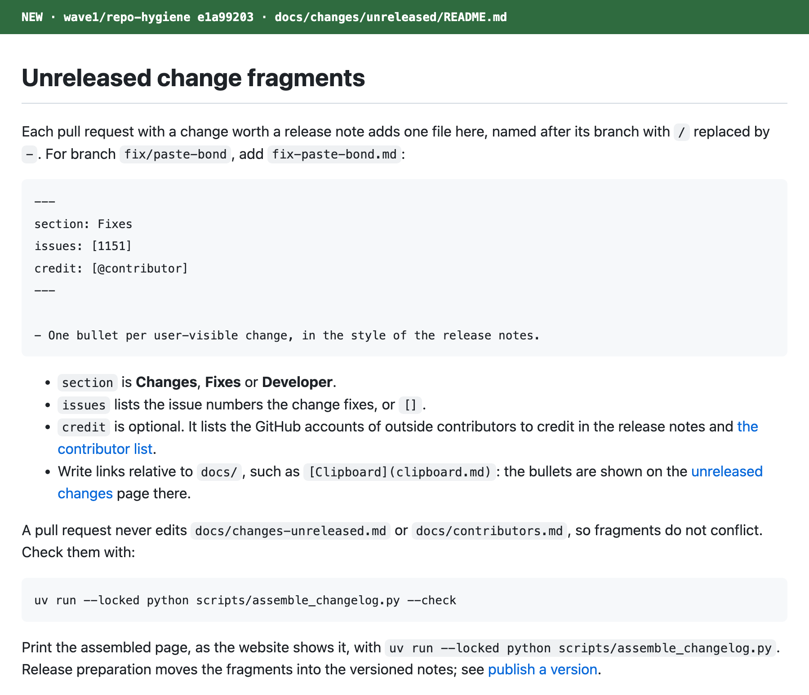

`--check` on the branch, then on a scratch copy with broken fragments ([m2-assemble-changelog.txt](m2-assemble-changelog.txt), [m2-assemble-changelog-broken.txt](m2-assemble-changelog-broken.txt)):

```
$ uv run --locked python scripts/assemble_changelog.py --check
1 changelog fragments are valid
exit 0

$ python3 scripts/assemble_changelog.py --check     # empty fragment body
Changelog fragment error: fix-empty.md: write the change as '- ' bullets
exit 1
$ python3 scripts/assemble_changelog.py --check     # section: Fixed
Changelog fragment error: fix-paste-bond.md: section must be one of Changes, Fixes, Developer
exit 1
$ python3 scripts/assemble_changelog.py --check     # issues: 1151
Changelog fragment error: fix-paste-bond.md: expected a [list], got '1151'
exit 1
```

### M7 Vendored crates

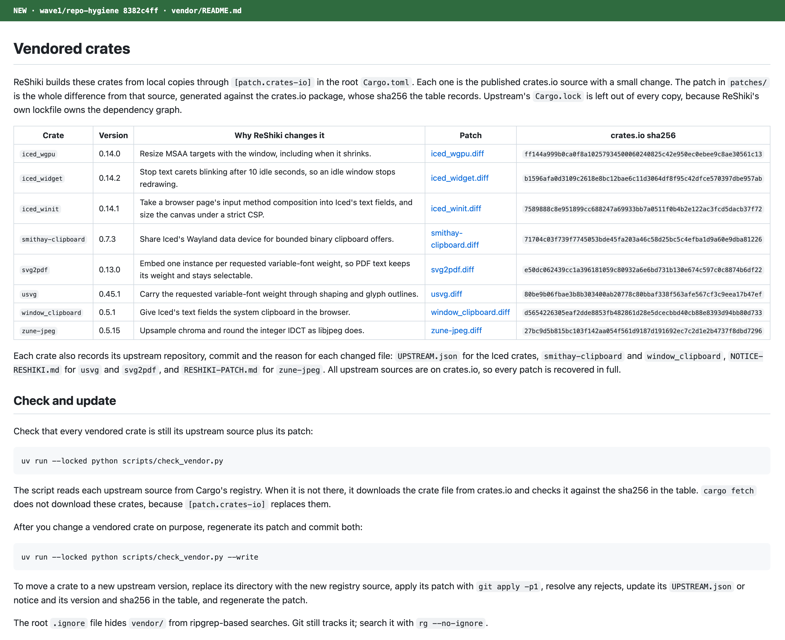

With an empty `CARGO_HOME`, so all 8 crates come from `static.crates.io`, then on fresh scratch copies of `scripts/` and `vendor/` with one edit each ([m7-check-vendor.txt](m7-check-vendor.txt)):

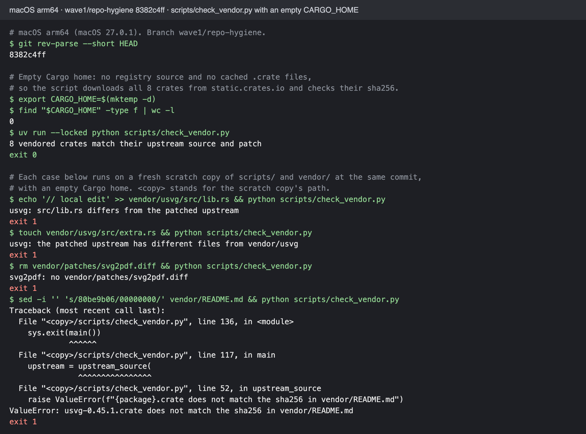

A wrong sha256 in the table stops the script with a `ValueError` that names the crate file.

### D1 Documentation drift

| Before (main e80cbf4f) | After (e1a99203, unchanged at 8382c4ff) |
| --- | --- |
| 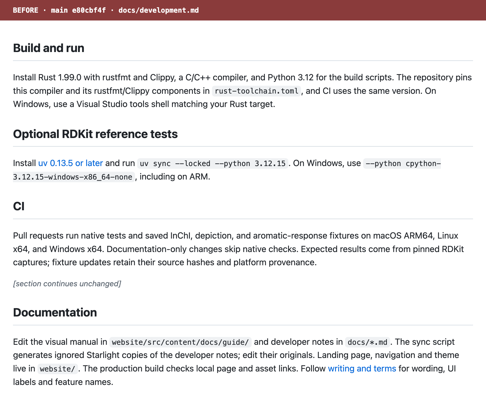 | 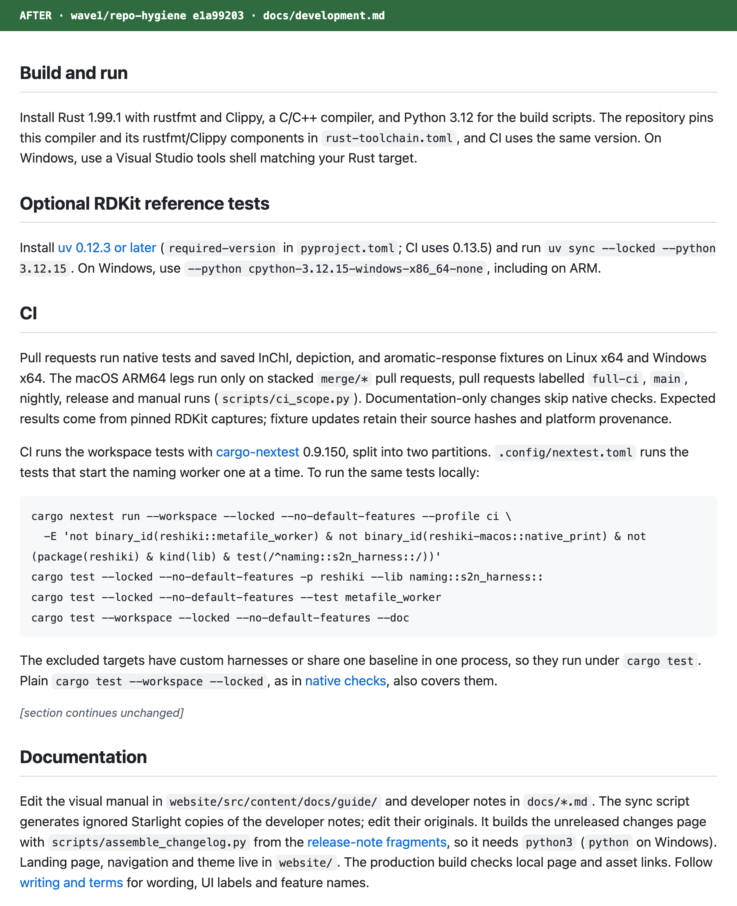 |
| 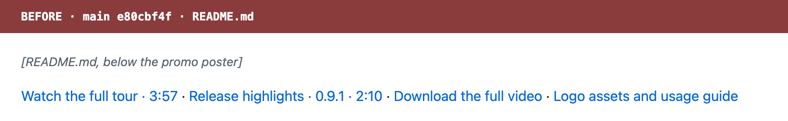 | 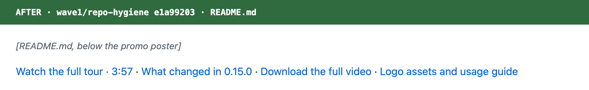 |

The development excerpt shows the changed paragraphs: Build and run, Optional RDKit reference tests, CI (up to the unchanged browser-build paragraph) and Documentation.

### B1 DMG compression

A driver stages the released 0.15.0 `ReShiki.app` the way `mac_disk_image` does (app, `Applications` link, `Install ReShiki.txt`) and calls this branch's `create_disk_image` with each command echoed. It then runs main's `hdiutil create -format UDZO` on the same folder ([b1-dmg-ulmo.txt](b1-dmg-ulmo.txt)):

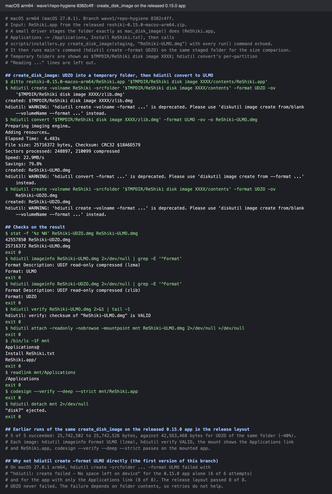

This run: 25,716,372 bytes against 42,557,850 bytes for UDZO (−40%). `hdiutil imageinfo` reports ULMO (lzma), `hdiutil verify` reports VALID, the mounted image holds `Applications` → `/Applications`, `Install ReShiki.txt` and `ReShiki.app`, and `codesign --verify --deep --strict` passes on the mounted app. Five earlier runs gave 25,742,502–25,742,526 bytes against 42,563,468 bytes, with the same checks passing.

### B2 Strip and symbols

Released 0.15.0 macOS arm64 executable ([b2-strip-size.txt](b2-strip-size.txt)):

```
$ stat -f '%z %N' reshiki-0.15.0
100855808 reshiki-0.15.0
$ nm reshiki-0.15.0 | wc -l
  160118
$ strip -x -o reshiki-0.15.0-stripped reshiki-0.15.0
83492432 reshiki-0.15.0-stripped
$ nm reshiki-0.15.0-stripped | wc -l
   14138
```

The release profile on a scratch crate keeps file and line in the dSYM ([b2-dsym-proof.txt](b2-dsym-proof.txt)):

```
$ nm target/release/symdemo | grep -c crash_here     # no function symbols
0
$ dwarfdump --uuid target/release/symdemo target/release/symdemo.dSYM
UUID: 57C995AB-3F88-35A9-BE5A-38EC38F9B7B6 (arm64) target/release/symdemo
UUID: 57C995AB-3F88-35A9-BE5A-38EC38F9B7B6 (arm64) target/release/symdemo.dSYM/Contents/Resources/DWARF/symdemo-75fd2a785a4b0eda
$ atos -o target/release/symdemo.dSYM/Contents/Resources/DWARF/symdemo-* -arch arm64 -l 0x100000000 0x$addr
_RNvCs76zrxM7ygTX_7symdemo10crash_here (in symdemo-75fd2a785a4b0eda) (main.rs:2)
```

Copied away from its dSYM, the same executable prints the panic location but no backtrace frames.

## Verification

macOS arm64, head 8382c4ff ([verify-python.txt](verify-python.txt)):

| Command | Result |
| --- | --- |
| `uv run --locked python scripts/assemble_changelog.py --check` | 1 fragment valid |
| `uv run --locked python scripts/check_vendor.py` with an empty `CARGO_HOME` | 8 vendored crates match |
| `uv run --locked python -m unittest tests.test_assemble_changelog tests.test_release tests.test_windows_signing_workflows tests.test_download_tls` | 40 tests OK |
| `ruff check` / `ruff format --check` on the changed scripts and tests | passed, 7 files formatted |
| `create_disk_image` on the released 0.15.0 app in the release layout | 6 of 6 runs succeeded |
| `hdiutil verify`, mount, `codesign --verify --deep --strict` on the ULMO image | VALID, layout correct, signature valid |

VERIFICATION_TABLE

## Risk

- **The Release builds workflow has not run on this branch.** The per-platform strip overrides, the Linux `objcopy` split and the `symbols-<platform>` artifact stay unverified until the next nightly or release run. On macOS, `target/<target>/release/reshiki.dSYM` is a symlink into `deps/`; check that the uploaded artifact holds the DWARF file.
- **The disk image path is tested only on macOS 27.0.1 arm64.** The release runner is `macos-15`. The UDZO step is main's command, and `hdiutil convert` to ULMO has been available since macOS 10.15. On macOS 27, every `hdiutil` subcommand prints a deprecation warning that points to `diskutil image`; it still works.
- Stripping removes symbol names from local panic backtraces in shipped builds. Crash reports need the matching symbol artifact.
- `scripts/check_vendor.py` needs network access to `static.crates.io` when Cargo's registry has neither the source nor the `.crate` file.
- Docs and scripts only for M1, M2, M7 and D1. The docs sync now runs `python3` (`python` on Windows) during the website build, through `sync-docs.mjs`.

## Changelog

`docs/changes/unreleased/wave1-repo-hygiene.md`:

```md
---
section: Developer
issues: []
---

- Each pull request adds its release note as one file in
  [`changes/unreleased/`](changes/unreleased/README.md) instead of editing this
  page or the contributor list. `scripts/assemble_changelog.py` checks the
  files, assembles this page and moves them into the release notes.
- macOS disk images use LZMA compression and are about a third smaller.
- Release executables and the Python package carry no symbols. The Release
  builds workflow keeps them as a separate symbol file for crash reports.
- `vendor/README.md` lists every vendored crate with its upstream version, its
  reason and its patch; `scripts/check_vendor.py` checks each one against its
  crates.io source.
- `AGENTS.md` tells coding agents and contributors which checks to run.
- The old getting-started page redirects to the
  [install guide](https://reshiki.com/guide/install/). The development,
  architecture and roadmap notes match the current toolchain, CI and crates.
```

## Contribution license

- [x] I have read [CONTRIBUTING.md](https://github.com/Ameyanagi/ReShiki/blob/main/CONTRIBUTING.md). I have the right to submit this contribution and agree to offer my original contributions under both MIT and Apache-2.0, so recipients may choose either license (`MIT OR Apache-2.0`).
- [x] Any third-party material is identified below with its source and license, and its required notices are preserved; otherwise, no third-party material is added.

Third-party sources, if any: `vendor/patches/*.diff` record changes to crates already vendored from crates.io under their own licenses (iced_wgpu, iced_widget, iced_winit, smithay-clipboard, svg2pdf, usvg, window_clipboard, zune-jpeg); no new third-party code is added.
