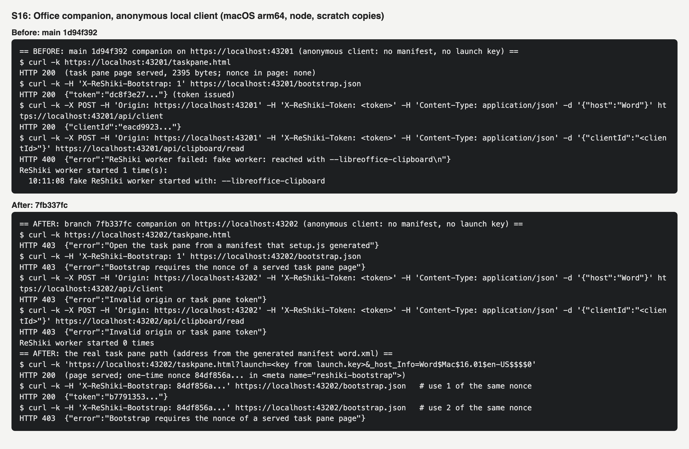
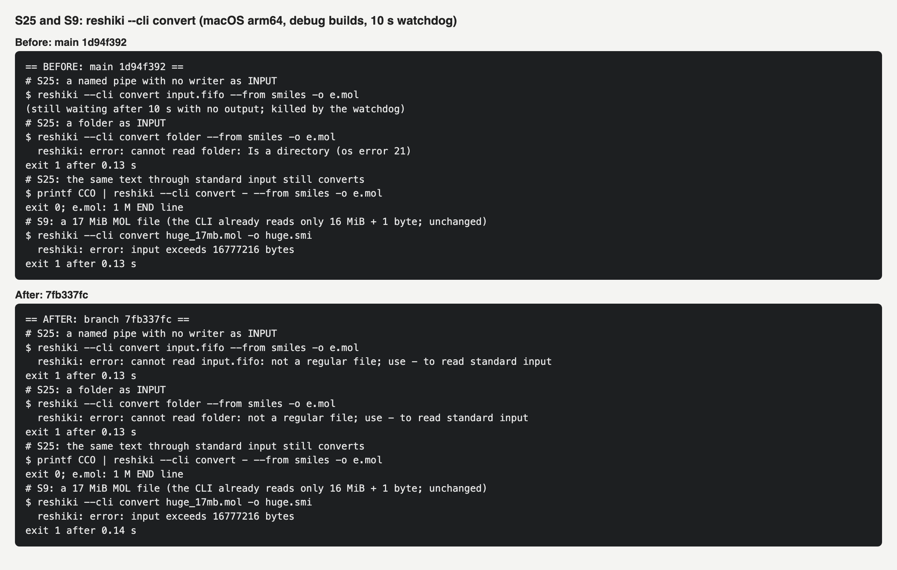
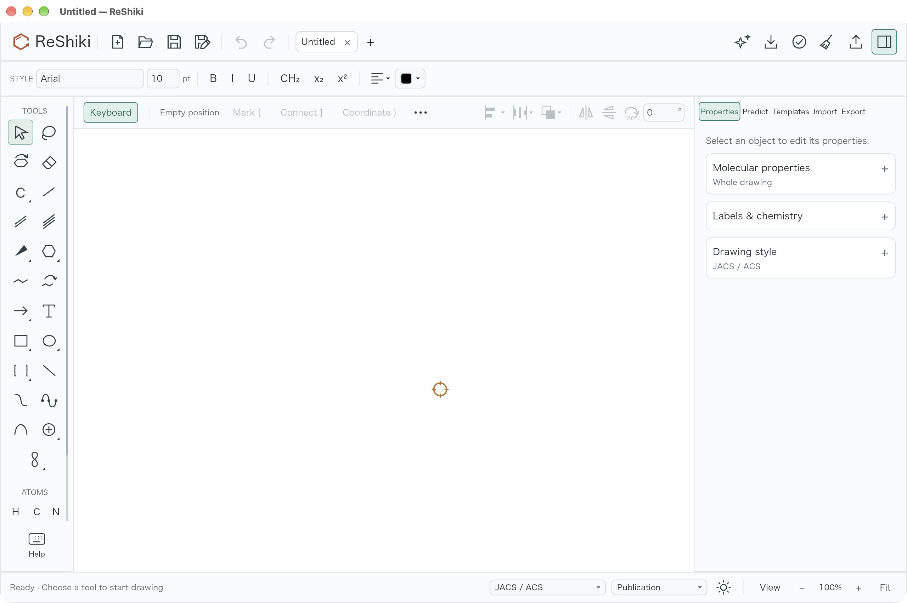
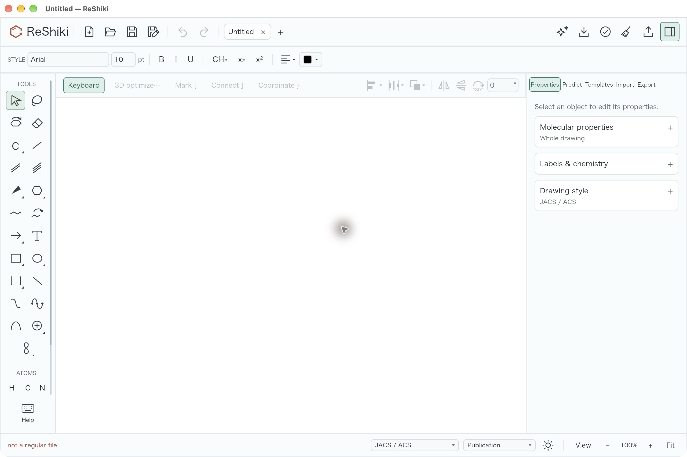
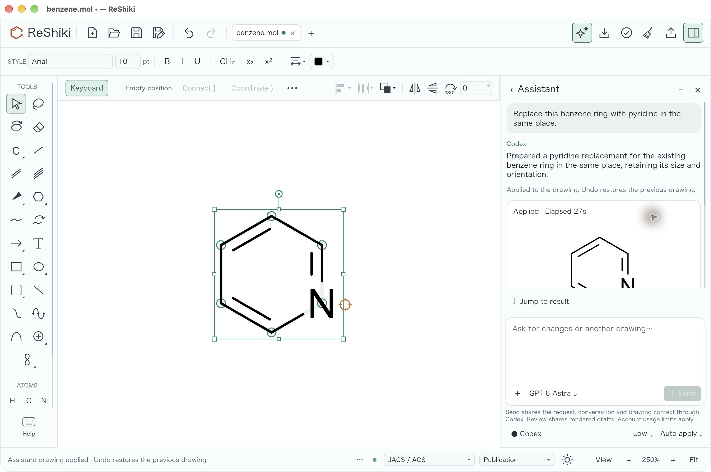
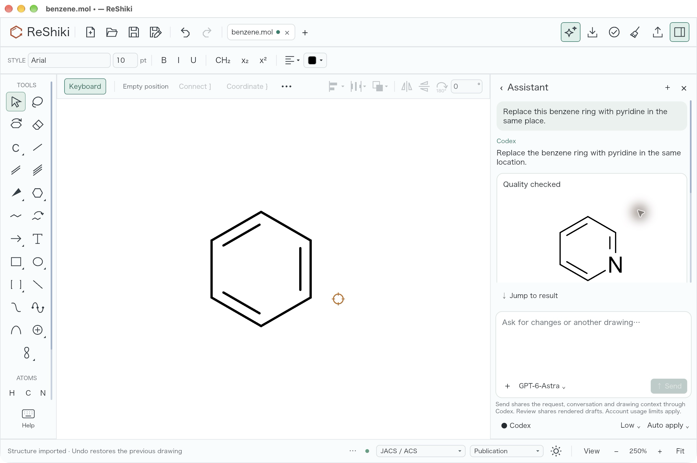

## Summary

This branch fixes 17 findings from the improvement-plan security and performance audit (S5, S6, S9 to S22, S25) in the agent tools, the updater, the Linux desktop endpoint, the LibreOffice and Microsoft 365 integrations, the browser editor frame and the assistant. Two are partial. S13: an InChI export with no identifier now fails, but other exports still run the InChI step. S5: the Windows publisher check is in, but Linux update checksums are still unsigned.

## Why it matters

All items come from the improvement-plan audit and were reproduced on this branch's base (`main` 1d94f392) before they were fixed. Timings are from debug builds on macOS arm64 unless noted.

- **S9, files that are not regular files, and oversized structure files (app).** Opening a named pipe with no writer kept the app waiting on it forever. Opening a MOL, RXN, CDXML, CDX or SMILES file over 16 MB read the whole file into memory before the parser refused it: a 16 MiB + 4,096 byte `.mol` was read whole (16,781,312 bytes). Now 16,777,217 bytes are read and the file is refused with `File exceeds 16 MB`.
- **S25, the same for `reshiki --cli`.** `reshiki --cli convert input.fifo` with no writer never returned. Now it fails at once with `not a regular file; use - to read standard input`. Standard input still streams.
- **S10, LibreOffice and Microsoft 365 previews.** A 200,000-atom drawing was refused after 203.8 s and 1.27 GB peak memory; now after 2.7 s and 0.33 GB. A 55 MB drawing took 56.7 s and 2.97 GB; now 10.9 s and 1.31 GB (JSON parsing only). The 0.15.0 release build took 11.4 s / 1.64 GB and 10.3 s / 2.45 GB.
- **S11, agent `apply` over a budget.** Doubling a 59,900-object drawing over MCP was refused only by the final commit, after 38.7 s. It is now refused after 3.9 s, before reconciliation.
- **S12, agent `inspect` on large drawings.** Its time grew with the square of the atom count. Rows of 300 bonded carbons: 11,250 atoms 2.13 s to 0.53 s, 22,500 atoms 6.59 s to 0.65 s, 45,000 atoms 30.74 s to 1.01 s.
- **S13, an InChI that cannot be made.** An InChI export of a drawing with no identifier (a wildcard atom, or a 2,000-carbon chain) wrote a valid 0-byte file. Partial: see Risk.
- **S14, S15, S5, updates.** A staged update was not checked again before it was installed, so a change made while the update waited for a restart was installed. A Linux update archive could hold a symbolic or hard link. On Windows only `SHA256SUMS` protected the installer.
- **S16, Microsoft 365 companion.** Any local process could fetch the task pane page, ask `/bootstrap.json` for the token with the fixed header `X-ReShiki-Bootstrap: 1`, and then call the API, for example to read the clipboard through ReShiki.
- **S17, Linux without `XDG_RUNTIME_DIR`.** The desktop endpoint lived under `/tmp/reshiki-desktop-<uid>-<hash>`. Another user could create that name first. An endpoint error also blocks saving, so that user could stop this user's saves.
- **S18, LibreOffice extension.** Without a chosen app, a program named `reshiki` earlier on `PATH` was started before the installed ReShiki.
- **S19, assistant Accept all edits.** A draft that replaced objects outside the current selection was applied without review. Text in an opened drawing can shape what the model replaces.
- **S6, assistant tools.** ReShiki turns off Codex's own tools with start-up flags whose names a Codex release can change. A turn that ran a shell command anyway completed normally.
- **S20, assistant error log.** An unreadable reply was written to stderr with its first 200 characters, which can quote the drawing.
- **S21, S22, browser editor frame.** `frame.html` posted to `"*"` and loaded fonts from any URL, including one that redirects to a third origin.

## Approach

- **S9 and S25: refuse by file type, then read to the limit.** `src/app/files.rs` checks `fs::metadata(path).is_file()` before opening, for Open, startup, desktop handoff and Insert. `import::limit` now returns the 16 MiB exchange limit for MOL, RXN, CDXML, CDX and SMILES; `import::open_limit` applies it to Open as well. A read takes `limit + 1` bytes, and `prepare` and `import::read` refuse a longer file with `File exceeds 16 MB`. Crystal files and `.rsk` drawings keep no byte limit, as their readers have none. `src/cli/io.rs` does the same type check for a named CLI input.
  - Rejected: an `O_NONBLOCK` open and `fstat`. It closes the tiny window between `metadata` and `open` but adds platform code for a case only the folder's owner could cause (see Risk).
- **S10.** The preview refuses a drawing over the agent import's 100,000 objects before rendering, and all three `--libreoffice-*` modes start under the 2 GiB heap ceiling that `--cli` and `--mcp` use.
- **S11.** New `Documents::fits` runs the commit's own preflight (new drawing, the old drawing as undo frame, kept history, other documents) after the edit is built and before reconciliation. An edit that changes nothing passes, as before. The commit still checks everything.
- **S12.** `scene::selections_bounds_in_axes` used `atom_labels::visible`, which scanned every bond for every atom. It now uses the existing `scene::graph::Graph` bond index (4 lines in `crates/model`).
- **S13.** `crates/agent/src/ops/export.rs` turns an empty InChI into `InChI has no identifier for this drawing` for `export`, `file_save` and CLI convert.
  - Not done: making SMILES, MOL, CDXML and CDX exports independent of the InChI step. It was implemented and then reverted: 8 `crates/io` tests and the RDKit reference comparison assert that every export response carries the InChI analysis. Changing that contract needs the owner's decision and the pinned RDKit environment. `crates/io` is identical to `main`.
- **S14.** `Prepared` records a SHA-256 of the whole staged payload (every entry's name, kind, size and bytes; link targets). `handoff` recomputes it and starts nothing if it changed. On macOS it also reruns `codesign --verify --deep --strict` with the publisher requirement on the staged bundle.
- **S15.** Linux staging also reads `tar -tvzf` and refuses any entry that is not a regular file or folder.
- **S5 (Windows part).** Staging asks PowerShell (`Get-AuthenticodeSignature`) for the status and signer of the running app and of the installer. A signed app installs only an installer with a valid signature from the same subject. Only an app with no signature at all skips the check. Any other status of the running app fails closed.
  - Not done here: a detached signature over `SHA256SUMS` for Linux. It needs a release signing key that only the owner can create.
- **S16.** `setup.js` writes a random `launch.key` (mode 0600) and puts it in each generated manifest's task pane address (`taskpane.html?launch=<key>`). The companion serves the page only to a request with that key, writes a one-time nonce into it, and `/bootstrap.json` gives the token once per live nonce. At most 32 unused nonces are kept.
  - Rejected: the nonce alone (the first round). A review showed any local process could fetch the page, take its nonce and get the token.
- **S17.** New `base` picks `XDG_RUNTIME_DIR`, else `/run/user/<uid>` when it is the user's own and mode 0700, else `XDG_CACHE_HOME` or `$HOME/.cache`, used only when the user owns it and no one else can write to it. With none of these, the endpoint is an error, never `/tmp`.
- **S18.** The extension tries the chosen app, then the installed app (`installed_executables()`), then `PATH`.
- **S19.** New `App::assistant_can_auto_apply` allows automatic Apply only when the draft passed review and every object it replaces (the effective `draft.replace`, abbreviation-expanded) is in the current selection. Otherwise the draft waits with `Ready for review · It replaces objects outside your selection`. A deferred automatic Apply (during a text edit) checks the selection again when the edit ends.
- **S6.** `run_turn` fails on any `item/started` or `item/completed` whose item is not a user message, agent message, reasoning or a registered canvas tool call, on any thread, and on an item event with no item. Context compaction stops the request with `The request grew too long for Codex. Start a new request with less context.`
  - Rejected: allowing compaction and subagent items, as the first round did. That leaves containment on the very start-up flags this item stops trusting.
- **S20.** The log line keeps only the JSON parse error.
- **S21, S22.** `frame.html` posts to and answers only the embedding origin (`location.ancestorOrigins[0]`, else the referrer's origin, else its own). Fonts load only from that origin or the frame's own, with the new mount option `fontRedirect: "error"`, so a redirect to a third origin fails. Refused fonts are reported through `onError`.

## Evidence

All runs: macOS arm64, debug builds, base `main` 1d94f392 vs branch 7fb337fc, unless a line says otherwise. Base and branch binaries differ (`shasum` 001359c4… vs ccb4352d…; only the branch holds the new messages). Other lanes were building on the same Mac, so absolute times are inflated.

### Tests that fail before and pass after

Each new test was run twice: on the branch, and on the branch with each fix switched off ([`before-neutralized.patch`](before-neutralized.patch): `main`'s version of each file where the new tests compile against it, otherwise only the new check removed, so the tests still build). Full output: [`tests-rust.txt`](tests-rust.txt).

| Item | Test | Before (fix off) | After |
| --- | --- | --- | --- |
| S11 | `ops::apply::tests::an_edit_over_a_budget_is_refused_before_the_commit` | FAILED: the commit hook fired ("The drawing has 8 objects; the limit is 5") | ok |
| S12 | `ops::inspect::tests::the_bounds_of_a_bonded_drawing_take_linear_time` | FAILED: 8,000 vs 32,000 atoms took 0.66 s vs 15.1 s (23x; the bound is 10x) | ok |
| S13 | `ops::export::tests::an_empty_inchi_is_an_error_not_an_empty_file` | FAILED: export of `*C` returned `byte_len: 0` | ok |
| S5 | `updates::install::tests::a_signed_app_needs_an_installer_from_its_publisher` | FAILED: `HashMismatch` app status accepted (`Ok(())`) | ok |
| S14 | `updates::install::tests::a_staged_program_that_changed_is_not_installed` | FAILED: `handoff` returned `Ok` for a replaced payload | ok |
| S14 | `updates::install::tests::a_staged_application_that_changed_outside_its_executable_is_not_installed` | FAILED: `handoff` returned `Ok` with a changed `Info.plist` | ok |
| S15 | `updates::install::tests::archive_links_are_unsafe_entries` | FAILED: a listing with `package/escape -> /etc` was accepted | ok |
| S6 | `assistant::codex::tests::a_turn_with_any_other_tool_fails` | FAILED: a `commandExecution` turn returned the structured reply | ok |
| S20 | `assistant::codex::tests::an_unreadable_reply_is_not_written_to_stderr` | FAILED: stderr held `reply: {private-reply-text` | ok |
| S10 | `libreoffice::tests::a_drawing_over_the_object_limit_is_refused_before_rendering` | FAILED after rendering for over 60 s: `Drawing is too large for a 1200 dpi PNG` | ok |
| S9 | `app::import::tests::a_named_pipe_is_refused_without_blocking` | FAILED: "reading a named pipe must not block" (5 s timeout) | ok |
| S9 | `app::import::tests::oversized_structure_files_are_read_only_past_their_limit` | FAILED: 16,781,312 bytes read instead of 16,777,217 | ok |
| S19 | `app::assistant::tests::accept_all_reviews_a_replacement_outside_the_selection` | FAILED: the draft was applied (`draft.is_some()` false) | ok |
| S25 | `tests/agent_api_cli_files.rs::input_from_a_fifo_is_refused_and_standard_input_still_streams` | FAILED: "reshiki did not exit and close its output within 20s" | ok |

Items outside the Rust crates, each with the branch's tests against `main`'s files (before) and the branch (after):

- **S16:** `cd integrations/office && node --test`: before 155 of 159 pass, 4 fail (the anonymous-sequence test fails on its first step, `/` returns 200 instead of 403); after 159 of 159. [`tests-s16-office.txt`](tests-s16-office.txt)
- **S21, S22:** `bun test test/frame.test.ts`: before 0 of 3 (posts to `"*"`, loads `https://elsewhere.test/c.ttf`, follows the redirect); after 3 of 3. [`tests-s21-s22-frame.txt`](tests-s21-s22-frame.txt)
- **S18** (Ubuntu arm64, LibreOffice UNO Python): with `main`'s lookup order the test gets `on-path` instead of `installed`; the branch passes. `main` has no `installed_executables()` to patch, so the before side is the branch's file with `main`'s order. [`tests-s18-uno.txt`](tests-s18-uno.txt)
- **S17** (Ubuntu arm64, Linux-only crate): `cargo test -p reshiki-linux desktop::tests::` with `base()` returning `main`'s `/tmp` parent: 2 of 9 fail (`left: "/tmp"`); the branch: 8 passed, 1 ignored. [`tests-s17-linux.txt`](tests-s17-linux.txt)

### S16: the anonymous page, nonce and token sequence

Two companions from scratch copies of `integrations/office` at each commit, set up with `setup.js`, a self-signed localhost certificate and a stand-in executable that only logs that it was started. A client with no manifest and no launch key runs the same four requests against each. Transcript: [`s16-companion.txt`](s16-companion.txt).

Before, every step succeeds: page 200, token 200, client 200, and the clipboard read starts the ReShiki worker (the stand-in then exits with an error, so that reply is 400; the real one would return the clipboard). After, every step is 403 and the worker never starts. The real task pane address from the generated `word.xml` still gets the page with a nonce, and that nonce gives the token once (the second use is 403).

### S25 and S9: `reshiki --cli convert`

Transcript: [`cli-s25-s9.txt`](cli-s25-s9.txt). Before, a named pipe with no writer was still waiting after 10 s and was killed. After, it fails in 0.13 s with `not a regular file; use - to read standard input`. A folder now gets the same message instead of `Is a directory (os error 21)`. `printf CCO | reshiki --cli convert - …` converts on both. The 17 MiB MOL file is refused the same way on both (`input exceeds 16777216 bytes`): the CLI already had this cap, so S9's change is in the app.

### S9 in the app: opening a named pipe and a 17 MiB MOL file

macOS arm64, debug builds, window 1280 x 852 pt, zoom 100%. Each file was opened at launch with `--open`, base `main` 1d94f392 vs branch 7fb337fc.

| | Before: main 1d94f392 | After: 7fb337fc |
| --- | --- | --- |
| Named pipe with no writer, about 15 s after launch |  |  |
| 17 MiB MOL file, status bar |  |  |

Before, the pipe open never finished: the status stayed **Ready** with no sign of work (captured at 18 s, and still the same at 42 s), while a worker thread waited on the pipe. After, the status reads `not a regular file` by the first capture (11 s after launch, mostly app start-up). The UI stayed responsive in both. The 17 MiB file is refused about 7 s after launch on both builds. The difference is how much is read: before, the whole 17 MiB file was read and then refused by the parser (`MOL input exceeds the size or work limit`); after, 16 MiB + 1 byte is read and the message names the limit. The test above measures the bytes read (16,781,312 vs 16,777,217 for a 16 MiB + 4,096 byte file). Whole windows: [before](gui-s9-huge-base.png), [after](gui-s9-huge-branch.png).

### S19 in the app: Accept all edits with nothing selected (live Codex)

macOS arm64, debug builds, window 1280 x 852 pt, drawing zoom 250% (the app's own fit for `benzene.mol`). Each build: open `benzene.mol`, press Escape and click empty canvas so nothing is selected, open **Assistant**, switch the mode menu to **Accept all edits** (the footer then reads **Auto apply**), and send `Replace this benzene ring with pyridine in the same place.` One request per build, model GPT-6-Astra at Low, with the local Codex sign-in.

| Before: main 1d94f392 | After: 7fb337fc |
| --- | --- |
|  |  |

Before, the replacement of an object outside the (empty) selection was applied on its own: `Applied · Elapsed 27s`, status bar `Assistant drawing applied · Undo restores the previous drawing`. After, the same quality-checked draft waits: benzene stays on the canvas and the card offers **Apply**, **Improve layout** and **Discard** ([whole window](gui-s19-branch-actions.png)). Both drafts passed the visual review, so the outside-selection rule is what held the branch's draft.

The panel does not show why it waits. `request.rs` sets the status `Ready for review · It replaces objects outside your selection`, but the panel prints the status only while a request runs or after an error (`assistant_activity_card` in `src/app/assistant/view.rs`). After the request ends the card shows only **Quality checked**, while the footer still says **Auto apply**. This is not a regression (the old `Ready for review · Nothing has been applied` was hidden the same way), but S19's message never reaches the user in the app. A follow-up should show it beside **Apply**.

Neither build showed `Codex used a tool that ReShiki does not allow` or `The request grew too long for Codex`: the branch's live generation and review turns completed under the stricter item check (S6).

## Verification

macOS arm64, from the implementation lane, on the final tree:

- `cargo fmt --all --check`: clean.
- `cargo clippy -p reshiki -p reshiki-agent --all-targets --locked -- -D warnings` and `cargo clippy --workspace --lib --bins --all-features --locked -- -D warnings`: clean.
- `cargo test --locked -p reshiki-agent`: 306 passed, 2 ignored (lib); 34 and 4 passed (other targets).
- `cargo test --locked -p reshiki --no-fail-fast` with the helpers set: 2,592 passed, 0 failed, 201 ignored across all targets.
- `crates/io` is identical to `main`, so `cargo test -p reshiki-io` was not rerun on the final tree.
- `node --test` in `integrations/office`: 159 of 159.
- `bun test` for the frame, fonts, embed and element tests in `packages/editor`: 23 of 23. `test/editor.test.ts` needs the wasm build, which is not in the worktree; it fails the same way on `main`.
- `bun fmt --check` on the changed files and `oxlint --deny-warnings` on `website`, `integrations/office` and `packages/editor`: pass.
- `uv run --locked python scripts/assemble_changelog.py --check`: pass.
- `codesign --verify --deep --strict -R <publisher requirement>` on a copy of the signed 0.13.1 `ReShiki.app`: exit 0; on a copy with one added file: exit 1.

Ubuntu arm64 (lane): `cargo test -p reshiki-linux` 27 passed, 15 ignored; clippy and fmt clean. LibreOffice UNO tests: 172 tests with 3 `test_session` errors that also occur on `main` on that machine; the new test passes.

VERIFICATION_TABLE

## Risk

- **S13 is partial.** An InChI export with no identifier now fails instead of writing an empty file. SMILES, MOL, CDXML and CDX exports still run the InChI step, so they still fail when the InChI helper fails or is missing, and they still wait for it. Fixing that changes a tested engine contract (8 `crates/io` tests and the RDKit reference comparison) and needs the owner's decision.
- **S5 is partial and untested end to end.** The Windows publisher check needs a real run with a signed app and signed and unsigned installers, which needs the pending code-signing certificate. Until then Windows builds are unsigned, skip the check, and rely on `SHA256SUMS`. The PowerShell report format was checked by hand on Windows x64 only. Linux still has no signature over `SHA256SUMS`: that needs a release signing key from the owner.
- **S14 needs a real update.** The re-check before handoff is unit-tested; a real update on macOS, Windows and Linux has not been run through it. On macOS the unit test's fake bundle also fails `codesign`, so the digest path alone is proven on Linux.
- **S16 needs real Office.** The task pane in real Word, Excel and PowerPoint, with the launch key and the nonce, has not been opened. Existing installs must run `setup.js` with a new `--directory` and sideload the new manifests: an old config no longer starts the companion, and the sample manifests in `integrations/office/manifests` no longer open the pane. A local process that can read the user's manifests or `launch.key` can still get the token; this binds the token to Office's manifest, not to Office itself.
- **S6 can stop real requests.** Live Codex turns may emit item types not seen in the 0.167.2 schema (for example `plan` or `imageView`), and a long conversation that Codex compacts now stops with the new message. One live text request (generation and review) completed on the branch; image reconstruction and **Improve layout** were not run live.
- **S19 changes the flow, and its reason is not shown.** With nothing selected, a request that makes the model replace existing objects now waits for **Apply** even under **Accept all edits**. The panel does not say why (see the S19 evidence), so a user who chose **Auto apply** sees a draft that did not apply with no explanation.
- **S9.** Process substitution (`<(...)`) as a CLI input is refused now; pipe it to `-`. A named folder now reports `not a regular file`. A tiny window between `metadata` and `open` remains; only someone who controls the named folder could use it.
- **S17** was run on Ubuntu arm64 only. Two windows without `XDG_RUNTIME_DIR` on a real Linux x64 desktop have not been tried. Ancestors of a user-set `XDG_CACHE_HOME` are not checked.
- **S21, S22, embedders.** Fonts on a third origin passed to `embed()` no longer load, and a cross-origin page that hides its referrer in Firefox cannot start the frame. Safari and Firefox were not tried in a real page.
- **S10.** The 2 GiB heap ceiling is not exercised by a test, and the after timings are debug builds.
- **Files outside the lane's own list:** `crates/model/src/scene.rs` (4 lines), `src/app/files.rs`, `src/app/import/tests.rs`, the Office task pane HTML and JS and their test stubs. Watch for overlap with other wave lanes.

## Changelog

`docs/changes/unreleased/wave1b-agent-platform-hardening.md` (section Fixes): files that are not regular files; structure files over 16 MB; agent `apply` over a budget; agent `inspect` on large drawings; an InChI that cannot be made; LibreOffice and Microsoft 365 previews; updates; Linux without `XDG_RUNTIME_DIR`; the LibreOffice extension's app lookup; the Microsoft 365 companion (rerun `setup.js`); Accept all edits; other Codex tools and context compaction; the browser editor frame.

## Contribution license

- [x] I have read [CONTRIBUTING.md](https://github.com/Ameyanagi/ReShiki/blob/main/CONTRIBUTING.md). I have the right to submit this contribution and agree to offer my original contributions under both MIT and Apache-2.0, so recipients may choose either license (`MIT OR Apache-2.0`).
- [x] Any third-party material is identified below with its source and license, and its required notices are preserved; otherwise, no third-party material is added.

Third-party sources, if any: none.
