## Summary

**Clean up…** with **Selected atoms** no longer folds a selected ring onto the fixed atoms beside it (#1181). It turns the ring back to the free side, and it warns when the result is crowded or when it has to leave the selection unchanged. **Invert selection** now refreshes the bond **Color** field. The release test build compiles again, and CI now builds it.

Fixes #1181

## Why it matters

- **#1181: selected cleanup folds a ring onto fixed atoms.** A spiro compound laid out with a squashed benzene ring (the layout some MOL files carry) is a normal input. With that ring selected, **Clean up…** → **Selected atoms** put two ring atoms exactly on two fixed atoms (0.00001 and 0.000008 world units apart, where a bond is 42). The drawing turned into a different-looking molecule, and no warning appeared. An adversarial review of the #1112 tests found it. The lane reproduced it with a failing test on `main`, and the app screenshots below show it on `main` 1d94f392. A second selection on the same drawing (four atoms) gives a tangle of crossing bonds on `main`, also without a warning.
- **R5: Invert selection leaves the bond Color field stale.** After **Invert selection**, **Properties → Bond appearance → Color** still shows the color of the bonds selected before. Pressing **Apply** next to it would then paint the newly selected bonds with the old color. On `main` the field showed `#1F77B4` (blue) for a red bond selection. The improvement-plan audit found it, and a failing unit test reproduced it.
- **P11: the release test build does not compile.** `cargo test --release --locked --bin reshiki --no-run` failed on `main` with E0277 (`(): iced::advanced::Renderer` is not satisfied) in `src/appearance/tests.rs`. The performance harnesses run in a release test build, so none of them could run.
- **R3: Undo/Redo "skip" the picture-size and arrow-label-gap inputs. The bug half was refuted.** `main` already refreshes both inputs (details under Evidence). What the audit did find is real: three recent fixes had to be made twice, once in the commit path and once in Undo/Redo. This PR shares those steps in one method.

## Approach

- **#1181** (`crates/io/src/chemistry/cleanup.rs`, `unfold`). After the layout solver runs and fixed atoms are pinned back, a check finds moved atoms that lie within 0.1 bond length of a fixed atom. For each such atom it collects the bonded group of moved atoms and the fixed atoms that hold the group. If exactly two fixed atoms hold it, the group is reflected across the line through those two atoms. The solver closed the ring on the wrong side of that line. Then every reflected atom is checked against every atom outside its own group: fixed atoms, selected atoms that stayed, and other reflected groups.
  - Still within 0.1 bond length of another atom, or not held by exactly two fixed atoms: that molecule's selected atoms stay unchanged, with the warning "Selected atoms in N molecule(s) kept unchanged: cleaned up, they would lie on other atoms. Choose Selected molecules."
  - Within 0.5 bond length (the app's atom-collision distance): the result is kept, with the warning "Selected atoms in N molecule(s) now lie close to other atoms. Review the drawing, or choose Selected molecules."
  - The neighbour lookup uses a hash grid, so large selected cleanups stay linear. With no fixed atoms (whole drawing, selected molecules) the check returns at once, so those scopes are unchanged.
  - Rejected: re-running the solver with another seed, because it cannot promise the free side. Also rejected: refusing every crowded result. The owner prefers a warning over a refusal. For the issue's drawing, one corner of the turned-back ring is 0.38 bond lengths from an indanone carbon (that crowding is why the source layout squashed the ring), so the result is shown with the "close to other atoms" warning. **Decision for the owner:** treating "crowded" like "stuck" (leave the ring unchanged) is a one-line change.
- **R5** (`src/app/selection_edits.rs`). `invert_selection` now builds the new id list and calls `set_selection`, the same path as every other selection change. That path also runs `sync_bonds`. Before, it set `tab.selected` directly and called three of the four sync functions by hand.
- **P11** (`src/appearance/tests.rs`). iced implements the `()` renderer only in debug builds. The caret helper and its two tests are now `#[cfg(debug_assertions)]`, as `src/app/naming/locants/tests.rs` already does. The rest of the module still runs in release. CI gets one Linux step at the end of `rust-lint-goldens`: `cargo test --release --locked --no-default-features --bin reshiki --no-run`.
  - Rejected: moving the caret tests to the headless WGPU renderer. It needs a GPU, and its tests are all `#[ignore]`, so the tests would drop out of the default debug run.
- **R3** (`src/app.rs`, `src/app/history.rs`). `App::drawing_revised(chemistry_changed)` holds the steps that a commit and Undo/Redo share: clear stereo notes, advance the revision, drop analysis and the chemistry notice and mark labels dirty when the chemistry changed (otherwise advance the inspector revision), and clear the error flag. This covers the twin edits of 336c05ae and b486df97. NMR invalidation, keyboard-drawing and recent-molecule restore, label settling and the sync calls differ between the two paths and stay where they were.

## Evidence

All app captures: macOS arm64, debug builds, base `main` 1d94f392 vs branch 572dc3be, window 1280 x 852 pt (2560 x 1704 px), driven by Codex computer use with an empty data folder for every run. Base and branch binaries differ ([`shasums.txt`](shasums.txt): 001359c4… vs d2d555e0…).

### #1181, case A: the squashed benzene ring selected

Input: [`before-squashed.rsk`](https://github.com/Ameyanagi/ReShiki-evidence/blob/6e47c59b2cc2a6f321c3936395502879ec0465dd/issues/spiro-selected-ring-fold/before-squashed.rsk) from the issue. Select the six atoms of the lower-left benzene ring, then **Clean up…** (Shift+Cmd+K) → **Selected atoms**, **Keep orientation** → **Apply**. Zoom 200% in every capture.

| | Before: main 1d94f392 | After: 572dc3be |
| --- | --- | --- |
| Selected | 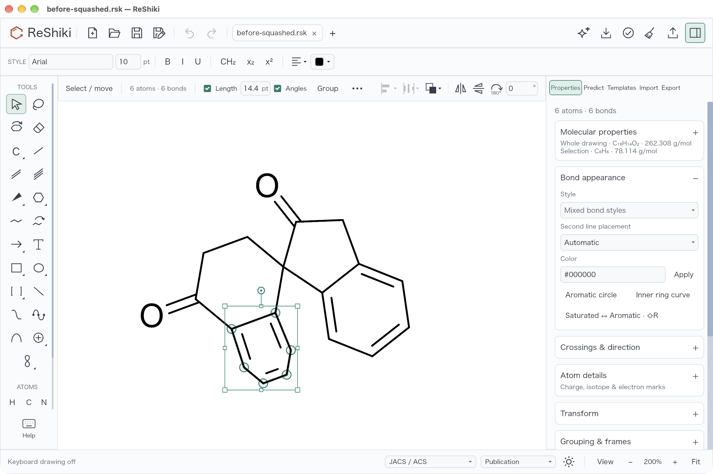 |  |
| Preview | 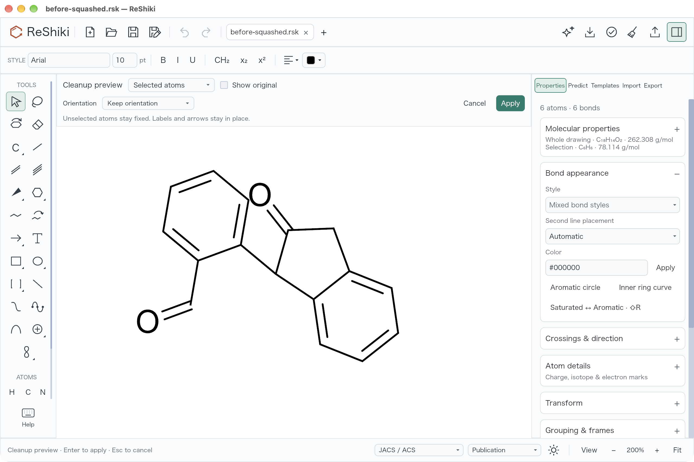 | 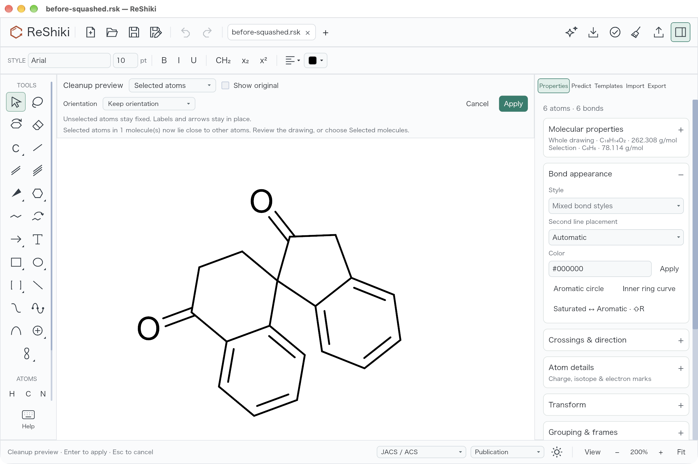 |
| Applied | 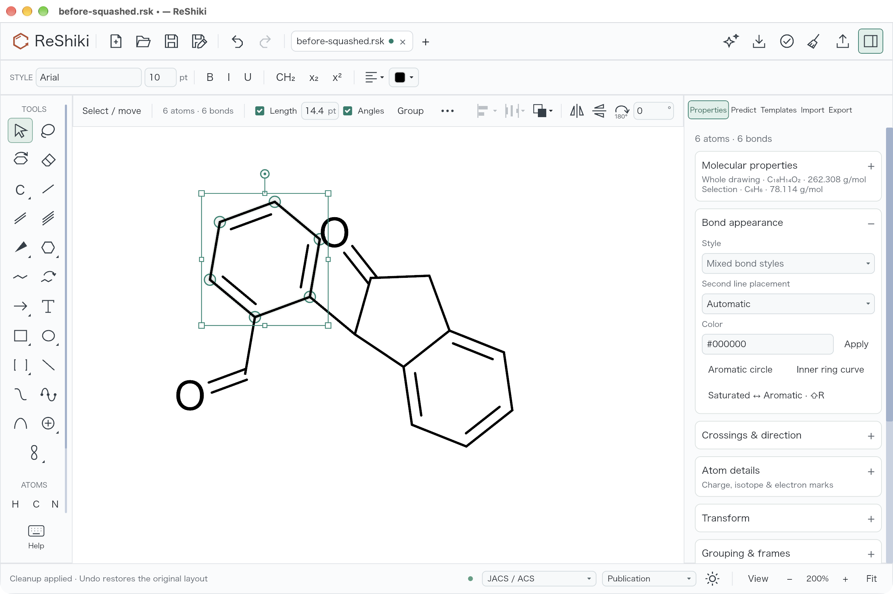 | 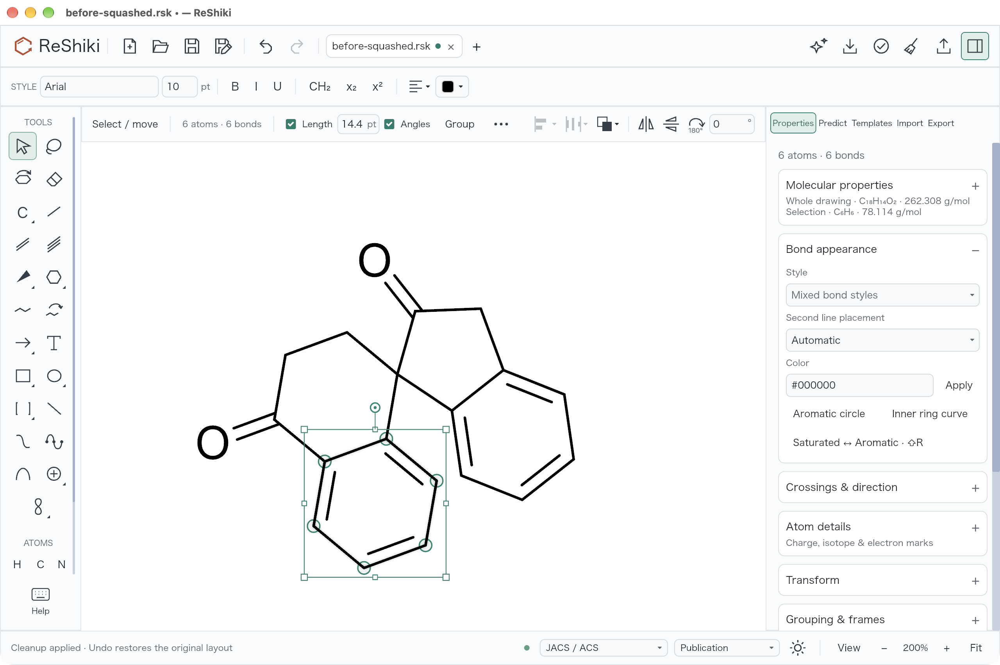 |

Before, the ring folded onto the fixed CH2–CH2 and one corner overlapped the upper carbonyl O. The preview showed no warning. After, the ring is a regular hexagon on the free side. The preview says it lies close to other atoms: its upper-right corner is 0.38 bond lengths from a carbon of the indanone benzene.

### #1181, case B: a selection whose cleanup would overlap

Same file and steps, with four atoms selected: the two CH2 corners of the tetralone ring, the benzene corner bonded to the C=O carbon, and the benzene corner below the one bonded to the spiro carbon. This is the reviewer's case from the earlier version of the fix. Zoom 200%.

| | Before: main 1d94f392 | After: 572dc3be |
| --- | --- | --- |
| Selected | 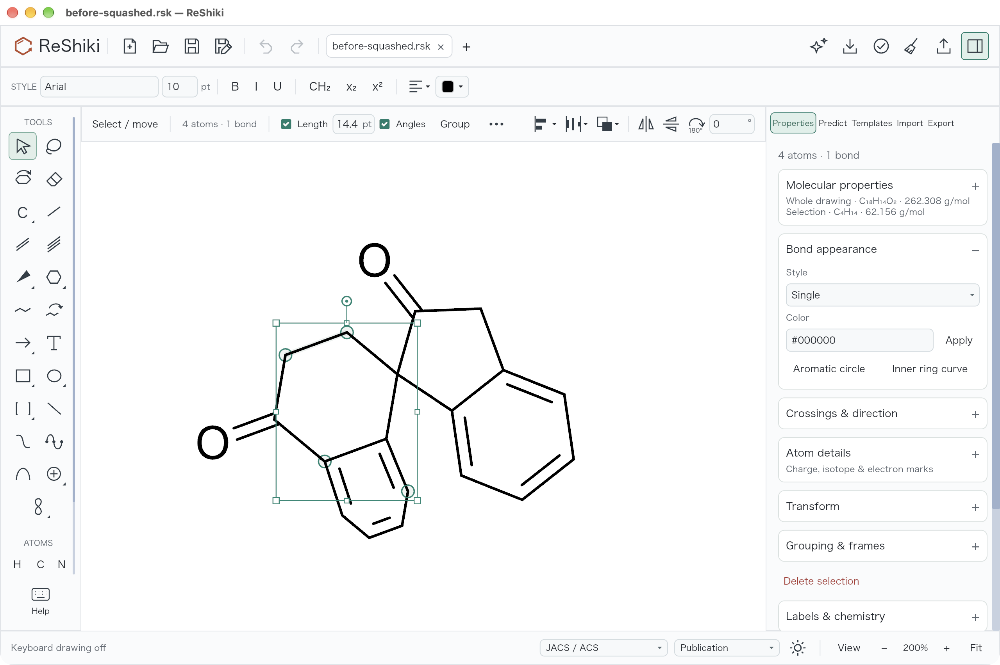 |  |
| Preview | 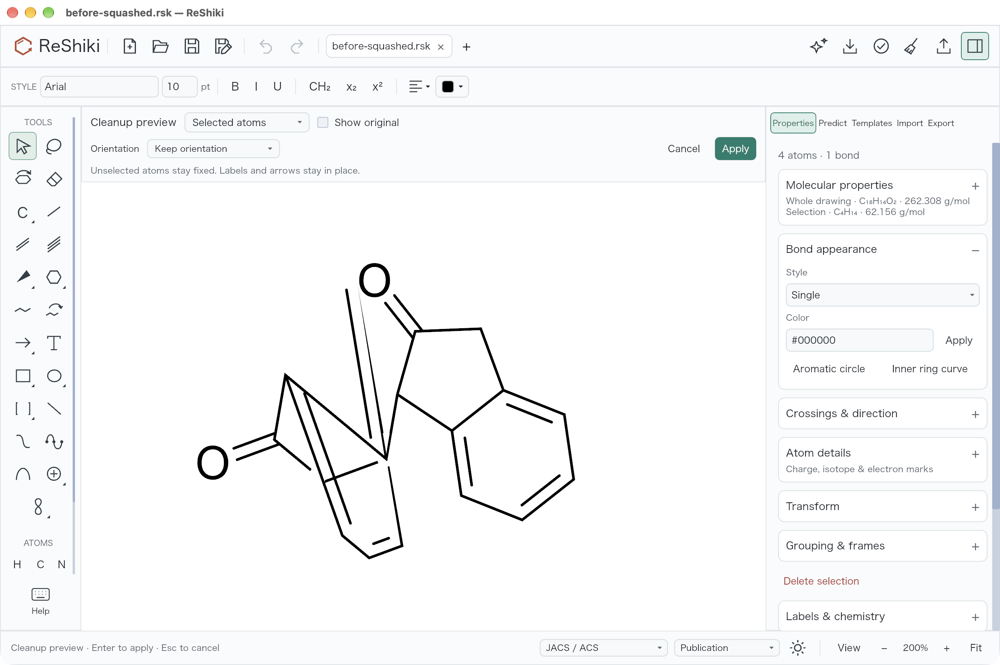 | 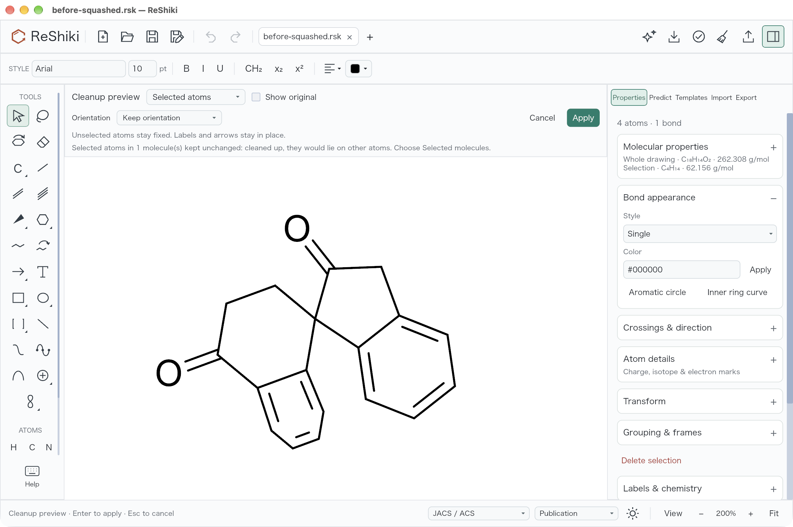 |
| Applied | 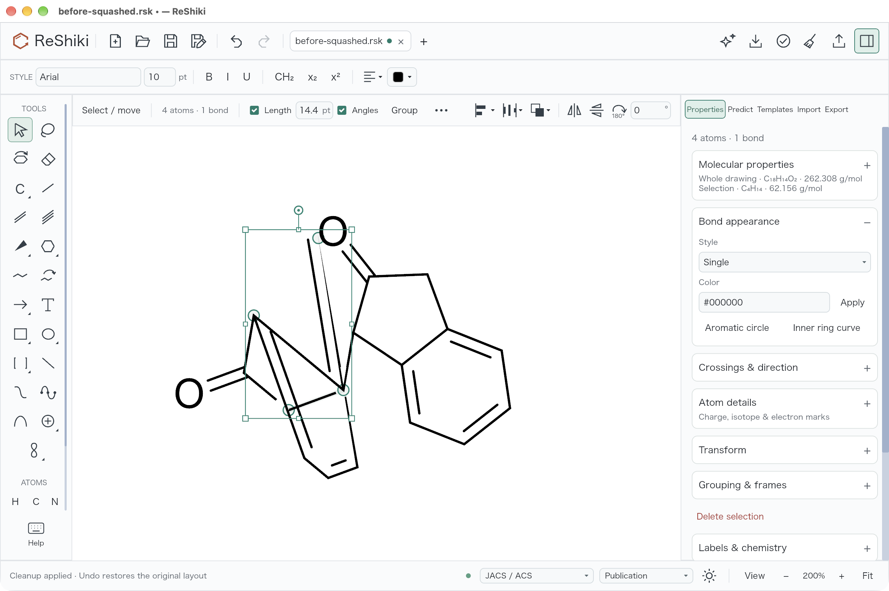 |  |

Before, the cleanup drew long crossing bonds through the tetralone and benzene rings, and one selected atom overlapped the upper O. No warning appeared. After, the selection stays as it was, and the preview says why.

### R5: Invert selection refreshes the bond Color field

Input: [`bond-colors.rsk`](bond-colors.rsk), with two separate chains: a blue chain (`#1F77B4`) on the left and a red one (`#D62728`) on the right ending in OH. Select the blue chain, then **Invert selection** (Shift+Cmd+A). Zoom 208% in every capture.

| | Before: main 1d94f392 | After: 572dc3be |
| --- | --- | --- |
| Blue chain selected |  | 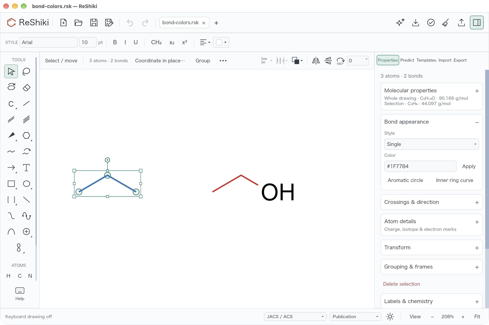 |
| After Invert selection |  | 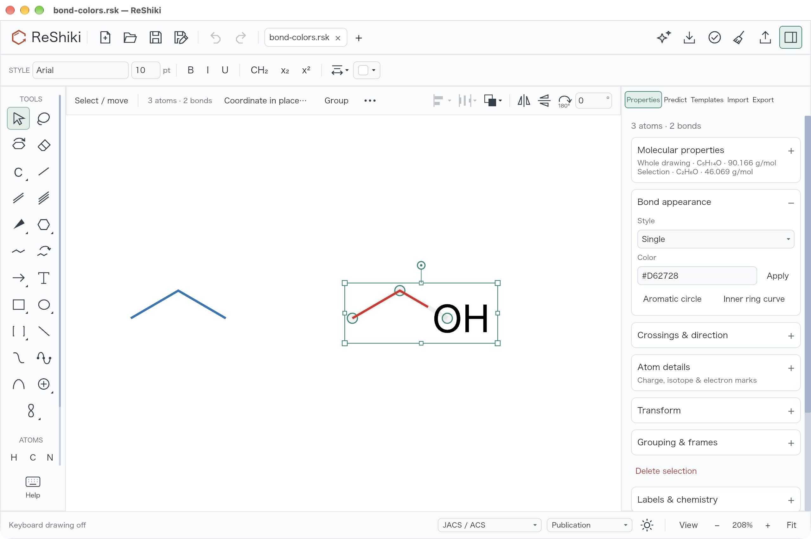 |

Unit test `app::selection_edits::tests::invert_selection_shows_the_newly_selected_bonds_color` failed on `main` (left `"#000000"`, right `"#123456"`) and passes on the branch.

### #1181 tests

- `engine::native_import::tests::spiro_cleanup_of_a_selected_ring_stays_clear_of_fixed_atoms`: the issue's squashed layout, both mirror images, **Keep orientation** on and off. It failed on `main` with atoms on top of each other and passes now.
- `engine::native_import::tests::spiro_cleanup_never_reflects_selected_atoms_onto_other_selected_atoms`: case B through the native cleanup path. It failed on the first version of the fix and passes now (unchanged, with the warning).
- `chemistry::cleanup::tests::selected_cleanup_reflects_atoms_folded_onto_fixed_atoms`, `selected_cleanup_leaves_atoms_it_cannot_unfold_with_a_warning`, `selected_cleanup_never_reflects_atoms_onto_other_selected_atoms`.
- `chemistry::cleanup::tests::unfold_accepts_huge_coordinates`: every atom at 1e20. It failed with "attempt to add with overflow" before b515c36c and passes now.
- `engine::native_import::tests::spiro_cleanup_keeps_regular_rings_and_bond_lengths` still passes.

### P11: release test build

- `cargo test --release --locked --bin reshiki --no-run`: fails on `main` with E0277 in `src/appearance/tests.rs`; builds on the branch.
- `cargo test --release --locked --bin reshiki appearance::tests`: 5 passed, 1 ignored.
- The gated tests `text_input_caret_stops_requesting_redraws_after_idle` and `text_editor_caret_stops_requesting_redraws_after_idle` still run in every debug test run.

### R3: why the Undo/Redo finding was refuted

On `main` 1d94f392, `step_history` (`src/app/history.rs:62-63`) calls `sync_typography()` and `sync_graphics()` after every Undo or Redo. `sync_graphics` starts with `sync_pictures()` (`src/app/graphics.rs:474`), which refreshes the picture size inputs. `sync_typography` ends with `sync_style_inputs()` (`src/app/typography.rs:400`), whose first call is `sync_arrow_label_gap_input()` (line 403). The existing test `arrow_gap_control_applies_ruler_units_and_undo_redo_as_one_edit` already checked the gap input after Undo. The two new tests pass on both `main` and the branch. They pin the behaviour and do not show a fix:

- `app::pictures::tests::undo_and_redo_refresh_the_picture_size_inputs`
- `app::history::tests::undo_and_redo_refresh_the_arrow_label_gap_input`

## Verification

macOS arm64, from the implementation lane:

- `cargo fmt --all --check`: pass.
- `cargo clippy --workspace --lib --bins --all-features --locked -- -D warnings`: pass (also as the pre-commit hook on every commit).
- `cargo test --locked -p reshiki-io --no-fail-fast` at 572dc3be, with the InChI and naming helpers set to the built `reshiki` and `RESHIKI_REQUIRE_INCHI_HELPER=1`: lib 646 passed, 5 ignored; integration tests 10, 3 and 1 passed.
- `cargo test --locked --bin reshiki` (temporary data folder, helpers set): 1583 passed, 0 failed, 182 ignored. This ran on the app commits; the later commits change only `crates/io` and the changelog fragment.
- `cargo test --release --locked --bin reshiki --no-run`: fails on `main`, builds on the branch. `appearance::tests` in release: 5 passed, 1 ignored.
- `uv run --locked python scripts/assemble_changelog.py --check`: 5 changelog fragments are valid.

VERIFICATION_TABLE

## Risk

- **Selected-atom cleanup only.** `unfold` returns at once when no atom is fixed, so whole-drawing and selected-molecule cleanup are unchanged. It changes a result only when a moved atom lies on a fixed atom, which was always a broken drawing.
- **More results come with a warning, and some selections now stay unchanged.** A selection whose turned-back atoms would still land on other atoms is left as it was, with a warning, where `main` applied an overlapping layout. The crowded case is applied with a warning (see the owner decision above).
- **Overlap with other molecules is not checked.** Selected cleanup never checked other molecules, and this PR does not add that. The release note limits its claim to the same molecule.
- **Invert selection** now runs the same selection path as every other selection change. The bond sync is the only new effect.
- **CI time.** The new release test build step is a full release build in a 45-minute job, with no saved release cache. Watch the job's duration on the first run.
- **R3 refactor.** The shared method keeps both paths' behaviour. A commit used to set `labels_dirty` and clear the chemistry notice on a chemistry change even when nothing was recorded, but `Reconciled::outcome` makes that case unreachable.

## Changelog

`docs/changes/unreleased/wave1b-app-followups.md` (section Fixes, issue 1181): the selected-cleanup fix, the bond Color refresh on **Invert selection**, and a developer note that the release test build compiles again and CI builds it.

## Contribution license

- [x] I have read [CONTRIBUTING.md](https://github.com/Ameyanagi/ReShiki/blob/main/CONTRIBUTING.md). I have the right to submit this contribution and agree to offer my original contributions under both MIT and Apache-2.0, so recipients may choose either license (`MIT OR Apache-2.0`).
- [x] Any third-party material is identified below with its source and license, and its required notices are preserved; otherwise, no third-party material is added.

Third-party sources, if any: none.
