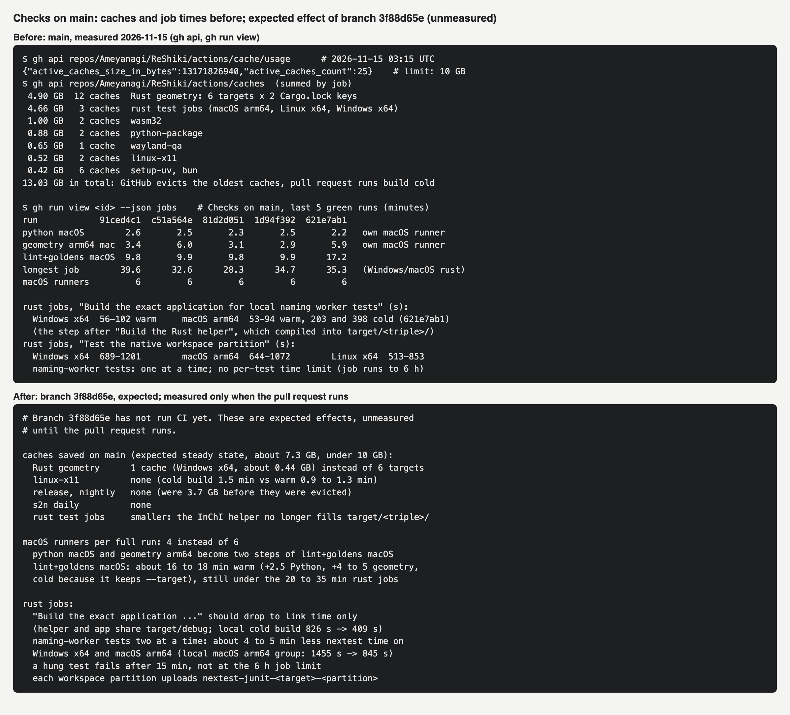
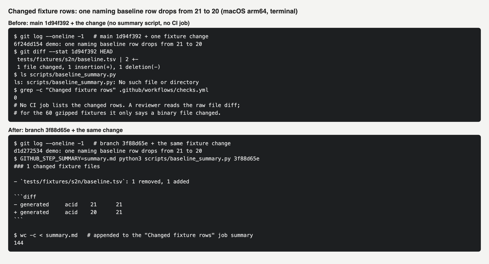
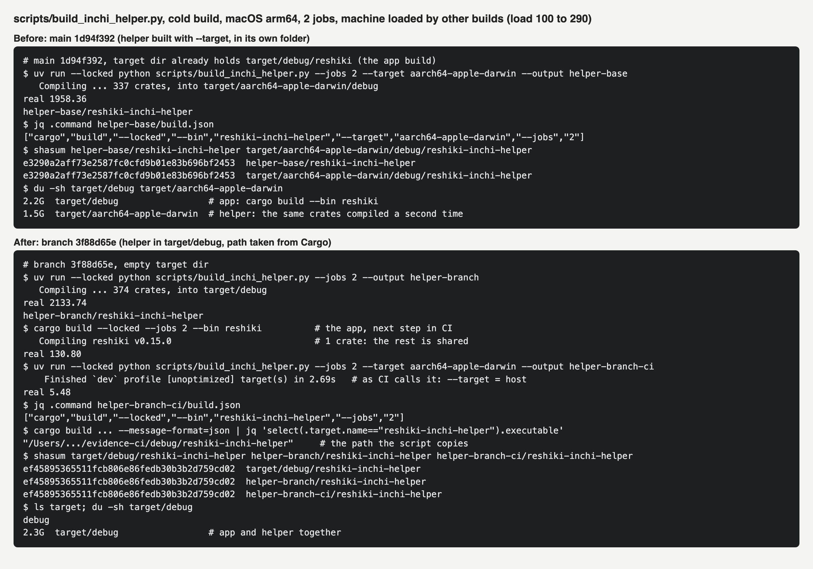
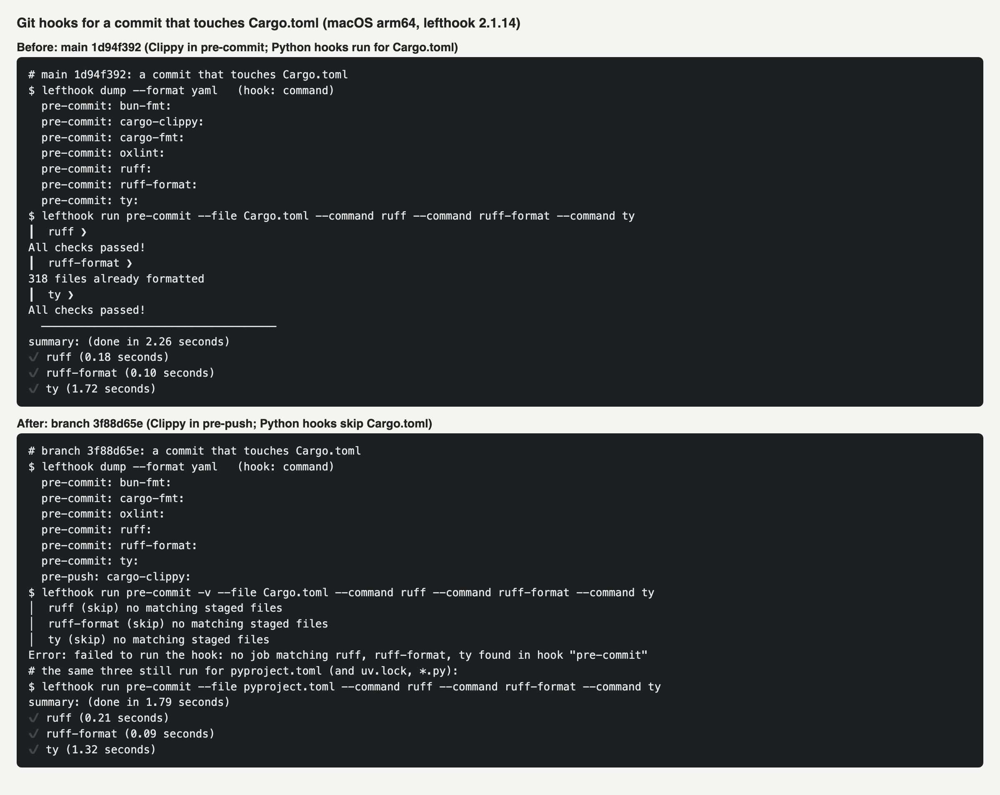
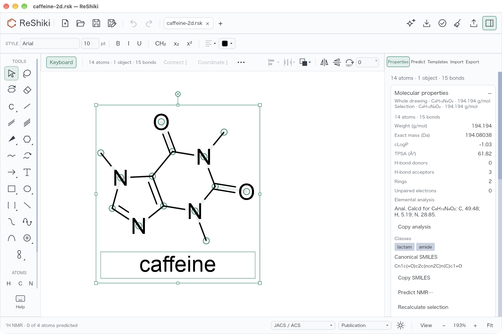
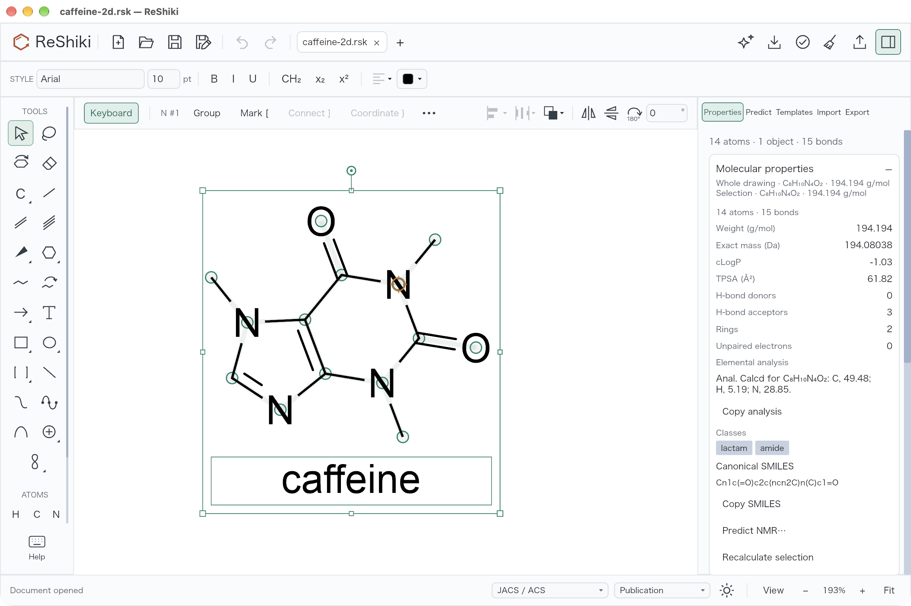
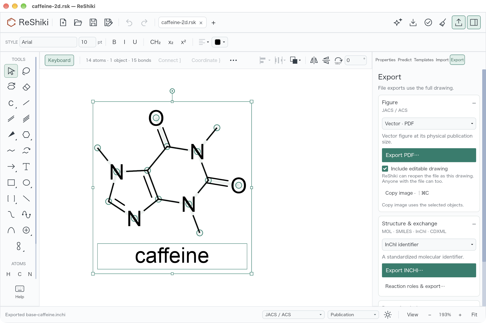
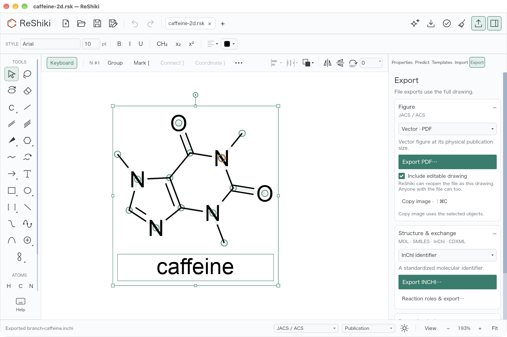

## Summary

Pull request checks keep their build cache again, and a full run needs 4 macOS runners instead of 6. The InChI test helper and the app now share one build, naming-worker tests run two at a time, and a hung test fails after 15 minutes. A new **Changed fixture rows** job lists the fixture rows a pull request changes, and Clippy moves from the pre-commit hook to pre-push.

## Why it matters

- **The Actions cache is over GitHub's 10 GB limit, so pull requests build cold.** On 2026-11-15 the repository held 13.17 GB in 25 caches. The geometry job alone kept 12 caches (6 targets × 2 `Cargo.lock` keys, 4.9 GB). GitHub evicts the oldest caches first, which were the pull request ones. The six nightly release caches (3.7 GB) competed for the same space until they were evicted. Found by listing the caches with `gh api` after cold pull request runs.
- **The InChI helper build compiled the whole workspace a second time.** `scripts/build_inchi_helper.py` always passed `--target`, so Cargo built everything under `target/<triple>/debug`, and the next step, `cargo build --bin reshiki`, built the same crates again under `target/debug`. On `main` that second step took 53 to 102 s warm and 203 to 398 s cold (macOS arm64, run of 621e7ab1). Locally, a cold build of both took 826 s before and 409 s after (lane measurement, 3 jobs). For this PR, on a Mac loaded by other builds with 2 jobs, the `main` helper build compiled 337 crates a second time into a 1.5 GB folder (1958 s). On the branch, the app build after the helper compiled one crate (131 s).
- **Naming-worker tests ran one at a time.** That group set the length of the whole test phase: Windows x64 618 s and macOS arm64 550 s of nextest wall time. With two at a time, the group took 845 s instead of 1455 s on macOS arm64 (417 of 417 passed). Peak memory was 293 MiB for all test and worker processes together; each worker is capped at 384 MiB.
- **A hung test ran until the 6-hour job limit.** The nextest `ci` profile had no time limit and the rust job has no `timeout-minutes`. The slowest test on CI took 222 s (cold Windows x64), and 319 s with two worker tests at a time on a busy Mac.
- **Fixture changes are hard to review.** A changed baseline row shows up only in the raw diff, and the 60 gzipped fixtures show only "binary file changed". Reviewers had to check out the branch to see which rows moved.
- **macOS runners are the scarcest.** The macOS Python job (2.2 to 2.6 min) and the arm64 geometry job (2.9 to 6.0 min) each took a macOS runner of their own on every run.
- **Clippy ran on every commit that touched Rust or Cargo files.** It took 2 min 50 s locally. The Python hooks also ran for `Cargo.toml` and `Cargo.lock`, which they do not check.

## Approach

- **Caches** (`release.yml`, `s2n.yml`, `checks.yml`). Release and nightly builds no longer save a cache. The daily s2n run no longer saves one either. The geometry job saves one cache, for Windows x64 only, under the shared key `geometry`: there a warm build saves about 3.5 minutes on pull requests. The other geometry targets build cold in 4 to 8 minutes, off the critical path. The Linux X11 clipboard job drops its cache (cold 1.5 min vs warm 0.9 to 1.3 min). The python-package, wasm32 and wayland-qa caches stay, because each saves 2 to 5 minutes. Expected steady state: about 7.3 GB.
  - Rejected: one geometry cache for all targets. A build cache cannot be shared across operating systems or architectures.
  - No existing cache was deleted. The old `geometry-<target>` caches age out, or the owner can delete them once.
- **InChI helper** (`scripts/build_inchi_helper.py`). For the host, the script leaves out `--target`, so the helper lands in `target/debug` next to the app and shares its build. A cross build still passes `--target`. When `CARGO_BUILD_TARGET` is set, the script passes `--target <host>` so the helper is still built for the host. The script no longer guesses the output path: it runs Cargo with `--message-format=json-render-diagnostics` and copies the `executable` that Cargo reports. That also covers a target set in a Cargo config file.
  - Not covered: a `[build] target` in a Cargo config file that names another triple. The script then stops with the existing "architecture mismatch" error. Neither the repository config nor any workflow sets one.
- **Naming-worker group** (`.config/nextest.toml`). `max-threads = 2`.
- **Hang limit and JUnit** (`.config/nextest.toml`, `checks.yml`). The `ci` profile reports a test as slow after 60 s and stops it as failed after 15 minutes. A probe test that never ends failed with `TIMEOUT [600.025s]` and exit code 100 at the earlier 10-minute setting. Each workspace partition uploads `target/nextest/ci/junit.xml` as `nextest-junit-<target>-<partition>` (7 days).
  - The limit is 15 minutes, not 10, because of the 319 s run with two worker tests at a time.
- **Changed fixture rows** (`scripts/baseline_summary.py`, new `fixtures` job). On pull requests only, the job compares every changed file under `tests/fixtures/` between the base and the head. It lists removed and added rows in the job summary. `.gz` files are decompressed. `.tsv` rows are matched by the fewest leading columns that tell the rows apart (two for the naming baseline). If no prefix is unique, rows are compared as a multiset. Each file shows at most 40 rows of 300 characters. The summary is cut at 900,000 bytes on a line boundary, with any open code block closed. Paths with backticks or control characters are escaped.
  - A separate job, so a fault in it cannot block `scope`. It uses no token and posts no comment.
  - Rejected: reusing the row diff in `src/naming/s2n_harness.rs`. It compares a fresh run with the committed file and cannot compare two commits.
- **macOS runners** (`checks.yml`, `scripts/ci_scope.py`). The macOS `rust lint+goldens` job runs the six Python commands and the arm64 geometry, heap and process tests as two extra steps. The `python` and `geometry` matrices lose their macOS arm64 rows. The unused Windows `qa-help-polish` upload is removed; the Help renderer test still runs.
- **Hooks** (`lefthook.yml`). `cargo-clippy` moves to a new `pre-push` hook. `ruff`, `ruff-format` and `ty` match `*.py`, `pyproject.toml` and `uv.lock` only. Developers run `bun run --bun lefthook install` once to add the pre-push hook.

## Evidence

All terminal captures: macOS arm64. App captures: macOS arm64 debug builds, window 1280 × 852 pt (2560 × 1704 px), zoom 193%, driven by Codex computer use with an empty data folder for each run.

### CI cache and job times

Before is measured on `main`: cache usage from `gh api` (2026-11-15 03:15 UTC) and job times from the last five green **Checks** runs (91ced4c1, c51a564e, 81d2d051, 1d94f392, 621e7ab1). After is the expected effect. The branch has not run CI yet, so none of it is measured until this pull request runs. Raw data: [`ci-before.txt`](ci-before.txt), [`ci-after.txt`](ci-after.txt), [`caches-now.tsv`](caches-now.tsv).

### Changed fixture rows

Same input on both sides: one commit that changes `generated	acid	21	21` to `generated	acid	20	21` in `tests/fixtures/s2n/baseline.tsv`. On `main` 1d94f392 nothing reports it. On the branch 3f88d65e the script prints the changed row and writes the same 144 bytes to `$GITHUB_STEP_SUMMARY`. An earlier version keyed rows by the first column only and reported 0 changes here; this case is now a unit test.

### InChI helper build

Condensed transcript: the `Compiling` lines are counted, not shown. Both builds started without the helper in their target folder; `main` already had the app in `target/debug`. On `main`, the helper went to `target/aarch64-apple-darwin/debug` (337 crates, 1958 s, 1.5 GB next to the app's 2.2 GB). On the branch, the helper went to `target/debug` (374 crates, 2134 s), and the app build that follows compiled only `reshiki` (131 s). Called as CI calls it, with `--target aarch64-apple-darwin`, the branch script still leaves out `--target` and copies the same file Cargo reports (`ef458953…`). The machine ran other builds at a load average of 100 to 290, so the times are only rough; the lane's cold measurement was 826 s before and 409 s after.

### Git hooks

lefthook 2.1.14, a commit that touches only `Cargo.toml`. The `Error: … no job matching` line on the branch is what `lefthook run --command` prints when every named command was skipped. A real commit just skips them.

### App: no change

The branch changes no Rust code. The base and branch `reshiki` binaries are identical ([`shasums.txt`](shasums.txt): both 001359c4…). The app captures show that the InChI helper copied by the new script works in the app. In the branch run, `RESHIKI_INCHI_HELPER` pointed at the file the script copied from `target/debug` (ef458953…). In the base run, both helpers pointed at the app binary. Input: `tests/fixtures/model-face-handles/caffeine-2d.rsk`, select all, then **Export → Structure & exchange → InChI identifier → Export INCHI…**.

| | Before: main 1d94f392 | After: 3f88d65e |
| --- | --- | --- |
| Properties |  |  |
| InChI export |  |  |

Both exports wrote the same 67 bytes: `InChI=1S/C8H10N4O2/c1-10-4-9-6-5(10)7(13)12(3)8(14)11(6)2/h4H,1-3H3` ([`base-caffeine.inchi`](base-caffeine.inchi), [`branch-caffeine.inchi`](branch-caffeine.inchi)). The branch run also generated the name with the naming helper: `1,3,7-trimethyl-3,7-dihydro-1H-purine-2,6-dione`, marked **Preferred IUPAC name** ([`gui-branch-2-name.png`](gui-branch-2-name.png)).

## Verification

macOS arm64, from the implementation lane at 3f88d65e:

- `uv run --locked python -m unittest discover -s tests -p 'test_*.py'`: 252 tests OK, 12 skipped. The builder, scope and fixture-summary tests failed first on the old code, then passed.
- `uv run --locked ruff check`, `ruff format --check scripts tests`, `uv run --locked ty check`: pass.
- `cargo fmt --all --check` and `cargo clippy --workspace --lib --bins --all-features --locked -- -D warnings`: pass (Clippy also in the new pre-push hook).
- `cargo nextest run -p reshiki --lib --bins --test cli --test stated_ez_wedges --profile ci` on the naming-worker group: 417 passed at one and at two threads (1455.5 s and 844.6 s). `reshiki-process`: 9 passed at two threads.
- A test that never ends, with the `ci` profile at a 10-minute limit: `TIMEOUT [600.025s]`, exit code 100, `<failure type="test timeout"/>` in `junit.xml`.
- `scripts/build_inchi_helper.py` with `CARGO_BUILD_TARGET=aarch64-apple-darwin`: built and copied `target/aarch64-apple-darwin/debug/reshiki-inchi-helper`, not an older `target/debug` copy.
- `lefthook validate`, `bun fmt --check` on changed files, `uv run --locked python scripts/assemble_changelog.py --check`: pass. actionlint 1.7.7: no new findings.
- No Rust source changed, so the Rust test suites were not rerun.

VERIFICATION_TABLE

## Risk

- **Unmeasured on GitHub.** None of the workflow changes has run yet. On this pull request, check that **Changed fixture rows** appears, each rust partition uploads `nextest-junit-*`, and the macOS `rust lint+goldens` job runs the two new steps (expected 16 to 18 min warm; its timeout is 45 min).
- **Two naming-worker tests at a time was only run on macOS arm64.** If Windows x64 or Linux x64 show worker deadline failures or `TIMEOUT`, set `naming-worker = { max-threads = 1 }` again.
- **Release and nightly builds now always compile cold.** The last cold nightly legs took 14 to 40 minutes, Intel macOS and Windows x64 slowest.
- **Old caches stay until they age out.** The rust cache keys do not change, so their old `target/<triple>` content stays until `Cargo.lock` next changes. Deleting the six `v0-rust-geometry-<target>-*`, the `v0-rust-linux-x11-*` and the three `v0-rust-rust-*` caches once frees the space now.
- **Geometry on the macOS lint job builds cold** (it keeps `--target` and has no geometry cache), so that job grows by about 7 minutes. It stays shorter than the macOS rust jobs.
- **Developers must reinstall hooks.** Without `bun run --bun lefthook install`, Clippy no longer runs locally before a push.

## Changelog

`docs/changes/unreleased/wave1b-ci-speed.md` (section Developer): build cache, shared helper build, two naming-worker tests at a time with a 15-minute limit and JUnit reports, the **Changed fixture rows** summary, two fewer macOS runners, and the Clippy pre-push hook.

## Contribution license

- [x] I have read [CONTRIBUTING.md](https://github.com/Ameyanagi/ReShiki/blob/main/CONTRIBUTING.md). I have the right to submit this contribution and agree to offer my original contributions under both MIT and Apache-2.0, so recipients may choose either license (`MIT OR Apache-2.0`).
- [x] Any third-party material is identified below with its source and license, and its required notices are preserved; otherwise, no third-party material is added.

Third-party sources, if any: none.
