## Summary

ReShiki now refuses a few kinds of oversized or crafted files quickly, with a message that names the limit, instead of crashing, hanging for minutes or using close to 1 GB of memory. This covers deeply nested or attribute-heavy CDXML, DTD content in CDXML and style files, very long text boxes, `.rsk` files with too many picture pixels or bytes, and PNG and outlined SVG exports that are too large.

## Why it matters

These were found by the improvement-plan security and performance audit (items S1, S2, S3, S4, S7/S8 and P10) and reproduced on this branch's base. Anyone who opens a file from someone else, and any MCP client, can hit them.

- **S1, deep nesting.** A 45 KB CDXML file nested 3,000 levels deep made ReShiki abort with a stack overflow. In the app this closes ReShiki and loses unsaved work. Over MCP it ends the session.
- **S2, many attributes.** One element with 20,000 attributes (a 209 KB file) took 34 s to read in a debug build before it failed with an unrelated error. The parser's duplicate-attribute check is quadratic, so larger files take minutes.
- **S7/S8, DTD content.** A style (stationery) file with an internal entity was parsed with entities expanded and only refused afterwards. A CDXML file could hide an entity behind an `ELEMENT`, `ATTLIST` or `NOTATION` declaration that holds a quote, and three of the five readers then expanded it. The lane reproduced the expansion with a probe before the fix.
- **S3, long text.** A `.rsk` file with 200,000 characters in one text box was still converting after 180 s (debug build). The audit measured over a minute in a release build, and close to 1 GB of memory for a million characters. One long line also exported as a PNG 444,586 pixels wide.
- **S4, pictures.** A `.rsk` file holding 30 pictures of 4000 x 4000 pixels (480 million pixels, 2.8 MB on disk) was refused only after every picture had been decoded. In the debug build the CLI hit its 120 s deadline first.
- **P10, oversized exports.** A PNG export too large even at 72 dpi was refused only after the whole drawing was rendered as SVG and parsed. An outlined-text SVG over the 16 MiB output limit was refused only after the 39 MB file was fully written.

## Approach

- **One XML scan before every CDXML parser** (`crates/io/src/chemistry/cdxml/xml_guard.rs`). A single linear pass refuses nesting deeper than 64 levels below the root, more than 256 attributes on one element, and any declaration inside an internal DTD subset. It runs before `roxmltree` in all five readers (`tree.rs`, `parse.rs`, `bonds.rs`, `presentation.rs`, `document_styles.rs`). 64 levels keeps the depth the readers already accepted: 65 element levels pass and 66 fail, as before. The scan replaces the two older guards (`has_entity_declaration` and `reject_dtd_declarations`), which disagreed and could be bypassed. A reference to an external DTD, such as ChemDraw's, is still accepted and never fetched.
  - Rejected: raising the thread stack size, which only moves the limit; and fixing the old entity check, because `roxmltree` reads declarations more loosely than XML defines them, so a scan cannot tell where one ends.
- **Text limits in the model** (`crates/model/src/document.rs`). `Document::validate` refuses, first, a text box over 64 KB and a drawing with over 1 MB of text. The same check covers opening a file, an edit in the app and an MCP change. MCP session weight now counts 1 object per 64 bytes of text.
  - Rejected: truncating with a warning. Cutting the text would have to rewrite the style spans, and a silently shortened label is worse than a clear refusal.
- **Picture preflight** (`crates/model/src/pictures.rs`, `check_stored`). Before the full read, one light pass over `graphics[].picture` sums the stored bytes and reads each PNG's size from its 24-byte header. The file is refused when the total passes 64 MB or 64 million pixels, before any picture is decoded. Pictures within budget are read exactly as before. The final check in `validate` stays, since re-encoding changes the size.
  - Rejected: carrying a running budget through decoding. The preflight already bounds the work before decoding, and `validate` bounds the result.
- **PNG size before rendering** (`crates/io/src/export.rs`). A PNG side is now at most 32,767 pixels; export steps down the resolution ladder to fit it, as it already did for the 80 million pixel budget. `render_drawing` builds the scene once, checks the PNG size against the exact scene bounds (text, shapes and pictures as well as atoms), and reuses the same primitives for the SVG (`scene::svg_of`). `png_fits` uses the same f32 order as usvg, so it never refuses a size the real path accepts.
  - Rejected: a check from atom positions alone. It is cheaper but wrong for drawings with hidden atoms, text-only drawings and pictures.
- **Outlined SVG floor** (`export::publication_within`, used by MCP and the CLI). After the SVG is parsed, a lower bound of the path data that will be written is compared with `max_output_bytes`. If even the floor is over, the export is refused before the outlines are written. The floor is about 57% of the real size, so it catches files about 1.75 times over the limit or more. Closer cases still get the exact check on the finished file.
  - Partial: the scene build and the SVG parse still run before this refusal. No sound size estimate exists before text is outlined, and an unsound one could refuse a file that fits.

## Evidence

Inputs were made with [`gen_inputs.py`](https://github.com/Ameyanagi/ReShiki-evidence/blob/ccc9056e3fed1ef96529a726cb48dfbc8d7e47aa/pr-reviews/wave1b-import-limits/gen_inputs.py) (deep, attributes, text, pictures). `x16.rsk` and `x64.rsk` are 16 and 64 copies of the shortcut gallery. Large inputs are not committed. Full transcripts: [`cli-base.txt`](https://github.com/Ameyanagi/ReShiki-evidence/blob/ccc9056e3fed1ef96529a726cb48dfbc8d7e47aa/pr-reviews/wave1b-import-limits/cli-base.txt), [`cli-branch.txt`](https://github.com/Ameyanagi/ReShiki-evidence/blob/ccc9056e3fed1ef96529a726cb48dfbc8d7e47aa/pr-reviews/wave1b-import-limits/cli-branch.txt).

All terminal runs: macOS arm64, debug builds, base `main` 1d94f392 vs branch 0f3c65c4, `reshiki --cli convert`. Other lanes were building on the same Mac, so absolute times are inflated. Base and branch binaries differ (`shasum` 001359c4… vs 21b0d3ab…).

### S1: CDXML nested 3,000 levels deep

Before: the process aborts with a stack overflow (SIGABRT). After: refused in 0.02 s with "XML elements are nested more than 64 levels deep".

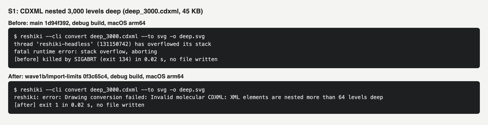

In the app (macOS arm64, debug builds, window 1280 x 852 pt, zoom 100%; file opened at launch with `--open deep_3000.cdxml`):

| Before: main 1d94f392 | After: 0f3c65c4 |
| --- | --- |
| 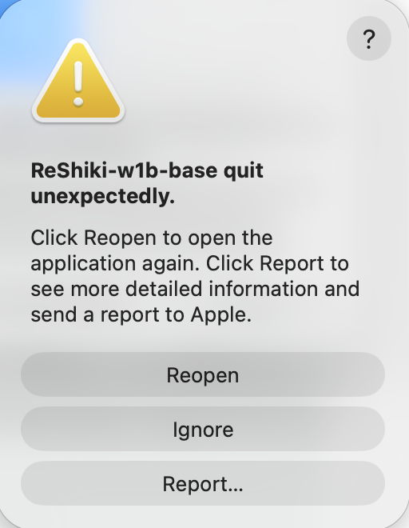 | 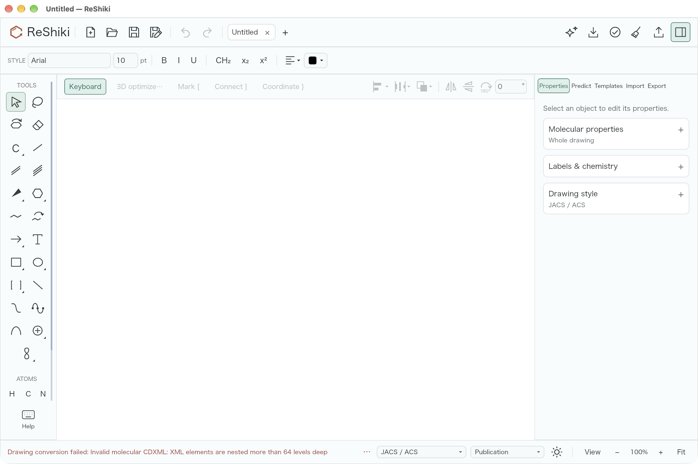 |

Before, the app crashed and macOS showed its "quit unexpectedly" dialog (cropped from a full-screen capture; the wrapper app is named ReShiki-w1b-base). After, the app stays open and the status bar shows the refusal about 7 s after launch.

### S2: one element with 20,000 attributes

Before: 34.0 s, then an unrelated error. After: refused in 0.02 s with "an XML element has more than 256 attributes".

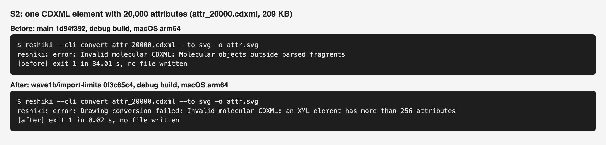

### S3: a 200,000-character text box

Before: still running after 180 s, killed. After: refused in 0.03 s with "A text box can hold at most 64 KB of text".

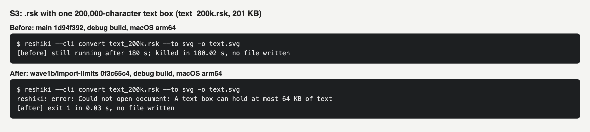

In the app (macOS arm64, debug builds, window 1280 x 852 pt, zoom 100% unless noted; `--open text_200k.rsk`):

| Before: main 1d94f392 | After: 0f3c65c4 |
| --- | --- |
| 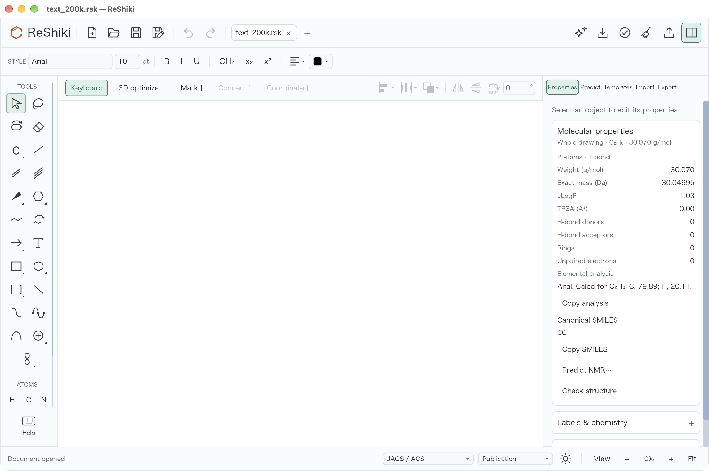 | 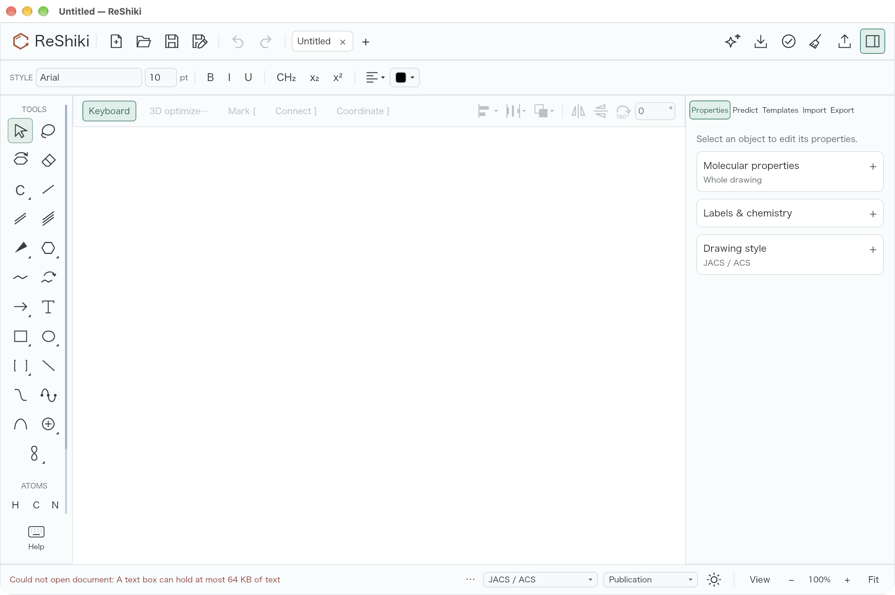 |

Before, the file opened (status "Document opened" by the first capture, about 17 s after launch), but the canvas looked empty and the zoom read 0%, so the text could not be seen or edited usefully. The slow part on the base is laying out and exporting the text: the CLI SVG conversion above was still running after 180 s. The changelog's "over a minute to open" figure is the audit's release measurement; this run did not reproduce a slow open in the app. After, the file is refused within about 5 s of launch.

### S4: 30 pictures of 4000 x 4000 pixels

Before: 121.9 s, then the CLI's 120 s deadline error. After: refused in 0.06 s with "Drawing pictures exceed 64 MB or 64 million pixels".

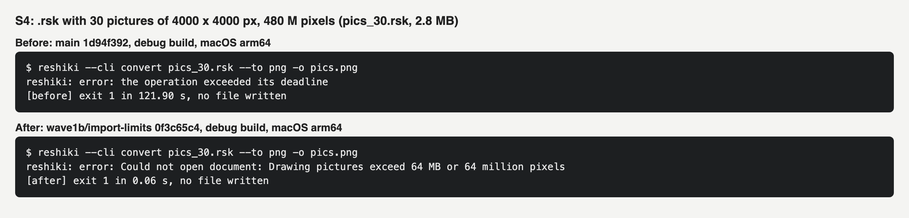

In the app (macOS arm64, debug builds, window 1280 x 852 pt, zoom 100%; `--open pics_30.rsk`):

| Before, 61 s after launch | Before, 120 s after launch | After: 0f3c65c4 |
| --- | --- | --- |
| 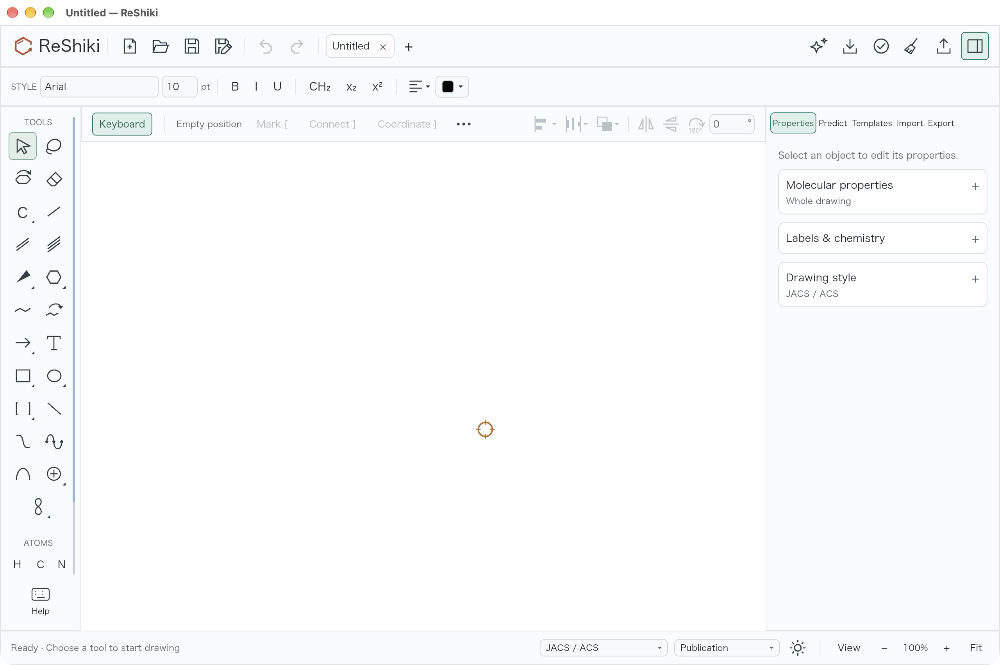 | 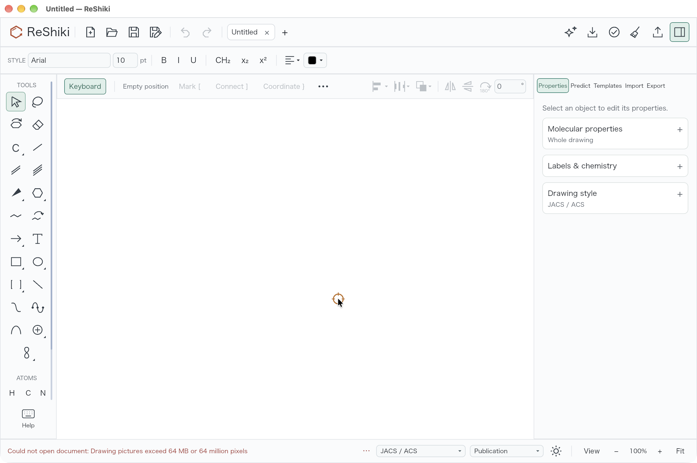 | 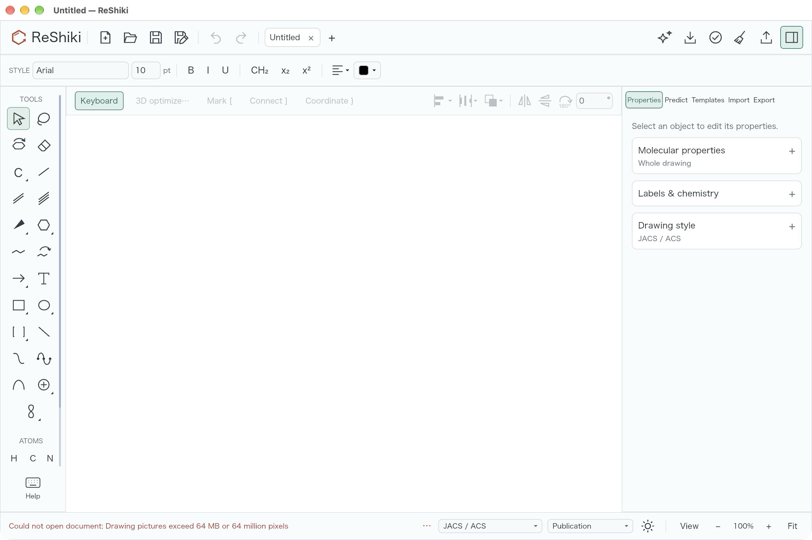 |

Before, the app showed "Ready" with no sign of loading for over a minute (the process used about 89% CPU at 19 s), then refused the file somewhere between 61 s and 120 s. After, the same message appears within about 5 s of launch.

### P10: oversized PNG and outlined SVG

Both builds refuse with the same kind of message; the change is how much work is done first. Repeated runs, alternating base and branch ([`timings-repeated.txt`](https://github.com/Ameyanagi/ReShiki-evidence/blob/ccc9056e3fed1ef96529a726cb48dfbc8d7e47aa/pr-reviews/wave1b-import-limits/timings-repeated.txt)):

| Case (debug build) | Before (s) | After (s) |
| --- | --- | --- |
| PNG of `x64.rsk`, too large even at 72 dpi | 83.5, 83.5, 137.3 | 73.3 (busy), 35.5, 40.7 |
| Outlined SVG of `x16.rsk` (38.9 MB) over 16 MiB | 15.6 (busy), 15.9, 10.1, 10.1 | 17.9 (busy), 10.6, 9.4, 9.4 |

The PNG refusal is about twice as fast. In a debug build the SVG refusal saves little (about 0.7 s on the quiet runs), because parsing and outlining dominate there. The lane measured the release stages for the same file: chemistry 36 ms, scene 300 ms, SVG parse with outlining 570 ms, writing the outlines 626 ms, so the early refusal skips about 40% of the release time. The message also changed: before, an SVG over the limit was told to "Use svg or pdf"; the early refusal now says "Use live text or pdf".

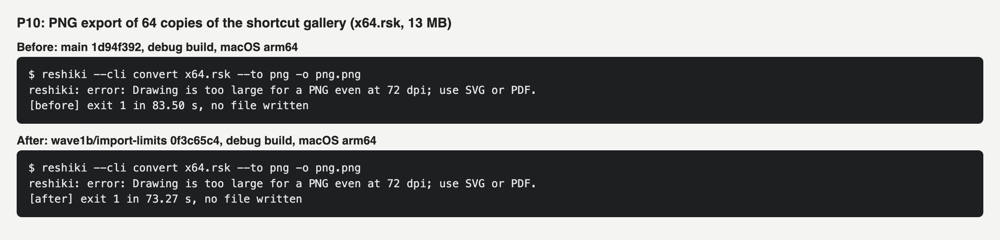

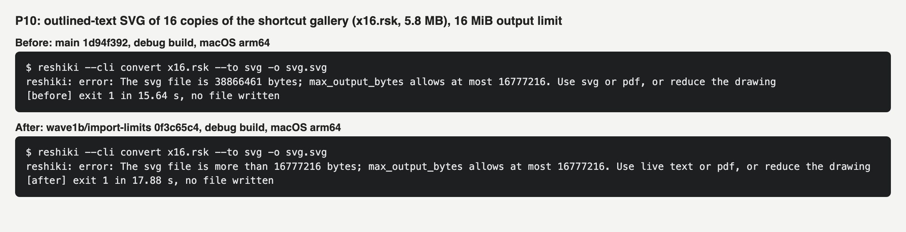

### S3 in the editor: pasting 70,000 characters into a text box

macOS arm64, debug builds, window 1280 x 852 pt, zoom 100%. New drawing, **Text label** tool, click the canvas, paste 70,000 characters, then apply (base: Cmd+Return; branch: the inline **Done** button; both apply the edit).

| | Before: main 1d94f392 | After: 0f3c65c4 |
| --- | --- | --- |
| After paste | 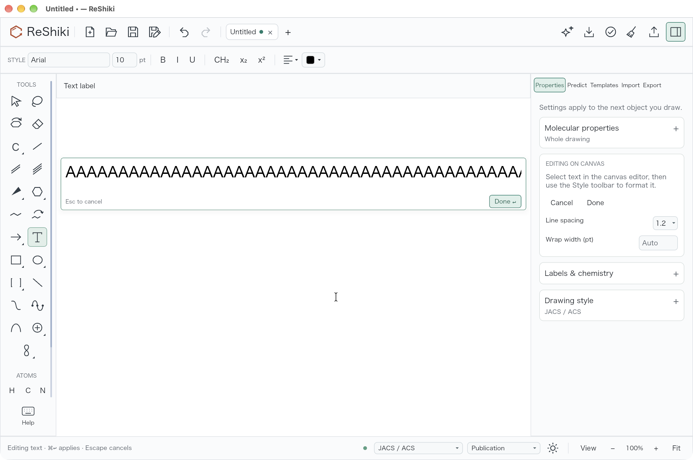 | 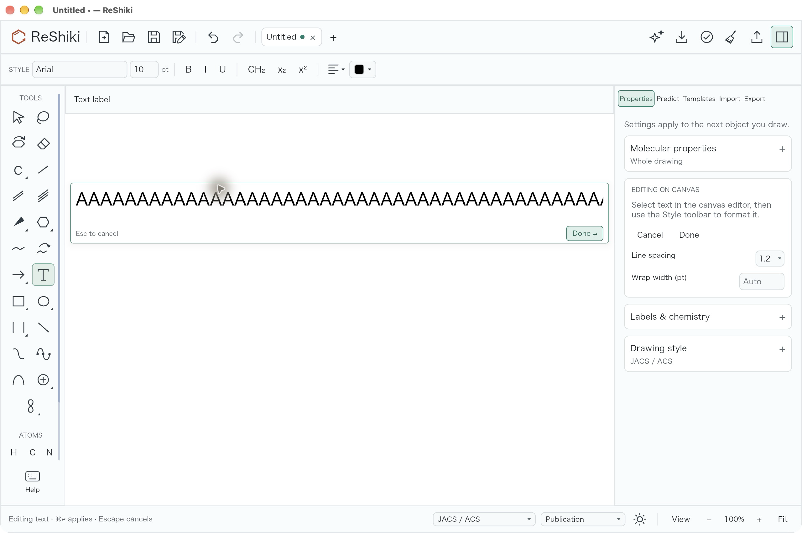 |
| After apply | 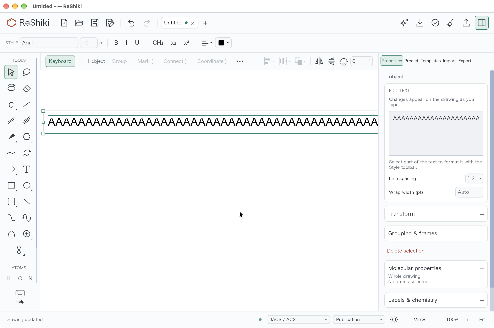 | 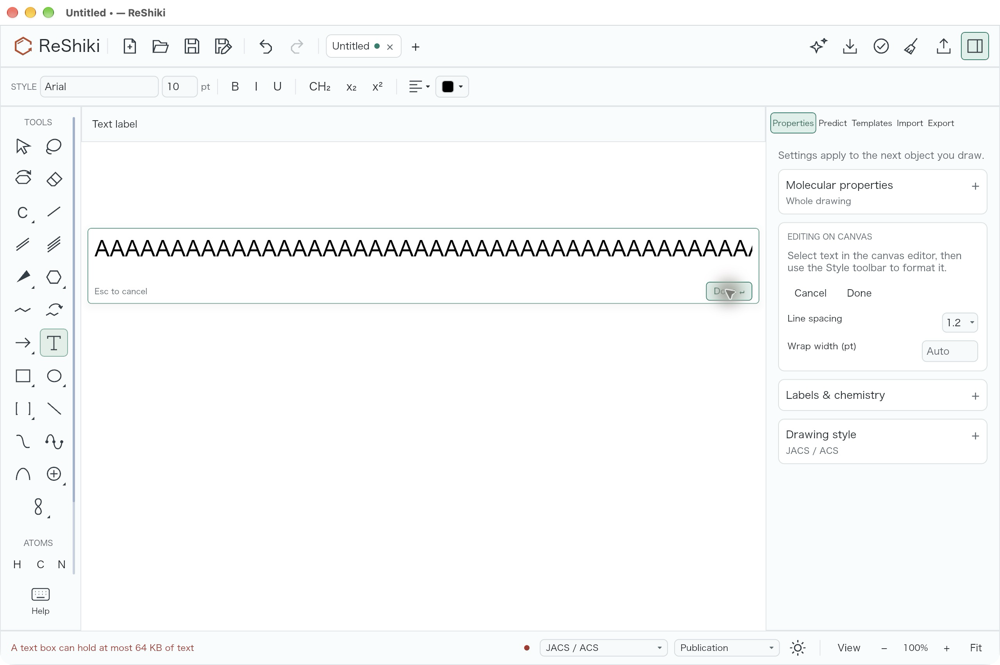 |

Before, the text box was accepted. After, the edit stays open with the text kept, and the status bar names the limit.

### Tests that failed before the fix

- S1: `deep_nesting_is_refused_before_the_parser_can_overflow_its_stack` aborted the test binary with a stack overflow on the base; it runs every reader on a thread with a 2 MiB stack.
- S2: `an_element_with_too_many_attributes_is_refused_before_parsing` now uses a valid stationery-style CDXML: all five readers accept 256 attributes and each refuses 257 with the limit's message. With the guard call removed from the molecules reader, it fails.
- S7/S8: `entity_declarations_are_refused_by_every_reader` and `no_declaration_hides_an_entity_or_nesting_from_the_scan` failed on the base; `an_external_dtd_and_an_inert_internal_subset_are_accepted` keeps ChemDraw's DTD reference working.
- S4: `stored_pictures_over_the_pixel_budget_are_refused_before_any_is_decoded`, `stored_pictures_over_the_byte_budget_are_refused_before_any_is_decoded` and `a_stored_picture_that_is_not_text_is_refused_before_any_is_decoded` failed on the earlier code with decoder errors.
- P10: `an_oversized_png_is_refused_before_the_scene_is_written` (atoms, a 10,000-character line, the line alone, a 200,000-unit rectangle) failed with 3 scenes written; `png_fits_sizes_a_scene_to_the_pixel_as_the_parsed_svg_does` failed on the old order ("Drawing is too large for a 1200 dpi PNG") for a scene the real path sizes at 10,822 x 7,392; `outlined_svg_is_never_smaller_than_its_floor` checks the floor is sound.
- S3: `annotation_text_is_capped_per_text_box_and_per_drawing` and `cost_counts_annotation_text_by_its_bytes` use the new constants, so they could not compile before.

## Verification

macOS arm64, from the implementation lane:

- `cargo fmt --all --check`: clean.
- `cargo clippy --workspace --lib --bins --all-features --locked -- -D warnings`: clean.
- `cargo test -p reshiki-model --locked`: 1436 passed, 9 ignored.
- `cargo test -p reshiki-io --locked` with `RESHIKI_INCHI_HELPER`, `RESHIKI_NAMING_HELPER` and `RESHIKI_REQUIRE_INCHI_HELPER=1`: 650 passed, 5 ignored, plus all integration and doc tests.
- `cargo test -p reshiki-agent --locked`: 304 + 34 + 4 passed, 2 ignored.
- `cargo test -p reshiki-mcp --locked`: 57 + 2 + 18 passed.
- `cargo test --locked --bin reshiki`: 1580 passed, 182 ignored (first round; the root crate's sources are unchanged since).
- Integration targets `figure_exports`, `headless_parity`, `picture_memory`, `agent_api_cli_files`, `cli`, `agent_api_malformed`: passed.
- `uv run --locked python scripts/assemble_changelog.py --check` and `bun fmt --check` on the changed docs: pass.

| Platform | Result |
|---|---|
| macOS arm64 | Lane run: reshiki-model 1436, reshiki-io 663, reshiki-agent 342 passed, 0 failed; clippy and fmt clean. Full suite on Apple M4: running, result will be added here |
| Ubuntu arm64 | Pass: fmt and clippy clean; workspace nextest 5519 passed, 0 failed, 238 ignored |
| Arch Linux x64 | Running, result will be added here |
| Windows x64 | PR CI (windows-2022): build, workspace tests and rendered UI tests |

## Risk

- **Stricter than before, on purpose.** A text box over 64 KB or a drawing over 1 MB of text is refused, not truncated. Any declaration in an internal DTD subset is now refused by every CDXML reader (only `tree.rs` refused `ELEMENT`, `ATTLIST` and `NOTATION` before). A hand-made `.rsk` whose stored pictures total over 64 MB is refused even if they would take less once read; files saved by ReShiki already hold the re-encoded pictures.
- **Limits chosen in this PR:** 1 MB of text per drawing (16 full text boxes), 32,767 pixels per PNG side, and 64 bytes of text per unit of MCP session weight.
- **S4 was marked "ask" in the improvement plan.** It is isolated in `pictures::check_stored` and one call in `Document::from_json`, so it can be dropped on its own.
- **Error text for malformed `.rsk` files.** The picture preflight reads the graphics first, so a file with several faults may now report a different one.
- **Windows-only code.** The clipboard PNG budget (8,192 pixels per side) and the EMF arm of `render_drawing` compile only on Windows, and `render_drawing` changed. The four-platform table above covers it.
- **Fonts.** The SVG floor depends on the fonts usvg finds; its "floor is more than half the real size" check was first run on macOS only.
- **P10 is partial for SVG.** The scene build and SVG parse still run before an oversized outlined SVG is refused.

## Changelog

`docs/changes/unreleased/wave1b-import-limits.md` (section Fixes):

- A CDXML file or ChemDraw style file nested more than 64 levels deep is refused with a message instead of closing ReShiki.
- A CDXML element with more than 256 attributes is refused at once.
- DTD content inside a CDXML or ChemDraw style file is refused before the file is read; a reference to the ChemDraw DTD still works.
- A text box holds at most 64 KB of text, and a drawing at most 1 MB.
- MCP session documents count text toward the session weight.
- A PNG is at most 32,767 pixels on a side.
- A `.rsk` file whose pictures are stored in more than 64 MB or hold more than 64 million pixels is refused before any picture is decoded.
- PNG export of a drawing too large even at 72 dpi is refused before the drawing is rendered.
- Over MCP and the command line, an outlined SVG far over the output limit is refused before the outlines are written.

## Contribution license

- [x] I have read [CONTRIBUTING.md](https://github.com/Ameyanagi/ReShiki/blob/main/CONTRIBUTING.md). I have the right to submit this contribution and agree to offer my original contributions under both MIT and Apache-2.0, so recipients may choose either license (`MIT OR Apache-2.0`).
- [x] Any third-party material is identified below with its source and license, and its required notices are preserved; otherwise, no third-party material is added.

Third-party sources, if any: none.
