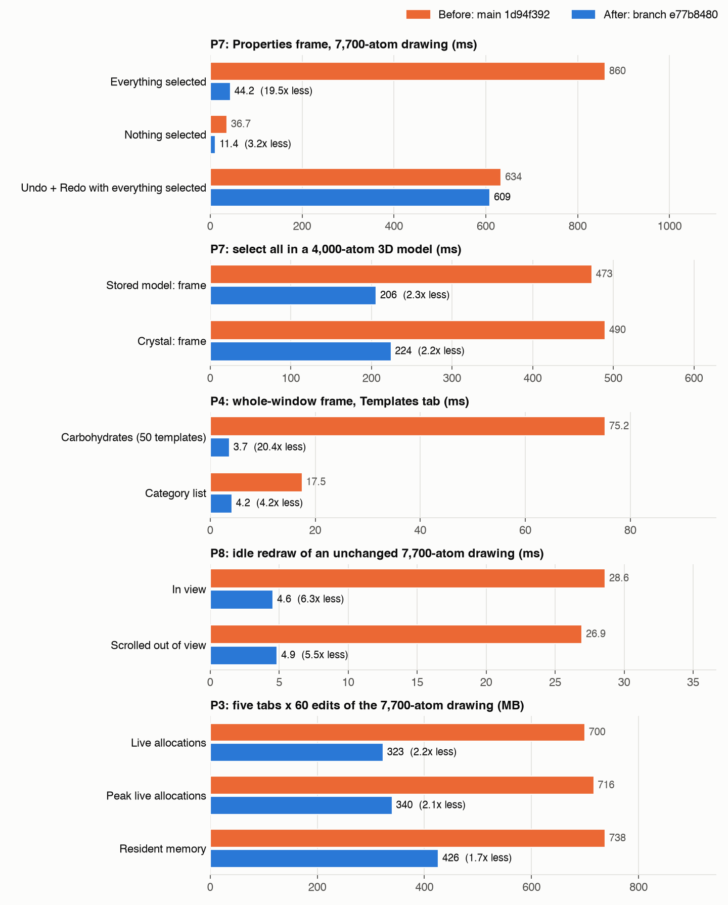
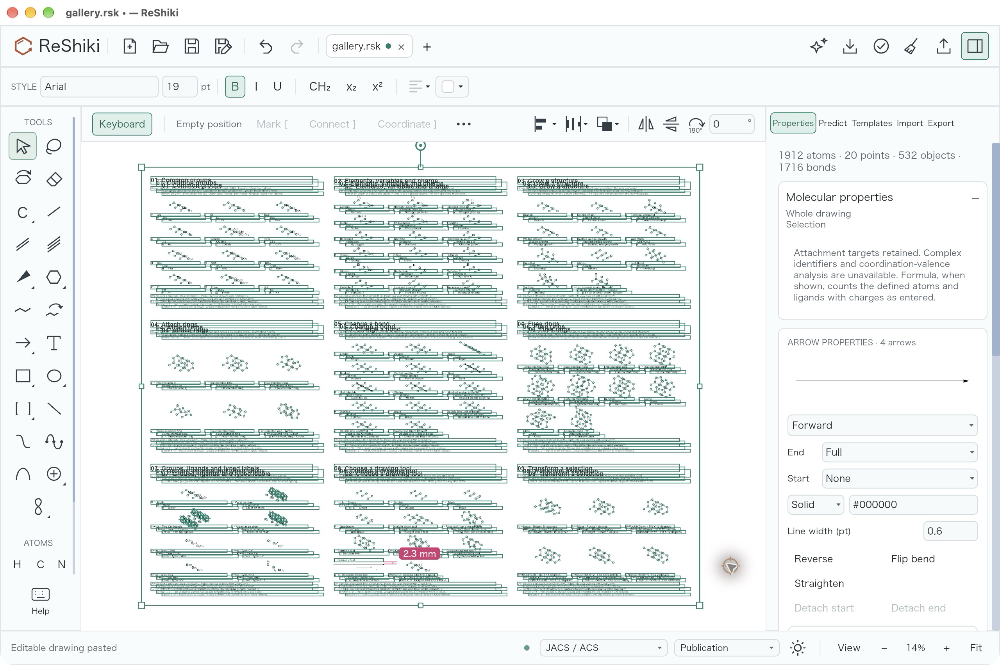
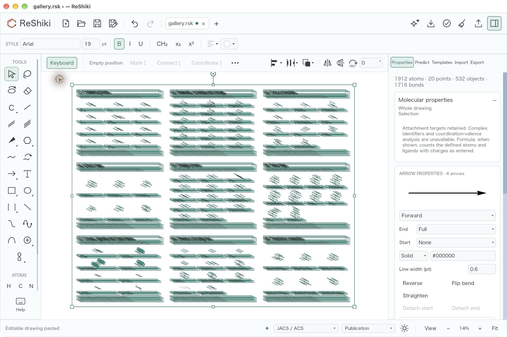
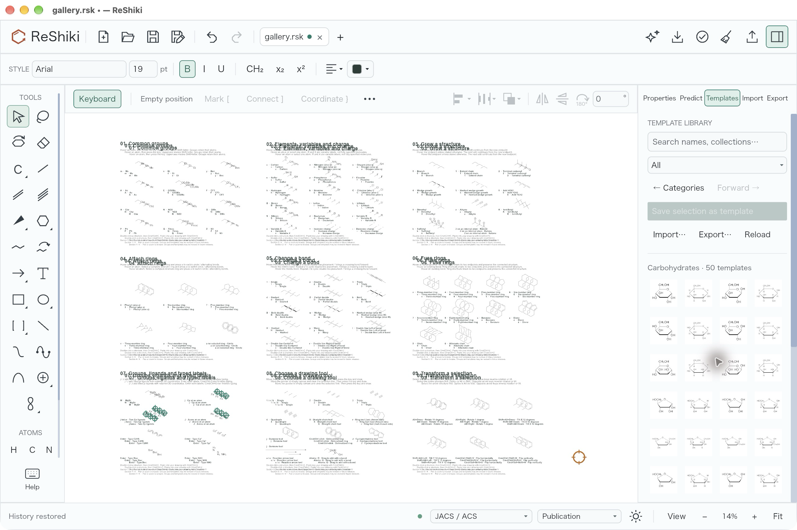
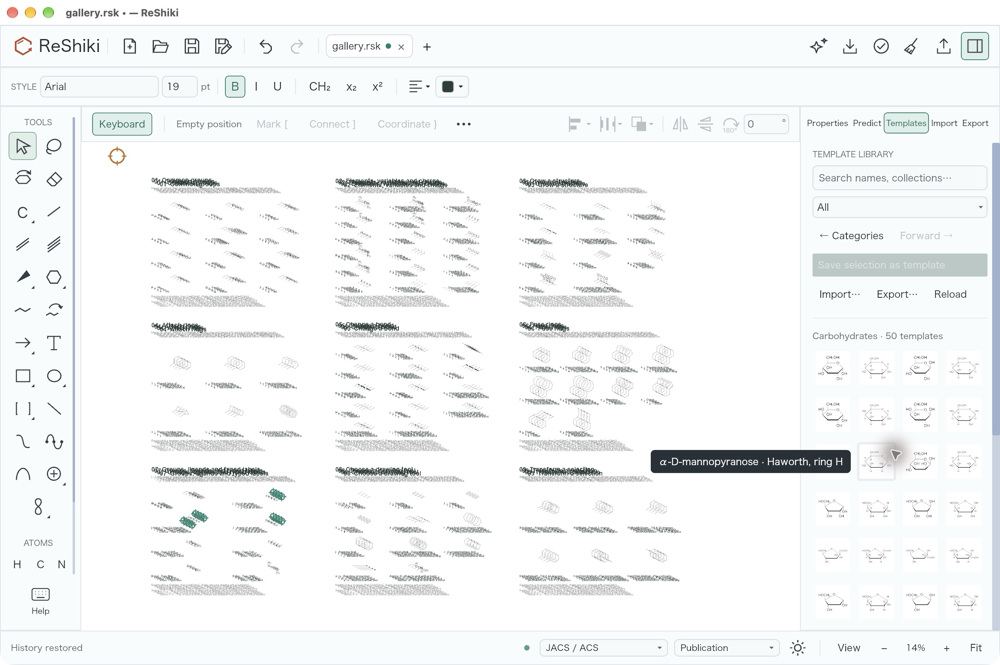
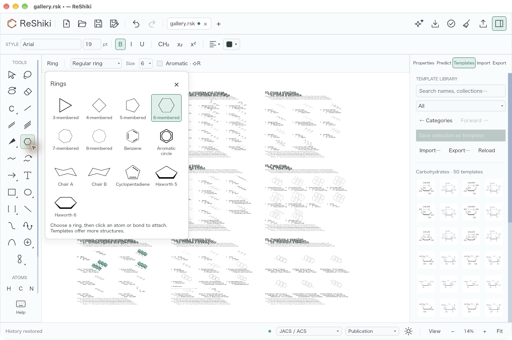
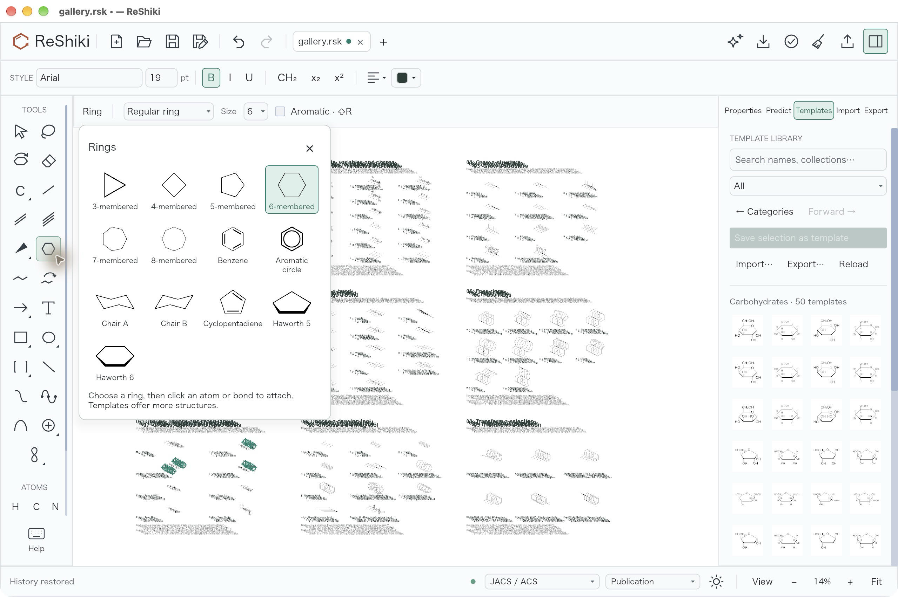
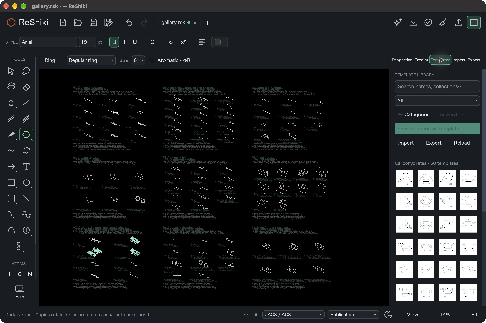
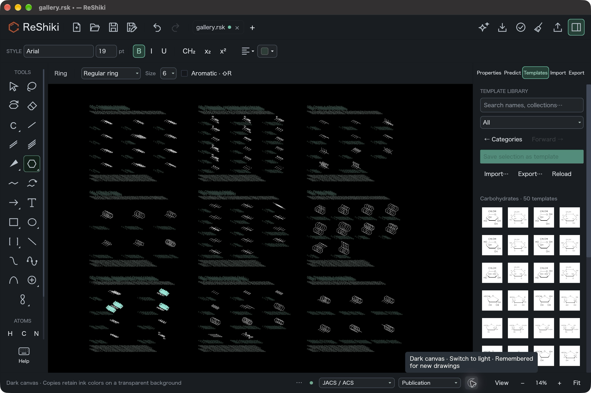

## Summary

Wave 2 of the app performance audit: large drawings redraw less and undo history uses less memory. Four audit items, two of them partly done. Times are medians from a busy Apple M1 (see Evidence). The lane's quieter runs gave the same ratios.

- **P7, select all with Properties open.** A frame of a 7,700-atom drawing with everything selected took 860 ms. It now takes 44 ms. Undo with everything selected is not faster in this PR (see Risk).
- **P4, template thumbnails.** The Templates tab drew every thumbnail again on every frame. It now keeps each one until the drawing, the tile size or the loaded fonts change. A frame with the 50 carbohydrate templates open: 75 ms → 3.7 ms.
- **P8, idle redraw.** A redraw of an unchanged 7,700-atom drawing (the pointer moving over it) compared the whole drawing several times. It now compares it once per draw: 28.6 ms → 4.6 ms.
- **P3, undo memory.** All tabs now share one undo and redo budget of about 256 MB. Each tab used to have its own 128 MB. Five tabs with the 7,700-atom drawing and 60 edits each: 700 MB → 323 MB of live allocations. One tab alone is unchanged.

No issue is filed for these items, so this PR closes none.

## Why it matters

The audit found these in the released 0.15.0 app. The numbers are from the workloads this PR adds, on base `1d94f392`.

- **P7: a freeze on every redraw.** With **Properties** open, **Select all** on a large drawing made each frame take 860 ms, so moving the pointer or scrolling stalled. A profile of main showed two causes. `opened_section` ran twice per frame, and each run built the molecules of the selection with a quadratic `retain` (52% of the frame). `models3d::selected_molecule` ran three times per frame with a linear atom lookup per selected atom (36%). The audit named only the first. With nothing selected, a drawing with attachment points ran a full validation and chemistry analysis on every frame (71% of that frame).
- **P4: the Templates tab was the slowest panel.** Opening the largest collection made each frame 30 times slower than the closed inspector (75 ms against 2.4 ms). The ring tool card in **Properties** and the reaction role, theme and drawing style previews draw through the same code.
- **P8: an idle drawing cost a full comparison per cache call.** Hovering over an unchanged drawing redraws it. Each cache lookup in that draw compared the whole drawing with the cached copy: 28.6 ms per redraw of the 7,700-atom drawing, even when it was scrolled out of view.
- **P3: memory grew with every open tab.** Each tab kept up to 128 MB of undo snapshots, so five tabs of a large drawing held about 700 MB of history.

## Approach

- **P7.** `opened_section` runs once per frame. A new `reactions::whole_molecules` (no bond leaves the selection) replaces building the molecules. `reactions::molecules` removes the atoms it finds instead of filtering all of them. `selected_molecule` and `App::selected_model` use hash sets, and the Properties panel looks up the 3D model once. **Bond appearance** and **Atom details** are built only when open. The composition shown for a drawing with attachment points is cached per revision, file and selection. The style bar's selection color check also uses a set.
- **P4.** `TemplateThumbnail` and `DrawingThumbnail` use the geometry cache that `DrawingPreview` already had (`PreviewState`). Its key adds the loaded-font count, so a thumbnail is drawn again after a web font loads.
- **P8.** A draw of the canvas compares the drawing once (`cache::Frame`). Other cache calls in the same draw skip the comparison. Calls between draws compare as before. Rejected: a revision counter, as the audit proposed. `tab.revision` is not bumped by previews and background labels, so a counter could serve a stale scene.
- **P3, small part (done).** `History::bytes()` counts undo and redo frames. When all tabs together go over the budget after an edit, undo or redo, the tabs behind the front one give way first, the largest history first. Each gives up its oldest undo steps, then the redo steps furthest ahead, down to 5 steps. The front tab is last and keeps at least 20 steps, as before. An edit routed to a tab behind the front trims once the front tab is back in place.
- **P3, large part (not done).** Sharing unchanged collections between undo frames (`Arc`) was measured and not built. One copy of the 7,700-atom drawing is 49,735 allocations and 6.28 MB. Atoms and bonds are 94% of the bytes, and one element edit changes both, so sharing per collection would save about 6% of a frame. Storing undo frames as differences would help, but it changes `History::undo_frames` and `redo_frames`, which `crates/agent` uses for its memory budgets. That is a separate change.

## Evidence

### Measured before and after

Release test builds of base `1d94f392` and branch `e77b8480`, both with the workloads of `81efb8f4` and `abd8aa0d`. Re-measured on macOS arm64 (Apple M1) for this description. Each timing is the median of 3 interleaved runs of base and branch, and each run is the median of 30 samples after 3 warm-up runs. The 3D model rows ran once. "16×" is 16 copies of the shortcut gallery, 7,728 atoms. Other builds kept the Mac at a load average of 85 to 230, so absolute times are higher than the lane's quieter runs ([lane-timings-before-after.csv](measurements/lane-timings-before-after.csv)), but the ratios agree.



| Item | Workload | Base `1d94f392` | Branch `e77b8480` | Change |
| --- | --- | ---: | ---: | ---: |
| P7 | Properties frame, everything selected, 16× | 860 ms | 44.2 ms | 19.5× less |
| P7 | Properties frame, everything selected, 4× | 67.9 ms | 8.1 ms | 8.4× less |
| P7 | Properties frame, nothing selected, 16× | 36.7 ms | 11.5 ms | 3.2× less |
| P7 | Undo + Redo, everything selected, 16× | 634 ms | 609 ms | about the same (Risk) |
| P7 | Find the selected 3D model, 4,000-atom stored model | 18.7 ms | 1.7 ms | 11× less |
| P7 | Frame with everything selected, 4,000-atom stored model | 473 ms | 206 ms | 2.3× less |
| P7 | Frame with everything selected, 4,000-atom crystal | 490 ms | 224 ms | 2.2× less |
| P7 | Frame with everything selected, 4,000-atom chain, no model | 310 ms | 208 ms | 1.5× less (Risk) |
| P4 | Window frame, **Templates → Carbohydrates** (50) | 75.2 ms | 3.7 ms | 20× less |
| P4 | Window frame, **Templates** category list | 17.5 ms | 4.2 ms | 4.2× less |
| P4 | Window frame, **Properties** | 4.6 ms | 2.6 ms | 1.8× less |
| P4 | Window frame, inspector closed | 2.4 ms | 2.2 ms | about the same |
| P8 | Idle redraw, 16×, drawing in view | 28.6 ms | 4.6 ms | 6.3× less |
| P8 | Idle redraw, 16×, drawing out of view | 27.0 ms | 4.9 ms | 5.5× less |
| P8 | Idle redraw, 4×, drawing in view | 3.1 ms | 1.4 ms | 2.3× less |
| P3 | Five tabs × 60 edits of 16×: live allocations | 699.7 MB | 323.1 MB | 2.2× less |
| P3 | Five tabs × 60 edits of 16×: peak live allocations | 716.4 MB | 339.8 MB | 2.1× less |
| P3 | Five tabs × 60 edits of 16×: resident memory | 737.7 MB | 426.1 MB | 1.7× less |
| P3 | Five tabs × 60 edits of 16×: undo frames kept | 100 | 40 | |
| P3 | One tab × 60 edits of 16×: live / peak | 147.2 / 163.9 MB | 147.2 / 163.9 MB | unchanged (Risk) |

Raw output: [measurements/](measurements/) (`base-*.txt`, `head-*.txt` per workload and run, [summary.csv](measurements/summary.csv), [binaries.txt](measurements/binaries.txt) with the SHA-1 of both test binaries). The lane's own runs are kept beside them as `lane-*.csv`.

To reproduce: `cargo test --release --locked --bin reshiki <name> -- --exact --ignored --nocapture --test-threads=1` with `app::performance::redraw::select_all_workloads`, `template_panel_workloads`, `model_select_all_workloads`, `history_memory` and `canvas::performance::idle_redraw_workloads`. On base, cherry-pick `81efb8f4` and `abd8aa0d` first. At `1d94f392` the release test build also needs `src/appearance/tests.rs` gated on `debug_assertions`. Main fixed that in `10793608`.

### The app draws and responds the same

Debug builds of base `1d94f392` and branch `e77b8480`, run one after the other on macOS arm64 with a fresh data folder. Steps: open `assets/examples/shortcut-examples.rsk`, paste it to four copies (1,912 atoms), **Select all** with **Properties** open, Undo and Redo, open **Templates → Carbohydrates**, open the **Rings** card, switch to the dark canvas. Window 1280 × 852 pt.

The Mac was under very heavy load from other builds (load average 85–230). The seconds in the reports are mostly that load and the automation's own capture time, so they do not compare the two builds. The screenshots show that both builds draw the same things.

| Base `1d94f392` | Branch `e77b8480` |
| --- | --- |
|  |  |
|  |  |
|  |  |
|  |  |

The two runs pasted the copies at slightly different offsets, so the drawings overlap differently. In the four-copy run, the arrow preview in **Properties** was thin on base and thick on branch. A second check with one copy shows the same thick preview on both builds, so the difference follows that run's paste history, not the build: [app-arrow-preview-1x-base-vs-branch.png](app-arrow-preview-1x-base-vs-branch.png) (full windows: [base](app-base-09-arrow-1x.png), [branch](app-branch-09-arrow-1x.png)).

Other screenshots: open ([base](app-base-01-open.png), [branch](app-branch-01-open.png)), four copies ([base](app-base-02-four-copies.png), [branch](app-branch-02-four-copies.png)), after Undo and Redo ([base](app-base-04-after-undo-redo.png), [branch](app-branch-04-after-undo-redo.png)), templates scrolled ([base](app-base-06-templates-scrolled.png), [branch](app-branch-06-templates-scrolled.png)). Reports: [app-base-report.md](app-base-report.md), [app-branch-report.md](app-branch-report.md).

### Rendering parity (from the lane)

- `canvas::render_parity_tests` with `RESHIKI_CANVAS_PIXELS`, baselines from base, compared on the branch: all 66 pixel baselines match.
- `ui_layout_snapshots`, base against branch: 166 of 171 PNGs are byte-identical. The other 5 (assistant example, structure-both) also differ between two runs of the same base binary.
- `views_match_captured_baseline`: no widget tree line differs. 280 of 350 views differ only in their allocation line (`ALLOC,<count>,<bytes>`), which this PR is meant to change.

## Verification

VERIFICATION_TABLE

The macOS arm64 rows ran on branch `e77b8480`, each build with its own `CARGO_TARGET_DIR`.

| Platform | Command | Result |
| --- | --- | --- |
| macOS arm64 | `cargo fmt --all --check` | pass |
| macOS arm64 | `cargo clippy --workspace --lib --bins --all-features --locked -- -D warnings` | pass |
| macOS arm64 | `cargo clippy -p reshiki-model -p reshiki --all-targets --all-features --locked -- -D warnings` | pass |
| macOS arm64 | `cargo test --locked -p reshiki-model` | 1435 passed, 9 ignored |
| macOS arm64 | `cargo test --locked --bin reshiki` (helper variables set, fresh data folder) | 1586 passed, 188 ignored |
| macOS arm64 | Ignored renderer checks: template thumbnails built once, hover reuses scene geometry, cached canvas matches fresh edits, drawing preview matches fresh theme | pass |
| macOS arm64 | `bun fmt --check .`, `uv run --locked python scripts/assemble_changelog.py --check` | pass |
| macOS arm64 | Release workloads, base and branch (Evidence) | as shown |
| macOS arm64 | Real app, base and branch debug builds (Evidence) | draws and responds the same |
| Ubuntu arm64 | full workspace tests | 5513 passed, 0 failed |
| Windows x64 | PR CI (`windows-2022` Rust, lint and goldens jobs) on head `9ada8b7e` (this branch with main merged) | pass, as are the Linux jobs |
| Arch Linux x64 | not run locally | no platform-specific code changed |

An independent review (Codex, read-only) of the first round found 4 issues. Three are fixed with tests: redo frames were outside the budget, an edit in a tab behind the front was never trimmed, and select all stayed quadratic for stored 3D models and crystals. The fourth is the large part of P3 (see Risk).

## Risk

- **Undo depth in tabs behind the front (user-visible, decided in this PR, not in the audit).** Once all tabs together hold more than about 256 MB, a tab behind the front can drop to 5 undo steps. With the old floor of 20 steps in every tab, the budget saved nothing for large drawings (20 frames × 6.4 MB = 128 MB per tab). To undo this decision, set `BACKGROUND_STEPS` to `History::MIN_STEPS` in `src/app/tabs.rs`. `docs/capabilities.md` and the changelog say so.
- **Partial: P3 large part.** One tab with a large drawing still holds as much history as before: 147 MB live after 60 edits, 164 MB peak. The 60 edits themselves allocate 3.4 GB in 40 million allocations. The undo copies are 7% of those allocations. Sharing between undo frames needs an owner decision and its own PR.
- **Partial: P7 undo and select all on very large single molecules.** Undo plus redo with everything selected in the 7,700-atom drawing stays at about 609 ms (634 ms before, and 334 against 376 ms in the lane's quieter runs). 94% of it is `scene::selection_bounds`. The model scaling change on main (`45010a3e`) speeds that up, and this PR's head now includes main, but it was not measured here. A single 4,000-atom molecule with everything selected still grows faster than linear in the style bar (`atom_labels::alignment` and `visible`, in the model scaling area). The stored-model and crystal paths are linear now.
- **Changelog wording.** "About 320 MB of history instead of 700 MB" counts all live Rust allocations in the workload, which includes the drawings and caches, not history alone.
- **Measurements.** All timings are from an Apple M1 shared with other builds. Compare before with after, not with the audit's M4 numbers. The audit's 1.35 GB / 1.6 GB resident figures for the released app were not reproduced by the headless harness.
- **Platforms.** No platform-specific code changed. The release workloads and the real-app check ran on macOS arm64 only. The browser editor's thumbnail cache now keys on the loaded-font count. No browser check was run.
- **View parity baselines.** A `RESHIKI_VIEW_PARITY` baseline captured on main before this PR fails on the allocation line of 280 views. Capture it again after merging.
- **Shared widget state.** `TemplateThumbnail`, `DrawingThumbnail` and `DrawingPreview` now share one state type. If one of them replaced another at the same place in the widget tree with an equal drawing and size, it would show the other's geometry until the drawing or size changed. No screen is known to do this.

## Changelog

`docs/changes/unreleased/wave2-app-redraw-memory.md`:

```markdown
---
section: Changes
issues: []
---

- Large drawings stay responsive with everything selected. With the
  **Properties** tab open, ReShiki built each frame of a 7,700-atom drawing in
  about 580 ms after **Select all**. It now takes about 20 ms. A drawing with
  attachment points also builds its frame faster with nothing selected: 6 ms
  instead of 21 ms. The times here are medians on an Apple M1.
- The **Templates** tab draws each thumbnail once and keeps it. A frame with the
  largest collection open takes about 2 ms instead of 44 ms. The preview of a
  ring tool in the **Properties** tab is kept the same way.
- An unchanged large drawing costs less to redraw: about 3 ms instead of 14 ms
  for a 7,700-atom drawing, whether or not it is in view.
- Undo and redo history has one memory budget for all tabs, about 256 MB, where
  each tab had its own 128 MB. When the history goes over the budget, the tabs
  behind the front one give way first: each gives up its oldest Undo steps, then
  the Redo steps furthest ahead, and keeps at least 5 steps. The front tab keeps
  at least 20, as before. Five tabs with a 7,700-atom drawing each now hold
  about 320 MB of history instead of 700 MB.
```

## Contribution license

- [x] I have read [CONTRIBUTING.md](https://github.com/Ameyanagi/ReShiki/blob/main/CONTRIBUTING.md). I have the right to submit this contribution and agree to offer my original contributions under both MIT and Apache-2.0, so recipients may choose either license (`MIT OR Apache-2.0`).
- [x] Any third-party material is identified below with its source and license, and its required notices are preserved; otherwise, no third-party material is added.

Third-party sources, if any: none.
