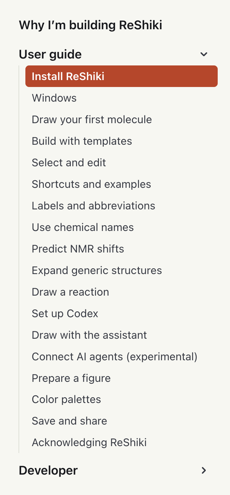
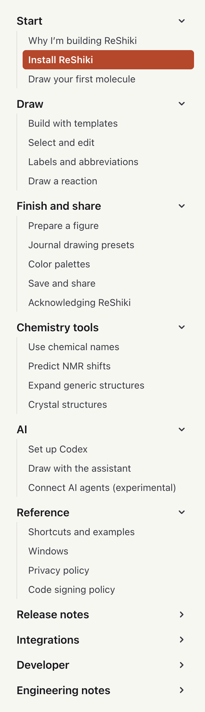
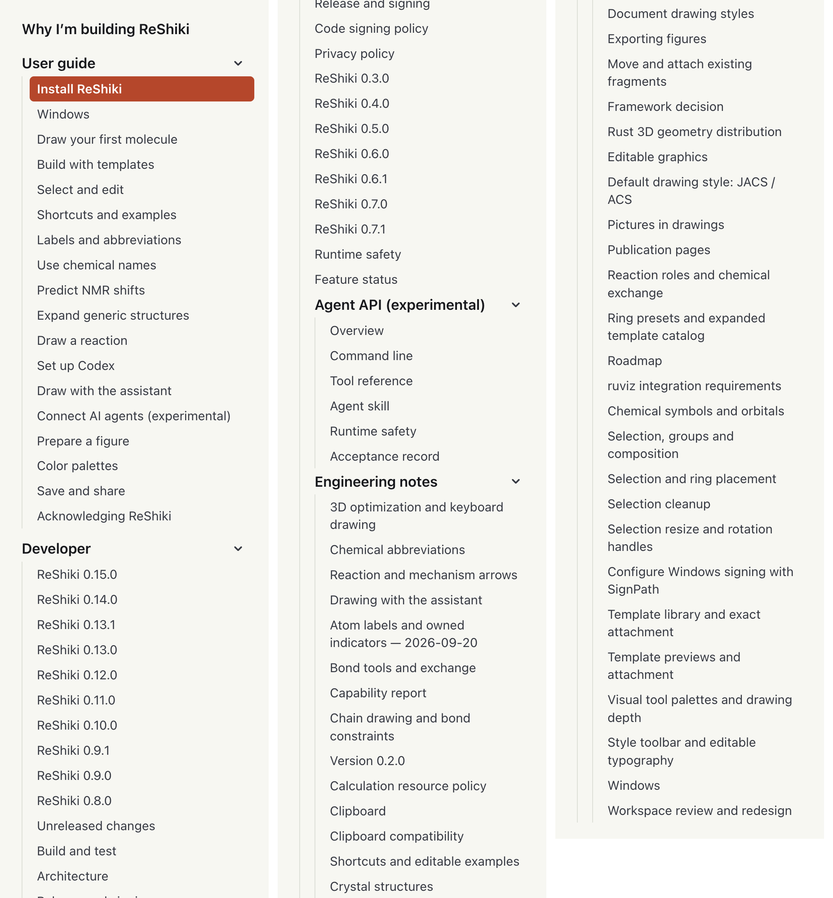
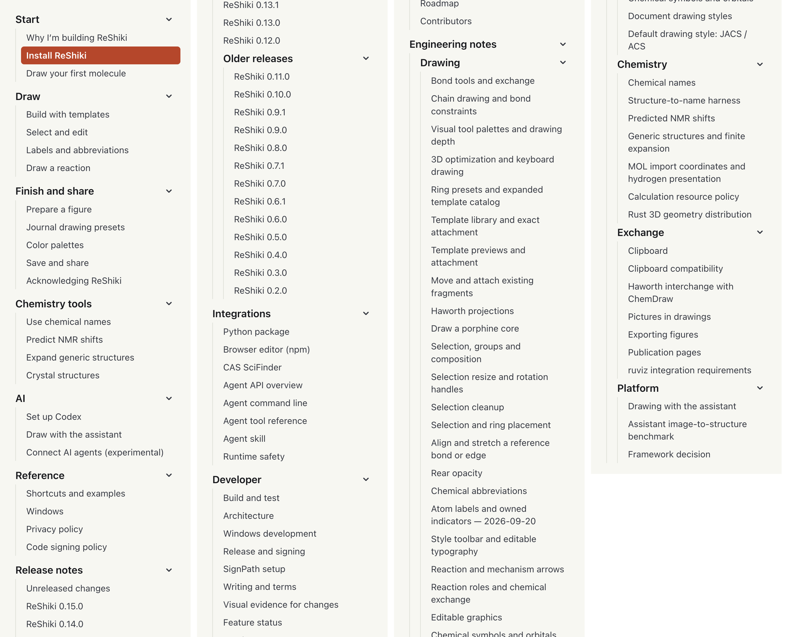
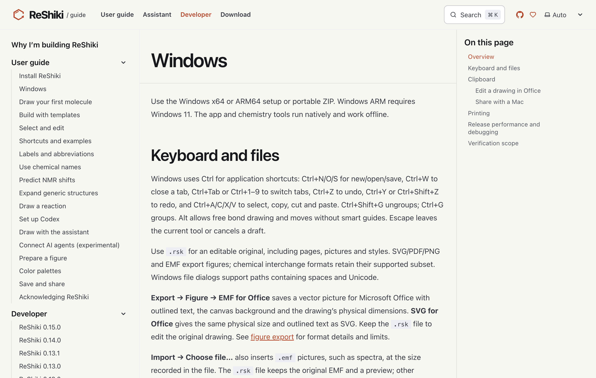
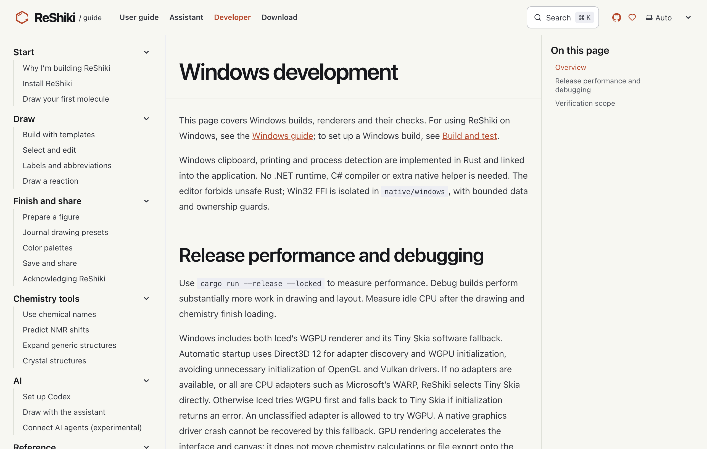
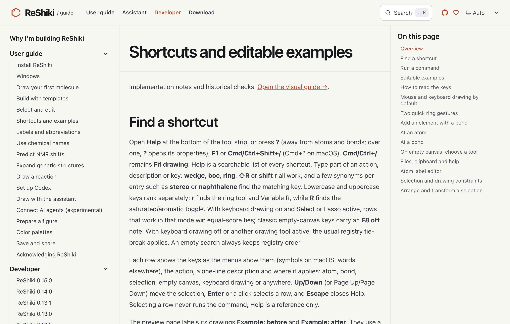
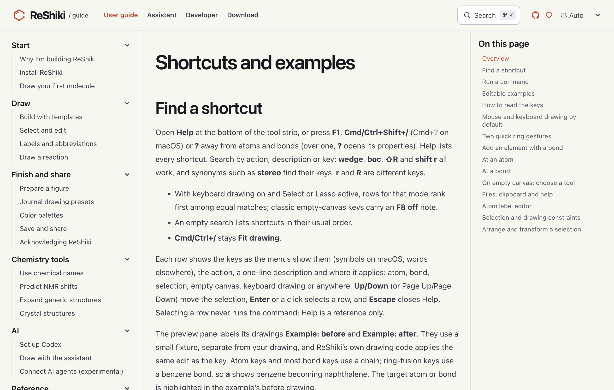
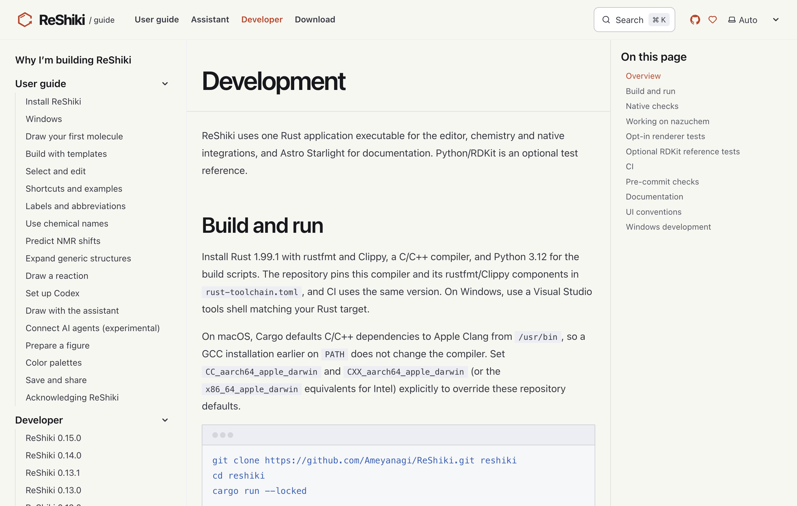
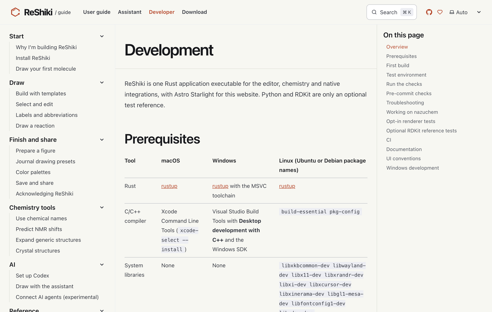

## Summary

The documentation now reads as a learning path. The website sidebar is ordered Start, Draw, Finish and share, Chemistry tools, AI, Reference, then Release notes, Integrations, Developer and Engineering notes, and every published page is in it once. 29 review and validation records leave the website for `docs/changes/`, and their old addresses redirect to GitHub. The README becomes a short landing page, the build guide covers three platforms, release notes get one template, and the manual screenshots are lossless WebP.

Items from the documentation audit: D2–D8, D10 (partial) and B4. No issue is closed by this PR.

## Why it matters

**D2 Sidebar.** On `main`, 43 published pages were in no sidebar (among them the Python, npm and SciFinder pages), Runtime safety was listed twice, and release notes were split into two runs inside the Developer group (0.15.0–0.8.0 at the top, 0.3.0–0.7.1 after the privacy policy). A new user saw one flat list of 18 guides.

**D7 Records on the website.** Review and validation records were published as developer pages next to the feature notes. They were 29 of 113 developer pages, and their images were most of the 60 MB of published doc images. Removing them and two duplicate pages cuts published developer words from 210,721 to 158,801.

**D3 README.** 787 words, including a release paragraph that needed an edit each release.

**D4 Repeated facts.** File compatibility and the signing status per platform were restated in the install guide, README, feature status and architecture pages, so each release needed edits in several places.

**D5 Build guide.** `development.md` had no per-OS prerequisites, no PowerShell form of the test variables, and its local check list missed the `native_print` harness that CI runs.

**D6 Release notes.** Each release note had its own shape, and 0.12–0.15 carried 103–208-word "Build and verification" sections that belong in the validation records.

**D8 Long passages.** The drawing-styles swatch paragraph was 345 words, and the 7 most affected pages had 33 paragraphs over 115 words.

**B4 Manual screenshots.** `website/public/manual` was 18.15 MB of PNG, loaded by the user guide.

## Approach

- **Sidebar (D2, D6).** Hand-ordered groups in `website/astro.config.mjs`. The Release notes group is generated from `docs/changes-*.md`, newest first; Unreleased plus the newest 5 are open and older ones sit in a collapsed "Older releases" group, so a new release needs no config edit. Engineering notes are grouped as Drawing, Chemistry, Exchange and Platform and collapsed. `packages/editor/README.md` is published as `/developer/npm-package/`, and `docs.yml` now runs on changes to that file.
- **Records (D7).** Moved to `docs/changes/`; image links rewritten to `../images`. The old `/developer/<slug>/` routes redirect to the GitHub file, generated from the `movedRecords` list in `website/scripts/doc-topics.mjs`. Every in-repo link was updated, including `scripts/agent_api_gates.py` and the nightly release-notes body. Rejected: keeping the records on the site under a collapsed group, which keeps the page and image weight; deleting them, which loses the history that release notes link to.
- **Duplicates.** `contextual-shortcuts` and `assistant-setup` are published only as guide pages; their developer URLs redirect there. `docs/windows.md` is now "Windows development" (build, renderer, verification); its user-only facts moved to the Windows guide.
- **README (D3), repeated facts (D4).** The README keeps tagline, links, badges, video, a two-line "What's new", install, use from code, acknowledging and contributing. Compatibility rules live only in the release note's File compatibility table; signing status lives only in the code signing policy. Other pages link there.
- **Build guide (D5).** Prerequisites table per OS (Linux packages from `.github/ci-images/jammy/Dockerfile`), first build in 3 commands, one table of test variables in sh and PowerShell, CI's exact nextest command (with a PowerShell form), pre-commit checks, troubleshooting.
- **Release notes (D6).** `docs/writing-style.md` gains a release-note template. The 0.12–0.15 build sections moved into their validation records; the notes keep a one-line link.
- **Long passages (D8).** About 10 passages became tables, bullets or split sections. Word counts barely change; the change is structure: over the 7 pages, paragraphs over 115 words go from 33 to 26 and sentences over 40 words from 24 to 19.
- **Screenshots (B4).** 48 of 54 PNGs converted to lossless WebP with sharp; decoded RGBA pixels match the PNGs exactly. Six Windows captures stay PNG because WebP was larger. Rejected: lossy WebP or AVIF, which would change the screenshots.

## Evidence

All captures: macOS arm64, headless Chromium (Playwright, `--force-device-scale-factor=2`), window 1280 × 900, light theme, 100% zoom. Before: `main` 1d94f392. After: `wave2/docs-structure` eaaceda6. Each site was built with `bun run docs:build` in a fresh worktree and served locally.

### Sidebar, default state (`/guide/install/`)

| Before | After |
| --- | --- |
|  |  |

### Sidebar, every group expanded (`/guide/install/`)

The full sidebar is split into columns of 1000 CSS px for reading.

Before:

After:

### Split: `/developer/windows/`

| Before: "Windows" (user and developer content) | After: "Windows development" |
| --- | --- |
|  |  |

### Merged: `/developer/contextual-shortcuts/`

After, the URL redirects to `/guide/shortcuts/`.

| Before: developer copy | After: the guide page |
| --- | --- |
|  |  |

### Restructured: `/developer/development/`

| Before | After |
| --- | --- |
|  |  |

### Build, link check and redirects

Full output: [link-check.txt](https://github.com/Ameyanagi/ReShiki-evidence/blob/8ef1bfdcb86864fe5180df0d54b9a0b056b8215a/pr-reviews/wave2-docs-structure/link-check.txt).

| | `main` 1d94f392 | Branch eaaceda6 |
| --- | --- | --- |
| `docs:build` (incl. link, llms and palette checks) | pass | pass |
| Local links and assets verified | 14,885 | 12,768 |
| Developer pages | 113 | 83 (+32 redirects) |
| Published doc images | 291 files, 60 MB | 108 files, 23 MB |
| Manual screenshots | 54 PNG, 18,152,869 B | 48 WebP + 6 PNG, 4,548,191 B |
| Built site (`dist`) | 132 MB | 80 MB |
| README (`wc -w`) | 787 | 291 |

Every one of the 171 routes on `main` still resolves on the branch, as a page or a redirect. All 29 GitHub redirect targets exist on the branch. The one new route is `/developer/npm-package/`.

No app UI changes, so there are no app screenshots.

## Verification

| Platform | Result |
|---|---|
| macOS arm64 | docs:build with link, llms and palette checks passes; lane checks pass |
| Ubuntu arm64 | Pass: workspace tests 5504 passed, 0 failed; all docs checks from checks.yml and docs.yml pass |
| Arch Linux x64 | PR CI |
| Windows x64 | PR CI (windows-2022) |

Commands on macOS arm64: `bun run check` (oxlint, `bun fmt --check`, docs tree check, sync, `astro check`), `bun run docs:build`, `uv run --locked ruff check`, `uv run --locked ty check`, Python unit tests (244 OK), `assemble_changelog.py --check`, `actionlint`, `cargo fmt --all --check`. No Rust source changed (only docs, the website, one Python path constant and two workflow files), so Rust tests were not rerun on macOS. Ubuntu arm64: workspace tests 5,504 passed, 0 failed, and every docs check from `checks.yml` and `docs.yml` passed. PR CI on Linux x64 and Windows x64 is green.

## Risk

- **D10 is partial.** Engineering notes are grouped, the two duplicate developer pages are gone, the dated changelog openings are removed, and `chain-tools.md` and `template-library.md` were split into guide steps, behavior notes and `docs/changes/` records. The other 25 engineering pages that repeat their guide pages still mix user steps, behavior and old QA. Cutting them to implementation notes needs a page-by-page comparison, because some user facts exist only there. That is left for a follow-up.
- **Old record URLs go to GitHub.** The 29 redirects point at `blob/main/docs/changes/...`, so they only resolve once this is merged. Anyone who bookmarked a record now lands on GitHub instead of the website.
- **0.15.0 release note.** Its opening (90 words) and highlights (9) are longer than the new template allows. Older notes were not rewritten to the template.
- **WebP.** Supported by every current browser; the conversion is lossless and pixel-identical, so screenshots look the same.

## Changelog

Fragment: `docs/changes/unreleased/wave2-docs-structure.md` (section Developer): sidebar order, records moved off the site, chain and template notes split, release-note template, short README and three-platform build guide, WebP manual screenshots (18.15 MB → 4.55 MB).

## Contribution license

- [x] I have read [CONTRIBUTING.md](https://github.com/Ameyanagi/ReShiki/blob/main/CONTRIBUTING.md). I have the right to submit this contribution and agree to offer my original contributions under both MIT and Apache-2.0, so recipients may choose either license (`MIT OR Apache-2.0`).
- [x] Any third-party material is identified below with its source and license, and its required notices are preserved; otherwise, no third-party material is added.

Third-party sources, if any: none.
