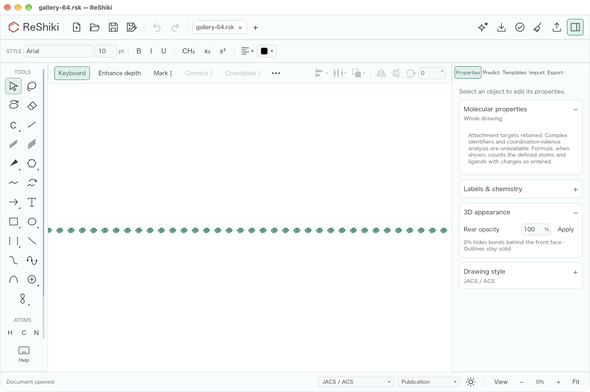
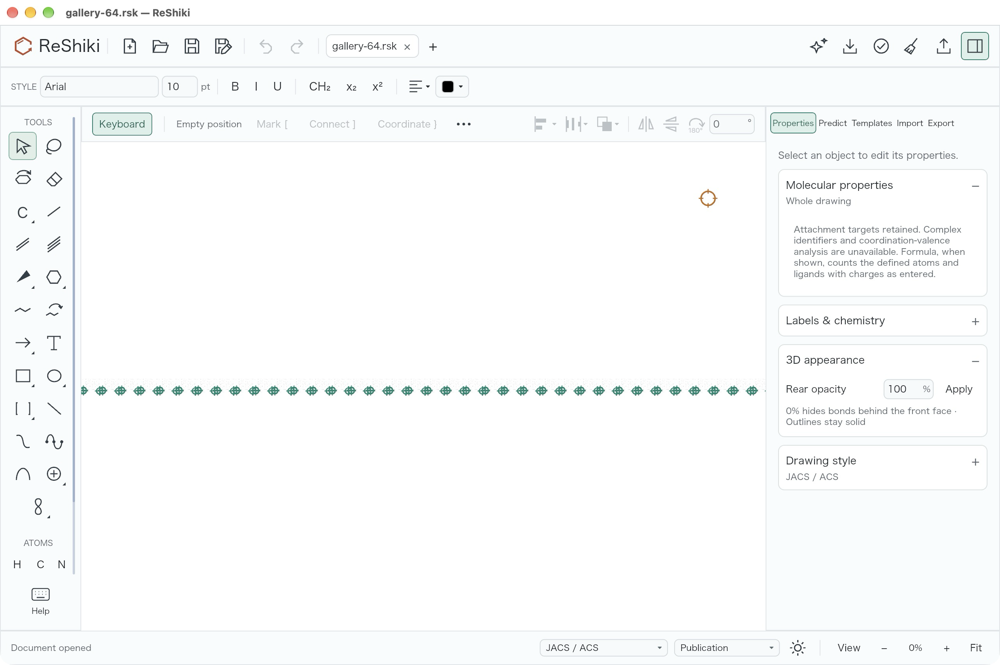
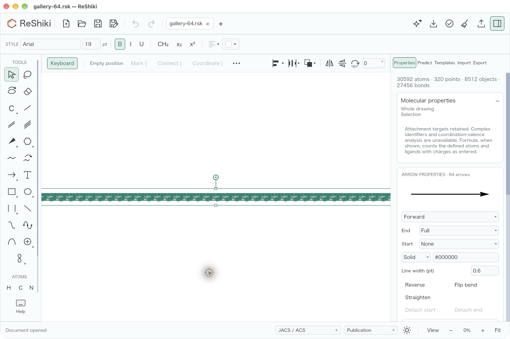
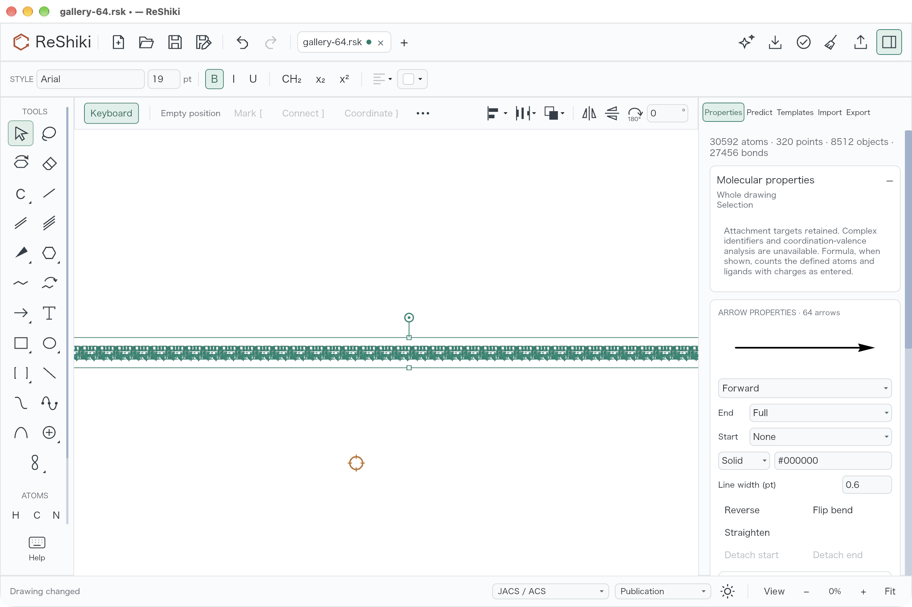
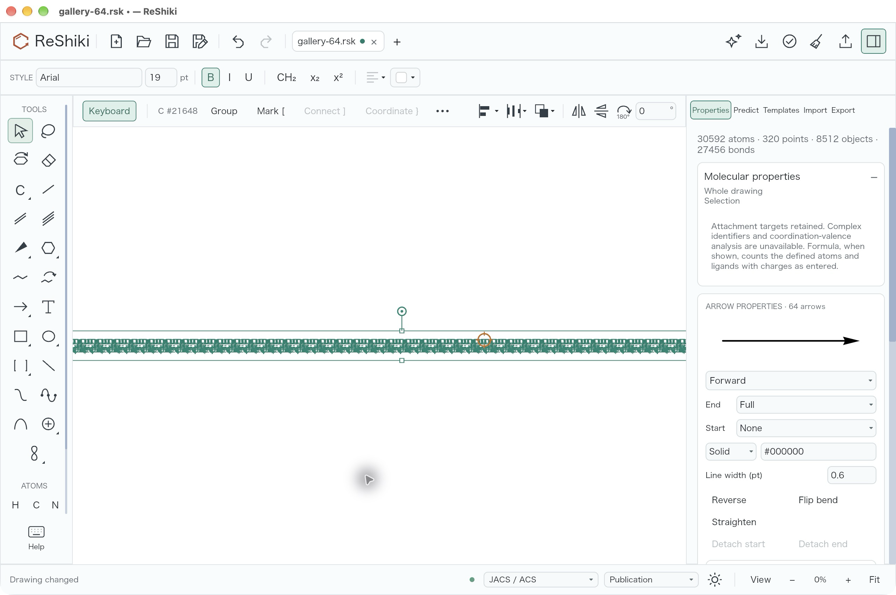
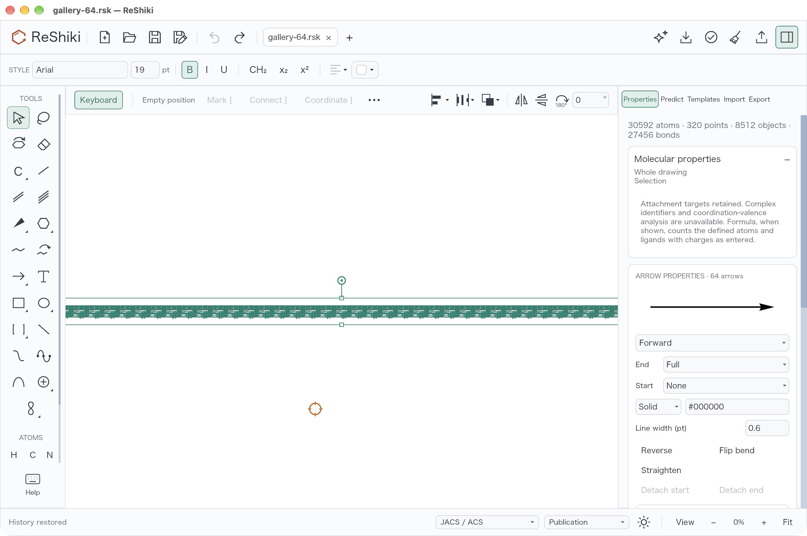
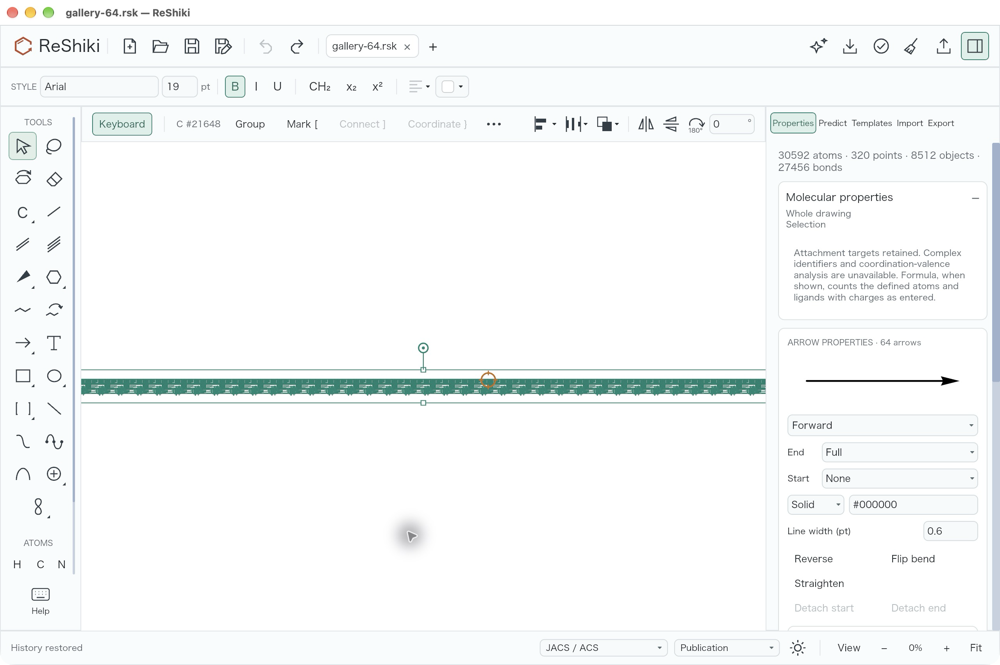
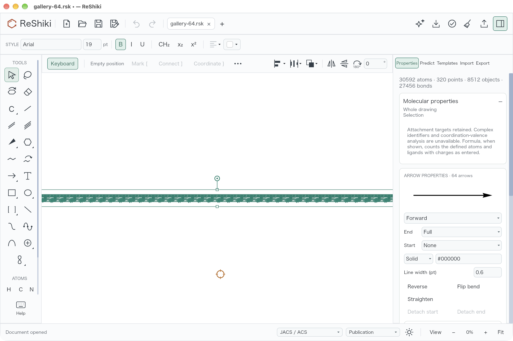

## Summary

Large drawings get faster to redraw, measure and align. Building the picture, measuring a selection, **Align** and **Distribute** and finding bond crossings now grow close to in step with the drawing, whether its structures sit side by side or one above the other. On base, a drawing 4 times larger took 15 times longer to align and 11 times longer to measure. A drawing with a two-attachment abbreviation, such as an amino-acid residue in a chain, is no longer copied several times for every pointer move. Only `crates/model` changes; the app code is untouched.

Improvement plan items P9 (partial, see Risk) and P2.

## Why it matters

The wave 1 performance audit found that a drawing made of many structures slows down much faster than it grows. Measured on base `1d94f392` (quiet machine, release), with the shortcut gallery (483 atoms) repeated 16 times (7,728 atoms):

- **Align left** on everything took 566 ms, 200 times as long as on one gallery. It moved the whole drawing once for every selected object.
- Measuring the selection took 72 ms, 88 times as long as on one gallery. Each label and bond asked the whole document whether it was hidden inside an abbreviation.
- A column of 4,096 captioned arrows took 1.3 s to **Align left**. A column of 4,096 bonds took 11 ms for crossing gaps, because a sweep along x alone compares bonds stacked one above the other pair by pair.
- With one two-attachment abbreviation in the drawing, every hit test, label and indicator query made its own full copy of the drawing (1.8 ms each at 7,728 atoms). The audit counted 8 to 11 copies per pointer move.

A user waits for these after every edit on a poster-sized drawing or a long scheme.

## Approach

- **One abbreviation index per pass.** `abbreviations::Membership` maps each atom to its abbreviation once. The scene's `Graph` carries it, so face adjacency, bond joins, junctions, crossings, ring strokes, occlusion and the bond paint loop ask the index instead of scanning `Document::abbreviations`.
- **Label layout borrows the pass's graph.** Neighbour directions, label visibility, an abbreviation label's side and condensed labels (`NMe`, `CF2`) use the indexed bonds. Nearby labels come from a square-cell index (`Graph::near`) queried by box, in document order. Selection bounds build one `Graph`.
- **Align and Distribute move every object in one pass.** `Document::translate_units` moves all units together, expands each collapsed abbreviation once, and updates arrow anchors and arrow captions in one pass (`arrow_labels::translated_units`). Before, it called `translate` once per unit, and each call walked the whole drawing. Arrows outside the moved units are not touched, so aligning objects that are already aligned leaves the drawing unchanged.
- **Crossings keep a sweep over x, now in bands of y.** A bond meets only earlier bonds in the bands it touches. Candidates are visited in the old order, so the gaps and the 200,000-pair budget count are the same. Two bonds at the same depth skip the rail geometry unless their centre lines cross; occlusion already returned nothing for them.
- **One shared render copy.** `Document::abbreviation_render_copy` returns `abbreviations::Drawn`: the document itself, or a remapped copy shared through `Rc`. The thread keeps the last copy and reuses it after an exact comparison with the current document. Any edit takes one fresh copy.

Rejected alternatives:

- A general 2D spatial index for crossings. A sweep with y bands gives the same order and output with less code, and the measured gaps grow in step with the drawing.
- Keying the render copy by a document revision number. That needs the app's revision counter, and another lane owns `src/canvas`. The exact comparison costs about 0.5 ms at 7,728 atoms and allocates nothing.
- Keeping one translate per unit. It made **Align** results depend on which object came first; see Risk.

## Evidence

### Benchmarks, base vs branch

Release builds of the `reshiki-model` tests on macOS arm64 (this Mac): base `1d94f392` with the branch's benchmark file copied in and no other change, and branch `7154c93b`. The two test binaries ran in turn, one test at a time (`--test-threads=1`), two rounds each, with a load average of about 3. Each cell is the mean of the two round medians; each round median is over 20 runs after 3 warm-ups. The two rounds agree within a few percent.

![Ten log-log panels, base in orange and branch in blue. Gallery 483 to 7,728 atoms: scene 3.7 to 135 ms on base vs 2.2 to 54 ms on the branch; selection bounds 0.82 to 72 vs 0.83 to 16; Align left 2.8 to 566 vs 1.1 to 21; crossing gaps 2.0 to 51 vs 0.49 to 12; repeated render copy 0.11 to 1.8 vs 0.03 to 0.53. Columns of 256 to 4,096: ammonia scene 35 vs 12.5 ms; bond column crossing gaps 11.2 vs 1.2; NMe scene 142 vs 33; captioned arrows Align left 1,278 vs 8.1; one collapsed group Align left 3.7 vs 3.3](benchmark-quiet-chart.png)

The dotted line is growth in step with the drawing, drawn from the branch's smallest size.

| Workload (ms) | Size | Base `1d94f392` | Branch `7154c93b` | Base / branch |
| --- | --- | ---: | ---: | ---: |
| Scene build, gallery | 483 / 1,932 / 7,728 atoms | 3.7 / 18.5 / 135 | 2.2 / 9.8 / 53.6 | 1.7× / 1.9× / 2.5× |
| Selection bounds, gallery | same | 0.82 / 6.3 / 72.4 | 0.83 / 3.5 / 16.2 | 1.0× / 1.8× / 4.5× |
| **Align left**, gallery | same | 2.8 / 38.3 / 566 | 1.1 / 4.6 / 21.0 | 2.6× / 8.3× / 27× |
| Crossing gaps, gallery | same | 2.0 / 8.8 / 50.9 | 0.49 / 2.2 / 12.4 | 4.1× / 3.9× / 4.1× |
| Scene build, gallery stacked | 1,932 / 7,728 atoms | 18.5 / 136 | 9.8 / 53.7 | 1.9× / 2.5× |
| **Align left**, gallery stacked | same | 38.5 / 565 | 4.6 / 21.0 | 8.4× / 27× |
| Document copy (control, same code) | 483 / 1,932 / 7,728 atoms | 0.10 / 0.38 / 1.6 | 0.10 / 0.38 / 1.6 | 1.0× / 1.0× / 1.0× |
| Render copy, repeated query | same | 0.11 / 0.44 / 1.8 | 0.03 / 0.12 / 0.53 | 3.6× / 3.6× / 3.4× |
| Render copy, first query after an edit | same | 0.11 / 0.44 / 1.8 | 0.14 / 0.57 / 2.3 | 0.8× / 0.8× / 0.8× |
| Ammonia column, scene | 256 / 1,024 / 4,096 labels | 0.72 / 4.3 / 35.2 | 0.74 / 2.9 / 12.5 | 1.0× / 1.4× / 2.8× |
| Bond column, crossing gaps | 256 / 1,024 / 4,096 bonds | 0.10 / 0.84 / 11.2 | 0.07 / 0.30 / 1.2 | 1.4× / 2.8× / 9.5× |
| `NMe` column, scene | 256 / 1,024 / 4,096 labels | 2.0 / 13.6 / 142 | 1.7 / 7.0 / 33.3 | 1.2× / 1.9× / 4.3× |
| Captioned arrows, **Align left** | 256 / 1,024 / 4,096 arrows | 5.2 / 81.1 / 1,278 | 0.49 / 2.0 / 8.1 | 11× / 41× / 158× |
| One collapsed group, scene | 256 / 1,024 / 4,096 atoms | 0.18 / 1.2 / 9.9 | 0.26 / 1.1 / 5.0 | 0.7× / 1.1× / 2.0× |
| One collapsed group, **Align left** | same | 0.14 / 0.65 / 3.7 | 0.21 / 0.84 / 3.3 | 0.7× / 0.8× / 1.1× |
| Imported polyalanine-200, scene | 1,001 atoms | 982 | 439 | 2.2× |
| Imported polyalanine-200, crossing gaps | 1,001 atoms | 812 | 309 | 2.6× |

All 55 rows: [benchmark-quiet-table.md](benchmark-quiet-table.md). Raw rows, with the load average at the start of each run and the SHA-256 prefix of each test binary: [benchmark-quiet-runs.txt](benchmark-quiet-runs.txt). Chart script: [benchmark-chart.py](benchmark-chart.py), run with `uv run --with matplotlib`.

An earlier set of three rounds, taken while other builds ran (load average 55 to 270), shows the same pattern with inflated times: **Align left** at 7,728 atoms 6,457 → 212 ms, captioned arrows at 4,096 9,244 → 64 ms ([benchmark-loaded-table.md](benchmark-loaded-table.md), [benchmark-loaded-runs.txt](benchmark-loaded-runs.txt)).

What the rows show:

- At 7,728 atoms the branch is 2.5 to 27 times faster on scene, bounds, crossings and **Align**.
- From 1,932 to 7,728 atoms (4 times the atoms), branch times grow 5.5 times (scene), 4.6 (bounds), 4.6 (**Align**) and 5.6 (crossings). Base times grow 7.3, 11.5, 14.8 and 5.8 times. The document copy grows 4.2 times. Crossings were already close to linear for the side-by-side gallery; the branch lowers their cost, and the bond column row shows the stacked case that was quadratic.
- Small drawings are about the same. A few rows at the smallest size are 0.03 to 0.08 ms slower on the branch, the cost of building the index.
- The first render copy after an edit is 0.5 ms slower at 7,728 atoms (2.3 vs 1.8 ms). It first compares the document with the cached copy, then copies. Every later query on the same drawing takes 0.53 ms and allocates nothing, so a pointer move that asks 8 to 11 times pays one copy instead of 8 to 11.
- One large collapsed group shows no gain for **Align left** (3.7 vs 3.3 ms at 4,096 atoms). It was not quadratic on base.
- Polyalanine-200 is one folded molecule whose bonds cross many times. It is 2.2 times faster here (982 → 439 ms). The changelog says "about a quarter faster", from the implementer's runs under load; that undersells this measurement. The rest of its time is the crossing geometry of bonds that really cross, which this branch does not change.

Parity, from the implementer's runs: `crossings::gaps`, `scene::primitives` and **Align left** output hashes are identical on base and branch for the gallery 4×, gallery 4× stacked and the imported polyalanine. The 336 arrangement cases captured on base match on the branch, and the captured `scene_primitives`, `atom_label_runs`, `arrow_paths`, `ring_placement`, `template_placement` and `reconstruct` baselines are identical apart from allocation counts.

### Real app: 64 copies of the shortcut gallery

Release app builds on macOS arm64: base `1d94f392` (SHA-256 `8782d6d16c4d…`) and branch `7154c93b` (`1e2189a00e34…`), each from its own target folder, each run with a fresh `RESHIKI_DATA_DIR`. Input: the shortcut gallery appended 64 times side by side with `editing::append` (30,912 atoms, 27,456 bonds, 8,512 objects). Window 1280 × 852 pt, captured at 2×. Codex (computer use) drove the app; it timed each step from a shell timestamp to its first successful screenshot.

Both builds open the drawing, select everything and distribute it the same way, and undo restores it:

| Step | Base `1d94f392` | Branch `7154c93b` |
| --- | --- | --- |
| Opened |  |  |
| **Select All** |  |  |
| **Distribute horizontally** |  |  |
| Undo |  |  |

Reports: [base](gui-edit-base-report.md), [branch](gui-edit-branch-report.md).

What this check does not show:

- **Speed.** Screenshot and accessibility calls timed out for 20 to 50 s after most keys on both builds, so the observed times (for example **Distribute horizontally**: 50 s on base, 66 s on the branch) are upper bounds set by the tool, not the app. The benchmark rows above are the speed evidence.
- **Nudge.** The **Keyboard** drawing toggle was on when the file opened, so the Down key moved the drawing cursor ("No drawing hotspot in that direction") instead of the selection, on both builds ([base](gui-edit-base-03-nudge.png), [branch](gui-edit-branch-03-nudge.png)). Nudge, its undo and redo were not checked.
- **Hover.** The computer-use tools had no pointer move without a click, so hover lag was not checked.

**Align left edges piles every copy at one edge, and both builds stop responding.** In a first run, **Select All** then **Align left edges** moved all 64 copies onto one left edge. Neither build showed the result within 5 minutes:

| Base `1d94f392`, 5 min after **Align left edges** | Branch `7154c93b`, 5 min after **Align left edges** |
| --- | --- |
|  |  |

The base window went blank about 17 minutes later ([gui-align-base-late-blank.png](gui-align-base-late-blank.png)); Cmd+Q did not respond and the app was stopped. On the branch, the **Align** model step itself takes about 21 ms at 7,728 atoms, so the time goes elsewhere. A macOS `sample` of the branch app 8 minutes in ([gui-align-branch-sample.txt](gui-align-branch-sample.txt)) shows the main thread inside the canvas redraw, in `scene::primitives`: `push_hydrogens` → `unrelated_bonds` → `Document::bond_visible`, plus `FaceIndex::face`, `find_ring_centers` and `nearby_label_ink`. With 64 copies stacked on one spot, every hydrogen label collides, and for each one `unrelated_bonds` still builds an atom map and a ring-face index of the whole drawing and checks every bond with the unindexed `Document::bond_visible`. That is one of the scans this PR leaves (see Risk). The branch run was stopped there. Report: [base](gui-align-base-report.md).

## Verification

| Platform | What ran | Result |
| --- | --- | --- |
| macOS arm64 | `cargo fmt --all --check`; `cargo clippy --workspace --lib --bins --all-features --locked -- -D warnings`; `cargo test --locked -p reshiki-model`; `cargo test --locked --bin reshiki` with the InChI and naming helpers set; ignored parity tests against captured base baselines; release benchmarks and the real-app check above | Pass: 1,439 model tests passed, 0 failed, 12 ignored; 1,580 app tests passed, 0 failed, 182 ignored |
| Ubuntu arm64 | Full workspace tests | Pass: 5,511 passed, 0 failed |
| Arch Linux x64 | Not run on a local host. PR CI ran the Rust tests (two shards) and lint+goldens on ubuntu-24.04 x86_64 | Pass in CI |
| Windows x64 | PR CI on windows-2022: Rust tests (two shards), lint+goldens, Python package | Pass in CI |

Other PR CI jobs passed: wasm32 browser build, Rust geometry on Linux and Windows (x86_64 and aarch64), Python headless wheel, clipboard regressions. Greptile: 5/5.

New and changed tests:

- `abbreviations::tests::membership_matches_document_visibility`
- `abbreviations::tests::queries_on_an_unchanged_drawing_share_one_render_copy`: seven kinds of pointer-move query, four times each plus once on an equal clone, take one copy in total; each of three edits takes exactly one more.
- `scene::graph::tests::lookups_match_linear_scans`: atom and bond visibility, `near` against a scan at four reaches, `faces_left` parity.
- `crossings::tests::bonds_far_apart_along_either_axis_are_never_paired`: 0 pair visits for 400 bonds in a column, a row, a diagonal and a 1e6-pitch column (base: 79,800 for the column).
- `editing::arrange_tests::units_translated_together_match_one_translate_per_unit`, `labelled_arrows_translated_together_match_one_translate_per_unit`, `a_fully_selected_collapsed_group_moves_as_one`, `aligning_aligned_objects_leaves_an_unselected_arrow_untouched`.
- Ignored release benchmarks `scene::performance::{model_scaling_workloads, column_and_large_group_workloads, imported_polyalanine_scene}`, described in `docs/performance/loaded-canvas.md`.

## Risk

- **P9 is partial.** One dense molecule whose bonds cross many times, such as polyalanine-200 imported from SMILES, still takes 439 ms per scene on this Mac (982 ms on base). The audit's 481 ms first scene came from the app's import path, which was not timed here. The remaining time is `Envelope::distance` in the gap geometry for bonds that really cross, plus the unchanged 200,000-pair budget. That needs a faster span computation, not a broad phase, and is not in this PR.
- Some per-label scans remain because they did not show in any benchmark workload: `doc.abbreviation(a.id)` in label runs, `nearby_mark_ink` and `unrelated_bonds` on the hydrogen-collision path, and `arrow_anchors::transformed_units`. The real-app check shows where this bites: when many hydrogen labels overlap (64 copies piled up by **Align left edges**), the branch did not finish a redraw within 8 minutes, like base. Drawings whose hydrogen labels do not collide do not reach this path.
- **Behaviour change in Align and Distribute.** When the move takes an arrow attached to an atom or bond in another aligned object, the arrow moves as drawn and that end detaches. Before, the end first followed its target if that target's object happened to be processed earlier, so the result depended on position. The changelog says so.
- One untested corner can differ from the old sequential moves: two captions on the same arrow, in different units, both moved apart from the arrow so that one lands on the side the other just left. The old code dropped the first; the batch keeps it.
- The first query after an edit pays one document comparison more (0.5 ms at 7,728 atoms). The thread keeps one remapped copy alive until the drawing changes (about 5 MB at 7,728 atoms).
- `abbreviation_render_copy` now returns `Drawn` instead of `Cow<Document>`. Workspace crates compile through `Deref` and `AsRef`; new code that matches on `Cow::Owned` or `Cow::Borrowed` will not.
- The changelog's "about a quarter faster" for the dense import is lower than the 2.2 times measured here. It is safe as written; the owner may want to raise it.

## Changelog

`docs/changes/unreleased/wave2-model-scaling.md` (section: Changes):

- **Large drawings of many separate structures stay responsive.** Redrawing after an edit, measuring a selection and **Align** or **Distribute** take time in step with the number of structures, labels, bonds and captioned arrows, side by side or one above the other.
- One molecule whose bonds cross each other many times, such as a long peptide imported from SMILES, redraws about a quarter faster.
- A drawing with a two-attachment abbreviation is no longer copied several times for every pointer move.
- **Align** or **Distribute** moves an arrow attached to another aligned object as drawn, and that end detaches.

## Contribution license

- [x] I have read [CONTRIBUTING.md](https://github.com/Ameyanagi/ReShiki/blob/main/CONTRIBUTING.md). I have the right to submit this contribution and agree to offer my original contributions under both MIT and Apache-2.0, so recipients may choose either license (`MIT OR Apache-2.0`).
- [x] Any third-party material is identified below with its source and license, and its required notices are preserved; otherwise, no third-party material is added.

Third-party sources, if any: none.
