## Summary

Wave 3 of the UI audit, three items in the context row, the Check drawing button and the status bar.

- **U4, keyboard drawing commands in the context row.** **Mark** appears only when an atom is the target. **Connect** and **Coordinate** appear only once an atom is marked. They used to be there all the time, greyed out when they did nothing. Their keys **[**, **]** and **}** are drawn as keycaps. A short row now folds its *last* commands into **⋯**, so selection commands stay visible and **Keyboard drawing** / **3D optimize…** go first. Tooltips and screen-reader names are the full command name plus its shortcut.
- **U7, Check drawing results.** Findings stay on the **Check drawing** button as a red count until the drawing changes, also across tab switches. Clicking the button opens a **FINDINGS** list with **Check again**, one row per finding, and **Reverse** / **Redraw stereo bonds**. Clicking a row selects that finding's atoms, brings them into view and blinks them three times. The status bar stays on one row at every window width; a long message is shortened and its full text is in the tooltip on **…**.
- **C3, Alt key naming.** Hints and tooltips say **⌥** on macOS and **Alt** on Windows and Linux instead of "Option/Alt" (20 strings). Tool palette tooltips are name + key only, for example "Straight chain · ⇧X".

No issue is filed for these items, so this PR closes none.

## Why it matters

All three were found in the audit of main and confirmed there before the change.

- **U4.** With nothing targeted, the row showed three greyed commands (**Mark [**, **Connect ]**, **Coordinate }**) that could not be used. With an atom marked and another one targeted, at the default 1280 pt window only **Coordinate }** stayed visible and the command you actually need next sat in **⋯**. The row folded from the front, so **3D optimize…** disappeared first. Screen readers read hint sentences instead of command names.
- **U7.** Check drawing results lived only in the status line, so the next message overwrote them, and there was no way to step through findings one by one. Below 1280 pt the status bar wrapped into two rows (80 pt high instead of 44 pt), taking 36 pt from the canvas at the 1040 × 680 minimum window.
- **C3.** "Option/Alt" in every hint is long and does not match the shortcut glyphs (⌥, ⇧) used everywhere else. Tool palette tooltips repeated the how-to sentence that the context row tooltip already shows.

## Approach

- **U4.** `context_commands` adds Mark / Connect / Coordinate from the keyboard-drawing state instead of always, and enables Connect / Coordinate only when the target is a different atom than the mark. The keys come from `shortcuts::binding`, so the **⋯** menu shows the same keys right-aligned. The order is keyboard commands, selection commands (Join, Merge, Move & attach, Coordinate in place, heads, Group/Ungroup), then depth, Keyboard drawing and 3D optimize…. `fit()`, the row render and `Page::More` now take the last *n*, so the row folds from the end. `RowCommand.hint` is gone; the tooltip and accessibility name are the full `menu` name. Rejected: keeping greyed commands with better tooltips. They still cost row space and do nothing.
- **U7.** The badge counts `tab.stereo_notes`, which every recorded change, undo/redo and file load already clears, so no new invalidation was needed. Leaving a tab now keeps its notes (it only stops the blink and closes the list); changing the IUPAC style-notes preference clears the notes of every tab. The list is the existing popover widget anchored to the button. The findings scroll inside a 360 pt cap with the header and fixes outside the scroll area. The blink reuses the canvas's locant-highlight ring (no renderer change), driven by a 125 ms subscription that runs only while a blink is active. Its ticks are handled before every modal, preview, popover and menu gate, so they neither get stuck under a 3D or cleanup preview nor close an open popover. Escape, clicking outside, or any other command closes the list and returns focus to the drawing. The status bar is one row: the message sits in a `responsive` line and the **…** cue appears exactly when it does not fit. Rejected: a separate findings panel (more space, and the Stereochemistry card in Properties already lists them).
- **C3.** One helper, `platform::alt_key()`, returns ⌥ on macOS and Alt elsewhere, matching `shortcuts::keys`. `Tool::hint` now returns `String`. The Text tool's separate mac / non-mac strings collapse into one.

## Evidence

Real app, macOS arm64, one build at a time, each with a fresh `RESHIKI_DATA_DIR`. Base is main `fcd2cde6`, branch is `b15af331` (head of this PR). Window 1280 × 820 pt unless the row says 1040 × 680 pt (the minimum size). Canvas zoom 250% (set by the imported files) unless noted. Inputs: benzene (`c1ccccc1` converted to a molfile by `reshiki --cli`) and a small drawing with two C/F/Cl/Br centres: the left one has a wedge whose narrow end is at F (probably reversed), the right one has no wedge (undefined stereocentre). Screenshots show only the ReShiki window; the cells below are crops of those windows at 2× pixels, and each row links the full window.

### U4: keyboard commands in the context row

| Base `fcd2cde6` | Branch `b15af331` |
| --- | --- |
| 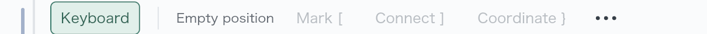 | 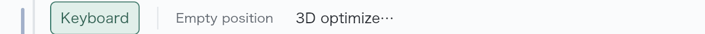 |
| Empty position targeted: **Mark [**, **Connect ]**, **Coordinate }** shown greyed out. | Empty position targeted: none of them; **3D optimize…** is back in the row. |
| 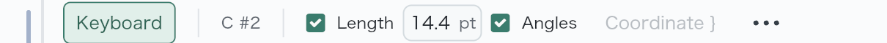 | 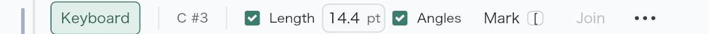 |
| An atom targeted, nothing marked: only a greyed **Coordinate }** fits. | An atom targeted: **Mark** with its **[** keycap; **Join** next (greyed, needs a selection). |
| 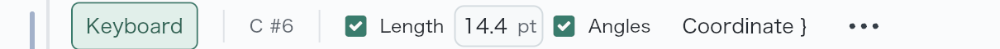 | 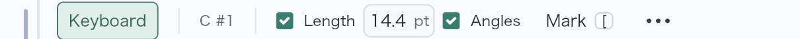 |
| One atom marked with **[**, another targeted: only **Coordinate }** is inline. | Same state: **Mark [** is inline. **Connect** and **Coordinate** are in **⋯** at this width (see Risk). |
| 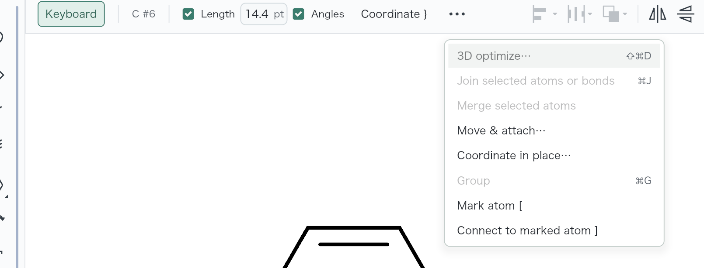 | 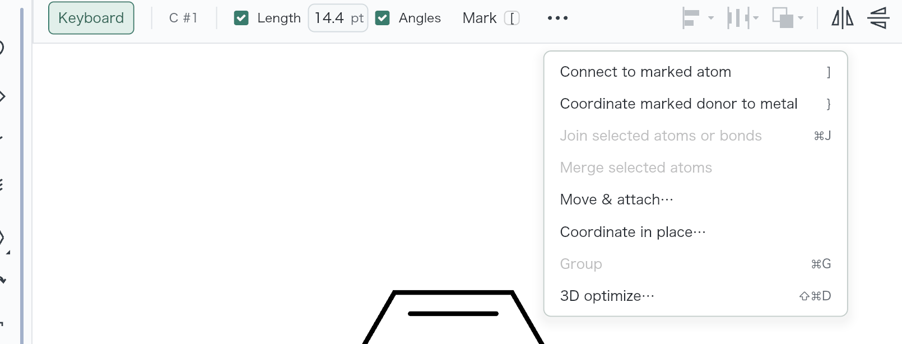 |
| **⋯** menu in the marked state: **3D optimize…** first, **Mark atom [** and **Connect to marked atom ]** last. Pointer hovers the first item. | **⋯** menu in the marked state: **Connect to marked atom** and **Coordinate marked donor to metal** first with their keys right-aligned, **3D optimize…** last. |

Full windows: blank ([base](base-01-keyboard-blank.png), [branch](branch-01-keyboard-blank.png)), atom ([base](base-02-keyboard-atom.png), [branch](branch-02-keyboard-atom.png)), marked ([base](base-03-keyboard-marked.png), [branch](branch-03-keyboard-marked.png)), menu ([base](base-04-more-menu.png), [branch](branch-04-more-menu.png)). In the branch menu shot the status reads "History restored": the automation's pointer move first triggered **Connect to marked atom** and it was undone with ⌘Z before the capture; the drawing and mark are the same as in the marked shot.

### U7: Check drawing findings and the status bar

| Base `fcd2cde6` | Branch `b15af331` |
| --- | --- |
| 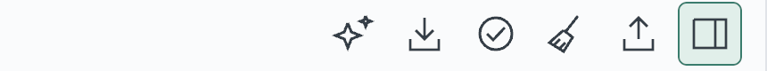 | 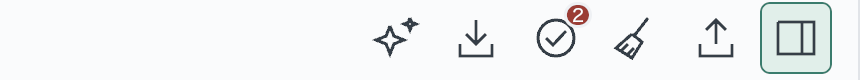 |
| After **Check drawing**, 1280 × 820: the button looks the same as before; the result is only in the status line. | After **Check drawing**: the button carries a red **2**. |
| 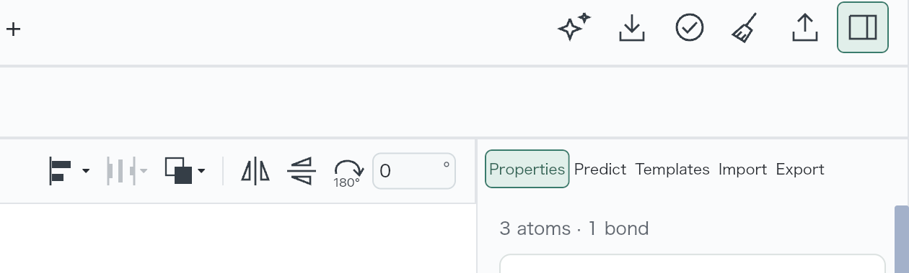 | 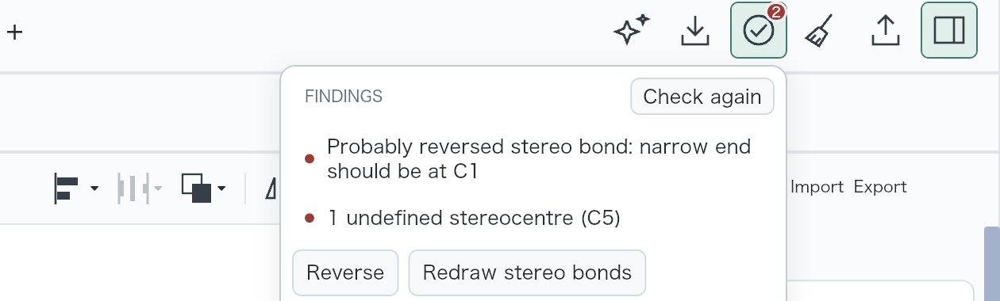 |
| Clicking the button again only runs the check again; no list. | Clicking it again opens **FINDINGS**: **Check again**, the two findings, **Reverse** and **Redraw stereo bonds**. |
| No findings list on base, so there is nothing to click. | 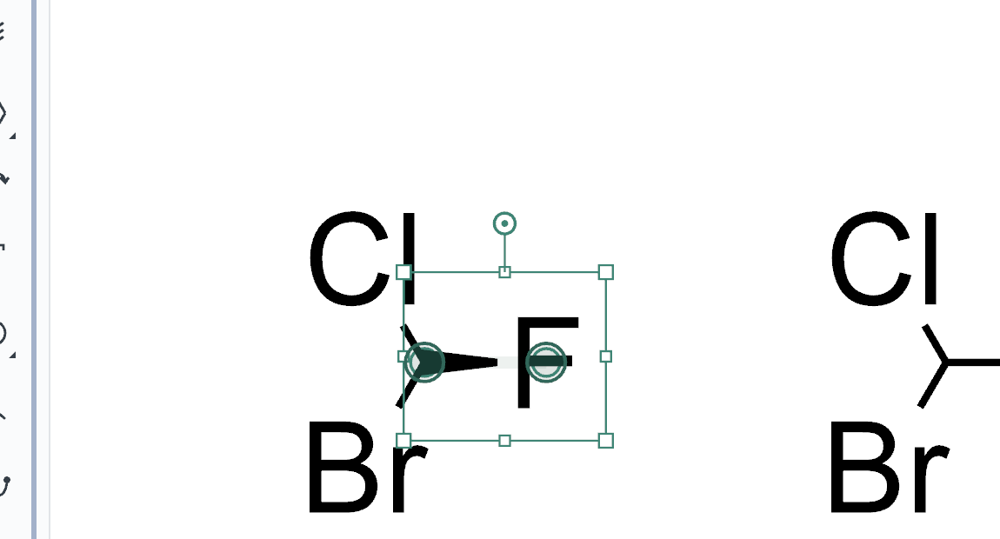 |
| | Right after clicking the first finding: its C and F are selected and blink (extra rings on both atoms). |
| | 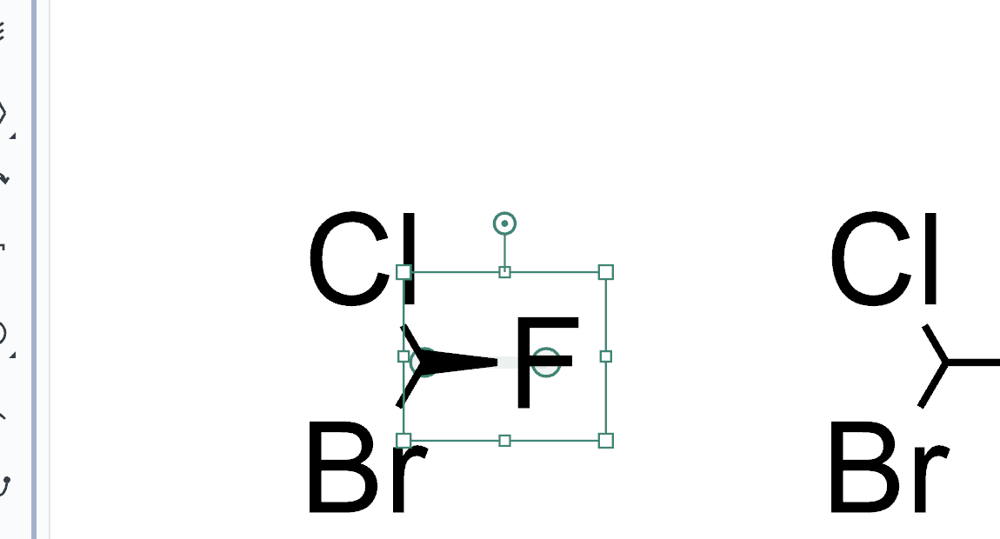 |
| | About 2 s later: the blink has stopped, the selection stays. |
| 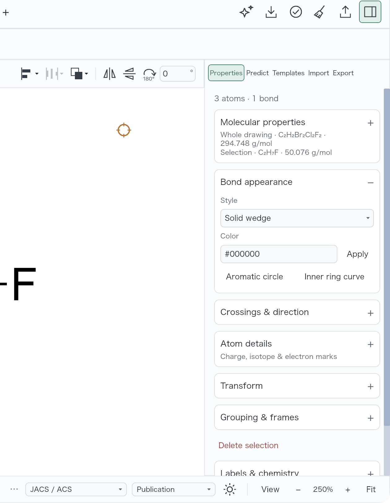 | 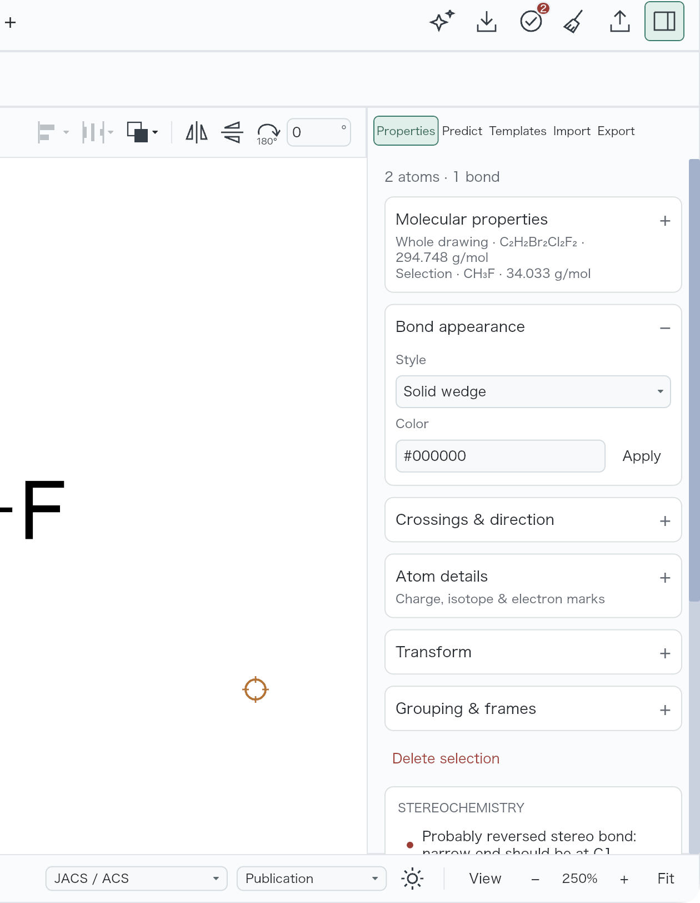 |
| Switched to the benzene tab and back: no count anywhere, and the **Stereochemistry** card is gone from Properties (the notes were cleared on leaving the tab). | Same switch: the **2** badge and the **Stereochemistry** card with the findings are still there. The selection differs from base because the branch run had clicked a finding first. |
| 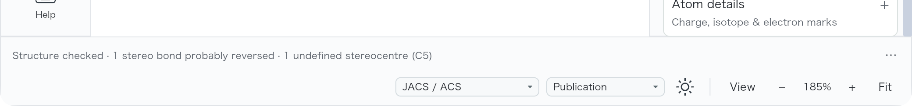 | 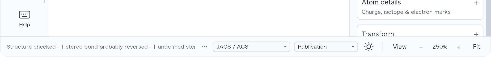 |
| 1040 × 680 (minimum window), after Check drawing: the status bar is two rows, message above, JACS / Publication / zoom below. | Same: one row. The message is shortened and followed by **…**; the canvas is that much taller. |
| 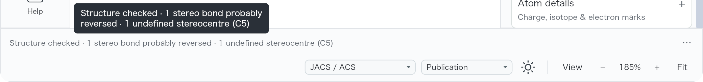 | 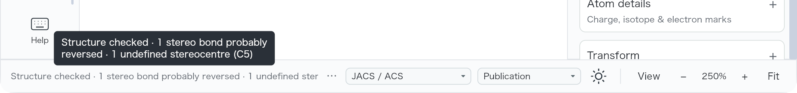 |
| Hovering the message at 1040 × 680 shows the full text. | Hovering shows the same full text. |

Full windows: after the check ([base](base-07-check-1280.png), [branch](branch-07-check-1280.png)), second click ([base](base-08-check-again-1280.png), [branch](branch-08-check-again-1280.png)), finding blink ([on](branch-09-finding-click-a.png), [off](branch-09-finding-click-b.png)), tab switch ([base](base-10-after-tab-switch.png), [branch](branch-10-after-tab-switch.png)), 1040 × 680 ([base](base-11-check-1040.png), [branch](branch-11-check-1040.png)), tooltip ([base](base-12-status-tooltip-1040.png), [branch](branch-12-status-tooltip-1040.png)). After the resize to 1040 × 680, base showed the drawing at 185% and branch at 250%; this does not affect the status bar comparison.

### C3: Alt key naming and tool tooltips

| Base `fcd2cde6` | Branch `b15af331` |
| --- | --- |
| 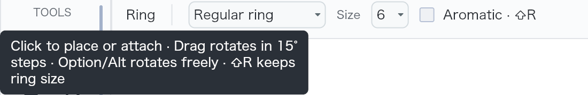 | 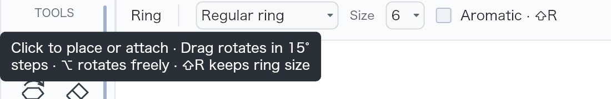 |
| Ring tool, tooltip on the tool name in the context row: "… Option/Alt rotates freely …" (three lines). | Same tooltip: "… ⌥ rotates freely …" (two lines). |
| 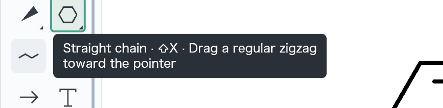 | 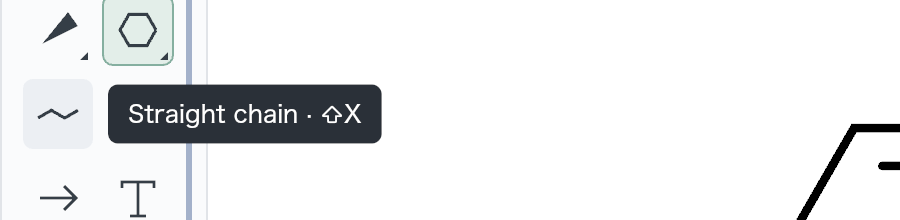 |
| Straight chain button in the tool palette: "Straight chain · ⇧X · Drag a regular zigzag toward the pointer". | "Straight chain · ⇧X". |

Full windows: ring hint ([base](base-05-ring-hint.png), [branch](branch-05-ring-hint.png)), chain tooltip ([base](base-06-chain-tooltip.png), [branch](branch-06-chain-tooltip.png)). Only macOS was rendered, so only ⌥ is shown; the Windows and Linux wording ("Alt rotates freely", "Alt-click") is covered by tests, not screenshots.

The base shots 01–06 and 07–12 come from two runs of the same base build (the first run's stereo input was a malformed molfile and was replaced). Codex computer use (gpt-6.1-sol) drove both builds; every image was checked by hand.

## Verification

VERIFICATION_TABLE

Run by the lane on macOS arm64 at the branch head before the last commit, then the touched modules again after it:

- `cargo fmt --all --check`, `cargo clippy --workspace --lib --bins --all-features --locked -- -D warnings`, `cargo clippy --locked -p reshiki --all-targets --all-features -- -D warnings`: pass.
- `cargo test --locked --bin reshiki` with `RESHIKI_INCHI_HELPER` / `RESHIKI_NAMING_HELPER` set and `RESHIKI_REQUIRE_INCHI_HELPER=1`: 1582 passed, 0 failed before the review fixes. After the review fixes: 1579 passed, 5 failed, all `app::naming` tests hitting the 15 s local-parse limit while the machine's load average was 44–73; the same tests pass 7/7 with `--test-threads=1`. This PR does not touch naming code.
- `cargo test --locked --bin reshiki -- --include-ignored shortcut_focus_tests::review_close:: app::stereo:: app::tabs:: app::gates::`: 68 passed, including the renderer tests for focus return after closing the list, scrolling a 16-finding list to its last row at the minimum window, blink ticks under a 3D preview and with a style popover open, and findings surviving A → B → A tab switches.
- Opt-in renderer tests `keyboard_bar_publishes_native_actions…`, `long_status_keeps…` (one 44 pt status row at 1040 / 1279 / 1280 / 1600 pt), `every_context_row_fits_the_minimum_window`: pass.
- `uv run --locked python scripts/assemble_changelog.py --check`, `bun fmt --check` on the changed docs, `bun run docs:check`: pass.
- CI on this PR (Linux x64 and Windows x64 jobs, wasm, Python, clipboard, Office add-in): all green at `b15af331`.
- Real app on macOS arm64: the screenshots above.

Not run: Arch Linux x64, Ubuntu arm64 and Windows x64 real-app checks; the view-parity baselines (`views_match_captured_baseline`, `entries_match_captured_baseline`), which need `RESHIKI_VIEW_PARITY` captured from main.

## Risk

- **Partial (U4).** With the Select tool, the arrange controls and a marked atom at 1280 pt, **Connect** and **Coordinate** still fold into **⋯** (the branch marked shot). The fold priority was kept on purpose: commands fold before the arrange group collapses. On main the visible one was **Coordinate**; now it is **Mark**. Putting Connect inline needs a change to fold priority that this PR does not make.
- **Partial (U7).** The badge counts stereo findings only. Engine notices from analysis (for example analysis-limit notices) have no atoms and still appear only in the status line. The findings list height is a fixed 360 pt cap; on a Windows window shorter than about 450 pt the fixes below it could be squeezed. The minimum window is 680 pt, so this is unlikely.
- **Behaviour change.** Switching tabs used to clear Check drawing results; now they stay until that drawing changes. Changing the IUPAC style-notes preference clears them in every tab.
- **Not seen on other platforms.** Keycap glyphs ([ ] }) and the badge digit were only rendered with the macOS UI font; the Windows and Linux "Alt" wording was not rendered. The VoiceOver reading of "Check drawing · 2 findings" and of the findings list was not checked.
- **View-parity baselines.** Context row labels, tooltips and the status bar layout changed on purpose, so the view-parity baselines must be recaptured from main.
- **Overlap.** C8 in the side-panels lane also reorders the context row (selection first, global modes last, fold from the end). This PR implements that part; C8 should drop it or rebase onto this branch.

## Changelog

`docs/changes/unreleased/wave3-context-row-status.md` (section Changes):

- In keyboard drawing, the context row shows **Mark** only when an atom is the target, and **Connect** and **Coordinate** only once an atom is marked, with their keys **[**, **]** and **}** as keycaps.
- A short context row folds its last commands into **⋯** first; selection commands come first, **Keyboard drawing** and **3D optimize…** last.
- Context row tooltips and screen readers give the command name and its shortcut.
- **Check drawing** findings stay as a count on its button until the drawing changes, also across tab switches. The button opens a scrolling list; clicking a finding selects, blinks and reveals its atoms.
- The status bar stays on one row at every window width; the full message is in the tooltip on **…**.
- Hints name the Alt key as ⌥ on macOS and Alt on Windows and Linux.
- Chain tool buttons' tooltips show only the tool name and its key.

Docs updated: `docs/3d-keyboard-drawing.md`, `docs/fragment-joining.md`, `docs/bond-tools.md`.

## Contribution license

- [x] I have read [CONTRIBUTING.md](https://github.com/Ameyanagi/ReShiki/blob/main/CONTRIBUTING.md). I have the right to submit this contribution and agree to offer my original contributions under both MIT and Apache-2.0, so recipients may choose either license (`MIT OR Apache-2.0`).
- [x] Any third-party material is identified below with its source and license, and its required notices are preserved; otherwise, no third-party material is added.

Third-party sources, if any: none.
