## Summary

Wave 3 of the UI audit: six text items (C1, C2, C4, C6, C9, C10). Every command gets one name, menus put Copy where people look for it, status messages say what happened and stop there, and the app writes US English. A new copy lint keeps it that way in CI.

- **C1, align names.** The right-click menu, the context-row Align menu and the command palette now all say **Align left / center / right / top / middle / bottom**. On main the same command had three names: the palette called Align center (⌥⇧⌘M, same X) "Align middles horizontally", the menu said "Align horizontal centers" and the context row said "Align vertical centers" for ⌥⇧⌘C. The palette's "Flip horizontally / vertically" is now **Flip horizontal / vertical**, as in the menus.
- **C6, selection menu order.** **Copy** now sits after **Cut**, followed by **Copy as**, **Paste** and **Duplicate**. Only **Delete** is pinned at the bottom; main pinned Copy there too, away from Cut and Paste.
- **C4, one name per command.** **Recalculate** (was "Check structure", which clashed with the separate Check drawing command). **Save as .rsk…** in Export, the toolbar tooltip and the palette (was "Save native document…", "Save as" and "Save as…"). **Abbreviate selection…** (was "Create group label…" in the menu and "Contract selection" in the panel). **Save as abbreviation** (was "Define abbreviation from selection"). Also **Page setup…**, **3D optimize…**, **Clean up…**, **Atom maps**, **Assistant** and **Show/hide side panel**.
- **C2, results-only status messages.** About 30 messages lost their "· Undo restores …" / "Undo removes it" / "Delete or Undo to remove" tails, for example "Structure imported", "RSC applied" and "Inserted ethanol". 27 other messages were shortened to 60 characters or fewer.
- **C9, sentence case and US English (partial).** **Convert to Fischer projection**, **Invert configuration here**, **Convert to wedge drawing**. US spelling in the app crate (center, stereocenter, Symmetrize, canceled, analyzed) and in Check drawing's stereo notices. Real plurals instead of "(s)", and "Esc" instead of "Escape" in hints. `section()` now draws its own capitals, so headings are written in sentence case in the code; "GENERATED SYSTEMATIC NAME · OPENCLATURA" became **GENERATED SYSTEMATIC NAME**. See Risk for what is left.
- **C10, rules and a lint.** `docs/writing-style.md` gets an "App text" section: limits (label ≤ 30, tooltip ≤ 80, status ≤ 60), one name per command, US English, real plurals, key names, and a terminology table. `scripts/copy_lint.py` (standard library only) checks the string literals in `src/` for those rules. The new **Check app text** step in the `web` job of `checks.yml` runs it on every PR. 7 unit tests are in `tests/test_copy_lint.py`.

No issue is filed for these items, so this PR closes none.

## Why it matters

All six come from the UI audit of main, and each was confirmed in the code first.

- **C1.** The same command had up to three names, and the palette names did not match what the commands do: "Align middles horizontally" lines objects up vertically on one X, which the menu called "Align horizontal centers". A user who learned a name in one place could not find the command in the palette, and the palette label described the opposite axis.
- **C6.** Copy is the most used command in the menu, but on main it sat in the pinned footer next to Delete, separated from Cut and Paste by Duplicate and Properties….
- **C4.** "Check structure" and "Check drawing" sounded like the same thing but run different code. "Save native document…" did not look like the Save as in the toolbar. The menu and the panel called one action by two names.
- **C2.** Every edit can be undone, so "Undo restores the previous drawing" adds words without adding information. The tails made statuses long (39 status literals were over 60 characters on main), and the bar truncates them at narrow windows.
- **C9 / C10.** The text mixed UK and US spelling, Title Case and sentence case, "(s)" plurals, and "Escape" and "Esc". Without a check, each new PR brings it back. On main, the lint in this PR reports **205** problems: 65 UK spellings, 58 statuses over 60 characters, 36 Undo tails, 24 "Escape", 18 ALL-CAPS `section()` labels and 4 "(s)" plurals. On this branch it reports **0**.

## Approach

- **Strings only.** No command, binding or behavior changed. Names live where they were; Save as uses one constant, `files::SAVE_AS`, shared by Export, the toolbar tooltip and the palette.
- **C1.** The names follow Keynote / PowerPoint: center = same X, middle = same Y. A new test, `arrange_commands_have_one_name_on_every_surface`, checks that every align, distribute and flip command has the same name in the right-click menu, the context-row menus and the palette. `save_as_has_one_name_on_every_surface` does the same for Save as.
- **C6.** The footer anchor moved from `Copy(false)` to `Delete`. The cascade renderer harness now treats only Delete as pinned. That change exposed a false pass: the compact-menu test only passed on main because of a 25 px offset, not because the menu scrolled. The test now moves the pointer before the wheel, as a real user does, and checks that Copy scrolls with the body.
- **C2.** Messages state the result. The library's "Undo library change is available" stays, because it names the separate library Undo button. `models3d::restored()` became dead and was removed.
- **C9.** `section()` upper-cases its label, so code reads in sentence case and the screen keeps the small-capitals style. The arrow panel heading now shows its count in capitals too ("ARROW PROPERTIES · 1 ARROW").
- **C10.** The lint tokenizes Rust strings, including multiline, raw and `concat!` literals. For `status =` it reads the whole expression, so it sees every branch of an `if` or `match` and resolves `&str` constants. A `{placeholder}` counts as 5 characters. It skips test files and inline test modules.

Alternatives considered and rejected:
- **Rebinding the align shortcuts to match the new names** (center = C, middle = M). Kept the existing letters for muscle memory and ChemDraw habits. This needs an owner decision; see Risk.
- **"Show/hide Properties"** (the audit's wording) for the side-panel toggle. It hides every tab, not only Properties, so it is **Show/hide side panel**.
- **Merging "Define abbreviation from selection" into Abbreviate selection.** They do different things: one contracts the selection under a label, the other saves a library definition. The second became **Save as abbreviation**, which also fits the 30-character limit.
- **i18n or a string table.** Too large for this wave. The lint gives the same consistency guarantee for English.

## Evidence

Real app on macOS arm64, one build at a time, each launch with a fresh `RESHIKI_DATA_DIR` and the build itself as the InChI and naming helper. Base is main `fcd2cde6`. The branch build is `2e9c60ab`, the lane head before `Merge main` (`95695ca4`) and the copy-lint-only commit `57578ba0`. Neither of those changes any string shown here. The branch build therefore lacks main's commits after the lane base `1d94f392` (for example the star prompt and update changes). That is why the base status bars show an extra `···` left of the green dot, which has nothing to do with this PR. Both windows are 1280 × 852 pt (2560 × 1704 px captures), light appearance. Input is `styrene-ethanol.mol` (`C=Cc1ccccc1.CCO`) at Fit zoom **198%**, except the ethanol insert (the app refit to 156% in both builds) and the stereo menu: `butanol.mol` ((R)-butan-2-ol, one hashed wedge) at Fit **250%**. Codex computer use (gpt-6.1-sol) drove both builds with the same steps, and screenshots show only the ReShiki window. Table cells are crops of those windows; full windows are linked under each table. I checked every image.

### C1: align names on every surface

| Base `fcd2cde6` | Branch `2e9c60ab` |
| --- | --- |
| 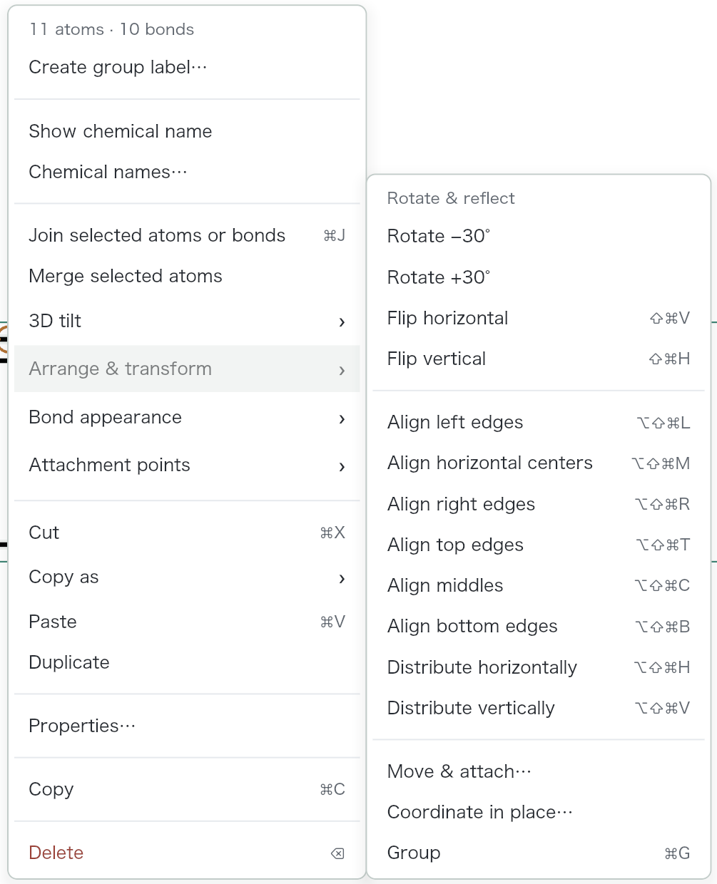 | 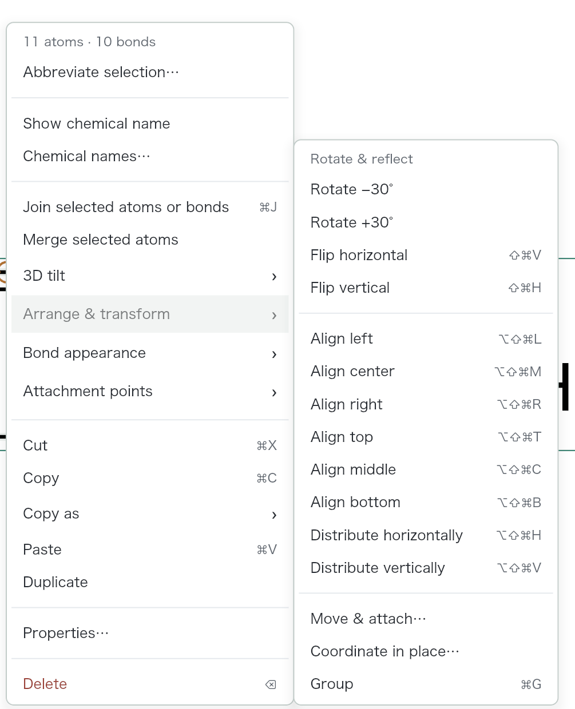 |
| Both molecules selected, right-click → **Arrange & transform**: Align left edges / horizontal centers (⌥⇧⌘M) / right edges / top edges / **Align middles** (⌥⇧⌘C) / bottom edges. | Same: Align left / **center** (⌥⇧⌘M) / right / top / **middle** (⌥⇧⌘C) / bottom. Flip horizontal / vertical are unchanged here. |
| 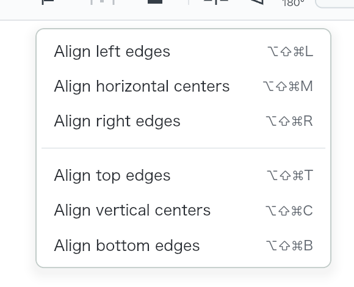 | 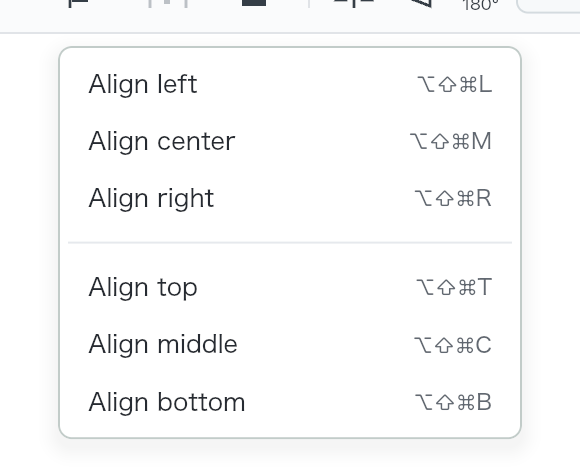 |
| Same selection, context-row Align menu: ⌥⇧⌘C is "Align **vertical centers**", a third name for the menu's "Align middles". | Same: the six names match the right-click menu. |
| 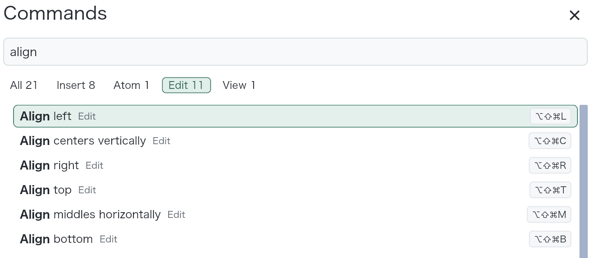 | 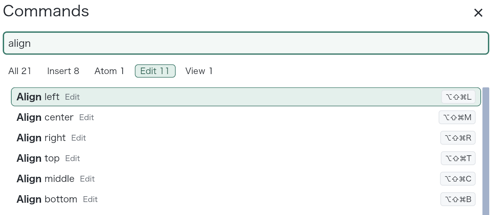 |
| Same selection, palette (`:`), "align", Edit filter: "Align **centers vertically**" (⌥⇧⌘C) and "Align **middles horizontally**" (⌥⇧⌘M). | Same: Align left / center / right / top / middle / bottom, with the same shortcuts as the menus. |
| 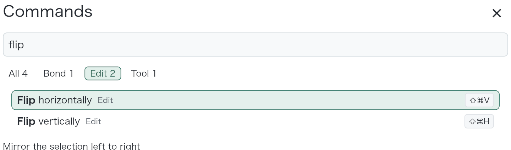 | 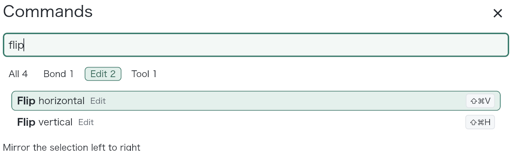 |
| Palette, "flip": "Flip horizontally / vertically", while the menus say "Flip horizontal / vertical". | Same: **Flip horizontal / vertical**, as in the menus. |

Full windows: submenu ([base](base-03-arrange-submenu.png), [branch](branch-03-arrange-submenu.png)), context-row Align ([base](base-04-toolbar-align.png), [branch](branch-04-toolbar-align.png)), palette align ([base](base-14-palette-align-selected.png), [branch](branch-14-palette-align-selected.png)), palette flip ([base](base-15-palette-flip-selected.png), [branch](branch-15-palette-flip-selected.png)). With nothing selected, the palette lists the same names below unrelated matches ([base](base-05-palette-align.png), [branch](branch-05-palette-align.png); flip: [base](base-06-palette-flip.png), [branch](branch-06-palette-flip.png)).

### C6 and C4: selection menu

| Base `fcd2cde6` | Branch `2e9c60ab` |
| --- | --- |
| 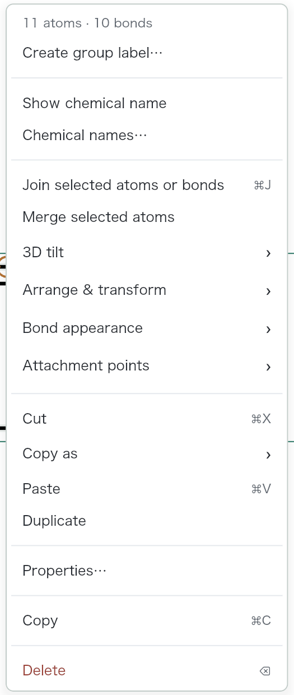 | 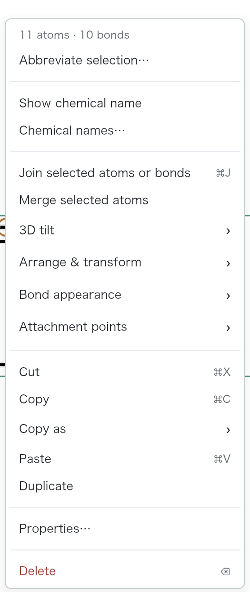 |
| Both molecules selected, right-click a ring bond: first command "Create group label…". The clipboard group is Cut · Copy as · Paste · Duplicate, then Properties…, with **Copy** and Delete pinned at the bottom. | Same: **Abbreviate selection…**, then Cut · **Copy** · Copy as · Paste · Duplicate, Properties…, and only **Delete** pinned. |
| 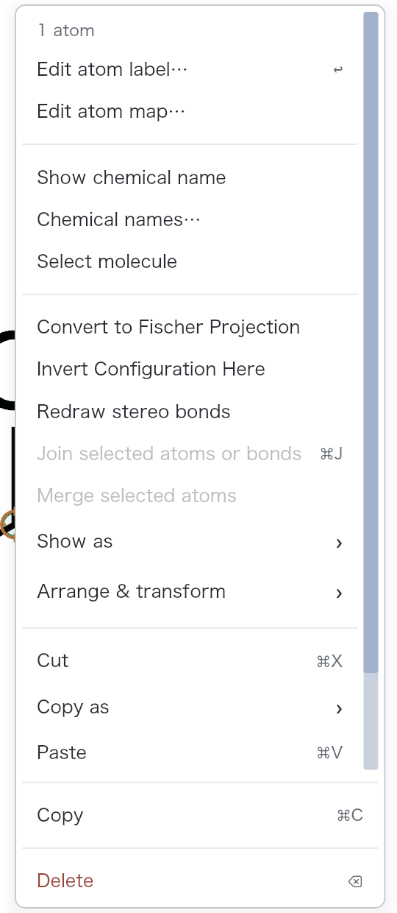 | 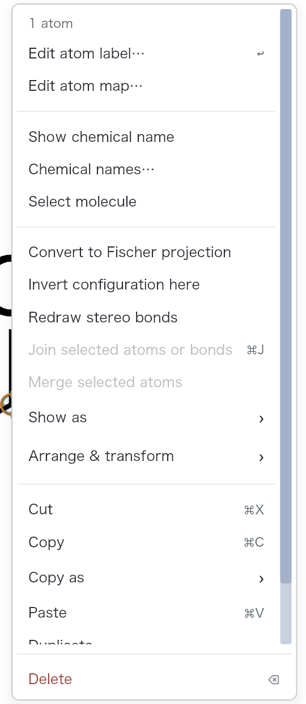 |
| `butanol.mol`, 250%, the stereocenter alone selected and right-clicked: "Convert to Fischer **P**rojection", "Invert **C**onfiguration **H**ere"; Copy pinned above Delete. | Same: **Convert to Fischer projection**, **Invert configuration here**; Copy after Cut, only Delete pinned. The menu is taller than the window here, so Duplicate is clipped and the body scrolls in both builds. |

Full windows: selection menu ([base](base-02-selection-menu.png), [branch](branch-02-selection-menu.png)), stereo menu ([base](base-13-stereo-atom-menu.png), [branch](branch-13-stereo-atom-menu.png)).

### C4: one name per command (Recalculate, Save as .rsk…)

| Base `fcd2cde6` | Branch `2e9c60ab` |
| --- | --- |
| 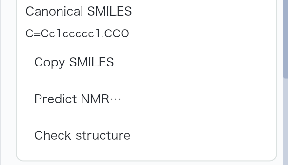 | 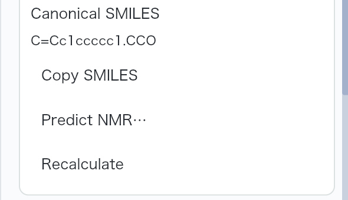 |
| Nothing selected, Properties → Molecular properties: the last button is "Check structure". | Same: **Recalculate**. |
| 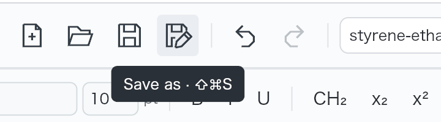 | 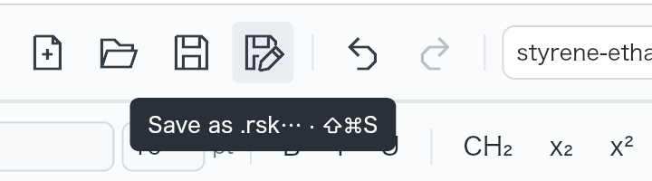 |
| Pointer on the toolbar Save as icon for 3 s: tooltip "Save as · ⇧⌘S". | Same: "**Save as .rsk…** · ⇧⌘S". |
| 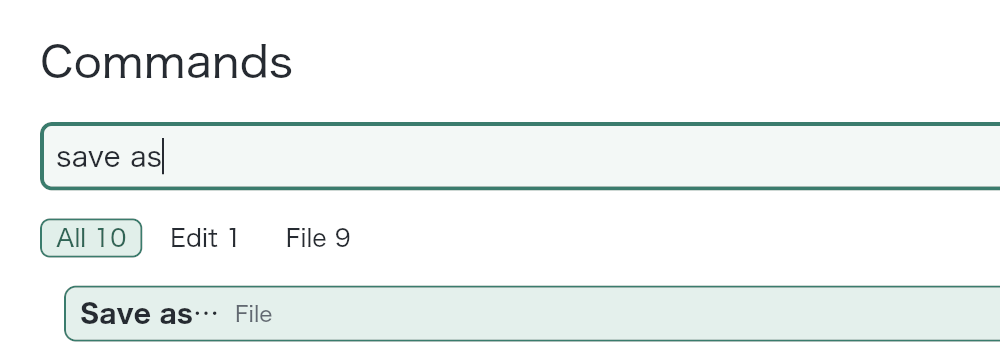 | 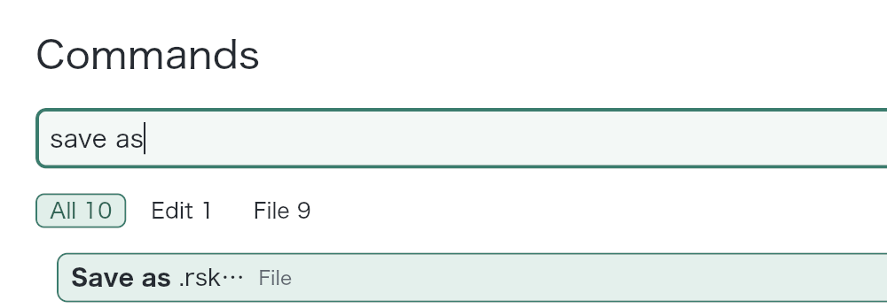 |
| Palette, "save as": first result "Save as…". | Same: **Save as .rsk…**. |
| 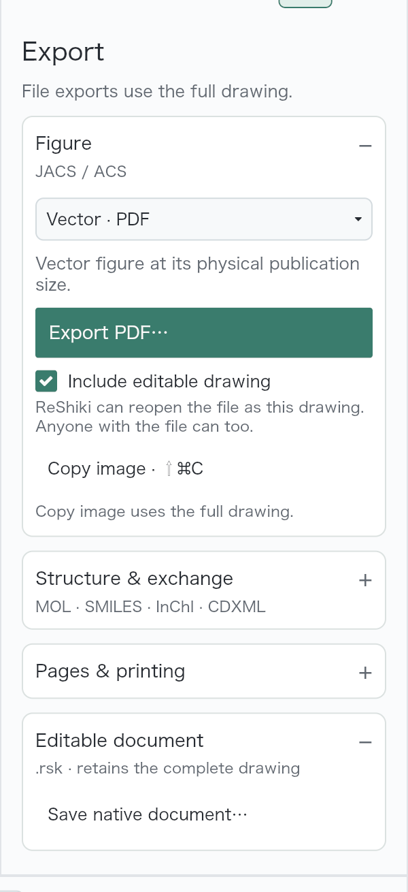 | 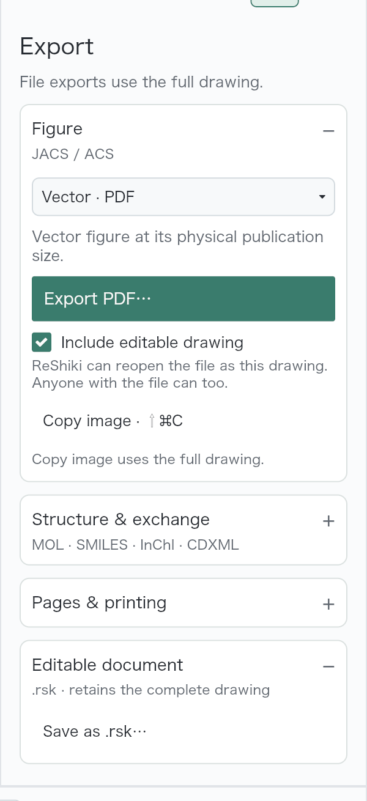 |
| Export tab, Editable document card: "Save native document…". | Same: **Save as .rsk…**, the name used by the toolbar and the palette. |

Full windows: Properties ([base](base-01-properties-none.png), [branch](branch-01-properties-none.png)), tooltip ([base](base-08-save-as-tooltip.png), [branch](branch-08-save-as-tooltip.png)), palette ([base](base-07-palette-save-as.png), [branch](branch-07-palette-save-as.png)), Export ([base](base-09-export.png), [branch](branch-09-export.png)).

### C2: results-only status messages

| Base `fcd2cde6` | Branch `2e9c60ab` |
| --- | --- |
|  |  |
| Status bar right after opening `styrene-ethanol.mol`: "Structure imported · Undo restores the previous drawing". | Same: "Structure imported". |
|  |  |
| Status bar drawing style **JACS / ACS → RSC**: "RSC applied · Undo restores the previous style and layout". | Same: "RSC applied". |
|  |  |
| Import → Name, "ethanol", Enter (local parse, nothing sent online): "Inserted ethanol · Undo removes it". | Same: "Inserted ethanol". |

Full windows: open ([base](base-01-properties-none.png), [branch](branch-01-properties-none.png)), RSC ([base](base-11-style-applied.png), [branch](branch-11-style-applied.png)), ethanol inserted at the app's automatic 156% refit ([base](base-12-name-inserted.png), [branch](branch-12-name-inserted.png)).

### C9: section headings

| Base `fcd2cde6` | Branch `2e9c60ab` |
| --- | --- |
|  | 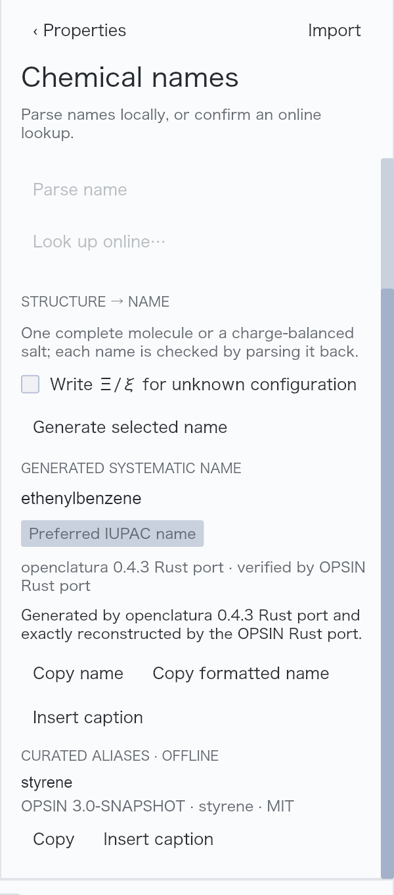 |
| Styrene, right-click → **Chemical names…** → **Generate selected name** (local), panel scrolled to the result: heading "GENERATED SYSTEMATIC NAME · OPENCLATURA", name ethenylbenzene. | Same: heading **GENERATED SYSTEMATIC NAME**; the engine is still named in the source line below the name. The other headings look the same as on main, because `section()` now adds the capitals. |

Full windows: [base](base-10-chemical-names.png), [branch](branch-10-chemical-names.png). In both builds the name did not appear on its own within 20 s; Codex pressed **Generate selected name** in both.

### C10: copy lint (non-visual)

The branch's `scripts/copy_lint.py` (at `57578ba0`), run on two exports of `src/`:

| Rule | main `fcd2cde6` | branch `57578ba0` |
| --- | ---: | ---: |
| write US English | 65 | 0 |
| status messages stay within 60 characters | 58 | 0 |
| state the result; Undo is always there | 36 | 0 |
| name the key Esc | 24 | 0 |
| write section headings in sentence case | 18 | 0 |
| write a real plural, not (s) | 4 | 0 |
| **Total (exit status)** | **205 (1)** | **0 (0)** |

The lane's first count on main (171) used the lint before the review fixes. The review made it read multiline, raw and `concat!` strings, constants and conditional statuses, which found the rest.

Not captured in the real app: the abbreviation panel buttons (Abbreviate selection, Save as abbreviation), the Esc hints, Symmetrize and the stereo tooltips. These are covered by the unit tests and the `ui_layout_snapshots` renders (70 of 174 PNGs changed).

## Verification

VERIFICATION_TABLE

Run by the lane on macOS arm64:

- `cargo fmt --all --check`, `cargo clippy --workspace --lib --bins --all-features --locked -- -D warnings`, `cargo clippy -p reshiki -p reshiki-model --all-targets --all-features --locked -- -D warnings`: pass.
- `cargo test --locked -p reshiki-model`: 1432 passed, 0 failed.
- `cargo test --locked --bin reshiki` with `RESHIKI_INCHI_HELPER` / `RESHIKI_NAMING_HELPER` set and `RESHIKI_REQUIRE_INCHI_HELPER=1`: 1581 passed and 182 ignored on the first run, with 0 failed. After the review fixes there were two runs, each with 1581 passed, 1 failed and 182 ignored. The failure was a different test each time: one naming test hitting the 15 s local-naming limit while the load average was 70–139. Each failing test passes alone, here and on the merge base. Per-module reruns of command_palette, context_menu, stereo, files, generic, optimization, help, autosave, keyboard_drawing, reaction_mapping, engine_jobs, theme_files, clipboard, desktop, inspector and workspace pass.
- `cargo test --locked --bin reshiki context_menu::cascade_tests -- --ignored`: 12 passed. `compact_menu_pins_delete_with_keyboard_and_accessibility_order` failed on the lane head before the harness fix and passes after it.
- New tests: `arrange_commands_have_one_name_on_every_surface` and `save_as_has_one_name_on_every_surface`, plus 3 new cases among the 7 in `tests/test_copy_lint.py`: multiline, raw and char literals; placeholders; constant and conditional statuses.
- `python3 scripts/copy_lint.py`: 0 problems; 205 on main (table above). `uv run --locked python -m unittest tests.test_copy_lint`, `ruff check`, `ty check`, `bun run format:check`, `bun run docs:check`, `assemble_changelog.py --check`: pass.
- `ui_layout_snapshots` before and after: 70 of 174 PNGs differ, all of them in text.
- CI on this PR at `57578ba0`: all green. That includes the Rust jobs on Linux x64 and Windows x64, Rust geometry on Linux and Windows (x64 and arm64), wasm, Python on Linux and Windows, the clipboard jobs, Office add-in, LibreOffice UNO, and the new Check app text step.
- Real app on macOS arm64: the screenshots above.

Not run: real-app checks on Arch Linux x64, Ubuntu arm64 and Windows x64. No platform code changed. The strings render in each platform's UI font, and the menus and palette rows got shorter, not longer.

## Risk

- **Partial (C9).** User-visible UK spellings and "(s)" plurals remain outside the app crate: `crates/io` clipboard and cleanup notices ("multi-centre", "bond(s)") and `crates/agent` / MCP messages. Those crates belong to other lanes, and some strings are API or file keys that must not change (`two_wedge_stereocentres`). The lint checks only `src/`. The style bar's `text("STYLE")` heading (`workspace.rs`, owned by the palette lane) was not converted.
- **Lint limits (C10).** A message that reaches `status` through a local variable (for example `clipboard.rs`'s `action`) is not followed. `docs/writing-style.md` says so. Messages built in other crates are not checked.
- **Owner decision: align shortcut letters.** The bindings did not change, so the letters now read against the names: **Align center is ⌥⇧⌘M** and **Align middle is ⌥⇧⌘C** (visible in the C1 shots). The same holds for Flip horizontal ⇧⌘V and Flip vertical ⇧⌘H. Rebinding is a separate change if wanted.
- **Renamed commands.** Docs and website pages that quoted old labels are updated in this PR. Anyone who searched the palette for "Check structure", "Toggle inspector", "AI assistant" or "Atom mapping" must use the new name. Older screenshots in guides still show the old labels.
- **Merge conflicts with other wave 3 PRs.** These are one-line string edits in `inspector.rs` (#1196 rewrites nearby panel text), `workspace.rs` (#1195 status bar and context row, #1196 palette, #1200 palette and help) and `canvas/tool.rs`. Whichever merges later must re-run `python3 scripts/copy_lint.py`; it flags any "Escape", Undo tail or ALL-CAPS `section()` a merge brings back. #1196's base screenshots also say "Check structure", which this PR renames.
- **Full-suite flake under load.** The single 15 s naming-limit failure per full run (Verification) was not reproduced alone or in CI. It was not caused here, but the lane never had a clean full local run after the review fixes.
- **Not seen in the real app:** the Office / LibreOffice / Microsoft 365 save statuses and the lost-proxy status (need a real Office session), and the Windows-only "Selection cut" clipboard branch.

## Changelog

`docs/changes/unreleased/wave3-names-menus-messages.md` (section Changes):

- Align commands have one set of names in the right-click menu, the context row and the command palette: **Align left**, **Align center**, **Align right**, **Align top**, **Align middle** and **Align bottom**. Before, the palette called **Align center** "Align middles horizontally". **Flip horizontal** and **Flip vertical** are named the same way everywhere.
- In the right-click menu, **Copy** sits with **Cut**, **Copy as** and **Paste**. Only **Delete** stays pinned at the bottom.
- Each command has one name on every surface: **Page setup…**, **Recalculate** (was Check structure), **Save as .rsk…**, **Abbreviate selection…** (was Create group label… and Contract selection), **Save as abbreviation**, **3D optimize…**, **Clean up…**, **Atom maps**, **Assistant** and **Show/hide side panel**. Menu items use sentence case, such as **Convert to wedge drawing**.
- Status messages state the result, such as "3D projection applied", without repeating that Undo brings the drawing back. Long messages are shorter.
- The app writes US English (**Center charge in ring**, **Symmetrize**, "canceled", and "undefined stereocenter" in **Check drawing** notices), real plurals instead of "(s)", and "Esc" for the Escape key.

## Contribution license

- [x] I have read [CONTRIBUTING.md](https://github.com/Ameyanagi/ReShiki/blob/main/CONTRIBUTING.md). I have the right to submit this contribution and agree to offer my original contributions under both MIT and Apache-2.0, so recipients may choose either license (`MIT OR Apache-2.0`).
- [x] Any third-party material is identified below with its source and license, and its required notices are preserved; otherwise, no third-party material is added.

Third-party sources, if any:
