## Summary

Wave 3 of the UI audit: six items in the left palette, the right panel and the View bar.

- **U1, atoms always in view.** **ATOMS** and **Help** are now a fixed footer of the left palette. Only the tools scroll, with a fade at the bottom when more are below. Tool buttons are 32 px on a 34 px pitch (was 42 px). **Fe** is gone. **\*** and a new **R** button have their own row. **R** places a `*` atom labeled R, by click, by replacing an atom or by dragging a bond, and each is one Undo step.
- **C7, tools paired by family.** The pairs are Select·Lasso, Eraser·3D tilt, Single·Double, Triple·Other bonds, Atom·Ring, the two chains, Arrow·Text, Line·Arc, Curve·Pen path, Rectangle·Ellipse, Brackets·Symbols, then Orbitals. The **View** bar lists canvas aids first and data display after them, with Page setup… and Done last. When it does not fit, it wraps to a second line; nothing is clipped.
- **U2, one panel width.** The right panel is 320 px on every tab (it was 256, 300, 320 or 380 px). The tab strip is a segmented control with 12 px labels (was 10 px). Each tab is an accessibility button with id `inspector-tab-<Tab>`.
- **U5, panel actions look like buttons.** Copy SMILES, Copy analysis, Predict NMR…, Check structure / Recalculate selection, Group, the Labels & chemistry actions, Templates Import… / Export… / Reload and others are now bordered secondary buttons. **Place** is the primary button for a chosen template. Copy SMILES and Copy analysis sit side by side after the SMILES. With a selection, Molecular properties no longer repeats the atom and bond counts.
- **C8, order in Properties and the context row.** A chemistry error shows under the panel summary at the top. **Delete selection** is the last button in the panel. The context row lists selection commands first and 3D optimize… / Keyboard drawing last, and a short row folds into **⋯** from the end.
- **C5, shorter panel text (partial).** The PubChem confirmation is one sentence, and its review advice moved into the **Send name** tooltip. The page setup notes are short ("Margins do not print"), and their details moved into hints. The same applies to the low-contrast notice, the stereo-group legend and the cut-bond note. Some strings were left alone on purpose; see Risk.

No issue is filed for these items, so this PR closes none.

## Why it matters

All of these come from the UI audit of main and were confirmed on main first.

- **U1.** At the default window (1280 × 820 pt) only **H**, **C** and **N** of the 11 atom buttons showed. With the View bar open, or at the 1040 × 680 pt minimum window, none showed. To get O, S, P, F, Cl or Br, the user had to scroll the whole palette. Those are the most used buttons in the palette.
- **C7.** Main paired unrelated tools (Tilt+Eraser, Atom+Single bond, Brackets+Line), so a tool's neighbour said nothing about where to find the next one. The View bar did not fit even at 1280: **Done** was off the window and **Page setup…** wrapped inside its own button. At 1040, Rulers and Crosshair were cut off as well.
- **U2.** Switching from Properties (300 px) to Templates (256 px) moved the tab strip and resized the canvas, and the context row gained or lost commands with it. The 10 px tab labels were small.
- **U5.** Panel actions were drawn as plain text, so **Copy SMILES** or **Recalculate selection** read like labels rather than something to click.
- **C8.** On main a valence error first appeared inside the Molecular properties card and then again below **Delete selection**. **Delete selection** sat in the middle of the panel, between Grouping and Labels & chemistry, where a stray click destroys the selection. In the context row, the selection commands were the first to fold away.
- **C5.** The panel spent two to four lines on notes that explain rather than inform ("Margins are guides and do not print. Use cropped drawing exports for figures that will be placed in another document.").

## Approach

- **U1.** The palette is a column: the tool area is a `scrollable` with a 6 px floating scrollbar, a 16 px bottom fade, and matching bottom padding so the last row clears the fade. ATOMS and Help sit below it outside the scroll. The `ToolButton` glyph and flyout corner follow the button size instead of fixed 36 px coordinates. The TOOLS heading is gone: with it, the tools overflowed by about 12 px at 1280 × 820. R goes through `atom_text::apply` in `Mode::Text`, so a user abbreviation named R cannot replace it. A dragged bond labels only a newly created end atom, so an existing endpoint keeps its element. Fe was dropped at the owner's request; `Fe` can still be typed into the Atom tool's symbol field.
- **C7.** The tool rows were reordered in the existing `tools` array. 3D tilt stays in the second row, so `docs/tool-palettes.md` is still correct. The View bar is a wrapping row of whole groups (canvas aids, data display, Page setup… / Done) with wider gaps between groups.
- **U2.** `inspector_width()` returns 320 for every tab, the Assistant included. Equal segments do not fit: at 12 px "Properties" is 63.4 px wide, but an equal segment is only 57.6 px. So each segment gets `FillPortion(label width + 8)`. The strip still fills the panel and never moves, and every label has at least 7 px of slack. The cost is 5 `text_width` measurements per frame, the same approach the context row already uses.
- **U5.** One helper, `workspace::panel_action`, draws a full-width secondary button. Both the inspector and Templates use it. A button that shares a row with a text input keeps its natural width, so the input is not squeezed. Navigation links (‹ All properties, ← Categories), the toolbar, the context row and the View bar keep their own styles.
- **C8.** In the panel, the error now renders directly under the summary, and Delete selection is a full-width secondary button with red text and accessibility id `selection-delete`, placed after Drawing style. In the context row, `standard_context_commands` puts the selection commands first and `context_commands` adds the global modes last. The row render (`take(len - folded)`), `fit()` and `Page::More(n)` all take the last *n* commands, so the row folds from the end. #1195 makes the same row change; one of the two copies must be dropped when merging (see Risk).
- **C5.** The long notes were replaced by short text, and their explanations moved into `hover_hint` tooltips. The plurals are real ("1 label has low contrast" / "N labels have low contrast").

## Evidence

Real app on macOS arm64, one build at a time, each launch with a fresh `RESHIKI_DATA_DIR`. Base is main `fcd2cde6`; the branch is `60b89876` (head of this PR). Window sizes are given as content size: 1280 × 820 pt (the default) or 1040 × 680 pt (the minimum), light appearance. Input is `styrene.mol` (`C=Cc1ccccc1`, written by `reshiki --cli convert`), plus `pentavalent.rsk` (one carbon bonded to five carbons, a valence error on purpose). Canvas zoom is 250% at 1280 × 820 and 185% at 1040 × 680, unless a row says otherwise. Screenshots show only the ReShiki window. The table cells are crops of those windows at 2× pixels, and each section links the full windows. Codex computer use (gpt-6.1-sol) drove both builds; I checked every image.

### U1 and C7: left palette

| Base `fcd2cde6` | Branch `60b89876` |
| --- | --- |
| 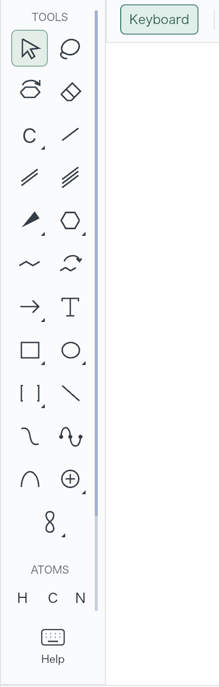 | 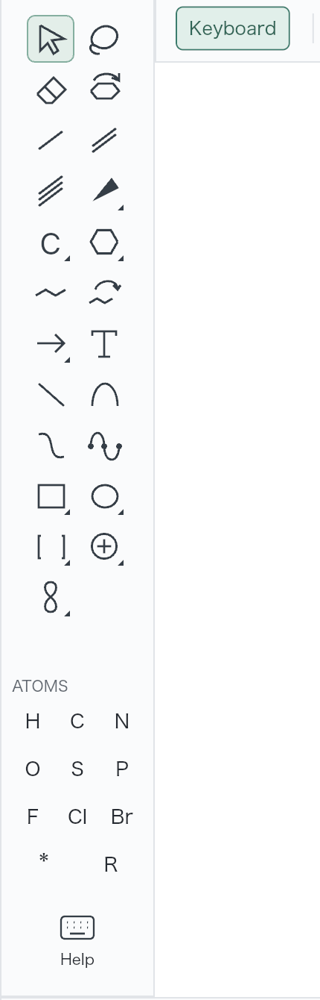 |
| 1280 × 820, nothing selected: under ATOMS only **H C N** show; the other 8 are below the fold. Pairs include Tilt+Eraser and Atom (C)+Single bond. | Same: all 11 show (**H C N / O S P / F Cl Br / \* R**), with Help below. The pairs are Select·Lasso, Eraser·Tilt, Single·Double, Triple·Other, Atom·Ring, and so on. |
| 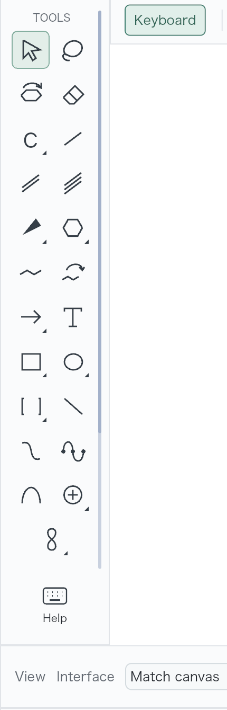 | 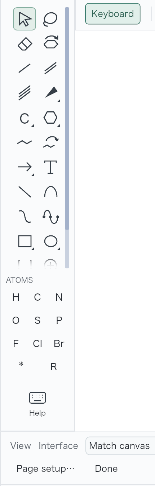 |
| 1280 × 820 with the View bar open: the ATOMS heading and all atom buttons are gone; only Help is left. | Same: all 11 atoms and Help stay. The tools above them get shorter and fade out at the bottom. |
| 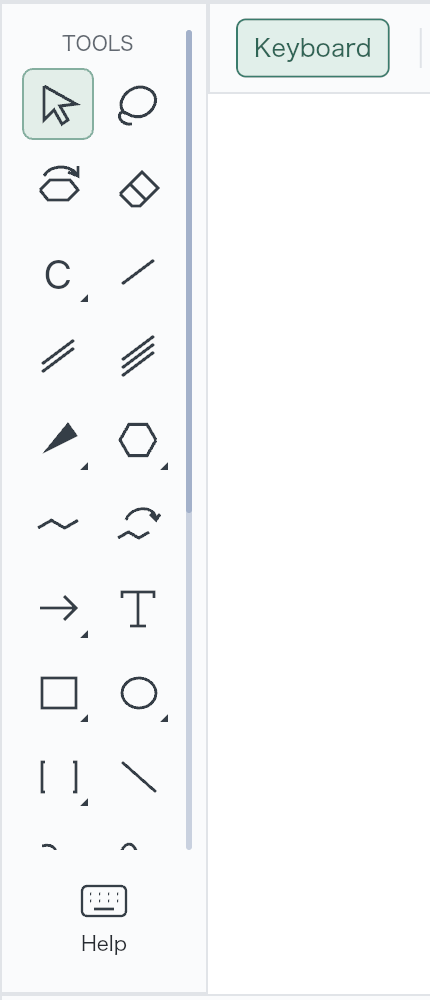 | 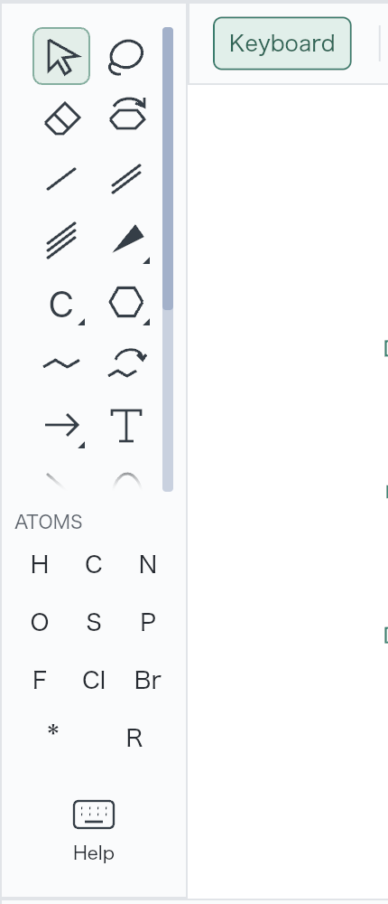 |
| 1040 × 680, styrene selected: no atom button visible. | Same: all 11 visible. |
| 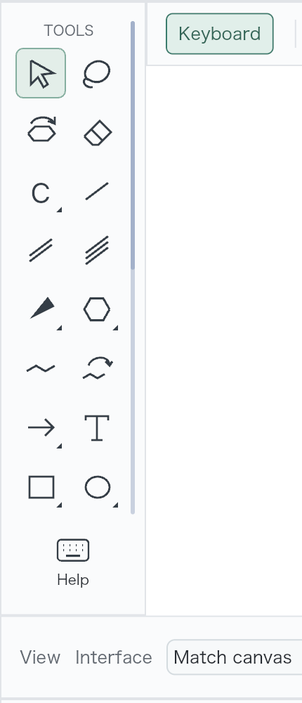 | 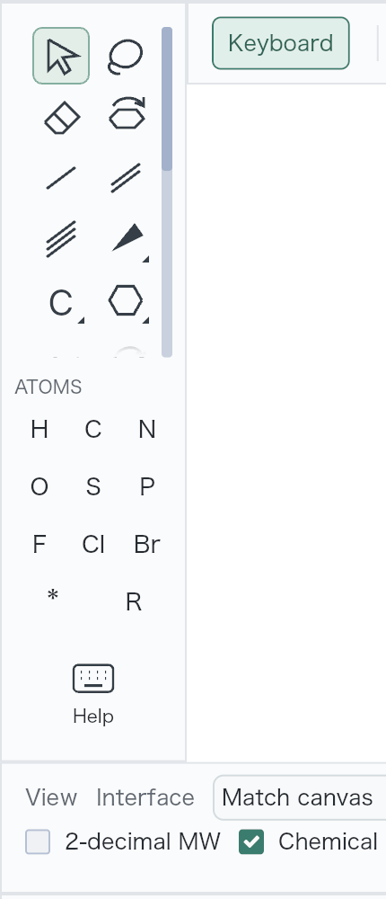 |
| 1040 × 680 with the View bar open: no atom button visible. | Same: all 11 visible (zoom 148%; opening the bar shrank the canvas). |
| 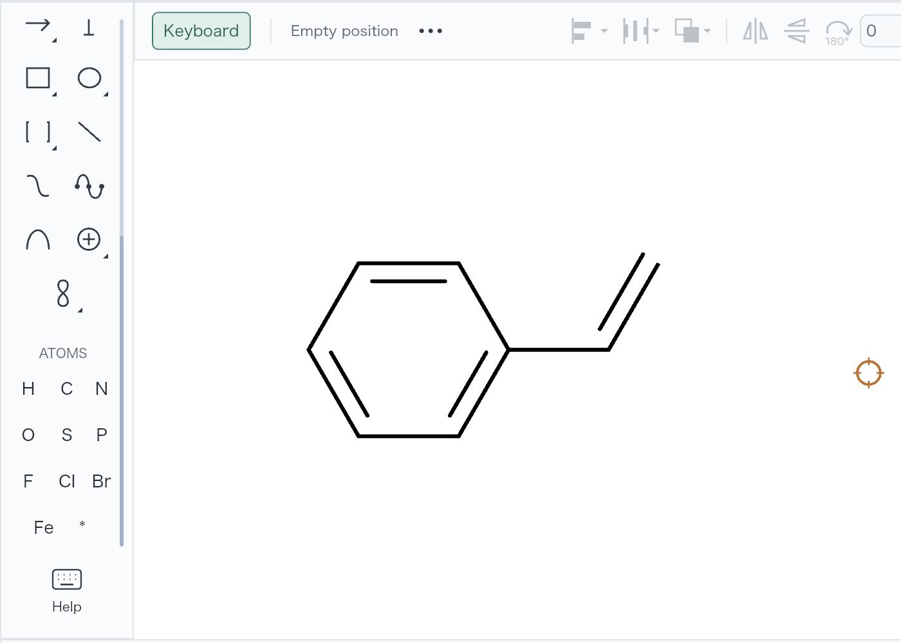 | 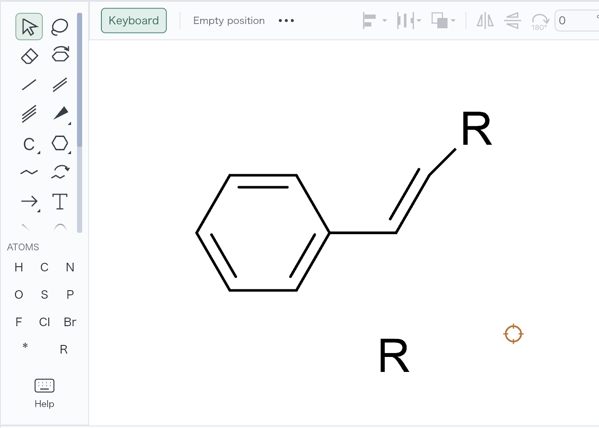 |
| 1040 × 680, palette scrolled to its end: the last ATOMS row is **Fe \***. There is no R. | 1040 × 680: **R** chosen, one click on empty canvas (lower R) and one drag from the vinyl end carbon (upper R). Status "Drawing changed"; the panel reports 10 atoms · 9 bonds. |

Full windows: default ([base](base-01-default-1280.png), [branch](branch-01-default-1280.png)), View bar 1280 ([base](base-08-view-bar-1280.png), [branch](branch-08-view-bar-1280.png)), 1040 ([base](base-13-selected-1040.png), [branch](branch-13-selected-1040.png)), View bar 1040 ([base](base-15-view-bar-1040.png), [branch](branch-15-view-bar-1040.png)), last row and R ([base](base-16-atoms-1040.png), [branch](branch-16-r-group-1040.png)).

### C7: View bar

| Base `fcd2cde6` | Branch `60b89876` |
| --- | --- |
| 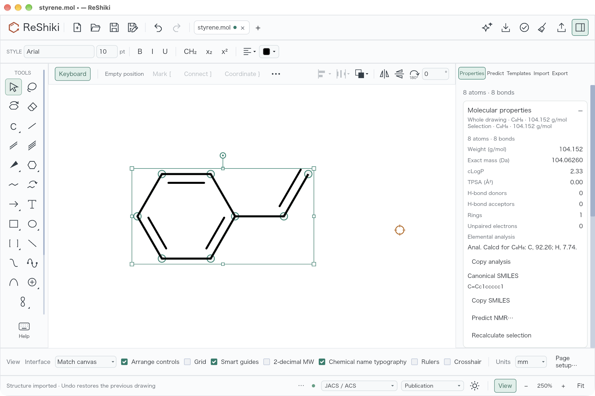 | 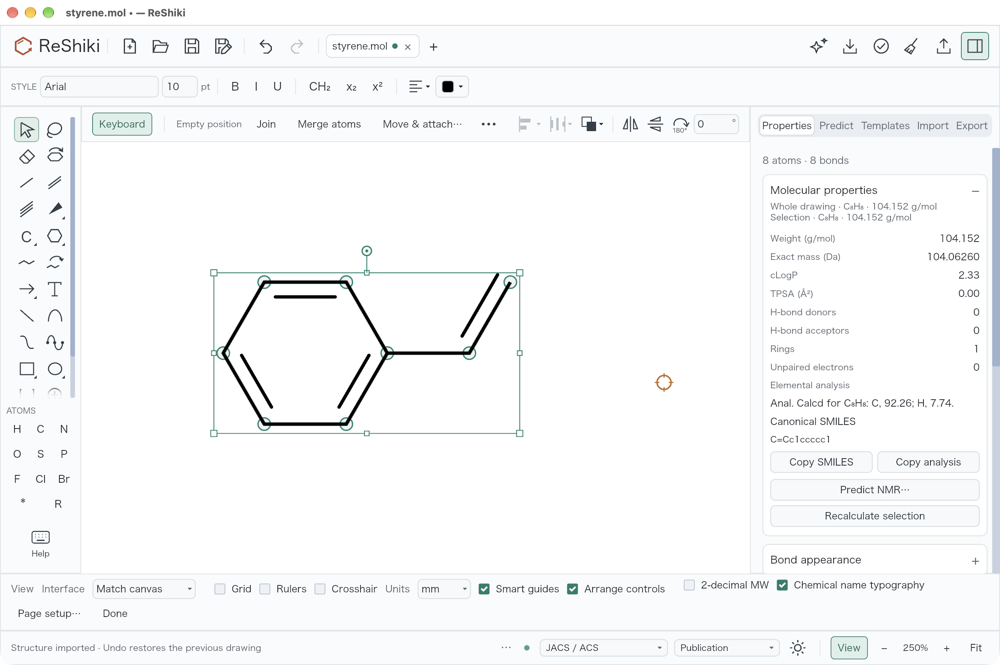 |
| 1280 × 820, styrene selected, View bar open: one line in the order Interface, Arrange controls, Grid, Smart guides, 2-decimal MW, Chemical name typography, Rulers, Crosshair, Units, then **Page setup…** wrapped onto two lines inside its button at the right edge. **Done** is not on screen. | Same state: line 1 has Interface, Grid, Rulers, Crosshair, Units, Smart guides, Arrange controls, then 2-decimal MW and Chemical name typography. Line 2 has **Page setup…** and **Done**, both whole. |
| 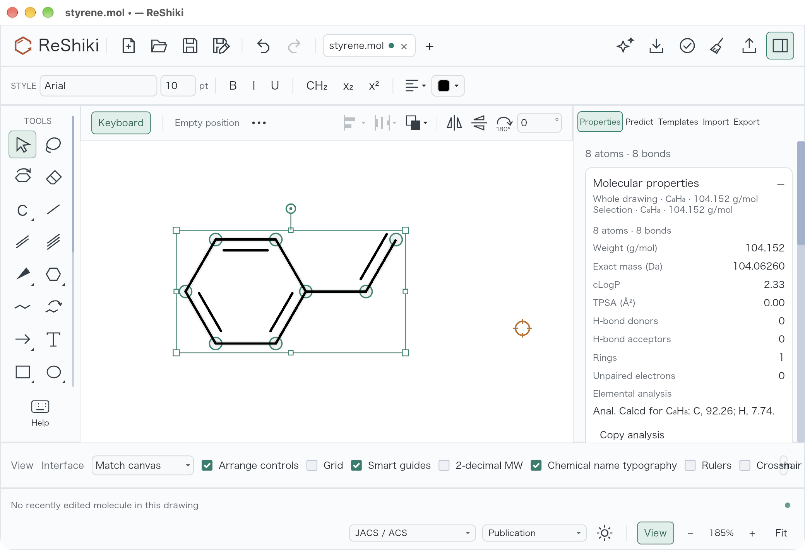 | 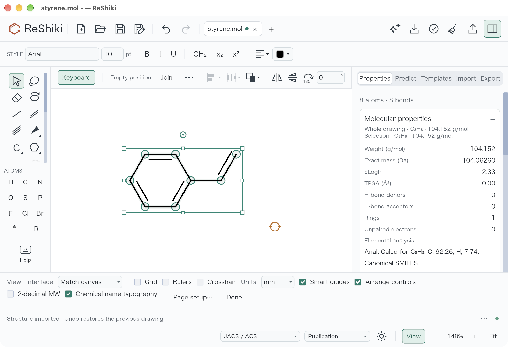 |
| 1040 × 680, same: the line ends mid-word at "Crosshair". Units, Page setup… and Done are off the window. | Same: two lines; 2-decimal MW, Chemical name typography, **Page setup…** and **Done** are on line 2. |

At 1040 × 680 both builds show the status bar on two rows. That is main's layout, unchanged here; #1195 makes it one row.

### U2: one panel width and segmented tabs

| Base `fcd2cde6` | Branch `60b89876` |
| --- | --- |
| 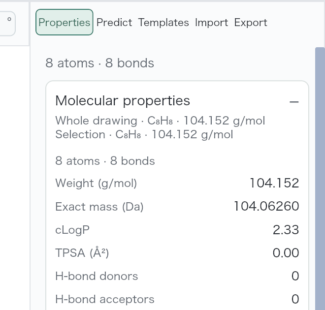 | 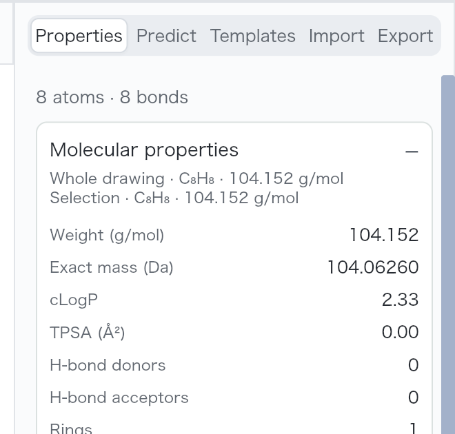 |
| 1280 × 820, styrene selected, **Properties**: about 300 pt wide; the tabs are 10 px text, and the selected one is boxed. | Same: 320 pt; the tabs are a segmented strip with 12 px labels and a raised selected segment. |
| 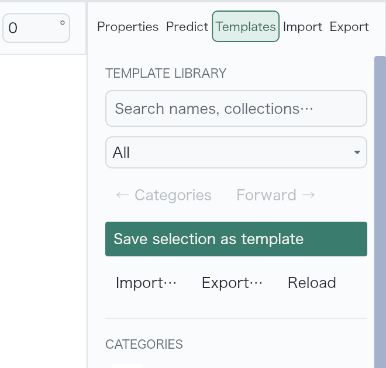 | 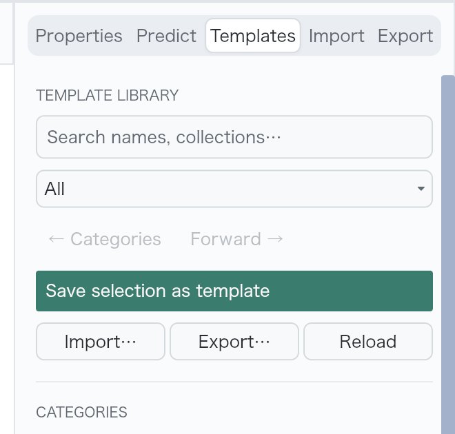 |
| **Templates**: the panel narrows to about 256 pt and the tab strip moves right. Import… / Export… / Reload are plain text. | **Templates**: still 320 pt and the strip does not move. Import… / Export… / Reload are bordered buttons. |

The panel widths were measured on the window captures by Codex (panel edge to the window edge); the code values are 300 / 256 on main and 320 on the branch. Full windows: Properties ([base](base-02-selected-1280.png), [branch](branch-02-selected-1280.png)), Templates ([base](base-04-templates-1280.png), [branch](branch-04-templates-1280.png)), Export (about 300 pt on [base](base-05-export-1280.png), 320 pt on [branch](branch-05-export-1280.png)). In the base Templates window the context row gains a **Group** command because the canvas got wider; on the branch the row stays the same across tabs.

### U5 and C8: Properties actions, error, Delete selection, context row

| Base `fcd2cde6` | Branch `60b89876` |
| --- | --- |
| 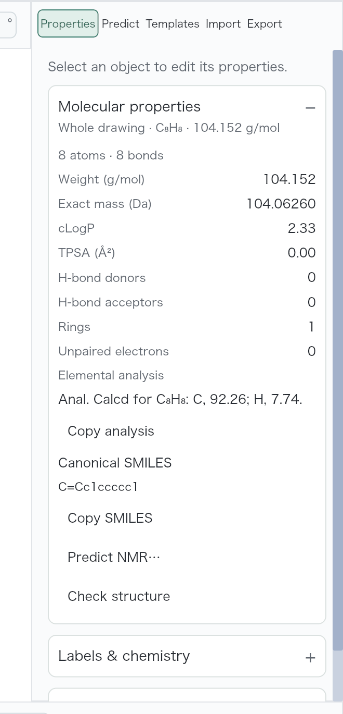 | 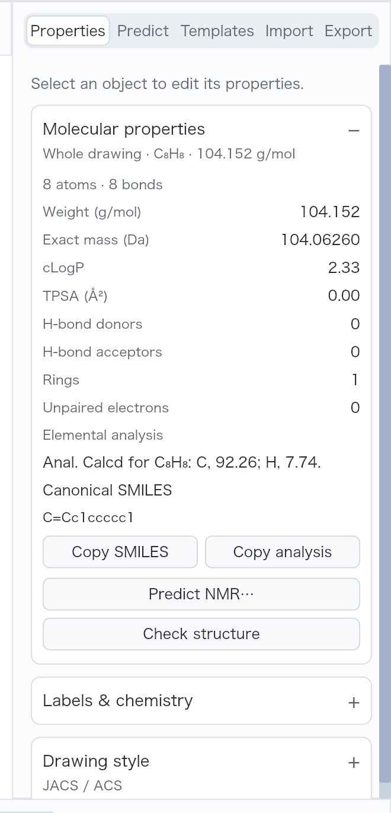 |
| 1280 × 820, nothing selected (whole drawing): Copy analysis, Copy SMILES, Predict NMR… and Check structure are plain text, one per line, with Copy analysis above the SMILES. | Same: bordered buttons. Copy SMILES and Copy analysis sit side by side after the SMILES; Predict NMR… and Check structure are full width. The whole-drawing "8 atoms · 8 bonds" line stays. |
| 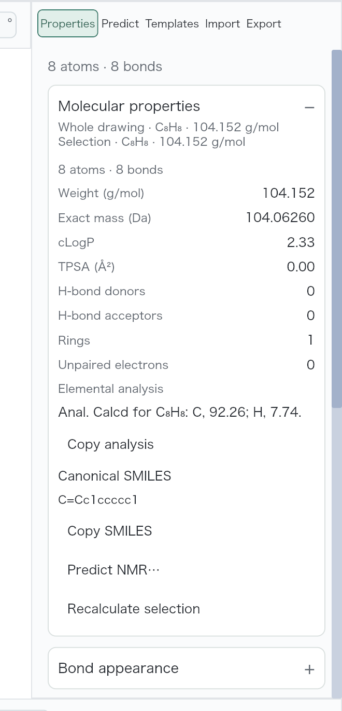 | 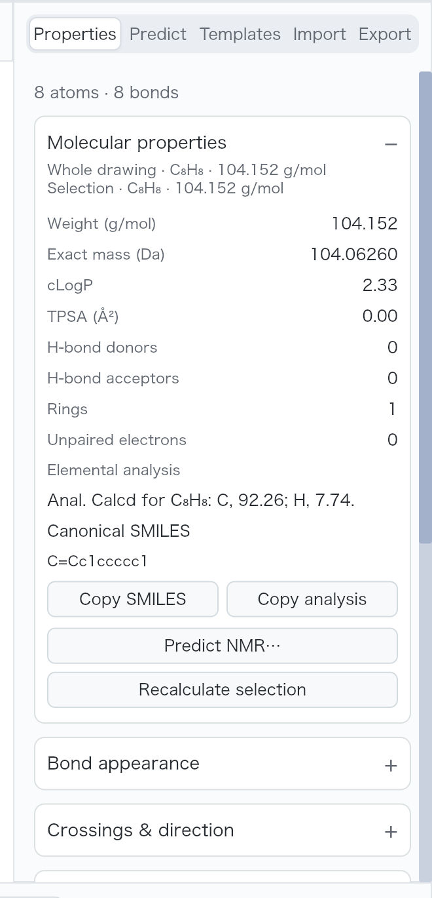 |
| Styrene selected: "8 atoms · 8 bonds" appears at the top and again inside Molecular properties. | Same: the count appears once, at the top. Recalculate selection is a full-width button. |
| 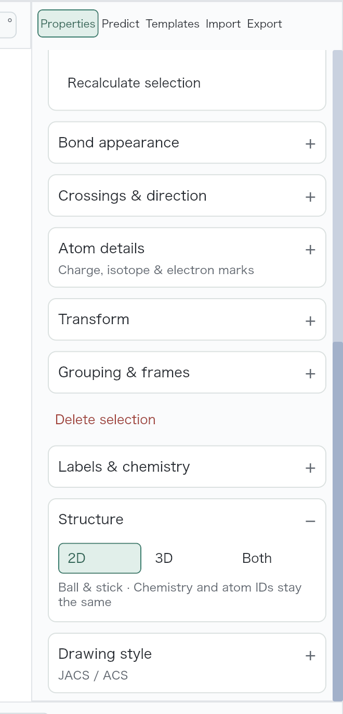 | 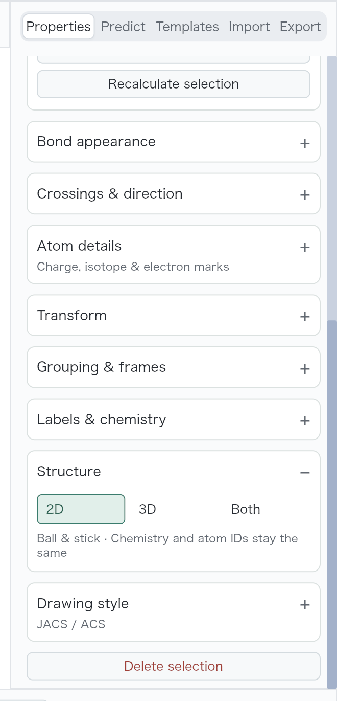 |
| The panel scrolled to its end: **Delete selection** (red text) sits between Grouping & frames and Labels & chemistry. | Same: **Delete selection** is the last item, a full-width button after Drawing style. |
| 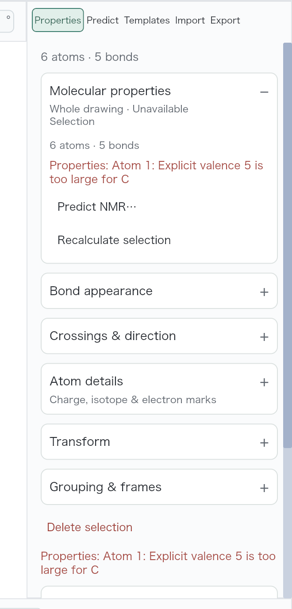 | 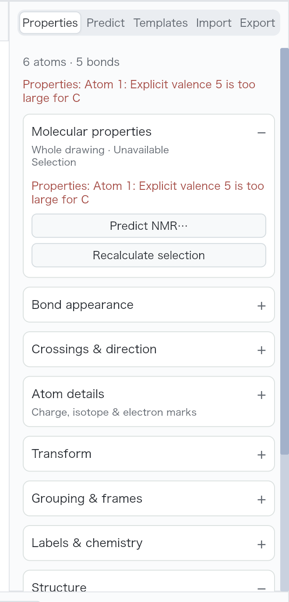 |
| `pentavalent.rsk`, all selected: the error "Properties: Atom 1: Explicit valence 5 is too large for C" is inside the Molecular properties card and again below Delete selection. | Same: the error is directly under "6 atoms · 5 bonds" at the top, and it is still repeated inside the card (see Risk). |
| 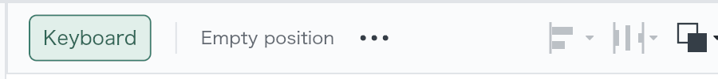 | 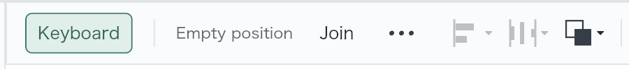 |
| 1040 × 680, styrene selected: the context row shows Keyboard, Empty position, **⋯**; no selection command fits. | Same: **Join** stays in the row before **⋯**. |
| 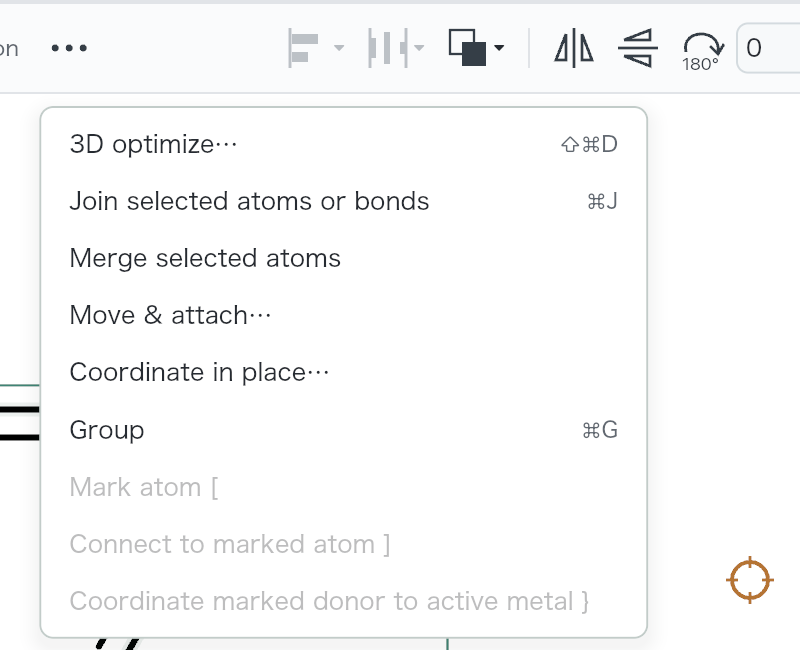 | 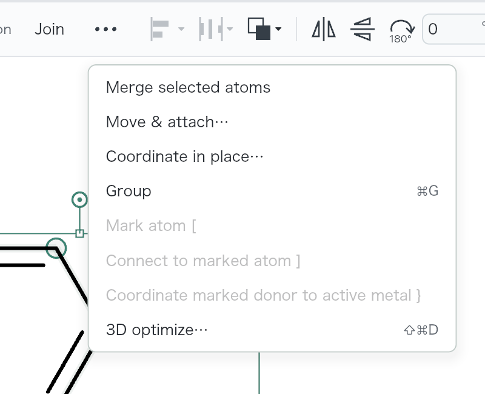 |
| The **⋯** menu in that state: 3D optimize… first, then Join … Group, then the greyed keyboard-drawing commands. | The **⋯** menu: Merge, Move & attach…, Coordinate in place…, Group, the greyed keyboard-drawing commands, and **3D optimize…** last. |

Full windows: whole drawing ([base](base-01-default-1280.png), [branch](branch-01-default-1280.png)), selected ([base](base-02-selected-1280.png), [branch](branch-02-selected-1280.png)), panel end ([base](base-03-selected-bottom-1280.png), [branch](branch-03-selected-bottom-1280.png)), error ([base](base-11-error-1280.png), [branch](branch-11-error-1280.png)), 1040 row ([base](base-13-selected-1040.png), [branch](branch-13-selected-1040.png)), menu ([base](base-14-more-menu-1040.png), [branch](branch-14-more-menu-1040.png)). The orange crosshair in the windows is the keyboard-drawing target left where the automation parked the pointer.

### C5: shorter panel text

| Base `fcd2cde6` | Branch `60b89876` |
| --- | --- |
|  | 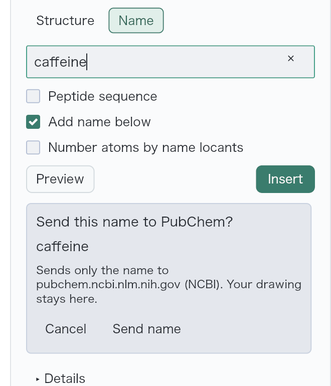 |
| Import → Name, "caffeine", **Look up online…**: "This uses the internet and sends the name to pubchem.ncbi.nlm.nih.gov (NCBI). Your drawing is not sent. Review the returned structure before inserting." | Same: "Sends only the name to pubchem.ncbi.nlm.nih.gov (NCBI). Your drawing stays here." |
| 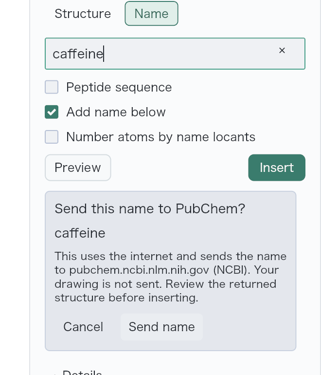 | 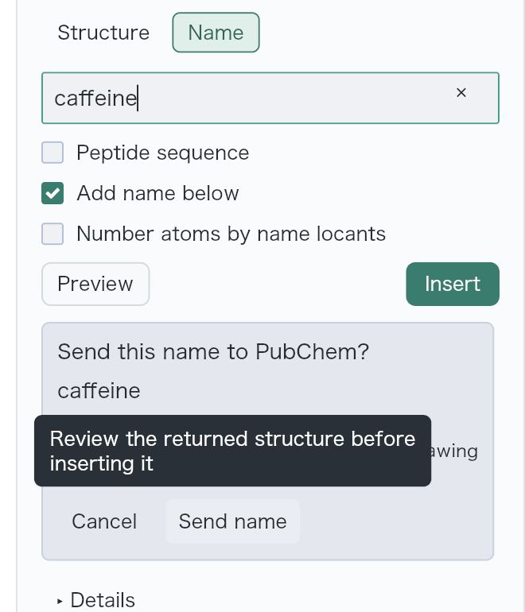 |
| Pointer on **Send name** for 2.5 s: no tooltip. | Same: tooltip "Review the returned structure before inserting it". (The tooltip covers part of the sentence while hovered.) |
| 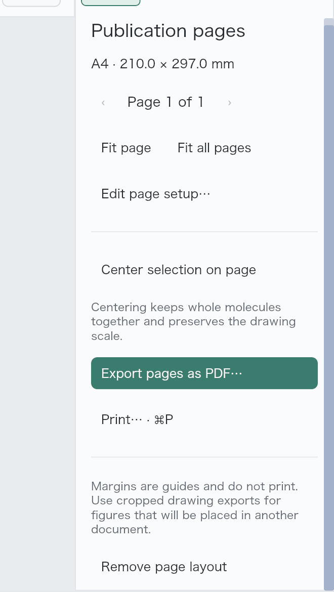 | 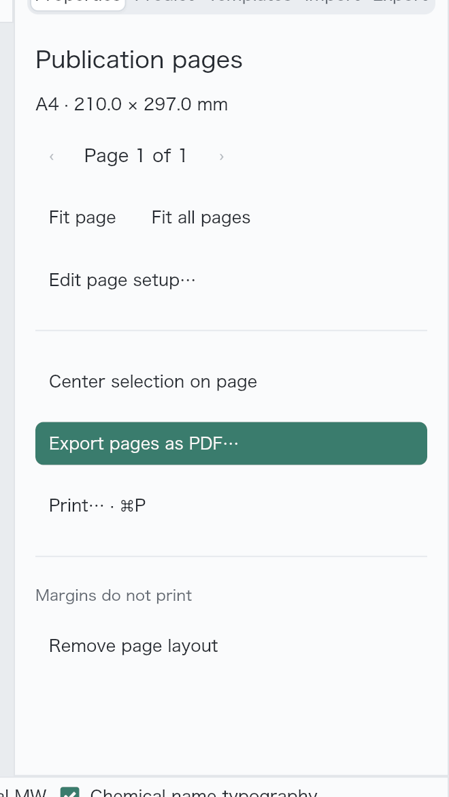 |
| View → Page setup… → A4 applied (zoom 21%): "Centering keeps whole molecules together and preserves the drawing scale." and a four-line margins note. | Same (zoom 20%): no centering note (now the Center selection on page tooltip) and "Margins do not print". |

Full windows: confirmation ([base](base-06-pubchem-confirm-1280.png), [branch](branch-06-pubchem-confirm-1280.png)), hover ([base](base-07-send-name-hover-1280.png), [branch](branch-07-send-name-hover-1280.png)), page setup ([base](base-09-page-setup-1280.png), [branch](branch-09-page-setup-1280.png)). Before applying, the setup form's last note went from "Page setup does not move or resize objects. Margin guides do not appear in exports. Drawing exports remain cropped to the artwork." to "Objects stay in place · Margins do not print" (Codex read both; not captured). **Send name** was never pressed in either run. The low-contrast notice, the stereo-group legend and the cut-bond note were not triggered in the real app. Those changes are covered by code review and the module tests only.

## Verification

VERIFICATION_TABLE

Run by the lane on macOS arm64:

- `cargo fmt --all --check`, `cargo clippy --workspace --lib --bins --all-features --locked -- -D warnings`, `cargo clippy --locked -p reshiki --all-targets --all-features -- -D warnings`: pass (also run by the pre-commit hook on every commit).
- `cargo test --locked --bin reshiki` with `RESHIKI_INCHI_HELPER` / `RESHIKI_NAMING_HELPER` set and `RESHIKI_REQUIRE_INCHI_HELPER=1`: 1583 passed, 0 failed before the review fixes. After them: 1582 passed, 3 failed. All three failures were naming / InChI tests that hit the 15 s local-parse limit while the machine's load average was about 165. Each passed when rerun alone.
- New and changed tests, each confirmed to fail on main or before its fix:
  - `side_panel_tests::every_atom_button_is_visible_at_the_default_window_size`: main has 3 of 11 at 1280 × 848; the branch has 11/11 at 1280 × 848 and at 1040 × 680.
  - `every_inspector_tab_has_the_same_width`, `inspector_tab_labels_fit_their_segments`.
  - `the_r_group_button_places_labeled_dummy_atoms`, `…_keeps_existing_bond_endpoints`, `…_ignores_a_user_abbreviation_named_r`.
  - `a_narrow_context_row_keeps_selection_commands_ahead_of_global_modes` (real renderer, 360–1200 px in 40 px steps).
- Opt-in renderer tests (`--ignored --test-threads=1`, skipping perf), main against the branch: 23 failures on each side. The 22 shared ones need baselines or environment that this machine does not have. The one branch-only failure (`drawing_polish_renderer_palette`, which activated Fe) is fixed and passes.
- `ui_layout_snapshots` with seven new states (templates, templates-active, labels, abbreviations, export, view-options, molecule-error): pass.
- `bun fmt --check .`, `bun run docs:check`, `uv run --locked python scripts/assemble_changelog.py --check`: pass.
- CI on this PR, including the Windows x64 Rust jobs, wasm, Python, clipboard and Office add-in jobs: all green at `60b89876`.
- Real app on macOS arm64: the screenshots above.

Not run: real-app checks on Arch Linux x64, Ubuntu arm64 and Windows x64. VoiceOver and Tab order through the new segmented tabs, the ATOMS footer and `selection-delete` were not checked either.

## Risk

- **Partial (C5).** These strings were left alone on purpose:
  - `updates.rs`: its paragraph is on the same line that #1192's star toast edits.
  - The Export panel strings ("File exports use the full drawing.", the Copy image captions, the SVG / editable-drawing notes): #1192 rewrites that section.
  - The "Choose a paper size…" line in `pages.rs`, which sits next to the C4 "Set up pages…" rename.
- **Partial (U5).** The Export panel's **Copy image** button is still plain text (see the Export full windows), also because #1192 reworks it. The "‹ All properties" back link is unchanged on purpose.
- **Not fully fixed (C8).** The chemistry error now sits at the top, but it is still printed a second time inside Molecular properties (branch error shot).
- **Overlap with #1195.** Both PRs reorder the context row and make it fold from the end. Whichever merges second must drop its copy or rebase onto the other. The C4 lane may also rename "Check structure" / "Recalculate selection" and the Page setup labels next to lines changed here.
- **Layout change at 1280.** The View bar now takes two lines at the default window size, about 16 pt more than main's single (clipped) line. While it is open, the tool list above ATOMS is shorter and fades out.
- **Not seen on other platforms.** On Windows x64 (Tiny Skia) `surface_shadow` draws no shadows, so only its border marks the selected tab segment, and nobody has looked at the palette fade there. Segment widths come from `text_width` in the platform UI font. They were measured only with the macOS font ("Properties" 63.4 of 70.8 px); Segoe UI and Noto Sans were not checked.
- **Screenshots in docs.** Guide and website screenshots that show the left palette, the inspector tabs or the View bar are now out of date and need retaking. The view-parity baselines must be recaptured from main.
- **Behaviour change.** **Fe** is no longer a palette button; type `Fe` in the Atom tool's symbol field. The R button always places a `*` atom labeled R, even when a user abbreviation named R exists.

## Changelog

`docs/changes/unreleased/wave3-side-panels.md` (section Changes):

- The **ATOMS** buttons and **Help** stay in view at the bottom of the left palette at every window size. Only the tools scroll, and they fade out at the bottom when more are below. At 1280 × 848, all 11 atom buttons now show instead of H, C and N only.
- **ATOMS** has its own line for **\*** (dummy atom) and a new **R** button, which draws an R group: a `*` atom labeled R, even when your abbreviations define a group named R. A bond dragged to an existing atom leaves that atom as it was. **Fe** left the palette; type `Fe` in the Atom tool's symbol field.
- Tools are paired by family: Select and Lasso, Eraser and 3D tilt, the bond tools, Atom and Ring, the two chains, Arrow and Text, then the drawing tools. Each row is a little shorter.
- The right panel keeps one width, 320 px, on every tab, so switching tabs no longer moves the tabs or the drawing. The tabs are a segmented control with 12 px labels.
- Panel actions such as **Copy SMILES**, **Predict NMR…**, **Group**, **Import…** in Templates and **Check drawing** look like buttons, and **Place** is the main button for a chosen template. **Copy SMILES** and **Copy analysis** sit side by side, after the SMILES.
- The context row lists selection commands first and **3D optimize…** and **Keyboard drawing** last. When the row is short, commands fold into **⋯** from the end, so the selection commands stay in view longest.
- In Properties, a chemistry error shows under the summary at the top, and **Delete selection** is the last button in the panel. With a selection, **Molecular properties** no longer repeats the atom and bond counts.
- Shorter panel text: the stereo group legend, the low-contrast advice, the page setup notes and the advice in the PubChem confirmation moved into hints.
- The **View** bar lists canvas aids first and data display after them. On a narrow window it wraps to a second line instead of hiding **Page setup…** and **Done**.

Docs updated: `website/src/content/docs/guide/generic-structures.mdx` (how to place R and \*).

## Contribution license

- [x] I have read [CONTRIBUTING.md](https://github.com/Ameyanagi/ReShiki/blob/main/CONTRIBUTING.md). I have the right to submit this contribution and agree to offer my original contributions under both MIT and Apache-2.0, so recipients may choose either license (`MIT OR Apache-2.0`).
- [x] Any third-party material is identified below with its source and license, and its required notices are preserved; otherwise, no third-party material is added.

Third-party sources, if any: none.
