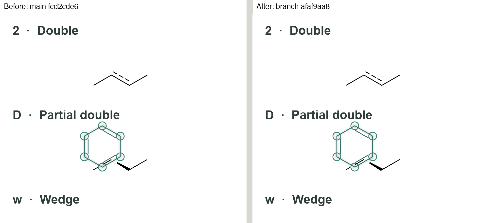
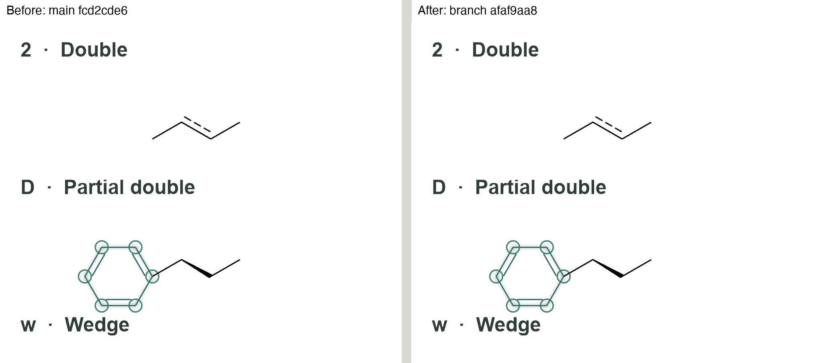
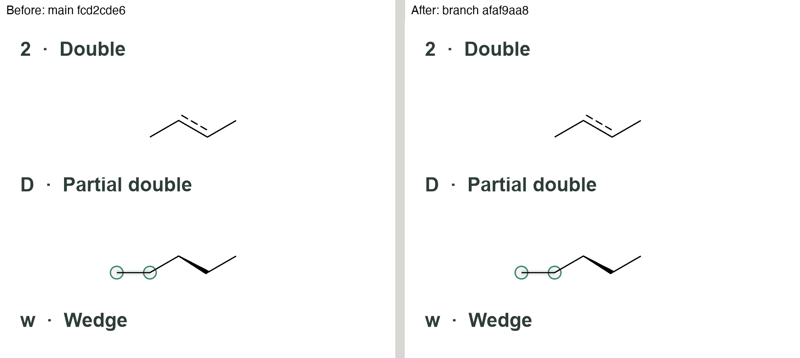
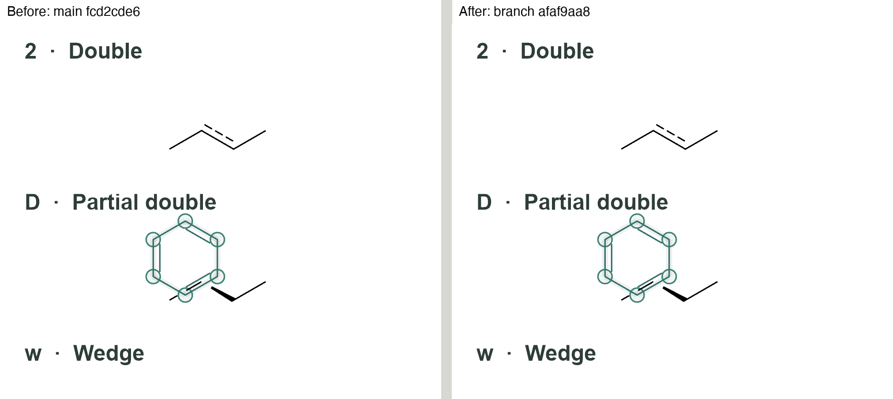
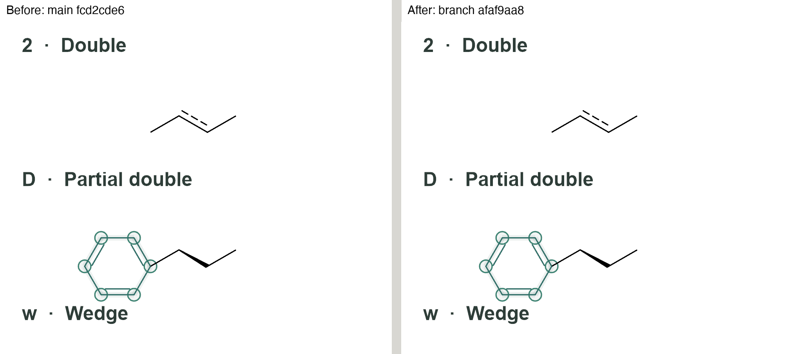
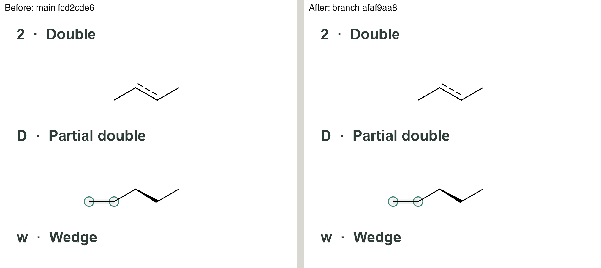
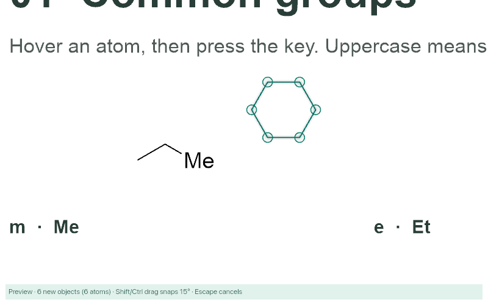
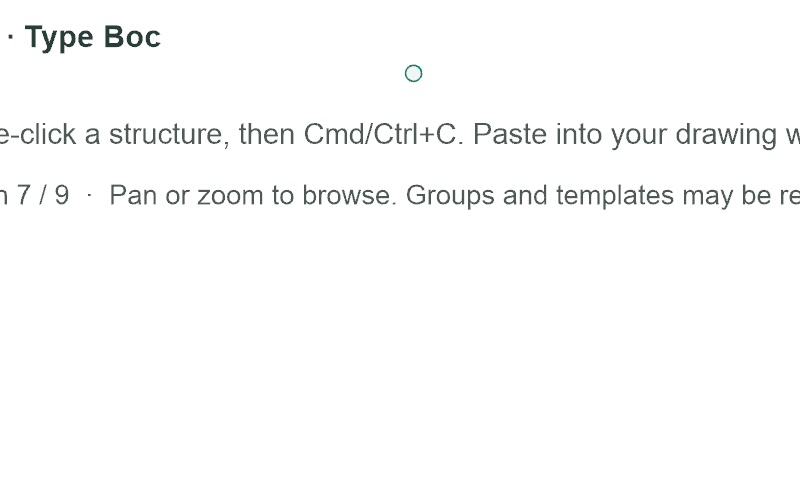

## Summary

Wave 4 of the app performance audit: previews cost less in large drawings, and panning stops redrawing the whole view. One audit item is done and two are partly done.

- **P6, panning (done).** Panning re-tessellated every visible bond and label on every frame. It now moves the drawing it already prepared. Pan at Fit in a 7,728-atom drawing: 102 ms → 4.0 ms per frame.
- **P1, previews (partly done).** Ring, template and bond previews and moves of part of a molecule rebuilt the whole drawing on every pointer move. They now redraw only the molecules they change, over a kept copy of the rest. At 7,728 atoms: benzene hover 146 → 54 ms, template hover 115 → 29 ms, bond drag 193 → 120 ms, moving part of a molecule 92 → 9.4 ms. A pointer that has not moved still costs as much as a moving one (see Risk).
- **P12, slow polyalanine insert (partly done).** Profiled only. The analysis step is not the slow part, so no code changed. The cost is in two scene builds that the model scaling work owns (see Risk).

The previews look the same. In the real app, ring previews are pixel-identical to main. Bond previews differ only in a few antialiased pixels (see Evidence).

No issue is filed for these items, so this PR closes none.

## Why it matters

The audit found these in the released 0.15.0 app. The numbers below are from the benchmark this PR adds, on main `fcd2cde6`.

- **Every preview frame redrew the whole drawing.** Hovering a ring or template, drawing a bond or moving part of a molecule built the scene of the entire drawing again for each pointer move, even when the drawing was off screen. A counting test on 4 copies of the shortcut gallery shows it: on main, a benzene hover frame redrew 1,325 primitives for a 1,321-primitive drawing. In a 7,728-atom drawing that is 146 ms per frame, so the preview trails the pointer.
- **Panning a zoomed-out drawing re-tessellated everything.** The kept geometry was keyed on the camera center, so every pan frame missed the cache. Pan at Fit took 102 ms per frame at 7,728 atoms.
- **Inserting polyalanine-200 from SMILES took several seconds.** The audit blamed the 1.16 s analysis step. A profile shows that number is a one-time cost of a newly built helper, not the analysis itself (41 ms warm).

## Approach

- **P1: redraw only what a preview changes.** `src/canvas/paper/fragment.rs` compares the preview with the drawing (atoms, bonds and abbreviations). It matches the equal start and end of each list, then compares the rest by ID. The changed atoms are widened to their whole molecules. Those molecules are drawn over a retained "remainder" scene of everything else. `SceneCache` keeps the remainder for as long as the same objects are left out, so the next frame reuses its scene and tessellation.
- **The split is used only when it cannot change the picture.** Each part counts its ink, every atom and bond (drawn or not) and the reach of each automatic indicator (`Indicator::reach`, new in `crates/model`). No box of the redrawn molecules may come within 3 px plus 0.12 of the largest label font size of the rest. That is the gap automatic hydrogens, charges and labels keep from other ink. Captions, arrows, graphics, 3D models and rear opacity always use the old whole-drawing path. So does any preview that fails the gap check.
- **P6: shift the kept drawing while panning.** The geometry cache key no longer includes the camera center. The first pan at a zoom level tessellates half a view beyond each edge. Later pans within that margin draw the same geometry shifted, through a renderer translation inside each layer's clip (`LayeredCanvas::shifted`). Edits and zoom changes still tessellate only the view, so they cost what they did.
- **P12: measure first.** The existing opt-in profiler (`app::engine_jobs::tests::profile_polyalanine_insert_stages`) now times each analysis step.

Rejected:

- **Tessellating in world coordinates with zoom thresholds** (for P6). It would change every zoom's cost and output. A translation leaves zoom alone. The zoom benchmarks stay within 6%.
- **Skipping the rebuild when the pointer has not moved** (the rest of P1). The cache key would need the inputs of 13 preview builders, from canvas fields and gesture state. `Gesture` holds a `RefCell` and is not comparable. Three builders also draw overlays straight into the frame, so a cached preview would have to replay them. Keying on the output preview alone would still build the preview every frame. This needs its own refactor (see Risk).
- **Changing the polyalanine scene builds** (for P12). They belong to the model scaling work (P9), which is not on main yet.

An independent review (Codex, read-only) found one blocking issue: splitting could move an automatic attached number, because its placement depends on atoms that draw no ink. That is fixed (the reach rule above) and covered by a new test case. The review's other findings led to a clean re-measurement and plainer wording in the docs and changelog.

## Evidence

### Measured before and after

Release builds of main `fcd2cde6` (with only this PR's benchmark file, `src/canvas/performance.rs`, added) and of this branch at `afaf9aa8`. Re-measured for this description on macOS arm64 (Apple M4, 32 GB), wgpu renderer, 1,066 × 570 view. Base and branch runs alternated: three runs each of `preview_workloads` and two each of `loaded_canvas_workloads`. Each run waited for other builds on the machine to stop compiling. Each timing is the median of the run medians; each run is the median of 20 iterations. The first base run started while another compile was still running and is up to twice as slow as the other two; the median of three leaves it out. "1×, 4×, 16×" are 1, 4 and 16 copies of the shortcut gallery (483, 1,932 and 7,728 atoms).


| Workload, 7,728 atoms | Before `fcd2cde6` | After `afaf9aa8` | Change |
| --- | ---: | ---: | ---: |
| Benzene hover | 146 ms | 54.2 ms | 2.7× less |
| Benzene hover, pointer still | 149 ms | 54.3 ms | 2.7× less |
| Benzene hover, drawing off screen | 133 ms | 50.9 ms | 2.6× less |
| Cyclohexane template hover | 115 ms | 29.1 ms | 3.9× less |
| Bond drag | 193 ms | 120 ms | 1.6× less |
| Move part of a molecule | 91.9 ms | 9.45 ms | 9.7× less |
| Pan at Fit | 102 ms | 3.96 ms | 26× less |
| Pan at 50% | 5.60 ms | 3.92 ms | 1.4× less |
| Unchanged redraw (control) | 16.4 ms | 16.2 ms | same |

Raw output, the run log with load averages and the SHA-256 of both test binaries: [measurements/](measurements/) ([summary.csv](measurements/summary.csv), [manifest.txt](measurements/manifest.txt), `raw/`).

To reproduce: `cargo test --release --locked --bin reshiki canvas::performance::preview_workloads -- --ignored --exact --nocapture --test-threads=1` (and `loaded_canvas_workloads`). On main, copy `src/canvas/performance.rs` from this branch first.

### Previews look the same in the app

Debug builds of main `fcd2cde6` and branch `afaf9aa8`, built on macOS arm64 and run one after the other with a fresh data folder. SHA-256 of the copied binaries: base `8b255eb2…5c3e`, branch `e7439461…5c05`. Window 1280 × 852 pt, zoom 100%. Steps on each build: open the drawing, **Fit**, then **Actual size** from the command palette. For the large drawing, pan by one fixed scroll input. The same scripted pointer input then made each preview, and each screenshot was taken while the mouse button was still held. The small drawing is the shortcut gallery (483 atoms). The large drawing is 64 copies of it in an 8 × 8 grid (30,912 atoms). Its view shows the same part of one copy.

Each image shows the same crop of the canvas from the two window screenshots: main on the left, this branch on the right.

**Large drawing (30,912 atoms), Benzene tool, pointer on empty paper just above a chain end; the preview snaps to that end.** The canvas pixels are identical.



**Large drawing, Benzene tool, dragging from the chain's end carbon.** The canvas pixels are identical.



**Large drawing, Single bond tool, dragging left from the same end carbon.** Same shape and position. 4,100 pixels differ: 4,085 by 1 of 255 levels on antialiased edges, and 15 by up to 37 levels where the new bond meets the end carbon's handle. Neither is visible at normal size.



**Small drawing (483 atoms), the same three previews.** Ring hover and ring drag: the whole window screenshots are byte-identical. Bond drag: 4,279 pixels differ, 4,273 by 1 level on antialiased edges and 6 by up to 35 levels at the same handle join.







The view before each preview is byte-identical on both builds ([small base](app/base/small-00-view.png), [small branch](app/branch/small-00-view.png), [large base](app/base/large-00-view.png), [large branch](app/branch/large-00-view.png)). The whole large drawing at 2% after opening: [base](app/base/large-open.png), [branch](app/branch/large-open.png).

Full window screenshots: [app/base/](app/base/) and [app/branch/](app/branch/). In two of them, a blue "A" badge sits at the top left of the canvas, outside the cropped area: base `large-01-ring-hover.png` and branch `large-02-ring-drag.png`. It came and went between identical steps on both builds and looks like the macOS input-source indicator. It is not part of the drawing. Per-pixel counts: [app/comparison-metrics.json](app/comparison-metrics.json). Run reports: [base small](app/base/report-small.md), [base large](app/base/report-large.md), [branch](app/branch/report.md). Inputs: [make64.py](app/make64.py) builds the large drawing, [gesture.py](app/gesture.py) sends the pointer input, and [inputs-coords.txt](app/inputs-coords.txt) lists the positions.

The debug builds are too slow at 30,912 atoms to compare speed by eye. On both builds a large-drawing preview took 90 to 180 s to settle while the machine was busy. The release benchmark above is the speed evidence.

### Split frames match whole frames (tests)

`canvas::paper::preview_tests::preview_fragments_match_whole_previews` draws 384 preview frames both ways: 4 tools, 24 pointer positions, 2 zoom levels, 2 views. All are pixel-identical. 208 of them use the split. It also moves an anonymous dummy atom, which draws nothing, next to an automatic attached number: the number moves the same way in both. That case failed before the review fix. Two of the frame pairs it compares (headless renderer, byte-identical PNGs):

| Template hover, split | Template hover, whole drawing |
| --- | --- |
|  |  |

| Bond drag, split | Bond drag, whole drawing |
| --- | --- |
|  |  |

`canvas::paper::preview_tests::preview_frames_draw_only_the_changed_molecules` counts the primitives a second preview frame draws at 4 copies (1,321 for the whole drawing). On main it failed: the benzene hover redrew 1,325. On this branch: benzene 4, template 1, bond drag 26, partial move 1.

## Verification

VERIFICATION_TABLE

What ran for this PR on macOS arm64, on the lane's final tree (`00b818dfa`; `afaf9aa8` adds only docs), each build with its own target directory:

| Platform | Command | Result |
| --- | --- | --- |
| macOS arm64 | `cargo fmt --all --check` | pass |
| macOS arm64 | `cargo clippy --workspace --lib --bins --all-features --locked -- -D warnings` | pass |
| macOS arm64 | `cargo clippy -p reshiki -p reshiki-model --all-targets --all-features --locked -- -D warnings` | pass |
| macOS arm64 | `cargo test --locked -p reshiki-model` | 1436 passed, 9 ignored |
| macOS arm64 | `cargo test --locked --bin reshiki` (helper variables set, fresh data folder) | 1596 passed, 189 ignored |
| macOS arm64 | `canvas::paper::preview_tests` and `retained_paper_scene_matches_live_layers_and_invalidates_draw_inputs` with `--ignored` (headless wgpu) | pass |
| macOS arm64 | Ignored canvas renderer tests against pixel baselines captured on main (`renderer_matches_captured_baseline`, `paper_layers_match_captured_baseline` and others) | 20 passed |
| macOS arm64 | `views_match_captured_baseline` against main | 2 views differ (Risk) |
| macOS arm64 | `bun fmt --check`, `bun run docs:check`, `uv run --locked python scripts/assemble_changelog.py --check` | pass |
| macOS arm64 | Release benchmarks, base and branch alternating (Evidence) | as shown |
| macOS arm64 | Real app, base and branch debug builds (Evidence) | previews look the same |
| Windows x64 | PR CI on `afaf9aa8` (`rust`, `rust lint+goldens`, Rust geometry jobs) | pass; the Linux CI jobs pass too |

## Risk

- **P1 is partial: a still pointer costs as much as a moving one.** Every preview frame still builds the preview document and compares it with the whole drawing. Preview times therefore still grow with the drawing: 54 ms for a benzene hover and 120 ms for a bond drag at 7,728 atoms. An earlier profile put about 40 ms of the 16× ring hover in placing the ring, which validates and copies the whole drawing. The editor markers take about 6 ms. Skipping a frame whose inputs did not change needs the preview builders refactored first, so their overlays become cached fields and their inputs one comparable key. That is a follow-up PR.
- **P12 is partial: no code changed.** Inserting polyalanine-200 still costs two scene builds of about 960 ms each, plus layout 313 ms and Fit 146 ms. Those scene builds belong to the model scaling work. The first analysis after a newly copied helper took about 1 s twice (991 and 1,201 ms) and 41 ms afterwards. That points to the cost of first launching a new executable, but the profiler does not time the helper's launch apart from its work, so the cause is not confirmed.
- **The split relies on a distance rule.** It assumes nothing farther than the gap and the indicator reach can change how either part is drawn. The review found one case that broke this (automatic attached numbers next to invisible atoms). It is fixed and tested, but another layout rule that reaches farther would show up as a preview that differs from the committed result. The fallback covers only the dependencies the rule knows about.
- **Bond previews are not pixel-identical in the app.** Up to 15 pixels change by up to 37 of 255 levels where the new bond meets the end carbon's handle, and a few thousand edge pixels change by 1 level. This is not visible at normal size. The headless test shows identical pixels for the same kind of frame.
- **Panned frames are not bit-exact.** A shifted pan matches a fresh tessellation within the drag preview's tolerance. Edges differ by floating-point rounding. The shifted-pan pixel test leaves out selection and NMR markers, and does not pan past the margin. The first pan at a new zoom tessellates up to four times the view's area once.
- **View parity baselines.** The `joining` view differs from captures made on main by 1 level in 45 pixels around a lone C label, which is now drawn from a kept layer, as idle frames on main already do ([diff](tests/view-parity-joining-diff.png)). `feature-structure-both` already differs between two captures of main. Capture the `RESHIKI_VIEW_PARITY` baseline again after merging.
- **Platforms.** The ignored pixel and counting tests need a headless renderer and ran only on macOS arm64. They were not run on Arch Linux x64, Ubuntu arm64 or with the tiny-skia renderer on Windows x64. The pan shift uses a renderer translation, which each renderer must apply the same way.
- **Model API.** `Indicator::reach` is new and public, and `editing::preserved_expansion_selection` is now public. Only the canvas split check uses them.

## Changelog

`docs/changes/unreleased/wave4-canvas-preview-cost.md`:

```markdown
---
section: Changes
issues: []
---

- Ring, template and bond previews and moves of part of a structure take less
  work in large drawings. When the structures a preview changes stay clear of
  the rest of the drawing, the preview redraws only those structures and
  reuses the prepared drawing of the rest.
- Panning a zoomed-out drawing no longer redraws every bond and label on each
  frame. The first pan at a zoom level prepares the drawing a little beyond
  the window's edges, and later pans move that drawing.
```

## Contribution license

- [x] I have read [CONTRIBUTING.md](https://github.com/Ameyanagi/ReShiki/blob/main/CONTRIBUTING.md). I have the right to submit this contribution and agree to offer my original contributions under both MIT and Apache-2.0, so recipients may choose either license (`MIT OR Apache-2.0`).
- [x] Any third-party material is identified below with its source and license, and its required notices are preserved; otherwise, no third-party material is added.

Third-party sources, if any: none.
