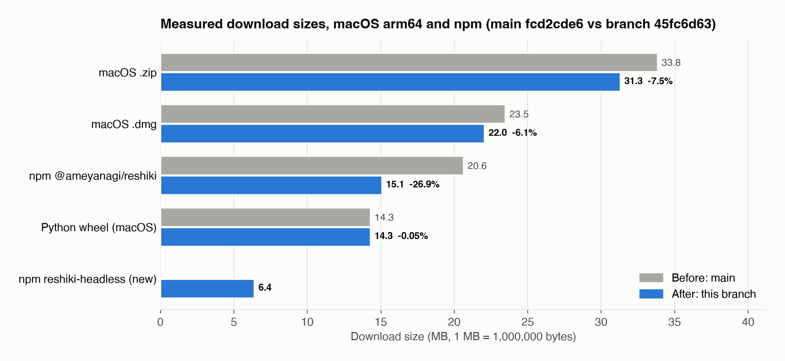

## Summary

Release downloads get smaller. Published builds use a new `dist` Cargo profile (fat link-time optimization, one codegen unit). TLS uses ring instead of aws-lc. Three large data files that ReShiki embeds are stored compressed. The npm package is split in two, so an editor install no longer downloads the headless library's WebAssembly.

On macOS arm64, built the way the release workflow builds it, the app executable goes from 81.4 MB to 67.3 MB (−17.3%). The disk image goes from 23.5 MB to 22.0 MB (−6.1%) and the portable archive from 33.8 MB to 31.3 MB (−7.5%). `@ameyanagi/reshiki` on npm goes from 20.6 MB to 15.1 MB (−26.9%). The Python wheel does not change.

**Breaking (npm):** the headless library moves to a new package, `@ameyanagi/reshiki-headless`, and `@ameyanagi/reshiki` loses its `.` and `./reshiki_web_bg.wasm` exports.

## Why it matters

- **Every user downloads the app, and every update downloads it again.** The executable carried code that one optimized unit removes, and almost 2 MB for a TLS library that is used only for the update check and online name lookup.
- **aws-lc needs CMake and a C build** on every release target. ring does not.
- **The npm package shipped three WebAssembly modules to everyone.** An editor user downloaded the headless library too (5.6 MB gzipped), and a headless user downloaded the editor and its worker (14.2 MB gzipped).
- Found in the release-size audit (items B3, B6, B7, B9 of the improvement plan).

## Approach

- **B3: `dist` profile** (`Cargo.toml`, `scripts/build_release.py`, `release.yml`). `[profile.dist]` inherits `release` and adds `lto = "fat"` and `codegen-units = 1`. `build_release.py` builds with `--profile dist` and reads `target/<target>/dist/`. The workflow takes the binary, symbol files and test helpers from there, and its strip and split-debuginfo overrides become `CARGO_PROFILE_DIST_*`. `cargo build --release`, `cargo test --release` and development bundles keep the `release` profile.
  - `panic = "abort"` is not set: the app recovers from panics.
  - Rejected: fat LTO in the `release` profile itself. Every local release build and test build would then pay the long link.
- **B7: ring for TLS** (`Cargo.toml`, new `src/http.rs`). reqwest uses `rustls-no-provider`. `http::client()` installs ring's provider before building a client, and the update check, update download and online name lookup all start there. `Cargo.lock` drops 14 packages, including `aws-lc-rs`, `aws-lc-sys` and `cmake`.
  - Trade-off: these connections no longer offer the post-quantum hybrid key exchange, which rustls provides only with aws-lc.
- **B6: compressed embedded data** (`build.rs` in `reshiki-chemistry`, `reshiki-model`, `reshiki-io`). The layout template catalog, the bundled drawing templates and the NMR shift index are deflated at build time with `miniz_oxide` (already in the tree). They are inflated once, on first use. Embedded data goes from 2.66 MB to 0.50 MB. Source files and their regeneration scripts are unchanged.
- **B9: npm package split** (`packages/headless`, `scripts/build_wasm.sh`, `checks.yml`, `release.yml`). The headless library moves to `@ameyanagi/reshiki-headless`. `@ameyanagi/reshiki` keeps `./editor`, `./element`, `./embed`, `./frame.html` and `./reshiki_bg.wasm`. The release job tests and publishes both packages. A refused credential for one package leaves a notice and goes on to the next. `packages/headless/README.md` has a "Moving from 0.15" table.
  - Rejected: keeping `.` on `@ameyanagi/reshiki` as an alias. The editor package would then still ship the headless module.

## Evidence

All builds: macOS arm64 (Apple M4), main `fcd2cde6` (the merge base) and the branch `45fc6d63`. Both sides ran `scripts/build_release.py --target aarch64-apple-darwin --installer` with the workflow's symbol settings, unsigned. The wheel was built with `maturin build --release` and the npm packages with `scripts/build_wasm.sh` and `bun pm pack`.

### Download sizes

Windows x64 and Linux were not built for this PR. Their rows show the published v0.15.0 assets only for scale. v0.15.0 predates main's stripped binaries and LZMA disk image, so it is not a "before" for this branch. Raw numbers, Mach-O sections and WebAssembly module sizes: [`sizes.txt`](sizes.txt). Chart data and script: [`sizes.json`](sizes.json), [`plot.py`](plot.py).

- The executable shrinks in code (`__text` −4.5 MB, from fat LTO and ring) and data (`__const` −3.3 MB, mostly B6). The archives shrink less, because zip and LZMA already compressed the data B6 compresses.
- The wheel uses the `release` profile and does not link reqwest, so only B6 reaches it. A wheel is a zip, so the size stays the same.
- The editor WebAssembly is 2.2 MB smaller raw, but 0.6% larger gzipped (9.91 to 9.97 MB). Deflated data does not compress again. Browsers download the gzip or brotli form.

### The smaller app still starts and works

![Terminal: main and branch apps both print reshiki 0.15.0, convert caffeine SMILES to a Molfile, print the same InChI, convert bicyclo[2.2.2]octane to SVG and name caffeine 1,3,7-trimethyl-3,7-dihydro-1H-purine-2,6-dione. The output files have the same SHA-256 on both sides](app-check.png)

The `ReShiki.app` executables from the two builds above, each run with an empty data folder. Both write byte-identical `.mol` and `.svg` files ([`app-check.txt`](app-check.txt)). The branch build also passed `build_release.py`'s own packaged-app checks: native chemistry without Python, the MCP server and CLI, MMFF94/UFF geometry, clipboard and print workers, and the disk-image install copy ([`build-log-excerpts.txt`](build-log-excerpts.txt)).

## Verification

macOS arm64, from the implementation lane:

- `cargo fmt --all --check`, `cargo clippy --workspace --lib --bins --all-features --locked -- -D warnings`: pass.
- `cargo test --locked --lib`: reshiki 401, agent 316, chemistry 314, io 661, mcp 57, model 1437 passed. `cargo test --locked --bin reshiki`: 1596 passed. Helpers set.
- New tests: each compressed file inflates to its source, `http::clients_use_ring_and_the_lockfile_has_no_aws_lc` (fails on main's lockfile), and release-workflow checks for the `dist` symbol settings and per-package WebAssembly. Deleting the `CARGO_PROFILE_DIST_*` lines makes the workflow test fail.
- `cargo test --lib http:: -- --ignored`: a real TLS handshake with api.github.com through ring.
- `uv run --locked python -m unittest discover -s tests`: 254 tests OK. `-s reference`: 185 OK. `ruff check`, `ty check`: pass.
- `scripts/build_wasm.sh --test`: headless 16 pass, editor 23 pass. `bun run check`: pass.
- `scripts/check_agent_dependencies.py`: passes for all 6 release targets.

macOS arm64, for this description: both release builds, both wheels and both npm builds above, and the app check.

Linux x64, Ubuntu arm64 (wheel) and Windows x64: the 35 PR checks pass, including the Rust test partitions on Linux x64 and Windows x64 and the wheel builds for Linux x64, Linux arm64, Windows x64 and Windows arm64.

VERIFICATION_TABLE

## Risk

- **The full Release builds workflow has not run on this branch.** PR checks do not build with the `dist` profile. Before the next tag, run it by hand on all six targets. Check that Windows writes `reshiki.pdb` and Linux splits `reshiki.debug` under `target/<target>/dist/`, and that the Linux x64 fat-LTO link works in the jammy container.
- **Memory and time.** The fat-LTO link peaked at 8.25 GB here (main's release build: 2.6 GB). GitHub's macOS arm64 runner has 7 GB, so that job may swap or fail. Each release job now also compiles dependencies twice: `dist` for the package, `release` for the cargo test steps. The `dist` build took 22 minutes against 7 for main's `release` build, with two builds sharing the machine.
- **Download sizes on Windows and Linux are not measured.** The relative change should be similar, but the first release run is the first measurement.
- **B6 leaves the largest file undone.** nazuchem's `automata.bin` (5.37 MB) and `retained_fused_graph_templates.json` (0.72 MB) are still embedded uncompressed. They live in the nazuchem repository. A local, unpushed nazuchem commit adds an opt-in compressed form for `automata.bin`. It needs a nazuchem merge and a rev bump here.
- **B6 makes browser downloads slightly larger.** The editor module is 0.6% larger gzipped (about 2% with LZMA, a stand-in for brotli). Limiting B6 to native targets would avoid that.
- **B9 is not done.** The package split here only stops each install from downloading modules it does not use. The editor and worker modules still each embed their own copy of the shared data, and installing both packages is 4% larger than the one package was.
- **npm migration.** Code that imports `@ameyanagi/reshiki` or `@ameyanagi/reshiki/reshiki_web_bg.wasm` breaks and must move to `@ameyanagi/reshiki-headless`. That package does not exist on npm yet. It needs a first publish with a token and its own trusted publisher (see `docs/releasing.md`). Until then a release publishes only `@ameyanagi/reshiki` and leaves a notice.
- **TLS.** The update check and online name lookup lose the post-quantum hybrid key exchange. A real handshake through ring has been checked on macOS arm64 only.
- The changelog fragment's macOS numbers (77.9 to 67.8 MB) measure B3 alone. Against main the executable goes from 81.4 to 67.3 MB.

## Changelog

`docs/changes/unreleased/wave4-release-size.md` (section Changes): the npm split with migration steps (breaking), the `dist` profile, the compressed embedded data, and ring for TLS.

## Contribution license

- [x] I have read [CONTRIBUTING.md](https://github.com/Ameyanagi/ReShiki/blob/main/CONTRIBUTING.md). I have the right to submit this contribution and agree to offer my original contributions under both MIT and Apache-2.0, so recipients may choose either license (`MIT OR Apache-2.0`).
- [x] Any third-party material is identified below with its source and license, and its required notices are preserved; otherwise, no third-party material is added.

Third-party sources, if any: none added. ring replaces aws-lc as a dependency. `THIRD-PARTY-NOTICES.txt` is generated from the dependency graph and covers it.
