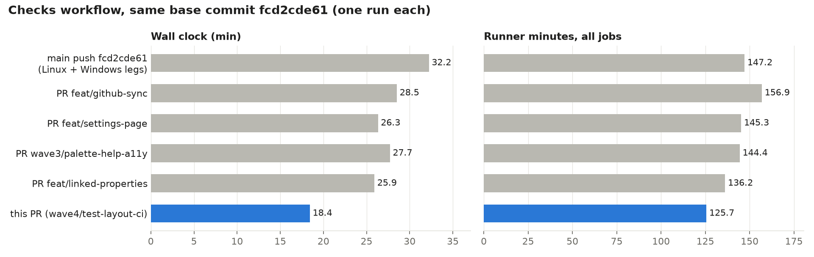
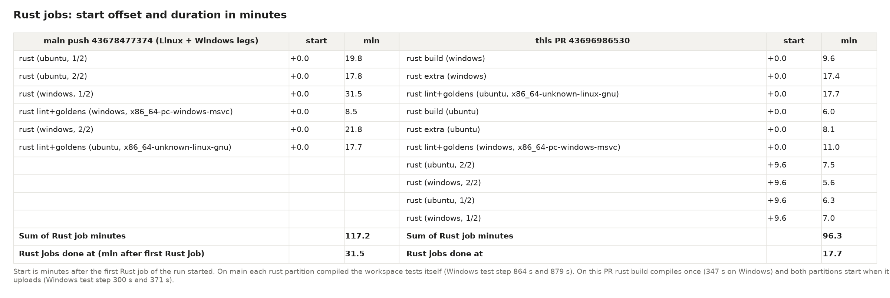
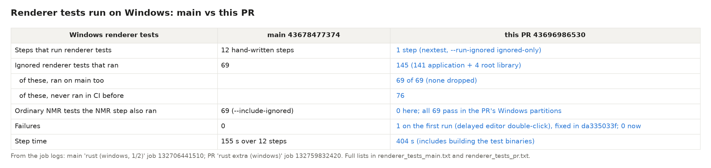
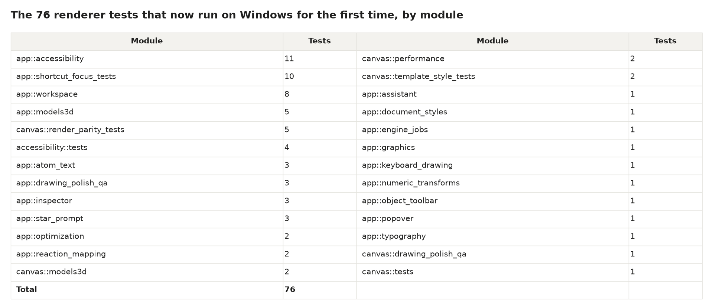

## Summary

The root integration tests now build as one test binary, `it`, instead of 103. CI compiles the workspace tests once per platform in a new **rust build** job, and both **rust** partitions run that archive without compiling. A new **rust extra** job runs the checks nextest leaves out. On Windows, one step now runs every renderer test (145) instead of 12 hand-written steps that ran 69. A generated module index lists every Rust module file with the first sentence of its `//!` comment.

Items: T4 fixed, M6 fixed, T5 partial, T6 partial, M5 not done.

## Why it matters

- **Every file under `tests/` linked the whole application library again.** 103 test binaries took 334 s to build and 7.0 GB on disk (macOS arm64, dependencies cached, 2 jobs). As one binary they take 37 s and 0.22 GB.
- **Each CI partition compiled the workspace tests on its own.** On Windows x64 the partition test step took 864 s and 879 s on `main`, most of it compiling. The Windows 1/2 job was the longest job of the run (31.5 min on `main`, 25 to 28 min on other pull requests).
- **Most renderer tests never ran in CI.** They are `#[ignore]` because they need a real renderer, and only 12 hand-written Windows steps picked some by name. Of 186 ignored tests in the application, 69 ran. A new renderer test ran only if someone also added a workflow step for it.
- **The first full run found a real failure.** `delayed_editor_real_pointer_focus_keyboard_and_ime` had never run in CI. On Windows x64 the second click came after three rendered frames, which took longer than the 450 ms double-click interval, so the test failed. da335033f stamps the first click so the frame cost no longer matters.
- **The architecture page could not keep up with 765 module files.** There was no list of what each file does.

## Approach

- **T4, one test binary.** `autotests = false` in `Cargo.toml`. `tests/it.rs` has one `mod` line per test file and declares the shared helpers (`headless`, `fixture`, `ring_basis`) once. No test file moved. 14 files change `#[path] mod headless` to `use crate::headless`. A guard test, `it::every_test_file_is_a_module_of_this_binary`, fails if a new file has no `mod` line. Three files stay separate targets: `metafile_worker` has its own `main`, `picture_memory` has its own global allocator, and release.yml builds `agent_api_windows_pipes` alone in the release profile. The nextest naming-worker filter, `scripts/agent_api_gates.py`, `scripts/run_reference_shard.py` and the docs now name `it`.
  - Rejected for now: moving the io-only and model-only files into their crates (M5, below).
- **T5, compile once per platform.** `rust build` builds the helper and the app, runs `cargo nextest archive --workspace`, and uploads the archive and the helpers. The two `rust` partitions download it and run `cargo-nextest nextest run --archive-file … --workspace-remap .`, with no toolchain, uv or MSVC. `rust extra` runs the protocol unittests, the dependency audit, the Windows renderer step, the naming corpus in one process, the metafile and print harnesses, doc tests, the font probe, SciFinder and the cache warm-up. `Rust checks` now also requires `rust build` and `rust extra`.
  - Rejected: running the extras in `rust build` after the upload. Review showed that the partitions then waited for all of them, and a Windows renderer failure skipped the Linux partitions too.
- **T6, all renderer tests on Windows.** One nextest step selects every ignored test of the application except names that start with `manual_` or end in `_child`, plus the 4 accessibility tests of the root library. 42 tools are renamed `manual_…`: benchmarks, baseline comparisons and captures that need their own folder or rewrite tracked files. A `_child` test runs only when its parent test starts it with the right environment. 3 tests that failed on `main` and that nothing ran are removed: `drawing_style_headless_snapshot`, `reaction_headless_snapshot` and `feedback_layout_and_visual_evidence`. One stale count is fixed: Help now has 5 controls.
  - Rejected: keeping one hand-written step per test. Each new renderer test would still need a workflow change.
- **M6, module index.** `scripts/module_index.py` writes `docs/modules.md` (765 files, 138 still without a `//!` comment). `tests/test_module_index.py` fails while the page is out of date. The website sidebar links to it.
- **M5, not done.** Moving 69 io-only and model-only test files into their crates gives no CI gain, because CI builds the whole workspace. Locally it would save about half the CPU time of a model-only edit loop (137 s for `it` against 112 s for `-p reshiki-model --lib`). The cost is 69 file moves with import rewrites. Left for an owner decision.

## Evidence

All CI numbers are from Checks runs on the same base commit, fcd2cde61. Before: the main push run 43678477374 (macOS legs left out; `main` runs them, pull requests do not). After: this PR's run 43696986530. For the spread between runs, 4 other pull-request runs on the same base are shown too.

### CI jobs and minutes






Wall clock did go down in this run, from 25.9 to 28.5 min on comparable pull requests to 18.4 min. Treat it as one sample. The Windows test chain (rust build 9.6 min, then a partition of 5.6 to 7.0 min) is no longer the longest path. The longest job is now **rust lint+goldens** on Linux x64, which this PR does not change. It took 17.7 min here but 23 to 26 min in the 4 comparison runs, so on a typical runner wall clock will be about 23 to 26 min. Runner minutes went down (125.7 against 136.2 to 156.9) even though there are 4 more Rust jobs. Raw data: [`ci_metrics.txt`](ci_metrics.txt), [`ci_jobs_main.txt`](ci_jobs_main.txt), [`ci_jobs_pr.txt`](ci_jobs_pr.txt).

### Renderer tests on Windows





Taken from the job logs: the `test … ok` lines of the 12 steps on `main`, and the `PASS` lines of the new step. None of the 69 tests that ran before was dropped. The old NMR step used `--include-ignored`, so it also ran 69 ordinary tests; all 69 appear as `PASS` in this PR's Windows partitions. Lists: [`renderer_tests_main.txt`](renderer_tests_main.txt), [`renderer_tests_pr.txt`](renderer_tests_pr.txt) (new tests marked `NEW`).

The delayed-editor test, before and after da335033f, on Windows x64:

```text
run 43695541196 (859950233)
  FAIL [ 24.808s] ( 33/145) reshiki::bin/reshiki app::atom_text::presentation_tests::delayed_editor_real_pointer_focus_keyboard_and_ime
  panicked at src\app\atom_text\presentation_tests.rs:127:5: Invisible dialog must not capture the second click
  Summary [ 189.848s] 145 tests run: 144 passed (1 slow), 1 failed, 2050 skipped

run 43696986530 (da335033f)
  PASS [ 58.446s] ( 42/145) reshiki::bin/reshiki app::atom_text::presentation_tests::delayed_editor_real_pointer_focus_keyboard_and_ime
  Summary [ 220.364s] 145 tests run: 145 passed (1 slow), 2050 skipped
```

Full excerpts: [`windows_renderer_before_fix.txt`](windows_renderer_before_fix.txt), [`windows_renderer_after_fix.txt`](windows_renderer_after_fix.txt).

### Test layout


![Table: git diff --numstat for tests/, Cargo.toml and .config/nextest.toml: 19 files, +213 −42, mostly one-line #[path] mod to use crate:: changes plus the new tests/it.rs](test_layout_diffstat.png)

The Windows partitions ran 5544 tests on `main` and 5545 here; the one extra is the guard test ([`nextest_partitions_windows.txt`](nextest_partitions_windows.txt)). Diff stat: [`test_layout_diffstat.txt`](test_layout_diffstat.txt). The local build numbers are from the lane's timing check on macOS arm64.

## Verification

- CI on this PR, run 43696986530 at da335033f: all 33 checks green, on Linux x64 and Windows x64. The Windows renderer step ran 145 tests, 145 passed. Greptile 5/5.
- macOS arm64, from the implementation lane: `cargo fmt --all --check`; `cargo clippy -p reshiki --all-targets --locked -- -D warnings`; `cargo clippy --workspace --lib --bins --all-features --locked -- -D warnings`; `cargo nextest run -p reshiki --profile ci …` 2589 passed; `cargo test --test it` 614 passed, 4 ignored; the sorted `--list` output before and after T4 differs only by the guard test (623 + 1).
- macOS arm64: the renderer filter passed 141 of 141 before the `_child` change; the 4 library accessibility tests pass.
- macOS arm64: a root-package nextest archive (261 MB) ran from a separate folder with `--workspace-remap`, 13 tests passed.
- `uv run --locked python -m unittest discover -s tests -p 'test_*.py'` 254 OK; `ruff check`, `ruff format --check`, `ty check`; `bun run format:check`, `bun run lint:js`, `bun run docs:check`; `python3 scripts/module_index.py --check`; `scripts/assemble_changelog.py --check`: pass.
- The `Rust checks` result script was run with simulated job results: it fails when `rust extra` fails, is cancelled or is skipped on a Rust change, and passes on a docs-only change.
- Not run: Arch Linux x64 and Ubuntu arm64 test hosts, and the macOS legs of the new jobs.

VERIFICATION_TABLE

## Risk

- **M5 is not done.** The io-only and model-only test files stay in the root `tests/`. Moving them saves local build time only; it needs an owner decision.
- **T5 is partial.** It has run on Linux x64 and Windows x64, but not on macOS arm64, which runs only on `main`, nightly, release and stacked `merge/*` PRs. `rust extra` compiles its own targets (the app, the library tests, the harnesses, doc tests), so each platform now compiles about one and a half times, not once. There are 4 more Rust jobs per run, and 2 more macOS runners on runs with macOS legs. After merge, check that `rust extra` saves the shared `rust` cache on `main` and that the next pull request restores it. If branch protection names a `rust (…)` job, add the new job names; `Rust checks` already covers them. A failed **rust build** on one platform still skips the partitions of the others.
- **T6 is partial.** Only Windows x64 runs the renderer sweep. About 65 ignored tests outside the application binary are left as they are (child-process helpers, the X11 tests that the Linux X11 job already runs, allocation and timing measurements, fixture regenerators, network and signed-image tests). The 42 `manual_` tools still run only by hand. Renderer tests that depend on frame time may still be flaky on slower runners; the delayed-editor test was one.
- **Renamed commands.** Anyone who runs `--test <file>` or an old tool name by hand must use `--test it <file>::` and the `manual_` name. `presets/themes/README.md` still says `cargo test --locked --test theme_reference`; it should be `cargo test --locked -p reshiki --test it theme_reference::`.
- **Step time.** The Windows renderer step takes 404 s, including building the test binaries, against 155 s for the 12 old steps. It runs in `rust extra`, off the partitions' path.

## Changelog

`docs/changes/unreleased/wave4-test-layout-ci.md` (section Developer): one `it` test binary, one test compile per platform with a separate **rust extra** job, every renderer test on Windows with `manual_` and `_child` names, three removed capture tests, and the module index.

## Contribution license

- [x] I have read [CONTRIBUTING.md](https://github.com/Ameyanagi/ReShiki/blob/main/CONTRIBUTING.md). I have the right to submit this contribution and agree to offer my original contributions under both MIT and Apache-2.0, so recipients may choose either license (`MIT OR Apache-2.0`).
- [x] Any third-party material is identified below with its source and license, and its required notices are preserved; otherwise, no third-party material is added.

Third-party sources, if any: none.
